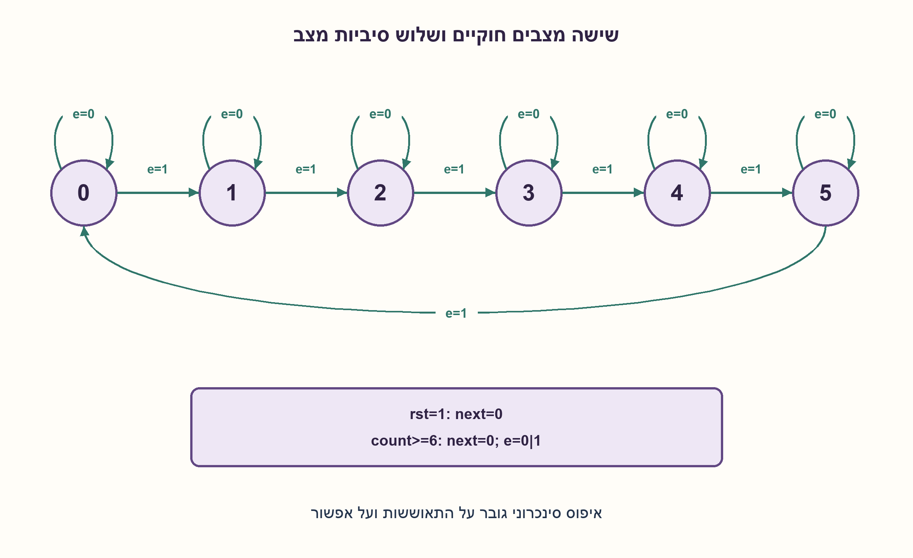
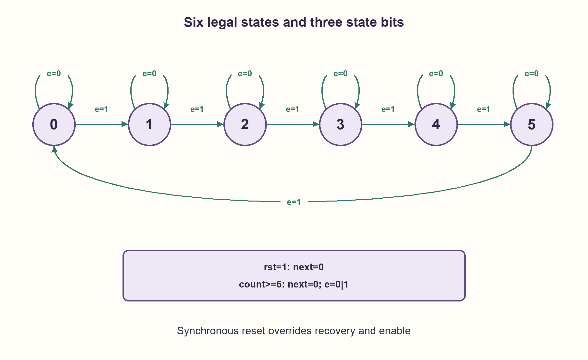

# PREP-202 — מונה 0 עד 5 עם Enable

פתרון מוצע בסיוע AI; ביקורת מקצועית אנושית ממתינה. הקושי אינו מכויל.

[צילום מקור פרטי](../sources/2026-10-31-batch21-05.png)

ממש קאונטר עד 5 עם כניסה נוספת: במידה שהיא 0 המערכת נשארת באותו מצב, ובמידה שהיא 1 המערכת מתקדמת.

חברות לפי הדיווח בצילום בלבד: NVIDIA.

## עברית

ממשו מונה המתקדם כאשר enable=1 ושומר מצב כאשר enable=0. נבחרה ספירה הכוללת 0,1,2,3,4,5 וחזרה לאפס. הציגו מצבים, רוחב אוגר, עדכון ובדיקות גבול.

הבהרות עריכה: שעון משותף, עדכון בעלייה ו־reset סינכרוני פעיל בגבוה הקודם לכל פעולה. במצבים החוקיים enable=0 שומר מצב. המצבים הלא חוקיים 6 ו־7 מתאוששים לאפס בחזית הבאה, גם כאשר enable=0. „עד 5” במקור אינו מגדיר אם 5 נכלל, איפוס, גלישה או מדיניות מצבים לא חוקיים; כאן אלו תנאים מפורשים.

1. כמה מצבים שונים יש כשסופרים מאפס ועד חמש, וכמה ביטים דרושים להם?
2. עדכון רגיל של מונה בן שלוש סיביות מגיע גם לשש ולשבע. היכן צריך לשנות אותו?
3. סדר הקדימויות הוא reset, התאוששות מקוד לא חוקי, ואז enable. במצב חמש עם enable חוזרים לאפס; ביתר המצבים החוקיים מוסיפים אחת.

### שישה מצבים אינם דורשים שישה FF
יש שישה ערכים חוקיים, ולכן צריך לפחות ceil(log2(6))=3 סיביות מצב בקידוד בינארי. נבחר count[2:0]. בחזית שעון: reset מאפס; אחרת count≥6 מאפס; אחרת enable=0 משאיר count; אחרת count=5 מאפס; אחרת count_next=count+1.

מ־reset מתחילים באפס. כל צעד חוקי שומר את count בתחום 0..5: החזקה אינה משנה, תוספת במצבים 0..4 מגיעה לכל היותר לחמש, ובמצב חמש חוזרים לאפס. לכן באינדוקציה לא מגיעים לשש או שבע בעבודה רגילה. מדיניות ההתאוששות מטפלת באתחול לא ידוע או הפרעה שמכניסה קוד כזה, אך אינה הבטחת עמידות בפני כל תקלה פיזית.

לדוגמה, enable ברצף 1,1,0,1 יוצר אחרי reset את הערכים 1,2,2,3. שישה צעדים מופעלים משלימים מחזור. משתמשים באוגר בן שלושה FF, לוגיקת זיהוי חמש/קוד לא חוקי ומגדיל קטן; אין לשער את השעון עם AND של enable. שלושה הם המינימום לסיביות מצב בינאריות בששת המצבים, לא מינימום שערים או שטח. אוגר וקטורי אחד ברוחב שלוש מכיל שלושה רכיבי זיכרון של ביט.

### מודל לוגי בפייתון שהורץ

```python
"""Three-bit enabled counter; reset and illegal-state recovery are explicit."""


def next_count(state, enable, reset=False):
    if not 0 <= state < 8 or enable not in (0, 1):
        raise ValueError("three-bit state and binary enable required")
    if reset or state >= 6:
        return 0
    if not enable:
        return state
    return 0 if state == 5 else state + 1
```


### קוד SystemVerilog מוצע; לא הודר בבדיקה זו

```systemverilog
// Proposed RTL; Python transition model was executed. HDL not compiled here.
module enabled_mod_six_counter (
    input logic clk, rst, enable,
    output logic [2:0] count
);
    always_ff @(posedge clk) begin
        if (rst) count <= 3'd0;
        else if (count >= 3'd6) count <= 3'd0;
        else if (enable) count <= count == 3'd5 ? 3'd0 : count + 3'd1;
    end
endmodule
```




### assumptions

```json
[
  "0..5 כולל הקצה; השהיה של חזית קבלה אחת.",
  "reset קודם ל־enable, והתאוששות מ־6/7 קודמת להחזקה."
]
```

### optimality

שלושה FF בקידוד בינארי נדרשים ומספיקים לשישה מצבים. עלות הלוגיקה וההשהיה תלויות בספרייה.

### verification

נבדקו כל 32 צירופי מצב, enable, reset ועוד 1000 חזיתות עם enable רציף מול מודולו שש. קוד SV מוצע לא הודר.

### edge_cases

```json
[
  "מצב חמש נשמר אם enable=0 וחוזר לאפס אם enable=1.",
  "6/7 חוזרים לאפס גם כשהמונה כבוי; reset בזמן enable מאפס."
]
```

### common_mistakes

```json
[
  "לממש מודולו חמש ולדלג על חמש.",
  "לתת ל־enable לחסום את reset.",
  "להשתמש בפלט המונה כשעון."
]
```

### interview_answer

אבחר שלושה FF ואעדכן באותו שעון. enable מחזיק או מקדם, חמש חוזר לאפס, reset קודם לכולם, וקודים שש ושבע מתאוששים בנפרד.

### source_ambiguities

נבחר חוזה תואם לדוגמת המונה הקיימת במאגר, כולל איפוס והתאוששות מפורשים, בלי לייחס אותם לצילום הקצר.

### solution_extensions

```json
[
  {
    "question": "האם enable=0 חייב לשמור גם מצב לא חוקי?",
    "answer_direction": "זו החלטת מפרט. במימוש הזה ההתאוששות קודמת להחזקה; מדיניות אחרת תקפה אם מוגדרת, אך משנה בדיקות ואתחול.",
    "principle": "סדר הקדימויות הוא חלק מהמפרט."
  }
]
```

## English

Implement a counter that advances for enable=1 and holds for enable=0. Choose the inclusive sequence 0,1,2,3,4,5, then wrap to zero. Give states, register width, update logic and boundary checks.

Editorial contract: one clock, rising-edge updates, and synchronous active-high reset with highest priority. Disabled legal states hold. Illegal encodings six and seven recover to zero on the next edge even if enable=0. The source’s “up to five” does not specify endpoint inclusion, reset, wrap or illegal-state policy; these are explicit completions.

1. How many states are needed from zero through five, and how many bits encode them?
2. An ordinary three-bit counter also visits six and seven. Where must its update differ?
3. Use reset first, illegal-state recovery next, then enable. Enabled five wraps to zero; other legal states increment.

### Six states do not require six flip-flops
Six legal values require at least ceil(log2(6))=3 binary state bits. Use count[2:0]. On a rising edge: reset clears; otherwise count≥6 clears; otherwise disabled holds; otherwise enabled count=5 clears; otherwise increment.

Reset establishes zero. Every legal update preserves 0..5: holding changes nothing, incrementing zero through four reaches at most five, and enabled five wraps. Induction therefore excludes six and seven during ordinary operation. Recovery handles an illegal initialization or injected encoding; it does not guarantee protection against every physical fault.

For enable inputs 1,1,0,1 after reset, outputs are 1,2,2,3. Six enabled advances complete a cycle. The implementation uses three state FFs, decode logic and a small incrementer. Do not create a clock by ANDing enable with clk. Three is minimal binary state storage for six states, not a gate/area minimum. One three-bit register contains three one-bit storage elements.

### Executed Python logical model

```python
"""Three-bit enabled counter; reset and illegal-state recovery are explicit."""


def next_count(state, enable, reset=False):
    if not 0 <= state < 8 or enable not in (0, 1):
        raise ValueError("three-bit state and binary enable required")
    if reset or state >= 6:
        return 0
    if not enable:
        return state
    return 0 if state == 5 else state + 1
```


### Proposed SystemVerilog; not compiled in this check

```systemverilog
// Proposed RTL; Python transition model was executed. HDL not compiled here.
module enabled_mod_six_counter (
    input logic clk, rst, enable,
    output logic [2:0] count
);
    always_ff @(posedge clk) begin
        if (rst) count <= 3'd0;
        else if (count >= 3'd6) count <= 3'd0;
        else if (enable) count <= count == 3'd5 ? 3'd0 : count + 3'd1;
    end
endmodule
```




### assumptions

```json
[
  "The endpoint five is included; updates occur at the sampling edge.",
  "Reset overrides enable, and illegal six/seven recovery overrides hold."
]
```

### optimality

Three binary state FFs are necessary and sufficient for six states. Logic cost and delay depend on the library.

### verification

All 32 state/enable/reset combinations and one thousand continuously enabled edges passed an independent modulo-six oracle. Proposed SV was not compiled.

### edge_cases

```json
[
  "Five holds when disabled and wraps when enabled.",
  "Six/seven recover even while disabled; reset with enable clears."
]
```

### common_mistakes

```json
[
  "Implementing modulo five and omitting five.",
  "Letting enable block reset.",
  "Using a counter output as a clock."
]
```

### interview_answer

Use three FFs on one clock. Enable holds or advances, five wraps, reset has priority, and six/seven have explicit recovery.

### source_ambiguities

The chosen contract preserves the existing example counter behavior, including explicit reset and recovery, without attributing those details to the terse source.

### solution_extensions

```json
[
  {
    "question": "Must disabled operation retain an illegal state too?",
    "answer_direction": "That is a specification choice. Here recovery outranks hold; another explicit policy changes initialization and tests.",
    "principle": "Priority ordering belongs to the contract."
  }
]
```
