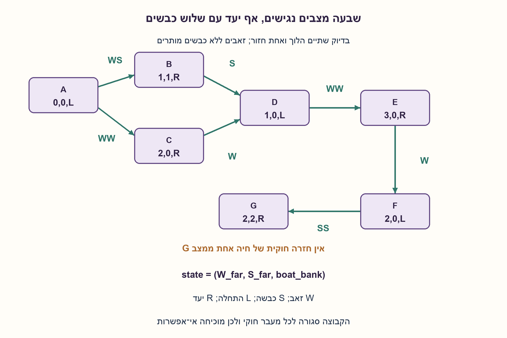
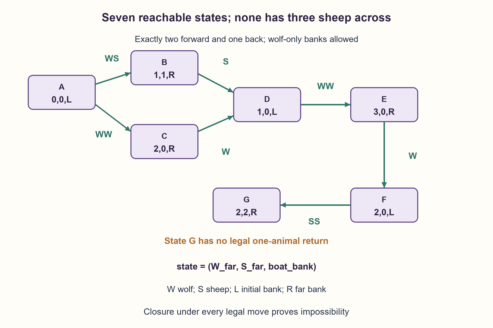

# PREP-203 — שלושה זאבים ושלוש כבשים: האם הכללים מאפשרים פתרון?

פתרון מוצע בסיוע AI; ביקורת מקצועית אנושית ממתינה. הקושי אינו מכויל.

[צילום מקור פרטי](../sources/2026-10-31-batch21-09.png)

בצד אחד של הנהר נמצאים 3 זאבים ו־3 כבשים. המטרה: להעביר את כל הכבשים לצד השני. החוקים: בכל פעם מותר להעביר 2 חיות בסירה, 1 חייב לחזור; אסור שבאף צד יהיה בו זמנית יותר זאבים מכבשים (מי שבסירה נחשב בצד שאליו הסירה נוסעת).

שיוכי חברות שדווחו בצילום ולא אומתו עצמאית: NVIDIA.

## עברית

בגדה אחת נמצאים שלושה זאבים ושלוש כבשים וסירה אחת. המטרה היא להעביר את כל הכבשים לגדה השנייה; אין דרישה להעביר גם את כל הזאבים. בניסוח המילולי של הצילום כל הפלגה מהגדה המקורית לגדה השנייה מעבירה בדיוק שתי חיות, וכל חזרה מעבירה בדיוק חיה אחת. הסירה אינה שטה ריקה. חיות שבסירה נספרות עם הגדה שאליה הן נוסעות.

בדקו אם אפשר להשיג את המטרה בלי שבגדה עם כבשים יהיו יותר זאבים מכבשים. אם אין פתרון, הוכיחו זאת. הבהירו גם מה קורה אם קוראים את איסור הזאבים באופן מילולי אפילו בגדה שאין בה כבשים. רק כהשוואה נפרדת, בדקו גרסה מקלה שבה מותרות חיה אחת או שתיים בכל כיוון.

הבהרות: כל החיות והסירה מתחילות יחד; לא משאירים חיות במים ולא משנים נוסעים באמצע. לאחר שכל הכבשים הגיעו אפשר לעצור. חריגת 'אין כבשים, אין טריפה' אינה כתובה בצילום, ולכן שני פירושי הבטיחות נבדקים במפורש. אין להחליף בשקט את כלל החזרה היחידנית בגרסת הנהר הקלאסית.

1. בדקו את מספר החיות המותר בכל כיוון לפני שמנסים לשחזר את הפתרון של החידה המוכרת.
2. שמרו מצב קטן: מספר הזאבים והכבשים בגדה השנייה וצד הסירה. אילו מצבים אפשר להגיע אליהם מן ההתחלה?
3. גם עם היתר להשאיר זאבים בגדה ללא כבשים, יש רק שבעה מצבים נגישים. עקבו אחרי שתי ההפלגות הראשונות האפשריות עד שהן מתמזגות, ובדקו מדוע אי אפשר לחזור מהמצב עם שתי כבשים ביעד.

### תחת כלל 'שניים הלוך, אחד חזור' אין פתרון
זו אינה רק דרך מסובכת יותר לפתרון הקלאסי: האילוץ הנוסף חוסם את ההעברה. נסמן מצב `(w,s,b)`, כאשר w ו־s הם מספר הזאבים והכבשים בגדה השנייה, ו־b הוא צד הסירה: L בתחילת הנהר ו־R בגדה השנייה. בגדה המקורית נותרו `3−w,3−s`.

תחילה נרשה זאבים לבדם בגדה ללא כבשים, כמקובל בפרשנות טריפה. בגדה שיש בה כבשים נדרוש w≤s. להלן **כל** המצבים שנגישים מההתחלה וכל ההמשכים החוקיים שלהם. W מסמן זאב ו־S כבשה:

| מצב | המשך חוקי |
|---|---|
| (0,0,L) | WS הלוך אל (1,1,R), או WW הלוך אל (2,0,R) |
| (1,1,R) | S חוזרת אל (1,0,L) |
| (2,0,R) | W חוזר אל (1,0,L) |
| (1,0,L) | WW הלוך אל (3,0,R) |
| (3,0,R) | W חוזר אל (2,0,L) |
| (2,0,L) | SS הלוך אל (2,2,R) |
| (2,2,R) | אין חזרה חוקית של חיה אחת |

למשל, מ־(2,2,R) החזרת זאב משאירה ביעד זאב אחד ושתי כבשים, אך בגדה המקורית נוצרים שני זאבים וכבשה אחת. החזרת כבשה יוצרת ביעד שני זאבים וכבשה אחת. שתי האפשרויות אסורות.

הטבלה היא גם הוכחת אי־אפשרות: היא כוללת את מצב ההתחלה וסגורה תחת כל מעבר חוקי. באינדוקציה, כל מסלול אפשרי נשאר בקבוצה הזאת; באף מצב אין שלוש כבשים ביעד. לכן אין פתרון, גם אם מתירים מספר בלתי מוגבל של הפלגות. זה אינו כישלון של ניסיון בודד.

אם דורשים את האי־שוויון 'זאבים≤כבשים' גם בגדה שאין בה כבשים, המצב מוגבל עוד יותר. מכיוון שסך הזאבים שווה לסך הכבשים, בכל גדה חייב להיות מספר שווה משני הסוגים. ההפלגה הראשונה היחידה היא WS; החזרה של חיה אחת מפרה שוויון באחת הגדות. יש רק שני מצבים נגישים, וגם כאן אין פתרון.

### גרסה מקלה נפרדת: עד שתי חיות בכל כיוון
אם משנים במפורש את כלל החזרה ומרשים גם שתי חיות לחזור, ובמקביל מתירים גדה שיש בה רק זאבים, כל הכבשים יכולות להגיע בשבע הפלגות:

```text
WS ->,  S <-,  WW ->,  W <-,  SS ->,  WS <-,  SS ->
```

אחרי ההפלגה השביעית נמצאים ביעד זאב אחד ושלוש כבשים; שני זאבים נשארים בגדה המקורית. ההפלגה השישית מחזירה **שתי חיות**, ולכן אינה פתרון לנוסח המילולי. העברת כל שש החיות, שהיא יעד אחר, דורשת מינימום 11 הפלגות בגרסה המקלה; אין צורך להוסיף אותה לתשובת המקור.

מודל BFS מיצה את כל מצבי הספירה החוקיים. עם חריגת הגדה ללא כבשים: בנוסח המילולי יש 20 מצבים חוקיים, 17 קשתות ו־7 מצבים נגישים; בגרסה המקלה יש 34 קשתות ו־16 מצבים נגישים, ומרחק היעד הוא 7. אורקל עצמאי ייצג את שש החיות בזהויות נפרדות ובדק כל מצב, מעבר ומרחק בארבעת צירופי הכללים. הגרף כאן סופי בגודל קבוע; BFS כללי עולה O(V+E) בזמן ובמקום עבור גרף שמוחזק במפורש.

```python
"""Exact finite river-puzzle model; literal and explicitly relaxed contracts.

State is (wolves_on_far_bank, sheep_on_far_bank, boat_bank), bank 0/1.
Boat passengers count toward the destination bank during a crossing.
"""

from collections import deque
from itertools import product


def safe_bank(wolves, sheep, *, allow_no_sheep=True):
    return (allow_no_sheep and sheep == 0) or wolves <= sheep


def state_graph(*, relaxed=False, allow_no_sheep=True):
    states = [state for state in product(range(4), range(4), range(2))
              if safe_bank(state[0], state[1], allow_no_sheep=allow_no_sheep)
              and safe_bank(3 - state[0], 3 - state[1], allow_no_sheep=allow_no_sheep)]
    graph = {state: [] for state in states}
    for wolves, sheep, boat in states:
        for moved_wolves, moved_sheep in product(range(3), repeat=2):
            passengers = moved_wolves + moved_sheep
            allowed = 1 <= passengers <= 2 if relaxed else passengers == (2 if boat == 0 else 1)
            if not allowed:
                continue
            sign = 1 if boat == 0 else -1
            target = (wolves + sign * moved_wolves, sheep + sign * moved_sheep, 1 - boat)
            # Counts must stay in 0..3 and both arrival/departure banks must be safe.
            if target in graph:
                graph[(wolves, sheep, boat)].append((target, (moved_wolves, moved_sheep)))
    return graph


def analyze(*, relaxed=False, allow_no_sheep=True, all_animals=False):
    graph = state_graph(relaxed=relaxed, allow_no_sheep=allow_no_sheep)
    start = (0, 0, 0)
    distance, previous = {start: 0}, {}
    queue = deque([start])
    while queue:
        state = queue.popleft()
        for target, passengers in graph[state]:
            if target not in distance:
                distance[target] = distance[state] + 1
                previous[target] = (state, passengers)
                queue.append(target)
    goals = [state for state in distance if state[1] == 3 and (not all_animals or state[0] == 3)]
    route = None
    if goals:
        goal = min(goals, key=distance.get)
        route = []
        while goal != start:
            source, passengers = previous[goal]
            route.append((source, passengers, goal))
            goal = source
        route.reverse()
    return {"graph": graph, "distance": distance, "route": route}
```




## English

Three wolves, three sheep and one boat start on one bank. The goal is to move all sheep to the far bank; moving every wolf is not required. Read the screenshot's rule literally: each forward crossing carries exactly two animals, while each return carries exactly one. The boat never moves empty. Passengers count with the destination bank during travel.

Determine whether the goal can be reached without wolves outnumbering sheep on a bank containing sheep. Prove impossibility if no solution exists. Also analyze the fully literal safety interpretation that prohibits extra wolves even on a bank with zero sheep. Only as a separate comparison, consider a relaxed version permitting one or two animals in either direction.

Clarifications: everyone and the boat start together; no swimming or midstream passenger changes. Stop once all sheep arrive. The usual no-sheep/no-predation exception is absent from the screenshot, so both safety interpretations are explicit. Do not silently replace the one-animal return rule with the classic river puzzle.

1. Check passenger counts in each direction before reusing a familiar river-puzzle solution.
2. Record only far-bank wolf count, sheep count and boat side. Which states can the initial state reach?
3. Even allowing wolf-only banks, only seven states are reachable. Follow the two possible first trips until their paths merge, then inspect why the state with two sheep across has no legal return.

### Exactly two forward and one back admits no solution
The extra rule blocks the transfer rather than merely making the classic solution harder. Let `(w,s,b)` record far-bank wolf and sheep counts, and boat side L for the initial bank or R for the far bank. The initial bank then contains `3−w,3−s`.

First permit a wolf-only bank, as in the usual predation interpretation. On a bank containing sheep require wolves≤sheep. The following table lists **every** reachable state and all its legal continuations; W means wolf and S sheep:

| State | Legal continuation |
|---|---|
| (0,0,L) | WS forward to (1,1,R), or WW forward to (2,0,R) |
| (1,1,R) | S returns to (1,0,L) |
| (2,0,R) | W returns to (1,0,L) |
| (1,0,L) | WW forward to (3,0,R) |
| (3,0,R) | W returns to (2,0,L) |
| (2,0,L) | SS forward to (2,2,R) |
| (2,2,R) | No legal one-animal return |

From (2,2,R), returning a wolf leaves two wolves and one sheep on the initial bank. Returning a sheep instead leaves two wolves and one sheep on the far bank. Both returns are forbidden.

This is an impossibility proof: the table contains the initial state and is closed under every legal move. Induction therefore confines every possible route to this set, and no member has three sheep across. No number of additional trips can solve it; this is not merely one failed attempt.

If wolves≤sheep is enforced even on a bank with zero sheep, the restriction is stronger. Equal total wolf/sheep counts force equality on each bank. Only WS can cross first, and any single-animal return breaks equality. Exactly two states are reachable and the goal is still impossible.

### Separate relaxation: one or two animals in either direction
If two-animal returns are explicitly allowed and wolf-only banks remain safe, all sheep can reach the far bank in seven trips:

```text
WS ->,  S <-,  WW ->,  W <-,  SS ->,  WS <-,  SS ->
```

The final far bank has one wolf and three sheep; two wolves remain on the initial bank. Trip six returns **two animals**, so this is not a solution to the literal rule. Transporting all six animals is a different goal, with an eleven-trip minimum in the relaxed model; that extra goal is not required by the source.

BFS enumerated the complete finite count-state graphs. With the zero-sheep exception, the literal model has 20 legal states, 17 edges and seven reachable states. The relaxed model has 34 edges and sixteen reachable states, with goal distance seven. An independent six-identity bitmask oracle compared every state, edge and BFS distance under all four rule combinations. This instance is fixed finite size. General BFS on an explicitly stored graph takes O(V+E) time and space.

```python
"""Exact finite river-puzzle model; literal and explicitly relaxed contracts.

State is (wolves_on_far_bank, sheep_on_far_bank, boat_bank), bank 0/1.
Boat passengers count toward the destination bank during a crossing.
"""

from collections import deque
from itertools import product


def safe_bank(wolves, sheep, *, allow_no_sheep=True):
    return (allow_no_sheep and sheep == 0) or wolves <= sheep


def state_graph(*, relaxed=False, allow_no_sheep=True):
    states = [state for state in product(range(4), range(4), range(2))
              if safe_bank(state[0], state[1], allow_no_sheep=allow_no_sheep)
              and safe_bank(3 - state[0], 3 - state[1], allow_no_sheep=allow_no_sheep)]
    graph = {state: [] for state in states}
    for wolves, sheep, boat in states:
        for moved_wolves, moved_sheep in product(range(3), repeat=2):
            passengers = moved_wolves + moved_sheep
            allowed = 1 <= passengers <= 2 if relaxed else passengers == (2 if boat == 0 else 1)
            if not allowed:
                continue
            sign = 1 if boat == 0 else -1
            target = (wolves + sign * moved_wolves, sheep + sign * moved_sheep, 1 - boat)
            # Counts must stay in 0..3 and both arrival/departure banks must be safe.
            if target in graph:
                graph[(wolves, sheep, boat)].append((target, (moved_wolves, moved_sheep)))
    return graph


def analyze(*, relaxed=False, allow_no_sheep=True, all_animals=False):
    graph = state_graph(relaxed=relaxed, allow_no_sheep=allow_no_sheep)
    start = (0, 0, 0)
    distance, previous = {start: 0}, {}
    queue = deque([start])
    while queue:
        state = queue.popleft()
        for target, passengers in graph[state]:
            if target not in distance:
                distance[target] = distance[state] + 1
                previous[target] = (state, passengers)
                queue.append(target)
    goals = [state for state in distance if state[1] == 3 and (not all_animals or state[0] == 3)]
    route = None
    if goals:
        goal = min(goals, key=distance.get)
        route = []
        while goal != start:
            source, passengers = previous[goal]
            route.append((source, passengers, goal))
            goal = source
        route.reverse()
    return {"graph": graph, "distance": distance, "route": route}
```




## חומר משלים / Supporting material

```json
{
  "assumptions": {
    "he": [
      "שלושה זאבים ושלוש כבשים; כל החיות והסירה מתחילות יחד.",
      "הנוסח המילולי הוא בדיוק שתיים הלוך ובדיוק אחת חזור; אי אפשר להחזיר סירה ריקה.",
      "חיות בסירה נספרות עם גדה היעד. המטרה היא כל הכבשים, לא בהכרח כל הזאבים.",
      "נבדקים בנפרד פירוש בטיחות עם חריגת גדה ללא כבשים ופירוש מילולי ללא החריגה."
    ],
    "en": [
      "Three wolves and three sheep start together with the boat.",
      "Literal trips carry exactly two forward and exactly one back; no empty return.",
      "Passengers count with their destination bank; the goal is all sheep, not necessarily all wolves.",
      "Safety with and without the zero-sheep exception is analyzed separately."
    ]
  },
  "optimality": {
    "he": "אין פתרון בנוסח המילולי בשני פירושי הבטיחות. רק בגרסה המקלה של 1–2 חיות בשני הכיוונים וחריגת אפס כבשים מתקבל מינימום 7 להעברתם של כל הכבשים. יעד כל שש החיות הוא אחר ומרחקו 11.",
    "en": "Literal rules are impossible under either safety interpretation. Only the explicit one/two-passenger relaxation with the zero-sheep exception achieves all sheep in a minimum of seven trips. The separate all-six goal has distance eleven."
  },
  "verification": {
    "he": "כל גרפי המצבים, הקשתות ומרחקי BFS הושוו לאורקל עצמאי של שש זהויות. הקבוצה המילולית הנגישה כוללת 7 מצבים ו־7 קשתות, ואין בה יעד. ללא חריגת אפס כבשים נגישים רק 2 מצבים.",
    "en": "Complete state graphs, edges and BFS distances matched an independent six-identity oracle. Literal reachable closure has seven states and seven edges with no goal; without the zero-sheep exception only two states are reachable."
  },
  "edge_cases": {
    "he": [
      "הגדה ללא כבשים משנה את קבוצת המצבים החוקיים, אבל אינה מצילה את כלל החזרה היחידנית.",
      "אפשר לעצור כשהכבשה השלישית מגיעה; אין דרישה להפליג שוב עם כבשה החוצה.",
      "חזרה של WS מותרת רק בגרסה המקלה."
    ],
    "en": [
      "Wolf-only banks change legal states but do not rescue the one-animal return rule.",
      "Stop when the third sheep arrives; no further sheep-return requirement is imposed.",
      "Returning WS is legal only in the relaxed variant."
    ]
  },
  "common_mistakes": {
    "he": [
      "להעתיק את פתרון 11 ההפלגות של כל שש החיות בלי לבדוק חזרה של שתיים.",
      "להוכיח רק שמסלול שנוסה נכשל במקום למצות קבוצה סגורה.",
      "לשנות את היעד מכבשים בלבד לכל החיות.",
      "להניח בשקט שזאבים לבדם אסורים או מותרים."
    ],
    "en": [
      "Copying an eleven-trip all-six solution without checking two-animal returns.",
      "Showing one route fails rather than exhausting a closed reachable set.",
      "Changing the goal from all sheep to all animals.",
      "Silently choosing whether wolf-only banks are legal."
    ]
  },
  "interview_answer": {
    "he": "לפי הכלל המדויק אין פתרון. אמנה את שבעת המצבים הנגישים גם כאשר זאבים לבדם מותרים: שתי ההפלגות הראשונות האפשריות מתמזגות למסלול שנעצר בשתי כבשים ביעד. חזרה של זאב או של כבשה שם אינה בטוחה. אם מתירים גם שתי חיות לחזור, יש פתרון אחר של שבע הפלגות לכבשים בלבד.",
    "en": "The exact rule is impossible. Even allowing wolf-only banks, the two possible first trips merge into a path ending with two sheep across and no safe single return. Enumerating the seven-state closed set proves impossibility. Allowing two animals to return defines a different seven-trip sheep-only solution."
  },
  "source_ambiguities": {
    "he": [
      "הצילום אינו מבהיר אם שתי חיות הן קיבולת מרבית או חובה, ואינו אומר במפורש מה קורה בגדה בלי כבשים. הניתוח שומר את הקריאה המילולית ומשווה בגלוי חלופה מקלה."
    ],
    "en": [
      "The source leaves capacity-versus-exact-two and wolf-only-bank semantics unclear. The analysis preserves the literal reading and explicitly separates the relaxation."
    ]
  },
  "solution_extensions": {
    "he": [
      {
        "question": "מה משתנה אם דורשים להעביר גם את כל הזאבים בגרסה המקלה?",
        "answer_direction": "משנים רק את תנאי היעד ל־w=s=3. אותו גרף BFS נותן 11 הפלגות במקום 7.",
        "principle": "תנאי היעד הוא חלק מהבעיה ולא פרט שאפשר להחליף."
      }
    ],
    "en": [
      {
        "question": "What if every wolf must also cross in the relaxed version?",
        "answer_direction": "Change only the goal predicate to w=s=3. BFS on the same graph gives eleven trips rather than seven.",
        "principle": "The goal predicate is part of the problem contract."
      }
    ]
  }
}
```
