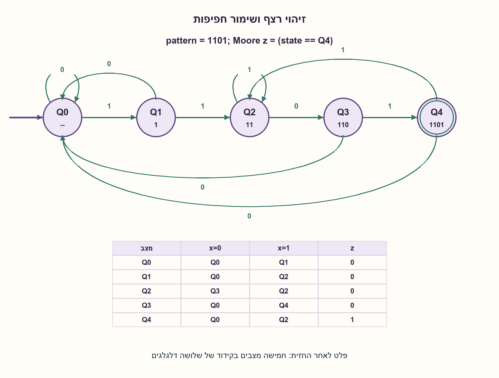
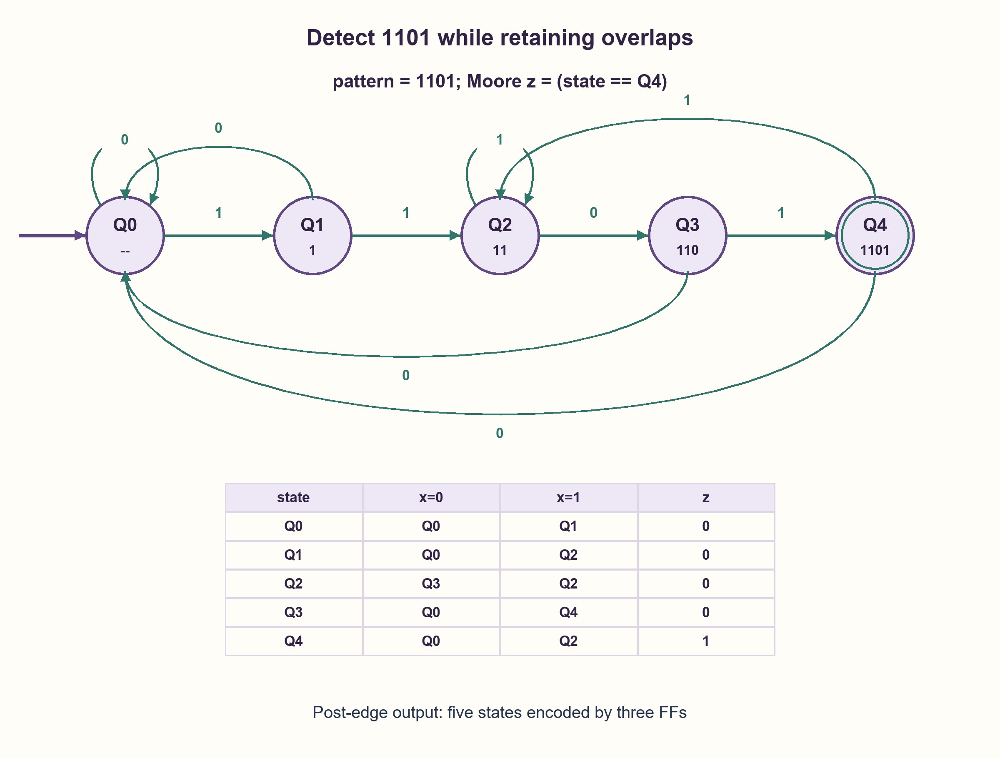

# PREP-204 — זיהוי 1101 וכמות סיביות המצב

פתרון מוצע בסיוע AI; ביקורת מקצועית אנושית ממתינה. הקושי אינו מכויל.

[צילום מקור פרטי](../sources/2026-10-31-batch21-13.png)

א. לבנות מכונת מצבים שמוציאה 1 עבור הקלט 1101. ב. כמה רגיסטרים צריך?

חברות לפי הדיווח בצילום בלבד: NVIDIA.

## עברית

בנו מכונת מצבים המזהה את הרצף הטורי 1101 ומוציאה 1 בזיהוי. כמה רכיבי זיכרון דרושים? הציגו מצבים, מעברים, חפיפות והבדל בין Moore ל־Mealy.

הבהרות עריכה: מקבלים ביט אחד בכל עליית clk, עם setup/hold תקינים; reset סינכרוני פעיל בגבוה מוחק היסטוריה וקודם לקליטה. נבחר מוצא Moore הנקרא לאחר התייצבות המצב בחזית שקלטה את הביט האחרון. זיהוי מותר בכל מיקום, לרבות חפיפה. הספירה מבדילה בין FF של ביט אחד לבין אוגר וקטורי, ובין פלט צירופי לפלט רשום.

1. לא חייבים לזכור את כל הזרם. איזו סיומת שלו יכולה להיות תחילת הרצף המבוקש?
2. המצבים יכולים לציין שאין התאמה, או שהסיומת היא 1,11,110, ולציין גם זיהוי מלא אם הפלט Moore.
3. אחרי 1101 ולאחר 1 נוסף הסיומת הרלוונטית היא 11. חזרה עיוורת למצב ההתחלתי הייתה מאבדת זיהוי חופף.

### המצב זוכר את הסיומת השימושית
נבחר Q0=ללא סיומת מתאימה, Q1=1, Q2=11, Q3=110, Q4=1101 שהושלם. פלט z=1 בדיוק ב־Q4. טבלת המעברים, לפי ביט הקלט, היא:

| מצב | קלט 0 | קלט 1 | z |
|---|---|---|---|
| Q0 | Q0 | Q1 | 0 |
| Q1 | Q0 | Q2 | 0 |
| Q2 | Q3 | Q2 | 0 |
| Q3 | Q0 | Q4 | 0 |
| Q4 | Q0 | Q2 | 1 |

בכל צעד נשמרת הסיומת הארוכה ביותר שהיא קידומת של 1101; Q4 מסמן שגם המילה המלאה היא הסיומת הנוכחית. הטבלה מתקבלת מבדיקת הסיומות לאחר הוספת הביט הבא. לכן נכונות המצבים באינדוקציה נותנת z=1 אם ורק אם ארבעת הביטים האחרונים הם 1101. לדוגמה 1101101 נותן 0001001: זיהויים בביטים הרביעי והשביעי. ב־Q4 עם קלט 1 עוברים ל־Q2, כי שתי האחדות האחרונות יכולות להתחיל זיהוי חדש.

### כמה רגיסטרים?
ל־Moore הזה חמישה מצבים מובחנים, ולכן קידוד בינארי צריך ceil(log2(5))=3 FF של ביט אחד. אפשר לכתוב אותם כאוגר state[2:0] אחד. אלה אינם חמישה FF חובה; קידוד one-hot משתמש בחמישה מבחירה. המוצא הוא פענוח צירופי של המצב ונקרא אחרי התייצבותו, ללא FF פלט נוסף במימוש זה. אין בכך הבטחה שהפענוח חסר glitches בכל רגע פיזי.

אפשר Mealy בעל ארבעת מצבי הקידומת Q0..Q3, שמפיק אירוע כאשר המצב Q3 והביט הנוכחי 1; אחרי האירוע נשמרת הקידומת 1. ארבעה מצבים דורשים שני FF, אך המוצא אז תלוי גם בקלט ונבחן בחלון הדגימה המתאים, ולא מתואר כפולס רשום אחרי החזית. אם רושמים את אירוע ה־Mealy כדי לקבל פולס מלא לאחר הקליטה, נדרש FF פלט נוסף: שלוש סיביות זיכרון בסך הכול. אין להשוות שתי סיביות Mealy לפלט Moore לאחר חזית בלי להסביר את שינוי התזמון.

לחמשת מצבי Moore אין איחוד חוקי: Q4 מובחן בפלטו הנוכחי, ובין שני מצבי קידומת שונים ניתן להשלים את הקידומת הארוכה למילה; הקצרה טרם קראה מספיק ביטים כדי לזהות באותו רגע. כך מתקבלת הצדקת מספר המצבים, בנפרד מהבדיקה הסופית של עשרת זוגות המצבים. ההרחבה אינה טענת מינימום שערים או השהיה.

### מודל לוגי בפייתון שהורץ

```python
"""Overlapping Moore detector; state is the longest matched prefix length."""

TRANSITIONS = ((0, 1), (0, 2), (3, 2), (0, 4), (0, 2))


def detect(bits, resets=()):
    state = 0
    reset_edges = set(resets)
    output = []
    for edge, bit in enumerate(bits):
        if bit not in (0, 1):
            raise ValueError("bits must be binary")
        state = 0 if edge in reset_edges else TRANSITIONS[state][bit]
        output.append(int(state == 4))
    return output
```


### קוד SystemVerilog מוצע; לא הודר בבדיקה זו

```systemverilog
// Proposed Moore RTL; synchronous reset; overlapping detections after sampling.
module sequence_1101 (
    input logic clk, rst, bit_in,
    output logic found
);
    logic [2:0] state, next_state;
    always_comb begin
        case (state)
            3'd0: next_state = bit_in ? 3'd1 : 3'd0;
            3'd1: next_state = bit_in ? 3'd2 : 3'd0;
            3'd2: next_state = bit_in ? 3'd2 : 3'd3;
            3'd3: next_state = bit_in ? 3'd4 : 3'd0;
            3'd4: next_state = bit_in ? 3'd2 : 3'd0;
            default: next_state = 3'd0;
        endcase
    end
    always_ff @(posedge clk) begin
        if (rst) state <= 3'd0;
        else state <= next_state;
    end
    assign found = state == 3'd4;
endmodule
```




### assumptions

```json
[
  "טורי, ביט בכל חזית, ללא גבולות מילה חיצוניים; חפיפה מותרת.",
  "איפוס נדרש לפני התחלה; הפלט מפוענח אחרי התייצבות המצב."
]
```

### optimality

Moore מינימלי בן חמישה מצבים: שלושה FF בינאריים. Mealy בן ארבעה מצבים: שני FF ופלט צירופי, או שלושה עם אירוע רשום. העלויות אינן שקולות בלי חוזה תזמון.

### verification

כל 8191 הזרמים באורכים 0–12 נבדקו מול oracle סיומות, עוד 256 תרחישי reset וכל עשרת זוגות המצבים נבדלו בהמשך מתאים. ה־SV לא הודר.

### edge_cases

```json
[
  "1101101 מכיל שני זיהויים חופפים.",
  "רצף קצר מארבעה ביטים אינו מזוהה; reset מוחק קידומת חלקית."
]
```

### common_mistakes

```json
[
  "לומר „שני רגיסטרים” בלי להבחין בפלט ובמספר סיביות.",
  "לחזור ל־Q0 אחרי זיהוי ולאבד חפיפה."
]
```

### interview_answer

אזכור את הקידומת שמופיעה כסיומת הזרם. למוצא Moore אחרי החזית אבחר חמישה מצבים ושלושה FF; חלופת Mealy חוסכת מצב וביט רק אם הפלט הצירופי מתאים.

### source_ambiguities

המקור אינו מגדיר תזמון פלט, חפיפה, reset או אם „רגיסטר” הוא ביט או אפיק. כל ההבחנות מוצגות במפורש.

### solution_extensions

```json
[
  {
    "question": "אם נדרש פלט רשום ללא פענוח צירופי, מה תבחרו?",
    "answer_direction": "אפשר ארבעה מצבי Mealy בשני FF ועוד FF לאירוע, ובכך שלוש סיביות. יש לחשב את האירוע מהמצב והקלט הישנים באותה חזית.",
    "principle": "מיקום אוגר הפלט משנה את ספירת הזיכרון ואת התזמון."
  }
]
```

## English

Build a serial FSM detecting 1101 and outputting one on detection. How many storage elements are required? Give states and transitions, overlap behavior, and a Moore/Mealy comparison.

Editorial contract: accept one bit per rising clk edge with valid setup/hold. Synchronous active-high reset clears history and overrides sampling. The main design uses a Moore output read after state settles on the edge accepting the final bit. Search every position, including overlaps. Distinguish one-bit FFs from vector registers, and combinational from registered outputs.

1. Which suffix of the input history is also a prefix of the target? The whole stream need not be stored.
2. States can represent no match or suffixes 1,11,110, plus a completed-match state for a Moore output.
3. After 1101 followed by another one, the useful suffix is 11. Resetting blindly after detection would lose overlap.

### State remembers the useful suffix
Use Q0=no matching suffix, Q1=1, Q2=11, Q3=110 and Q4=completed 1101. Set z=1 exactly in Q4:

| State | Input 0 | Input 1 | z |
|---|---|---|---|
| Q0 | Q0 | Q1 | 0 |
| Q1 | Q0 | Q2 | 0 |
| Q2 | Q3 | Q2 | 0 |
| Q3 | Q0 | Q4 | 0 |
| Q4 | Q0 | Q2 | 1 |

Each step retains the longest suffix that is a prefix of 1101; Q4 also records the complete word as the current suffix. Derive the table by examining suffixes after appending the next bit. Induction gives z=1 exactly when the latest four bits are 1101. For example, 1101101 gives 0001001, detecting at bits four and seven. From Q4 on one, move to Q2: the latest two ones can begin the next occurrence.

### How many registers?
This Moore machine has five distinguishable states, so binary encoding needs ceil(log2(5))=3 one-bit FFs. They may be declared as one vector register state[2:0]. Five FFs are an optional one-hot encoding, not a requirement. Output is a combinational state decode observed after settling, with no separate output FF in this design. That does not guarantee glitch-free decoding at every physical instant.

A Mealy alternative retains only the four proper-prefix states Q0..Q3. It generates an event for state Q3 with current input one, then retains prefix 1. Four states need two FFs, but its output depends on the input and is observed in the appropriate sampling window; it is not a registered post-edge pulse. Registering that Mealy event requires one additional output FF, giving three storage bits total. Comparing two-bit Mealy storage with post-edge Moore output without explaining timing changes is misleading.

The five Moore states cannot be merged: Q4 has a different current output; between two different proper prefixes, complete the longer prefix to the target word. The shorter prefix has not seen enough bits to detect at the same point. This proves the state distinction separately from the finite check of all ten state pairs. It is not a gate-count or delay optimum.

### Executed Python logical model

```python
"""Overlapping Moore detector; state is the longest matched prefix length."""

TRANSITIONS = ((0, 1), (0, 2), (3, 2), (0, 4), (0, 2))


def detect(bits, resets=()):
    state = 0
    reset_edges = set(resets)
    output = []
    for edge, bit in enumerate(bits):
        if bit not in (0, 1):
            raise ValueError("bits must be binary")
        state = 0 if edge in reset_edges else TRANSITIONS[state][bit]
        output.append(int(state == 4))
    return output
```


### Proposed SystemVerilog; not compiled in this check

```systemverilog
// Proposed Moore RTL; synchronous reset; overlapping detections after sampling.
module sequence_1101 (
    input logic clk, rst, bit_in,
    output logic found
);
    logic [2:0] state, next_state;
    always_comb begin
        case (state)
            3'd0: next_state = bit_in ? 3'd1 : 3'd0;
            3'd1: next_state = bit_in ? 3'd2 : 3'd0;
            3'd2: next_state = bit_in ? 3'd2 : 3'd3;
            3'd3: next_state = bit_in ? 3'd4 : 3'd0;
            3'd4: next_state = bit_in ? 3'd2 : 3'd0;
            default: next_state = 3'd0;
        endcase
    end
    always_ff @(posedge clk) begin
        if (rst) state <= 3'd0;
        else state <= next_state;
    end
    assign found = state == 3'd4;
endmodule
```




### assumptions

```json
[
  "Serial input, one bit per edge, no external word boundaries; overlap allowed.",
  "Reset before use; observe output after state settling."
]
```

### optimality

Minimal five-state Moore: three binary FFs. Four-state Mealy: two FFs with combinational event, or three including a registered event. Costs are not comparable without timing.

### verification

All 8191 streams of lengths zero through twelve matched an independent suffix oracle, with 256 reset cases and all ten state pairs distinguished. SV was not compiled.

### edge_cases

```json
[
  "1101101 contains two overlapping detections.",
  "Fewer than four bits cannot detect; reset discards a partial prefix."
]
```

### common_mistakes

```json
[
  "Saying “two registers” without output timing or bit count.",
  "Returning blindly to Q0 after detection and losing overlaps."
]
```

### interview_answer

Remember the target prefix that is a suffix of the stream. Post-edge Moore output uses five states and three FFs; Mealy saves a state and bit only if its combinational output timing is acceptable.

### source_ambiguities

The source omits output timing, overlap, reset and whether “register” means a bit or vector. These distinctions are explicit.

### solution_extensions

```json
[
  {
    "question": "What if the output must itself be registered?",
    "answer_direction": "Use a two-bit, four-state Mealy machine plus one event FF. Compute the event from old state and sampled input on the same edge.",
    "principle": "Output register placement changes both storage counting and timing."
  }
]
```
