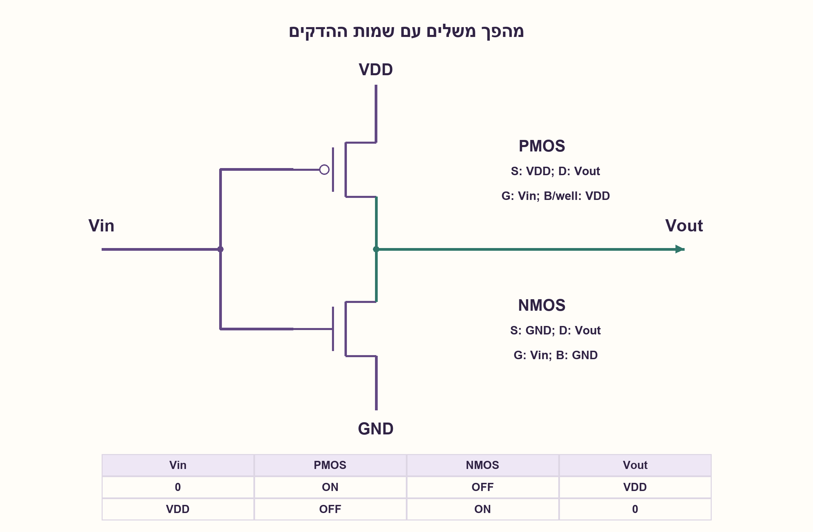
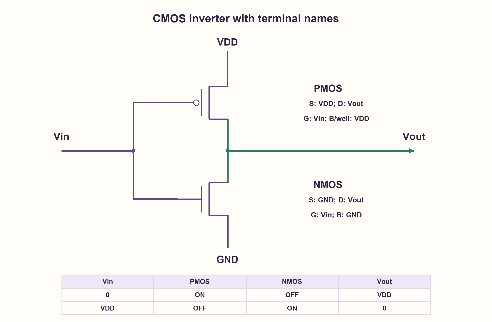

# PREP-205 — מהפך CMOS: חיבורים, מצבים ומעבר

פתרון מוצע בסיוע AI; ביקורת מקצועית אנושית ממתינה. הקושי אינו מכויל.

[צילום מקור פרטי](../sources/2026-10-31-batch21-14.png)

צייר CMOS inverter. פרט על אופן פעולתו.

חברות לפי הדיווח בצילום בלבד: NVIDIA.

## עברית

ציירו מהפך CMOS והסבירו כיצד הוא פועל עבור כניסה נמוכה, גבוהה ובזמן מעבר. ציינו חיבורי שערים, מקורות, נקזים וגוף, ואת מסלולי טעינת ופריקת העומס.

נבחר מהפך סטטי בסיסי עם NMOS ו־PMOS משלימים, אספקת VDD חיובית וכניסה בין 0 ל־VDD. המקור אינו מספק תהליך, מידות, ספים או עומס; לכן אין לשרטט עקומת מעבר מספרית מדויקת או לטעון לתדר מרבי. התיאור הלוגי של רמות מסילה מופרד מהתנהגות אנלוגית ומזרמי דליפה.

1. אחד הטרנזיסטורים צריך לחבר את היציאה למתח הגבוה והשני לאדמה. מי צריך להוליך עבור כניסה נמוכה?
2. חברו את שני השערים ל־Vin ואת שני הנקזים ל־Vout; המקורות הולכים למסילות המתאימות.
3. ב־Vin=0 ה־PMOS טוען את היציאה וה־NMOS כבוי. ב־Vin=VDD התפקידים מתחלפים. בזמן מעבר ייתכן ששניהם מוליכים.

### שני טרנזיסטורים שמשלימים זה את זה
ה־PMOS העליון מחובר במקורו ל־VDD, בנקזו ל־Vout ובשערו ל־Vin. ה־NMOS התחתון מחובר במקורו ל־GND, בנקזו לאותה Vout ובשערו לאותה Vin. בגוף bulk רגיל, גוף ה־PMOS/ה־well מחובר ל־VDD וגוף ה־NMOS למתח האדמה בהתאם לתהליך. החיבורים הללו מוצגים במפורש בשרטוט; אין להחליף שער בנקז.

Vin=0 נותן ל־PMOS מתח שער־מקור שלילי בעוצמה מספקת, והוא מוליך; ה־NMOS כבוי. היציאה נטענת דרך ה־PMOS לכיוון VDD ולכן הלוגיקה היא אחד. Vin=VDD מכבה את ה־PMOS ומפעיל את ה־NMOS; העומס נפרק לאדמה ולכן היציאה אפס. במודל המתגים האידאלי אין בשני מצבי המסילה מסלול DC ישיר מ־VDD לאדמה. במציאות קיימים זרמי דליפה, ולכן „הספק סטטי אפס” הוא קירוב ולא מדידה.

### מה קורה בין אפס לאחד?
אם Vtn<Vin<VDD−|Vtp| בתחום שבו התנאים חופפים, שני ההתקנים יכולים להוליך ונוצר זרם קצר־דרך בזמן המעבר. גם טעינה ופריקה של קיבול העומס צורכות אנרגיה; ההספק הדינמי תלוי בפעילות, בקיבול, במתח ובתדר. היציאה אינה משתנה מיד, ו־rise/fall delays תלויים בחוזק ההתקנים ובעומס. כניסה צפה או איטית מדי אינה מצב לוגי תקין מובטח.

צורת Vout(Vin) יורדת באופן טיפוסי, אבל נקודת המיתוג אינה בהכרח VDD/2: היא תלויה בספים וביחס חוזק NMOS/PMOS. בלי נתוני תהליך אין מספר יחיד לקביעתה, למרווחי רעש או להשהיה. ההסבר על רמות מסילה וזרמי מעבר נסמך על [TI — צריכת הספק ב־CMOS](https://www.ti.com/lit/an/scaa035b/scaa035b.pdf) ועל [Toshiba — פעולת CMOS בסיסית](https://toshiba.semicon-storage.com/ap-en/semiconductor/knowledge/e-learning/cmos-logic-basics/chap2/chap2-3.html). המודל המצורף בודק רק מצבי הולכה אידאליים, ולא מחליף ניתוח אנלוגי.

### מודל לוגי בפייתון שהורץ

```python
"""Ideal rail-input switch model, separate from any analog transfer curve."""


def rail_inverter(vin_bit):
    if vin_bit not in (0, 1):
        raise ValueError("rail model accepts only zero or one")
    pmos_on = vin_bit == 0
    nmos_on = vin_bit == 1
    return {"pmos_on": pmos_on, "nmos_on": nmos_on,
            "vout_bit": 1 - vin_bit, "ideal_dc_rail_path": pmos_on and nmos_on}


def gate_overdrive_flags(vin, vdd=1.0, vtn=0.3, vtp_abs=0.3):
    if not 0 <= vin <= vdd or min(vtn, vtp_abs) <= 0:
        raise ValueError("positive thresholds and legal input voltage required")
    # Only indicates possible channel conduction, not output voltage/current.
    return vin > vtn, (vdd - vin) > vtp_abs
```




### assumptions

```json
[
  "אספקה וכניסה בטווח המסילות; טרנזיסטורי enhancement משלימים.",
  "חיבורי גוף הם לסכימת bulk רגילה, בכפוף לכללי התהליך."
]
```

### optimality

המהפך הבסיסי משתמש בשני טרנזיסטורים; לא מוצגים מינימום שטח, הספק או השהיה בלי ספרייה וגדלים.

### verification

שתי שורות רמת המסילה נבדקו במודל מתגים, עם דוגמת Vin=0.5 V ושני ספים של 0.3 V המציגה אפשרות הולכה של שניהם. אין חישוב VTC, SPICE או אימות חומרה.

### edge_cases

```json
[
  "קלט באמצע התחום אינו עוד שורת אמת דיגיטלית מובטחת.",
  "עומס קיבולי מעכב תגובה; דליפה קיימת גם במנוחה."
]
```

### common_mistakes

```json
[
  "להפעיל PMOS עם רמה גבוהה בשער כמו NMOS.",
  "להבטיח VDD/2 לכל יחס גדלים.",
  "לומר שאין צריכת זרם בכלל כי אין מסלול DC אידאלי במנוחה."
]
```

### interview_answer

השערים משותפים לכניסה והנקזים ליציאה; PMOS מושך מ־VDD ו־NMOS לאדמה. בכניסה נמוכה הראשון מוליך, ובגבוהה השני. בזמן מעבר יש קיבול וייתכן זרם דרך שניהם; הספים וההשהיה תלויים בתהליך ובעומס.

### source_ambiguities

אין מקור למספרי מתח, גדלים, קיבול או תהליך בצילום. השרטוט הוא סכימה לימודית ולא תא מוסמך.

### solution_extensions

```json
[
  {
    "question": "כיצד הקטנת העומס משפיעה על ההשהיה?",
    "answer_direction": "באותו חוזק הנעה טעינה של קיבול קטן נוטה להסתיים מהר יותר; נדרשים מודל ותהליך לכימות, ומרווחי רעש אינם נובעים רק מהקיבול.",
    "principle": "אמת בוליאנית אינה מספיקה לניתוח תזמון."
  }
]
```

## English

Draw a CMOS inverter and explain operation for low input, high input and switching. Identify gate, source, drain and body connections and the load charging/discharging paths.

Choose a basic static complementary NMOS/PMOS inverter, positive VDD, and inputs within the supply rails. No process, sizing, thresholds or load are supplied, so no exact numerical transfer curve or maximum frequency is implied. Separate the rail-level logic model from analog behavior and leakage.

1. One device pulls the output high and the other pulls it low. Which must conduct for a low input?
2. Connect both gates to Vin and both drains to Vout, with sources at the appropriate rails.
3. At Vin=0 the PMOS charges the output and NMOS is off. At Vin=VDD the roles reverse. Both can conduct during a transition.

### Two complementary devices
The upper PMOS has source at VDD, drain at Vout and gate at Vin. The lower NMOS has source at ground, drain at the same Vout and gate at the same Vin. In a conventional bulk implementation, connect the PMOS body/well to VDD and NMOS body to ground as required by the process. The diagram identifies these terminals; do not confuse a gate with a drain.

Vin=0 supplies sufficient negative gate-source voltage to turn on the PMOS while NMOS is off. The load charges through PMOS toward VDD, giving logic one. Vin=VDD turns PMOS off and NMOS on; the load discharges toward ground, giving zero. In the ideal switch model neither rail-input state has a direct DC path from VDD to ground. Real devices leak, so “zero static power” is an approximation rather than a measured guarantee.

### Between the rails
When Vtn<Vin<VDD−|Vtp| and the intervals overlap, both devices can conduct, producing transition short-circuit current. Charging and discharging load capacitance also consumes energy; dynamic power depends on activity, capacitance, voltage and frequency. Output does not change instantaneously, and rise/fall delays depend on sizing and load. Floating or excessively slow inputs do not provide a guaranteed valid logic state.

The typical transfer characteristic decreases with Vin, but its switching point is not universally VDD/2: thresholds and relative NMOS/PMOS strengths matter. Without process data there is no unique numerical switching point, noise margin or delay. Rail and transient behavior are described by [TI's CMOS power note](https://www.ti.com/lit/an/scaa035b/scaa035b.pdf) and [Toshiba's CMOS operation guide](https://toshiba.semicon-storage.com/ap-en/semiconductor/knowledge/e-learning/cmos-logic-basics/chap2/chap2-3.html). The attached model checks only ideal conduction states; it is not an analog analysis.

### Executed Python logical model

```python
"""Ideal rail-input switch model, separate from any analog transfer curve."""


def rail_inverter(vin_bit):
    if vin_bit not in (0, 1):
        raise ValueError("rail model accepts only zero or one")
    pmos_on = vin_bit == 0
    nmos_on = vin_bit == 1
    return {"pmos_on": pmos_on, "nmos_on": nmos_on,
            "vout_bit": 1 - vin_bit, "ideal_dc_rail_path": pmos_on and nmos_on}


def gate_overdrive_flags(vin, vdd=1.0, vtn=0.3, vtp_abs=0.3):
    if not 0 <= vin <= vdd or min(vtn, vtp_abs) <= 0:
        raise ValueError("positive thresholds and legal input voltage required")
    # Only indicates possible channel conduction, not output voltage/current.
    return vin > vtn, (vdd - vin) > vtp_abs
```




### assumptions

```json
[
  "Rail-bounded supply/input and complementary enhancement devices.",
  "Body connections depict a conventional bulk implementation subject to process rules."
]
```

### optimality

The basic topology uses two transistors; no area, power or delay optimum is claimed without a library and sizing.

### verification

Both rail-input rows were checked in an ideal switch model. A Vin=0.5 V example with 0.3 V thresholds flags possible simultaneous conduction. No quantitative VTC, SPICE or hardware validation.

### edge_cases

```json
[
  "Midrail input is not another guaranteed digital truth-table row.",
  "Capacitive loading delays switching; leakage remains in steady state."
]
```

### common_mistakes

```json
[
  "Turning PMOS on with a high gate as if it were NMOS.",
  "Promising VDD/2 for every sizing ratio.",
  "Claiming no current consumption because ideal steady-state DC paths are absent."
]
```

### interview_answer

Tie gates to input and drains to output; PMOS pulls from VDD and NMOS to ground. Low input activates PMOS, high activates NMOS. Switching involves capacitance and possible through-current; thresholds and delay depend on process and load.

### source_ambiguities

The screenshot supplies no voltage, sizing, capacitance or process values. The diagram is an educational schematic, not a qualified cell.

### solution_extensions

```json
[
  {
    "question": "How does reducing load affect delay?",
    "answer_direction": "With comparable drive, a smaller capacitance generally charges faster; quantitative values need a process/model, and noise margins do not follow from capacitance alone.",
    "principle": "Boolean truth does not determine timing."
  }
]
```
