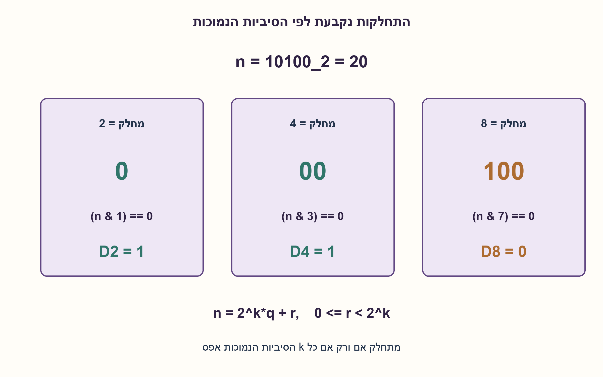
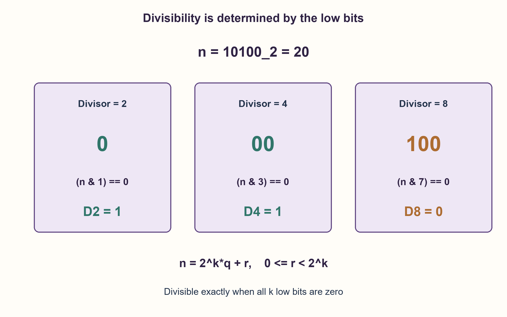

# PREP-206 — התחלקות בינארית ב־2, ב־4 וב־8

פתרון מוצע בסיוע AI; ביקורת מקצועית אנושית ממתינה. הקושי אינו מכויל.

[צילום מקור פרטי](../sources/2026-10-31-batch21-15.png)

נתון מספר בינארי. 1. איך יודעים האם הוא מתחלק ב־2? 2. איך יודעים האם הוא מתחלק ב־4? 3. איך יודעים האם הוא מתחלק ב־8?

שיוכי חברות שדווחו בצילום ולא אומתו עצמאית: NVIDIA.

## עברית

נתון מספר שלם לא שלילי בייצוג בינארי. הסבירו כיצד יודעים אם הוא מתחלק ב־2, ב־4 וב־8, באמצעות הסיביות בלבד. תנו כלל כללי להתחלקות ב־2^k והסבירו מדוע הוא נכון.

הבהרות: מדובר בייצוג בינארי רגיל של מספר שלם, לא ב־BCD או בשבר. אפסים מובילים מותרים; מספר עם פחות משלוש סיביות נחשב כמושלם באפסים משמאל. המספר 0 כלול. אין דרישה לקרוא את כל המספר מחדש אם הוא כבר נמצא במילת מכונה.

1. כתבו את המספר כסכום של כל סיבית כפול חזקה של שתיים. איזו סיבית לבדה קובעת זוגיות?
2. כל הסיביות ממיקום k ומעלה מייצגות כפולות של 2^k. מה נשאר לבדוק?
3. להתחלקות ב־2 דרוש סוף 0, ב־4 סוף 00, וב־8 סוף 000. נסחו זאת כמסכה על k הסיביות הנמוכות.

### בודקים את הסיומת הנמוכה

| מחלק | תנאי על הסיביות | בדיקת מסכה |
|---|---|---|
| 2 | הסיבית הנמוכה 0 | (n & 1)==0 |
| 4 | שתי הסיביות הנמוכות 00 | (n & 3)==0 |
| 8 | שלוש הסיביות הנמוכות 000 | (n & 7)==0 |

לדוגמה 11000 בבינארי, כלומר 24, מסתיים ב־000 ולכן מתחלק בשלושתם. 10100, כלומר 20, מסתיים ב־00 אבל לא ב־000: הוא מתחלק ב־2 וב־4, אך לא ב־8. 10, כלומר 2, משלים ל־010: הוא מתחלק ב־2 בלבד.

### ההסבר אינו טריק למספרים האלה בלבד
אפשר לפרק כל מספר שלם לא שלילי כך: `n = 2^k·q + r`, כאשר r הוא הערך של k הסיביות הנמוכות ו־0≤r<2^k. החלק הגבוה כבר מתחלק ב־2^k. לכן n מתחלק אם ורק אם r=0, כלומר כל k הסיביות הנמוכות אפס. המסכה `(1<<k)−1` מכילה בדיוק k אחדים נמוכים, ולכן `(n & ((1<<k)-1))==0` בודקת את התנאי.

אפשר לקבל גם אותות חומרה צירופיים: D2=NOT b0, D4=NOT(b1 OR b0), ו־D8=NOT(b2 OR b1 OR b0). בהוספת אפסים משמאל, הכלל נשאר נכון גם למספר קצר.

אפס מתחלק ב־2,4,8, כי 0 הוא כל אחד מן המחלקים כפול 0. אין לדרוש סיבית אחת דולקת: זהו תנאי לשאלה אחרת, האם המספר עצמו חזקה של שתיים. עבור k=0 המחלק הוא 1; המסכה ריקה והתשובה אמת לכל n בתחום.

כאשר n כבר במילת מכונה ורק שלושת המחלקים הקבועים נשאלים, נדרשות שלוש בדיקות קבועות ו־O(1) מילות עזר. אם הקלט הוא מחרוזת ויש לאמת שכל תו הוא 0 או 1, האימות דורש O(L) בזמן עבור אורך L; אין להסתיר זאת. גם יצירת מסכה ל־k לא חסום בחשבון של מספרים גדולים אינה נחשבת תמיד פעולה קבועה בביטים.

נבדקו כל 65,536 המספרים הלא מסומנים בעלי 16 סיביות מול שארית בחלוקה, ועוד גבולות של מספרים בני מאות סיביות. הכלל עצמו מוכח בפירוק למנה ושארית.

```python
"""Divisibility of a nonnegative binary integer by powers of two."""


def divisible_by_power_of_two(number: int, exponent: int) -> bool:
    if type(number) is not int or type(exponent) is not int or number < 0 or exponent < 0:
        raise ValueError("Require a nonnegative integer number and exponent")
    mask = (1 << exponent) - 1
    return (number & mask) == 0


def divisibility_2_4_8(number: int) -> tuple[bool, bool, bool]:
    if type(number) is not int or number < 0:
        raise ValueError("Require a nonnegative integer")
    return (number & 1) == 0, (number & 3) == 0, (number & 7) == 0
```




## English

Given a nonnegative integer in ordinary binary representation, explain how to tell whether it is divisible by two, four and eight using only its bits. State and justify the general rule for divisibility by 2^k.

Clarifications: this is an integer, not BCD or a binary fraction. Leading zeros are allowed; representations shorter than three bits are implicitly padded with zeros on the left. Zero is included. A number already available in a machine word need not be reparsed.

1. Expand the number as bits times powers of two. Which bit alone determines parity?
2. Every bit at position k or above contributes a multiple of 2^k. What remains to inspect?
3. Divisibility by two requires suffix 0; by four suffix 00; by eight suffix 000. Express this as a mask over the low k bits.

### Inspect the low-bit suffix

| Divisor | Required suffix | Mask test |
|---|---|---|
| 2 | Low bit 0 | (n & 1)==0 |
| 4 | Low two bits 00 | (n & 3)==0 |
| 8 | Low three bits 000 | (n & 7)==0 |

For example, binary 11000 is 24 and ends in 000, so all three divisors divide it. Binary 10100 is 20 and ends in 00 but not 000, so it is divisible by two and four but not eight. Binary 10 is two; padding it to 010 confirms that only two divides it.

### Why the suffix rule works
Write a nonnegative integer as `n = 2^k·q + r`, where r is the value of the low k bits and 0≤r<2^k. The high part is already a multiple of 2^k. Divisibility is therefore equivalent to r=0: all k low bits must be zero. The mask `(1<<k)−1` has exactly k low ones, so `(n & ((1<<k)-1))==0` tests precisely this condition.

Equivalent combinational hardware outputs are D2=NOT b0, D4=NOT(b1 OR b0), and D8=NOT(b2 OR b1 OR b0). Left-zero-padding makes the rule apply to short binary representations too.

Zero is divisible by two, four and eight because it equals each divisor times zero. Requiring exactly one set bit solves a different question: whether the number itself is a power of two. At k=0 the divisor is one, the mask is empty and every permitted n passes.

For a value already in a machine word and the three fixed divisors, only a constant number of bit operations and O(1) auxiliary words are needed. If input is a string whose characters must all be validated, validation takes O(L) time for length L. Creating a mask for unbounded k in big-integer arithmetic is also not automatically constant bit cost.

All 65,536 unsigned 16-bit values were compared with an independent remainder oracle, together with large-integer boundary examples. The quotient/remainder argument establishes the general rule independently of finite testing.

```python
"""Divisibility of a nonnegative binary integer by powers of two."""


def divisible_by_power_of_two(number: int, exponent: int) -> bool:
    if type(number) is not int or type(exponent) is not int or number < 0 or exponent < 0:
        raise ValueError("Require a nonnegative integer number and exponent")
    mask = (1 << exponent) - 1
    return (number & mask) == 0


def divisibility_2_4_8(number: int) -> tuple[bool, bool, bool]:
    if type(number) is not int or number < 0:
        raise ValueError("Require a nonnegative integer")
    return (number & 1) == 0, (number & 3) == 0, (number & 7) == 0
```




## חומר משלים / Supporting material

```json
{
  "assumptions": {
    "he": [
      "מספר שלם לא שלילי בייצוג בינארי רגיל; אפס ואפסים מובילים מותרים.",
      "לניתוח זמן קבוע מניחים ערך זמין במילת מכונה ומחלקים קבועים 2,4,8."
    ],
    "en": [
      "Nonnegative ordinary binary integer; zero and leading zeros allowed.",
      "Constant-time analysis assumes a value already in a machine word and the fixed divisors two, four and eight."
    ]
  },
  "optimality": {
    "he": "התחלקות ב־2^k שקולה לאפס ב־k הסיביות הנמוכות. שלוש הבדיקות הקבועות דורשות O(1) פעולות מילים; קלט טקסטואלי דורש O(L) לאימותו. אין טענת קבוע בביטים למספרים ול־k בלתי חסומים.",
    "en": "Divisibility by 2^k is equivalent to zero in the low k bits. The three fixed tests take O(1) word operations; validating text takes O(L). No constant-bit-cost claim for unbounded numbers and k."
  },
  "verification": {
    "he": "65,536 קלטי 16 סיביות נבדקו בכל שלוש הבדיקות. בנוסף בוצעו 589,852 השוואות כלליות של חזקה ומסכה מול שארית, כולל ערכים סביב 2^200.",
    "en": "All 65,536 16-bit inputs were checked for the three divisors. General exponent tests made 589,852 mask-versus-remainder comparisons, including values around 2^200."
  },
  "edge_cases": {
    "he": [
      "0 מתחלק בכל מחלק חיובי מבין אלה.",
      "1 אינו מתחלק ב־2,4,8; 2 מתחלק רק ב־2; 4 ב־2 וב־4.",
      "מספר קצר מושלם באפסים משמאל; אפסים מובילים אינם משנים ערך.",
      "k=0 משמעו חלוקה ב־1."
    ],
    "en": [
      "Zero is divisible by each specified positive divisor.",
      "One passes none; two passes only divisor two; four passes two and four.",
      "Short representations are left-zero-padded; leading zeros preserve value.",
      "k=0 means divisor one."
    ]
  },
  "common_mistakes": {
    "he": [
      "לבדוק סיבית במיקום 2 או 3 בלבד במקום את כל הסיומת הנמוכה.",
      "להשתמש במסכה 4 לבדיקת התחלקות ב־4 במקום במסכה 3.",
      "לבלבל התחלקות בחזקה של שתיים עם היות המספר חזקה של שתיים.",
      "לטעון לזמן קבוע גם כאשר חייבים לסרוק ולאמת מחרוזת ארוכה."
    ],
    "en": [
      "Inspecting bit two or three alone instead of the entire low suffix.",
      "Using mask four for divisibility by four instead of mask three.",
      "Confusing divisible by a power of two with being a power of two.",
      "Claiming constant time while parsing and validating a long text input."
    ]
  },
  "interview_answer": {
    "he": "הסיבית הנמוכה קובעת התחלקות ב־2; שתי הנמוכות חייבות להיות 00 ל־4, ושלוש הנמוכות 000 ל־8. כל שאר הסיביות כבר תורמות כפולות של המחלק, ולכן בדיקת הסיומת מספיקה. אפס עובר את כולן.",
    "en": "The low bit must be zero for two, the low pair 00 for four, and the low triple 000 for eight. Higher bits already contribute multiples of the divisor, so the suffix is sufficient. Zero passes all three."
  },
  "source_ambiguities": {
    "he": [
      "המקור אינו מגדיר סימן, רוחב או שבר. העריכה בוחרת מספר שלם לא שלילי ומפרידה קריאת טקסט מפעולת הסיביות."
    ],
    "en": [
      "The source omits signedness, width and fractional semantics. The edited contract selects nonnegative integers and separates parsing from bit tests."
    ]
  },
  "solution_extensions": {
    "he": [
      {
        "question": "מהו המחלק הגדול ביותר שהוא חזקה של שתיים עבור מספר חיובי?",
        "answer_direction": "ספרו את מספר האפסים הרצופים מה־LSB. אם יש k כאלה, 2^k מחלק את המספר אך 2^(k+1) אינו מחלק. אפס דורש טיפול נפרד כי אין לו חזקה מרבית כזו.",
        "principle": "הופכים בדיקת סיומת לניתוח של מספר האפסים הסופיים."
      }
    ],
    "en": [
      {
        "question": "What is the largest power-of-two divisor of a positive number?",
        "answer_direction": "Count trailing zero bits. With k trailing zeros, 2^k divides the number but 2^(k+1) does not. Zero needs separate treatment because no greatest such divisor exists.",
        "principle": "Extend a suffix test to trailing-zero analysis."
      }
    ]
  }
}
```
