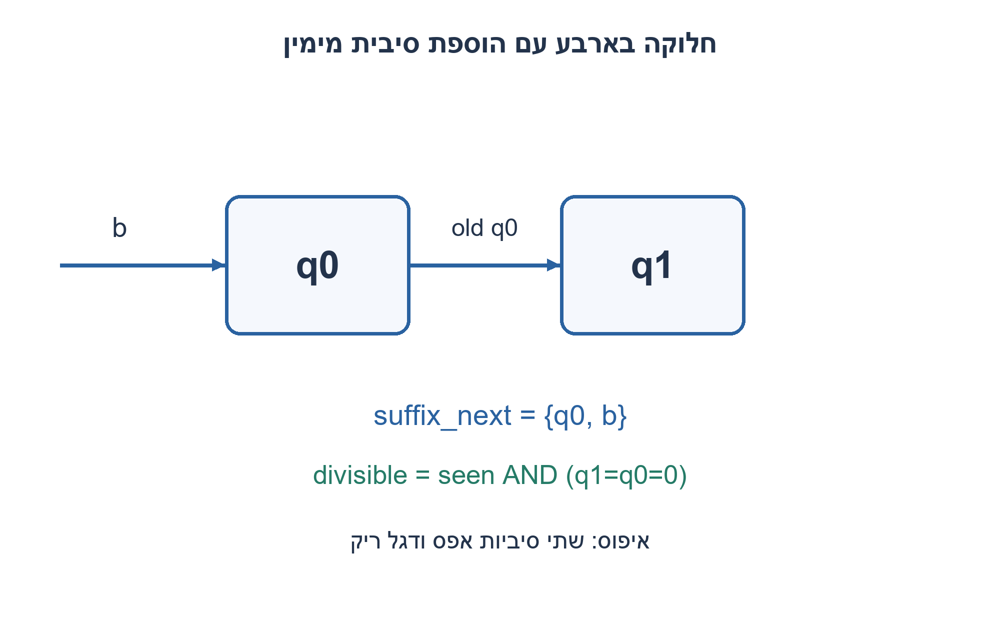
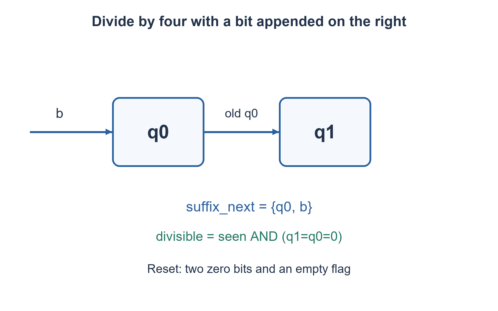

# PREP-206 — התחלקות בינארית ב־2, ב־4 וב־8

פתרון מוצע בסיוע AI; ביקורת מקצועית אנושית ממתינה. הקושי אינו מכויל.

[צילום מקור פרטי](../sources/2026-11-07-batch10-02.png)

נתון ביט-סטרים / מספר בינארי אינסופי שבכל רגע מתווספות אליו עוד ספרות. ידוע שכאשר שתי הספרות הימניות הן 0 אז המספר מתחלק ב-4. איך ניתן לבדוק בכל רגע נתון שהמספר מתחלק ב-4?

חברות לפי הדיווח בצילום בלבד: NVIDIA.

## עברית

### וריאציה נוספת: חלוקה בארבע בזרם סיביות
בכל מחזור תקף מתווספת סיבית מימין למספר בינארי שאורכו אינו חסום. תכננו רכיב שמוציא 1 בדיוק כאשר המספר שהתקבל עד כה מתחלק ב־4. אין לשמור את המספר כולו.

השלמת חוזה: הכנסה ל־LSB פירושה הוספה מימין, כלומר הביטים מגיעים מן ה־MSB אל ה־LSB של המספר הנבנה. איפוס סינכרוני פותח מילה חדשה; bit_valid=0 משהה אותה. לפני הביט הראשון היציאה 0; אפס שאינו ריק מתחלק בארבע. וריאציה זו נפרדת מתרגיל החלוקה בשבע שלעיל.

1. איזה חלק של מספר קובע את השארית בחלוקה בארבע?
2. איך משתנות שתי הסיביות הימניות כשמצרפים סיבית חדשה?
3. שמרו שתי סיביות אחרונות ודגל seen. היציאה 1 כאשר seen=1 ושתי הסיביות אפס.

### שתי הסיביות הן השארית
כל מספר הוא `N=4q+r`, כאשר r נמצא ב־0..3 והוא מיוצג בשתי הסיביות הימניות. בהוספת b מימין מתקבל `Nnext=2N+b`, ולכן `rnext=(2r+b)%4`. בחוטים זו רק הזזה: `suffix_next={suffix[0],b}`. שומרים שני FF ודגל seen; אין צורך במחלק או במספר בעל רוחב הולך וגדל.

המצב מאופס ל־00, אך seen=0 מבדיל מילה ריקה מאפס חוקי. אחרי ביט תקף seen=1 והיציאה היא `seen && suffix==0`. מילה קצרה משתי סיביות מרופדת באפסים משמאל: ״0״ מתחלקת בארבע, ״1״ לא. bit_valid=0 משאיר גם את הסיומת וגם את הדגל; איפוס גובר.

נכונות באינדוקציה: בתחילה הסיומת 0; בכל צעד היא שתי הסיביות האחרונות של הקידומת החדשה, ולכן היא N modulo4. דגל seen מוסיף רק את דרישת אי־הריקות. שלושה ביטי מצב ועדכון O(1) לכל ביט, בלי תלות באורך הזרם.

אם הכוונה הייתה לסדר הגעה LSB-first אמיתי, שתי הסיביות הראשונות קובעות את החלוקה וכל הבאות אינן משנות אותה. זה חוזה אחר. כאן הקלט מוסיף סיבית מימין; אין לערבב בין השניים.

### קוד SystemVerilog; תוצאות סימולציה בדוח נפרד

```systemverilog
`timescale 1ns/1ps
module prep206_serial_four_batch1107b10(
 input logic clk,rst,bit_valid,bit_in, output logic divisible);
 logic [1:0] suffix;
 logic seen;
 always @(posedge clk) begin
   if(rst) begin suffix<=0; seen<=0; end
   else if(bit_valid) begin suffix<={suffix[0],bit_in}; seen<=1; end
 end
 assign divisible=seen && (suffix==2'b00);
endmodule
```




### assumptions

הוספה מימין, מילה חדשה באיפוס, bit_valid משהה; מילה ריקה אינה תקפה.

### optimality

שני ביטי סיומת ודגל seen; אין תלות באורך המספר.

### verification

אימות RTL אמיתי: Icarus Verilog 12 קימפל את חמש הווריאציות והרתמה עברה 138,967 בדיקות בסביבה מבודדת ללא רשת: 2,046 מילים טוריות, 5,000 מחזורי FIFO, 1,300 מחזורי חלון וכל 16 זוגות המקסימום. בדיקת Python עצמאית מרחיבה את הכיסוי ל־4,094 מילים ו־10,000 מחזורי FIFO. ראיות: checks/batch1107b10-native-verification.json ו־checks/batch1107b10-hardware-model-verification.json. זו סימולציה דיגיטלית מוגבלת; לא בוצעו סינתזה או ניתוח תזמון.

### edge_cases

```json
[
  "0,00,1,100,101; הובלת אפסים.",
  "השהיות ואיפוס באמצע מילה."
]
```

### common_mistakes

שמירת המספר ללא חסם; בדיקת רק הסיבית האחרונה; ערבוב הוספה ל־LSB עם הגעת LSB ראשון.

### interview_answer

בחלק בארבע מעניינות רק שתי הסיביות האחרונות; אזיז אותן בכל ביט ואבדוק 00 עם דגל מילה לא ריקה.

### source_ambiguities

הצילום הנוכחי מציין ארבע. הגדרות האיפוס, התקפות והריקות הן השלמות מפורשות; תרגיל השבע הקודם נשמר בנפרד.

### solution_extensions

```json
{
  "question": "מה צריך עבור חלוקה בשמונה?",
  "direction": "שלוש סיביות סיומת ודגל seen.",
  "tests": [
    "000",
    "1000",
    "1001"
  ]
}
```

## English

### Additional variant: divisibility by four in a bit stream
Each accepted cycle appends a bit on the right of an unbounded binary number. Output 1 exactly when the number received so far is divisible by four, without retaining the whole number.

Completed contract: inserting at the LSB means appending on the right, so the growing word arrives MSB first. Synchronous reset starts a new word; bit_valid=0 pauses it. Before any bit the output is zero; a nonempty zero is divisible by four. This is separate from the preceding divide-by-seven exercise.

1. Which part of a binary number determines its remainder modulo four?
2. How do the two rightmost bits change after an append?
3. Store two suffix bits and seen. Output one when seen is set and both suffix bits are zero.

### The suffix is the remainder
Every integer is `N=4q+r`, with r in0..3 represented by its two rightmost bits. Appending b gives `Nnext=2N+b`, hence `rnext=(2r+b)%4`. In wires this is simply `suffix_next={suffix[0],b}`. Two flip-flops and a seen flag suffice; neither a divider nor an expanding integer is needed.

Reset sets suffix00 but seen0 distinguishes an empty word from a legal zero. After an accepted bit, seen becomes one and output is `seen && suffix==0`. Short words are zero-padded on the left: "0" is divisible by four; "1" is not. An idle bit_valid leaves both registers unchanged; reset wins.

Induction: initially suffix is zero, and each shift leaves exactly the last two bits of the new prefix, equal to N modulo4. Seen adds only the nonempty requirement. State uses three bits; each update is O(1), independent of stream length.

With genuine LSB-first arrival, the first two bits determine divisibility and later bits cannot change it. That is a different contract. This variant appends on the right; do not conflate the orders.

### SystemVerilog; simulation results are in a separate report

```systemverilog
`timescale 1ns/1ps
module prep206_serial_four_batch1107b10(
 input logic clk,rst,bit_valid,bit_in, output logic divisible);
 logic [1:0] suffix;
 logic seen;
 always @(posedge clk) begin
   if(rst) begin suffix<=0; seen<=0; end
   else if(bit_valid) begin suffix<={suffix[0],bit_in}; seen<=1; end
 end
 assign divisible=seen && (suffix==2'b00);
endmodule
```




### assumptions

Right append; reset separates words; bit_valid pauses; the empty word is invalid.

### optimality

Two suffix bits and seen; no dependence on number length.

### verification

Executed RTL verification: Icarus Verilog 12 compiled the five variants and the harness passed 138,967 checks in an isolated network-denied environment: 2,046 serial words, 5,000 FIFO cycles, 1,300 window cycles and all 16 maximum-input pairs. Independent Python checks extend coverage to 4,094 words and 10,000 FIFO cycles. Evidence: checks/batch1107b10-native-verification.json and checks/batch1107b10-hardware-model-verification.json. This is bounded digital simulation, not synthesis or timing analysis.

### edge_cases

```json
[
  "0,00,1,100,101; leading zeros.",
  "Idle cycles and reset within a word."
]
```

### common_mistakes

Storing an unbounded integer; checking only the last bit; confusing insertion at LSB with LSB-first arrival.

### interview_answer

Only the last two bits matter modulo four; shift them on each bit and test00 with a nonempty flag.

### source_ambiguities

This screenshot specifies four. Reset, validity and empty-word conventions are explicit additions; the prior seven exercise remains separate.

### solution_extensions

```json
{
  "question": "What changes modulo eight?",
  "direction": "Three suffix bits and seen.",
  "tests": [
    "000",
    "1000",
    "1001"
  ]
}
```
