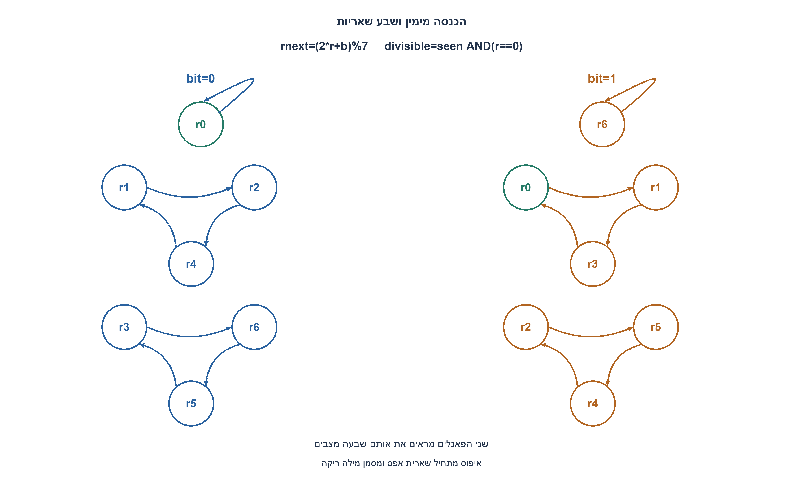
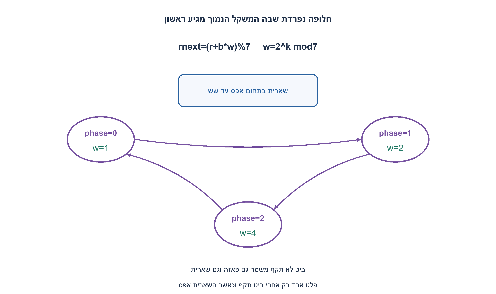
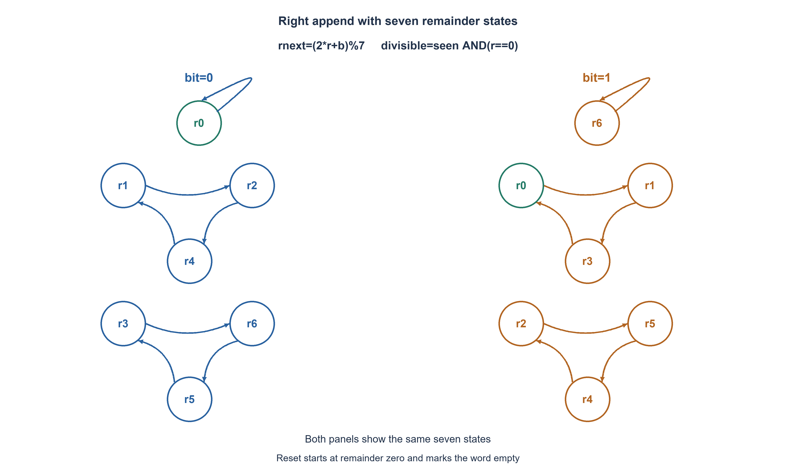
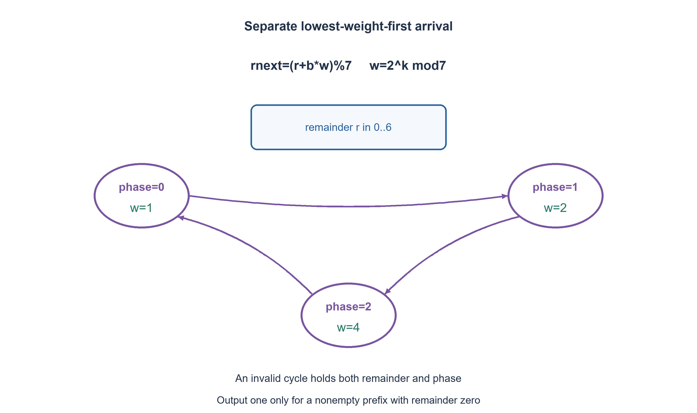

# PREP-206 — התחלקות בינארית ב־2, ב־4 וב־8

פתרון מוצע בסיוע AI; ביקורת מקצועית אנושית ממתינה. הקושי אינו מכויל.

[צילום מקור פרטי](../sources/2026-11-07-batch30-13.png)

ממש מכונת מצבים המקבלת בכל מחזור שעון ביט סדרתי ל-LSB ומחזירה אם המספר הנוכחי מתחלק ב-7. היה גם פולואפ שאינו זכור במקור.

חברות לפי הדיווח בצילום בלבד: Amazon.

## עברית

### וריאציה מקושרת: מכונה טורית להתחלקות בשבע
בנו מכונת מצבים המקבלת ביט בכל מחזור ומחזירה האם המספר הנוכחי מתחלק בשבע. המקור אומר ״ל־LSB״: בקריאה העיקרית ביט חדש מוכנס מימין, ולכן Nnext=2N+b. הציגו מצבים, טבלת מעברים, פלט ומימוש.

בנפרד נתחו חלופת LSB-first אמיתית: סיבית המשקל1 מגיעה ראשונה ואחריה משקלים2,4,8,..., ולכן Nnext=N+b·2^k. זהו סדר קלט שונה, שיש לו משוואת מצב אחרת.

הבהרות לשתי החלופות: כל חזית עולה עם bit_valid=1 מקבלת ביט;0 משמר מצב. rst סינכרוני פעיל בגבוה גובר ומתחיל מילה חדשה. הפלט מתאר את הקידומת הלא־ריקה אחרי החזית; במילה ריקה הפלט0. אפסים מותרים והמספר0 מתחלק בשבע. אין לאחסן את המספר השלם, ואין מגבלת אורך מילה. השאלה המקורית על התחלקות ב־2,4,8 נשמרת בחלקה הקודם; זהו תרגיל טורי נפרד על7. במקור מוזכר סעיף המשך שנשכח: הוא נשאר לא ידוע; ההמשך המוצע שלנו הוא חומר ערוך.

1. בררו כיצד ביט חדש משנה את המספר: כניסה מימין או הגעת המשקל הנמוך תחילה. איזה מידע על המספר דרוש להכרעת התחלקות בשבע?
2. בהכנסה מימין, אם המספר הוא7q+r, אחרי הביט b הוא14q+2r+b. לכן רק השארית r נחוצה.
3. השתמשו בשבע שאריות0..6 ובעדכון (2r+b) mod7. בחלופת LSB-first עקבו גם אחר משקל הביט modulo7: המחזור הוא1,2,4.

### הפירוש העיקרי: ביט חדש נכנס מימין
נכתוב N=7q+r, כאשר0≤r≤6. אחרי קבלת b, מתקיים `2N+b=14q+2r+b`, ולכן `rnext=(2r+b)%7`. מספיק לשמור שלוש סיביות שארית; מוסיפים seen לציון קידומת לא־ריקה. הפלט הוא `seen AND(r==0)`. seen מונע התראה לפני קבלת הביט הראשון, אך קבלת0 היא מספר חוקי ומפיקה1.

|r לפני|rnext כאשר b=0|rnext כאשר b=1|
|---|---|---|
|0|0|1|
|1|2|3|
|2|4|5|
|3|6|0|
|4|1|2|
|5|3|4|
|6|5|6|

הוכחת האינווריאנט: באיפוס r=0; בכל חזית קבלה משוואת השארית משמרת r=N mod7. אם אין קבלה, המספר והמצב נשארים. לכן אפס שארית אחרי קידומת לא־ריקה שקול בדיוק להתחלקות בשבע. לדוגמה111 מייצג7, עם שאריות1,3,0 ופלטים0,0,1. הרצף100 מייצג4 ואינו מתחלק; בדיקת שתי סיביות אחרונות00, המתאימה לארבע, אינה פותרת שבע.

מבחינת חומרה, `2r+b` נמצא0..13. יוצרים מועמד בן ארבע סיביות ומחסרים7 פעם אחת אם הוא לפחות7. אין צורך במחלק כללי. המימוש המצורף משתמש בשלושה ביטי שארית וב־seen, ואינו טוען למינימום קידוד מצבים.

### חלופת LSB-first אמיתית
כאשר הביט הבא שוקל2^k, שומרים בנוסף את הפאזה k mod3. מאחר ש־2^3=8≡1(mod7), המשקלים חוזרים1,2,4. העדכון הוא `rnext=(r+b*w)%7`, ולא `2r+b`; אחרי קבלת ביט מקדמים את הפאזה0→1→2→0. עבור bit_valid=0 גם הפאזה וגם השארית נשמרות.

כאן r+bw לכל היותר10, ולכן גם כאן מספיקה הפחתת7 יחידה. ניתן לייצג את21 הצירופים של שארית ופאזה באמצעות שלושה ועוד שני ביטי מצב, בתוספת seen בחוזה הבהיר הזה. זהו מימוש תקף ולא הוכחת מינימום: קיימים קידודים אלטרנטיביים, ואין לערבב את משמעות מצביהם עם שארית ישירה.

דוגמת הפרדה שנבדקה: רצף הביטים1,0,0,1,0,1,1 הוא75 בהכנסה מימין, ולכן אינו מתחלק בשבע; כאשר אותם ביטים מגיעים ממשקל נמוך תחילה הם מייצגים105, שכן מתחלק בשבע. לכן אין להחליף את משוואות שני החוזים. בשני המקרים האורקל משחזר בנפרד את המספר המתאים, ובודק גם שארית מדויקת וגם פלט.

בשני המימושים העבודה לכל ביט וזיכרון המצב קבועים. יש לאתחל לפני מילה, להגדיר חזית קבלה ולקרוא את הפלט לאחר עדכון הדלגלגים. אין הבטחת תזמון פיזי מסימולציה אידאלית.

### קוד SystemVerilog; תוצאות סימולציה בדוח נפרד

```systemverilog
`timescale 1ns/1ps
// Primary source reading: a new bit is inserted at the right/LSB, N'=2*N+b.
// The remainder is sufficient for unbounded word lengths; seen qualifies empty.
module prep206_append_lsb_seven(input wire clk, rst, bit_valid, bit_in,
                               output wire divisible);
  reg [2:0] remainder;
  reg seen;
  wire [3:0] candidate={remainder,bit_in};
  always @(posedge clk) begin
    if (rst) begin remainder<=0; seen<=0; end
    else if (bit_valid) begin
      remainder <= candidate >= 4'd7 ? candidate-4'd7 : candidate;
      seen <= 1;
    end
  end
  assign divisible=seen && (remainder==0);
endmodule

// Separate alternative: the lowest-weight bit arrives first, N'=N+b*2^k.
// phase tracks k modulo3 because powers of two modulo7 repeat 1,2,4.
module prep206_lsb_first_seven(input wire clk, rst, bit_valid, bit_in,
                              output wire divisible);
  reg [2:0] remainder;
  reg [1:0] phase;
  reg seen;
  wire [2:0] weight = phase==0 ? 3'd1 : (phase==1 ? 3'd2 : 3'd4);
  wire [3:0] candidate = {1'b0,remainder} + (bit_in ? {1'b0,weight} : 4'd0);
  always @(posedge clk) begin
    if (rst) begin remainder<=0; phase<=0; seen<=0; end
    else if (bit_valid) begin
      remainder <= candidate >= 4'd7 ? candidate-4'd7 : candidate;
      phase <= phase==2 ? 2'd0 : phase+2'd1;
      seen <= 1;
    end
  end
  assign divisible=seen && (remainder==0);
endmodule
```






### assumptions

```json
[
  "שתי חלופות נפרדות על מודולו7: הכנסה מימין או משקל נמוך תחילה.",
  "rst גובר, bit_valid=0 משמר את כל המצב, פלט ריק0; אפס לא־ריק מתחלק."
]
```

### optimality

מימוש ראשי:3 ביטי שארית ו־seen; חלופה ישירה:3 ביטי שארית,2 ביטי פאזה ו־seen. עדכון בעל רוחב קבוע, ללא אחסון המספר כולו או טענת מינימום.

### verification

360,456 בדיקות Python לכל הקידומות של כל המילים באורכים1..12 השוו שאריות ופלטים לשחזור מספר שלם עצמאי בשני סדרי הקלט. הרתמה המתוקנת קומפלה והורצה בפועל ב־Icarus12:172,128 בדיקות עברו, כולל שתי חלופות מודולו7, איפוס ו־valid. ראיה: checks/batch1107-native206-correction-verification.json. אין סינתזה או אישור תזמון/CDC פיזי.

### edge_cases

```json
[
  "מילה ריקה,0 ו־1 בודדים,111=7,100=4, גלישות שארית.",
  "איפוס באמצע מילה, valid=0 ופאזה שאינה מתקדמת במחזור לא תקף."
]
```

### common_mistakes

בדיקת שתי סיביות אחרונות במקום שארית7; החלפת סדרי קלט; שכחת פאזה ב־LSB-first; גלישה לפני חיסור; פלט1 למילה ריקה.

### interview_answer

אשמור את השארית בשבע. בהכנסה מימין rnext=(2r+b) mod7; אם המשקל הנמוך מגיע ראשון, אוסיף b כפול משקל מחזורי1,2,4 ואקדם פאזה.

### source_ambiguities

המקור אומר התחלקות בשבע וכניסה ״ל־LSB״. שתי משמעויות סדר הקלט מוצגות בנפרד; סעיף ההמשך שנשכח אינו משוחזר.

### solution_extensions

```json
{
  "question": "שאלת המשך שלנו: איך משתנה המימוש למודולוס חיובי אחר?",
  "direction": "בהכנסה מימין משתמשים ב־(2r+b) modm. ב־LSB-first צריך לעקוב אחר2^k modm או לבחור קידוד אחר ולהוכיחו; מחזור המשקלים תלוי ב־m.",
  "tests": "הכללת אינווריאנט השארית והבחנה בין סדרי קלט."
}
```

## English

### Linked variant: serial divisibility by seven
Build a machine accepting one bit per cycle and indicating whether the current number is divisible by seven. The source says into the LSB: the primary reading appends at the right, Nnext=2N+b. Give states, a transition table, output and implementation.

Separately analyze true LSB-first arrival: weight1 arrives first, then2,4,8,..., so Nnext=N+b·2^k. That is a different input order and requires a different state update.

For both alternatives, a rising edge with bit_valid1 accepts a bit; zero holds. Synchronous active-high rst overrides and begins a word. Output describes the nonempty prefix after capture, with output0 for the empty word. Zeros are legal and zero is divisible by seven. Do not store the whole integer; word length is unbounded. The preceding original2/4/8 exercise remains unchanged; this is a separate serial7 exercise. The forgotten source follow-up remains unknown; our proposed follow-up is explicitly authored material.

1. First define how a new bit changes the number: right append or lowest-weight-first arrival. What information suffices for divisibility by seven?
2. For right append, write N=7q+r: the next value is14q+2r+b, so only r matters.
3. Use seven remainders0..6 with update (2r+b) mod7. For true LSB-first also track the bit weight modulo7, repeating1,2,4.

### Primary reading: append at the right
Write N=7q+r with0<=r<=6. Accepting b gives `2N+b=14q+2r+b`, hence `rnext=(2r+b)%7`. Three remainder bits suffice; seen separately qualifies a nonempty prefix. Output `seen AND(r==0)` suppresses the empty-word indication while accepting0 still represents divisible zero.

|Old r|Next r for b0|Next r for b1|
|---|---|---|
|0|0|1|
|1|2|3|
|2|4|5|
|3|6|0|
|4|1|2|
|5|3|4|
|6|5|6|

Invariant proof: reset begins at r0; each accepted-bit recurrence preserves r=N mod7, and invalid cycles hold both logical input and state. Thus zero remainder after a nonempty prefix is precisely divisibility by seven. For111=7 the remainders are1,3,0 and outputs0,0,1. Sequence100 represents4 and is not divisible; checking only its final00 bits would incorrectly apply the divisibility-by-four rule.

The candidate2r+b lies0..13. Form it at width four and subtract7 once if at least7. A general divider is unnecessary. The supplied clear implementation stores three remainder bits and seen, without a minimum-state-encoding claim.

### Separate true LSB-first arrival
When the next bit has weight2^k, also track phase k modulo3. Because2^3=8≡1(mod7), weights repeat1,2,4. Update `rnext=(r+b*w)%7`, then cycle phase0→1→2→0. Invalid cycles hold both phase and remainder. The candidate is at most10, so one conditional subtraction still suffices.

This direct construction represents21 remainder/phase combinations using three plus two bits, with seen added for the declared empty-word policy. It is valid rather than a minimum-state proof; alternative encodings may compress this information but have different state meanings.

A checked separating example is the bit sequence1,0,0,1,0,1,1: right append represents75, not divisible by seven; the same arrivals interpreted from lowest weight first represent105, divisible by seven. The two state equations are therefore not interchangeable. Independent integer reconstruction checks both exact remainders and outputs for each input order.

Both constructions use constant state and constant work per accepted bit. Initialize before a word, define acceptance at a clock edge and observe the updated output afterward. Ideal simulation does not establish physical timing closure.

### SystemVerilog; simulation results are in a separate report

```systemverilog
`timescale 1ns/1ps
// Primary source reading: a new bit is inserted at the right/LSB, N'=2*N+b.
// The remainder is sufficient for unbounded word lengths; seen qualifies empty.
module prep206_append_lsb_seven(input wire clk, rst, bit_valid, bit_in,
                               output wire divisible);
  reg [2:0] remainder;
  reg seen;
  wire [3:0] candidate={remainder,bit_in};
  always @(posedge clk) begin
    if (rst) begin remainder<=0; seen<=0; end
    else if (bit_valid) begin
      remainder <= candidate >= 4'd7 ? candidate-4'd7 : candidate;
      seen <= 1;
    end
  end
  assign divisible=seen && (remainder==0);
endmodule

// Separate alternative: the lowest-weight bit arrives first, N'=N+b*2^k.
// phase tracks k modulo3 because powers of two modulo7 repeat 1,2,4.
module prep206_lsb_first_seven(input wire clk, rst, bit_valid, bit_in,
                              output wire divisible);
  reg [2:0] remainder;
  reg [1:0] phase;
  reg seen;
  wire [2:0] weight = phase==0 ? 3'd1 : (phase==1 ? 3'd2 : 3'd4);
  wire [3:0] candidate = {1'b0,remainder} + (bit_in ? {1'b0,weight} : 4'd0);
  always @(posedge clk) begin
    if (rst) begin remainder<=0; phase<=0; seen<=0; end
    else if (bit_valid) begin
      remainder <= candidate >= 4'd7 ? candidate-4'd7 : candidate;
      phase <= phase==2 ? 2'd0 : phase+2'd1;
      seen <= 1;
    end
  end
  assign divisible=seen && (remainder==0);
endmodule
```






### assumptions

```json
[
  "Separate modulo7 right-append and lowest-weight-first contracts.",
  "Reset overrides, invalid cycles hold all state, empty output0; nonempty zero is divisible."
]
```

### optimality

Primary: three remainder bits plus seen; direct alternative: three remainder bits, two phase bits and seen. Constant-width update without storing the complete integer or claiming a minimum.

### verification

360,456 Python checks over all prefixes of all words length1..12 compare exact remainders and outputs with independent integer reconstruction in both input orders. The corrected combined harness was compiled/run with Icarus12:172,128 checks passed, including both modulo7 variants, reset and valid. Evidence: checks/batch1107-native206-correction-verification.json. No synthesis or physical timing/CDC closure is claimed.

### edge_cases

```json
[
  "Empty word, single0/1,111=7,100=4 and remainder wrap.",
  "Midword reset, invalid cycles and phase holding when no bit is accepted."
]
```

### common_mistakes

Checking final two bits instead of modulo7; interchanging input orders; losing LSB-first phase; truncating before subtraction; reporting an empty word as valid.

### interview_answer

Store a remainder modulo7. For right append rnext=(2r+b) mod7; for lowest-weight-first add b times cyclic weight1,2,4 and advance the phase.

### source_ambiguities

The source says divisibility by seven and insertion into the LSB. The two arrival-order interpretations are separate; the forgotten follow-up is not reconstructed.

### solution_extensions

```json
{
  "question": "Our authored follow-up: how does another positive modulus change the machine?",
  "direction": "Right append uses (2r+b) modm. Lowest-weight-first tracks2^k modm or uses another proved encoding; the weight cycle depends on m.",
  "tests": "Generalizing remainder invariants while preserving input order."
}
```
