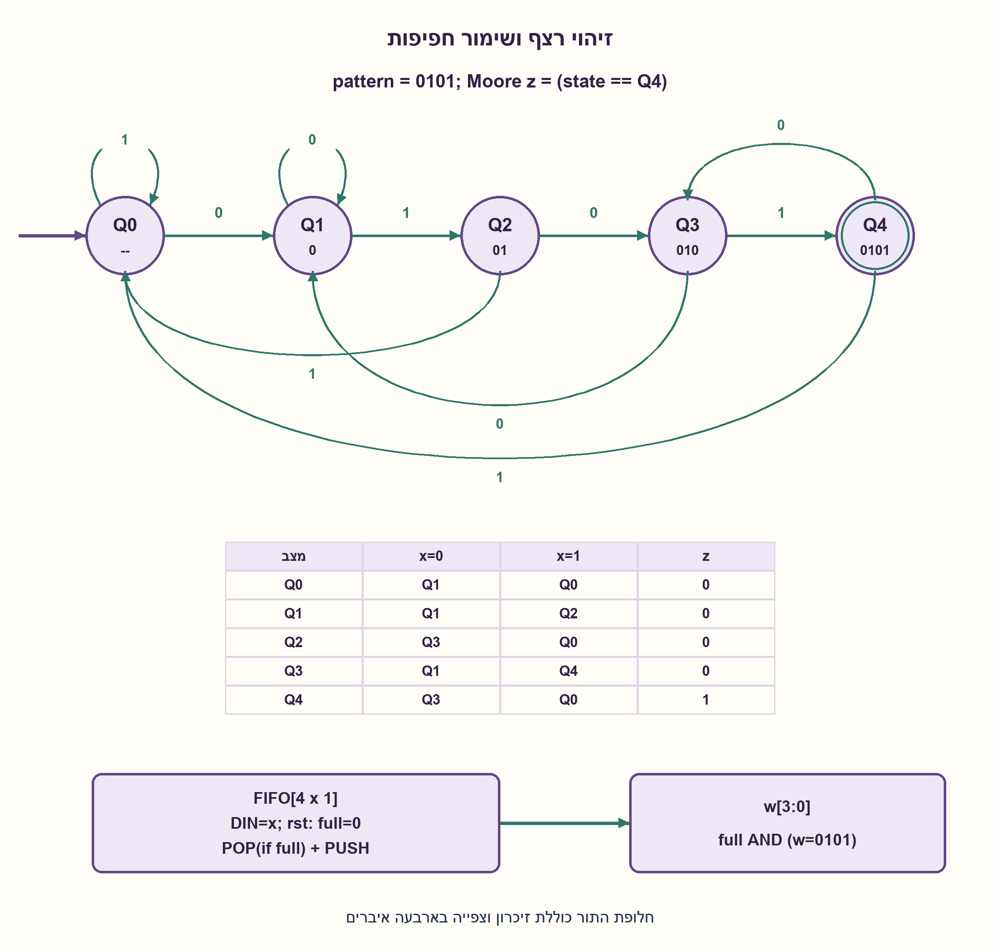
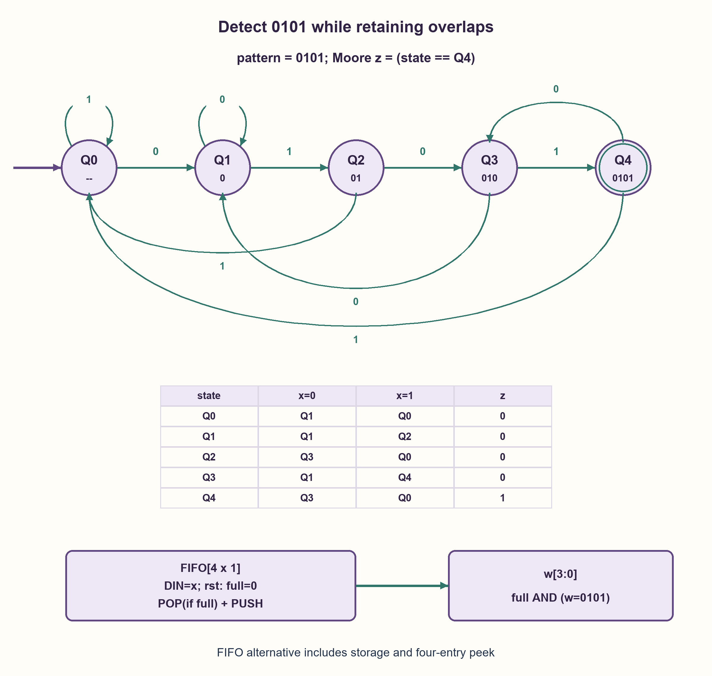

# PREP-207 — זיהוי 0101 בחפיפה ומה פירוש „ללא FF”

פתרון מוצע בסיוע AI; ביקורת מקצועית אנושית ממתינה. הקושי אינו מכויל.

[צילום מקור פרטי](../sources/2026-10-31-batch21-16.png)

1. לממש מכונת מצבים שמקבלת את הרצף 0101. מה קורה אם נקבל 010101? 2. כעת לממש עם רכיבים לוגיים ללא FF! אם משתמשים לדוגמה ב־FIFO אז לפרט מה הערך של הכניסה יהיה.

חברות לפי הדיווח בצילום בלבד: NVIDIA.

## עברית

א. ממשו מכונת מצבים לזיהוי 0101 בזרם ביטים. מה יקרה עבור 010101? ב. דונו במימוש בעזרת רכיבים לוגיים ללא FF. אם אתם מציעים FIFO, הגדירו במפורש את הנתון הנכתב, סדר הפעולות וממשק הקריאה.

הבהרות: ביט אחד מתקבל בכל חזית שעון; reset סינכרוני קודם לקליטה; המוצא נבדק לאחר החזית. בוחרים חפיפה, ולכן נדרשים שני זיהויים עבור 010101. חלק ב נבחן בשלושה חוזים נפרדים: קלט טורי עם שערים צירופיים חסרי זיכרון, חלון של ארבעה ביטים המוגש במקביל מבחוץ, או שימוש מפורש ברכיב זיכרון כדוגמת FIFO. איסור על רכיב FF אינו בהכרח איסור על כל זיכרון, אך אסור להסתיר זיכרון בתוך השם של רכיב אחר.

1. אחרי 0101 נשארת סיומת 01 שיכולה להתחיל עוד התאמה.
2. רשמו מצבים לפי הסיומת 0,01,010 וזיהוי מלא. השוו שני סיפורים שונים שמסתיימים באותו ביט קלט נוכחי.
3. לשער צירופי עם ביט נוכחי בלבד אין דרך להבדיל בין 0101 ל־0001. חלון מקביל מאפשר השוואה; FIFO שמחזיק חלון הוא בעצמו זיכרון והקלט אליו צריך להיות הביט החדש.

### לא מאבדים את הסיומת אחרי זיהוי
נבחר Moore עם Q0=ללא התאמה, Q1=0, Q2=01, Q3=010, Q4=0101. z=1 ב־Q4 בלבד. המעברים הם:

| מצב | קלט 0 | קלט 1 |
|---|---|---|
| Q0 | Q1 | Q0 |
| Q1 | Q1 | Q2 |
| Q2 | Q3 | Q0 |
| Q3 | Q1 | Q4 |
| Q4 | Q3 | Q0 |

המצב זוכר באינדוקציה את הסיומת הארוכה ביותר שהיא קידומת המטרה. בפרט, אחרי זיהוי וקלט אפס, הסיומת היא 010 ולכן עוברים ל־Q3. עבור 010101 מתקבל מוצא 000101: זיהוי בחזית הרביעית והשישית. החזרה ל־Q0 אחרי זיהוי הייתה מתעלמת מהחפיפה. במימוש Moore הזה חמישה מצבים ושלושה FF בינאריים; Mealy יכול להשתמש בארבעה מצבים ובאירוע צירופי, בכפוף לחוזה פלט אחר.

### ללא FF אינו בהכרח ללא זיכרון
אם הכניסה היא רק הביט הנוכחי, והמעגל חסר זיכרון ומשוב, אין פתרון לזיהוי טורי: בסוף ההיסטוריות 0101 ו־0001 הקלט זהה, 1, אבל התוצאות הנדרשות שונות. גם שערים נוספים אינם מתקנים את הסתירה. אם שערים עם משוב מותרים, אפשר לבנות latches, אך אז יש זיכרון וצריך לפרט תזמון, אתחול ויציבות; זו אינה רשת צירופית חסרת זיכרון.

אם ארבעת הביטים האחרונים מוגשים במקביל מבחוץ כ־w[3:0], מהישן לחדש, אז valid AND NOT w[3] AND w[2] AND NOT w[1] AND w[0] מזהה את החלון. המעגל הזה אינו מאחסן היסטוריה, אבל מי שמייצר את החלון כן. valid חייב לאשר שכבר התקבלו ארבעה ביטים, כדי לא לזהות ריפוד אתחול כנתונים.

### FIFO: כותבים את הנתון, ומצהירים על הממשק
המודל המצורף מתיר במפורש rolling FIFO בעומק ארבע וברוחב ביט אחד, עם צפייה מקבילה בארבעת האיברים ומצב full. בכל חזית שאינה reset כותבים DIN=x, הביט החדש. כשהרכיב מלא מפנים את האיבר הישן באותה חזית ואז מכניסים את החדש; ב־reset מרוקנים. אחרי העדכון, כאשר full=1, משווים את ארבעת האיברים מהישן לחדש ל־0101. כך מתקבל אותו מוצא בדיוק כמו ה־FSM, לרבות שני זיהויים ב־010101.

FIFO רגיל שמציג רק head אינו בהכרח מאפשר ארבעה taps או פינוי אוטומטי; אין להניח אותם בלי מפרט. FIFO ומצב המילוי שלו מכילים זיכרון, גם כאשר אין FF מפורש בסכימה החיצונית. אם נאסר כל זיכרון וגם אין חלון חיצוני, החלק הטורי נשאר בלתי אפשרי. המימוש מראה חלופה מותנית ומדויקת, ולא עוקף את האיסור בשם של רכיב.

### מודל לוגי בפייתון שהורץ

```python
"""Moore FSM and explicitly stateful four-tap rolling FIFO abstraction."""

from collections import deque

TRANSITIONS = ((1, 0), (1, 2), (3, 0), (1, 4), (3, 0))


def detect_moore(bits, resets=()):
    state = 0
    reset_edges = set(resets)
    result = []
    for edge, bit in enumerate(bits):
        if bit not in (0, 1):
            raise ValueError("binary serial input required")
        state = 0 if edge in reset_edges else TRANSITIONS[state][bit]
        result.append(int(state == 4))
    return result


def detect_rolling_fifo(bits, resets=()):
    # Requires a rolling overwrite policy and simultaneous four-entry peek.
    # These are extra contracts, not properties of every ordinary FIFO IP.
    history = deque(maxlen=4)
    reset_edges = set(resets)
    result = []
    for edge, bit in enumerate(bits):
        if bit not in (0, 1):
            raise ValueError("DIN is the current serial input bit, not a constant")
        if edge in reset_edges:
            history.clear()
        else:
            history.append(bit)
        result.append(int(len(history) == 4 and tuple(history) == (0, 1, 0, 1)))
    return result
```




### assumptions

```json
[
  "טורי, קלט סינכרוני, חפיפה ופלט Moore לאחר החזית.",
  "חלופת FIFO מתירה זיכרון, פינוי בהגעה לקיבולת וצפייה בארבעה taps; reset מרוקן ואין הוספת אפסים כנתוני אמת."
]
```

### optimality

חמישה מצבי Moore מובחנים מצריכים שלוש סיביות בינאריות. חלופת FIFO שומרת ארבעה ביטי נתונים ומידע מילוי פנימי; אין כאן מינימום זיכרון עבור FIFO או מינימום שערים.

### verification

כל 8191 הזרמים באורכים 0–12 הושוו גם ב־FSM וגם ב־FIFO לאורקל סיומות עצמאי, עם 256 תרחישי reset ועשרה זוגות מצבי Moore מובחנים. אין בדיקת FIFO IP אמיתי או RTL.

### edge_cases

```json
[
  "010101 מפיק 000101.",
  "לפני ארבע דגימות אין זיהוי; reset בין חלקי הרצף מונע התאמה."
]
```

### common_mistakes

```json
[
  "להזין FIFO בקבוע במקום בביט x.",
  "להניח שפלט head מכיל את כל ארבעת הביטים.",
  "לומר ש־FIFO אינו זיכרון או ששערי feedback הם צירופיים."
]
```

### interview_answer

אשמור קידומות ואאפשר חפיפה, כך ש־010101 מזוהה פעמיים. בלי זיכרון ועם ביט קלט אחד אי אפשר לזהות היסטוריה. FIFO מותר רק כחוזה זיכרון מפורש, עם DIN=x, חלון נגיש ומדיניות מילוי.

### source_ambiguities

המקור אינו מגדיר אם „ללא FF” אוסר כל זיכרון, אם מותר משוב או מה ממשק FIFO. ניתנות ההבחנות והחלופות בלי להמציא FIFO חסר זיכרון.

### solution_extensions

```json
[
  {
    "question": "האם אפשר לזהות בעזרת FIFO שמציג רק איבר אחד בזמן, בלי לעצור קלט?",
    "answer_direction": "צריך עוד רוחב קריאה, תדר פנימי או זיכרון עזר כדי להשוות חלון בזמן. מגדירים קצב ופורטים לפני שמבטיחים קלט רציף.",
    "principle": "ממשק זיכרון וקצב גישה הם חלק מהארכיטקטורה."
  }
]
```

## English

(a) Implement an FSM detecting 0101 in a bit stream. What happens on 010101? (b) Discuss implementation with logic components and no FFs. If proposing a FIFO, explicitly specify written data, operation ordering and read interface.

Contract: accept one bit per rising clock edge; synchronous reset overrides sampling; observe output after the edge. Allow overlap, requiring two detections for 010101. Separate three interpretations of part (b): serial input with memoryless combinational gates, an externally supplied parallel four-bit window, and explicitly permitted storage such as a FIFO. Banning an FF component need not ban all storage, but storage cannot be hidden under another component name.

1. After 0101, suffix 01 can begin another match.
2. Use suffix states 0,01,010 and full detection. Compare different histories ending in the same current input bit.
3. Memoryless gates seeing only the current bit cannot distinguish 0101 from 0001. A parallel window can be compared; a FIFO retaining that window is storage, and its input must carry the new bit.

### Retain the suffix after detection
Choose Moore states Q0=no match, Q1=0, Q2=01, Q3=010 and Q4=0101. Only Q4 outputs one:

| State | Input 0 | Input 1 |
|---|---|---|
| Q0 | Q1 | Q0 |
| Q1 | Q1 | Q2 |
| Q2 | Q3 | Q0 |
| Q3 | Q1 | Q4 |
| Q4 | Q3 | Q0 |

Inductively state retains the longest suffix that is a target prefix. In particular, after detection followed by zero, suffix 010 remains and state becomes Q3. Input 010101 produces 000101, detecting on edges four and six. Blindly returning to Q0 loses overlap. This five-state Moore implementation uses three binary FFs; a four-state Mealy machine can produce a combinational event under a different output-timing contract.

### No FF component need not mean no memory
With only the current input bit and memoryless, feed-forward gates, serial detection is impossible. Histories 0101 and 0001 both end with current input one but require different outputs. Additional combinational gates cannot resolve that contradiction. Feedback gates can implement latches if permitted, but then storage, timing, initialization and stability must be described; the network is no longer memoryless.

If the latest four bits are externally supplied in parallel as w[3:0], oldest to newest, then valid AND NOT w[3] AND w[2] AND NOT w[1] AND w[0] recognizes the window. This comparator stores no history, but its window producer does. valid must indicate four actual samples so initialization padding is not mistaken for data.

### FIFO: write data and declare the interface
The attached model explicitly permits a depth-four, one-bit rolling FIFO with simultaneous four-entry peek and a full indication. On each nonreset edge write DIN=x, the new input bit. When full, evict the oldest entry and insert the new bit on the same edge. Reset empties the FIFO. After update, if full, compare entries oldest-to-newest with 0101. This exactly matches the FSM output, including two detections for 010101.

An ordinary head-only FIFO need not provide four taps or automatic eviction; these features cannot be silently assumed. The FIFO and fill tracking contain storage even when no FF component is explicitly drawn outside. If all storage is forbidden and no external window exists, serial detection remains impossible. This is an explicit conditional alternative, not an evasion of the restriction through a component name.

### Executed Python logical model

```python
"""Moore FSM and explicitly stateful four-tap rolling FIFO abstraction."""

from collections import deque

TRANSITIONS = ((1, 0), (1, 2), (3, 0), (1, 4), (3, 0))


def detect_moore(bits, resets=()):
    state = 0
    reset_edges = set(resets)
    result = []
    for edge, bit in enumerate(bits):
        if bit not in (0, 1):
            raise ValueError("binary serial input required")
        state = 0 if edge in reset_edges else TRANSITIONS[state][bit]
        result.append(int(state == 4))
    return result


def detect_rolling_fifo(bits, resets=()):
    # Requires a rolling overwrite policy and simultaneous four-entry peek.
    # These are extra contracts, not properties of every ordinary FIFO IP.
    history = deque(maxlen=4)
    reset_edges = set(resets)
    result = []
    for edge, bit in enumerate(bits):
        if bit not in (0, 1):
            raise ValueError("DIN is the current serial input bit, not a constant")
        if edge in reset_edges:
            history.clear()
        else:
            history.append(bit)
        result.append(int(len(history) == 4 and tuple(history) == (0, 1, 0, 1)))
    return result
```




### assumptions

```json
[
  "Serial synchronous data, overlap and post-edge Moore output.",
  "FIFO alternative permits storage, eviction at capacity and four-entry peek; reset empties without treating padding zeros as actual samples."
]
```

### optimality

Five distinguishable Moore states need three binary bits. The FIFO alternative retains four data bits and internal fill metadata; no minimum FIFO storage or gate count is claimed.

### verification

All 8191 streams through length twelve matched an independent suffix oracle for both FSM and FIFO, plus 256 reset cases and ten distinguishable Moore state pairs. No actual FIFO IP or RTL execution.

### edge_cases

```json
[
  "010101 produces 000101.",
  "No detection before four samples; a reset within the pattern prevents a match."
]
```

### common_mistakes

```json
[
  "Writing a constant instead of current input x into the FIFO.",
  "Assuming a head-only output exposes all four samples.",
  "Calling a FIFO memoryless or feedback storage combinational."
]
```

### interview_answer

Track suffix prefixes and allow overlap, so 010101 detects twice. One current bit with no memory cannot identify a history. A FIFO is valid only as explicitly permitted storage with DIN=x, accessible window and fill policy.

### source_ambiguities

The source does not say whether “no FFs” bans all storage, permits feedback, or defines FIFO ports. The alternatives expose these gaps without inventing a memoryless FIFO.

### solution_extensions

```json
[
  {
    "question": "Can a head-only FIFO support continuous input while comparing four samples?",
    "answer_direction": "Additional read bandwidth, an internal clock ratio or auxiliary storage is needed. Specify ports and rate before promising continuous throughput.",
    "principle": "Memory interface and access rate belong to the architecture."
  }
]
```
