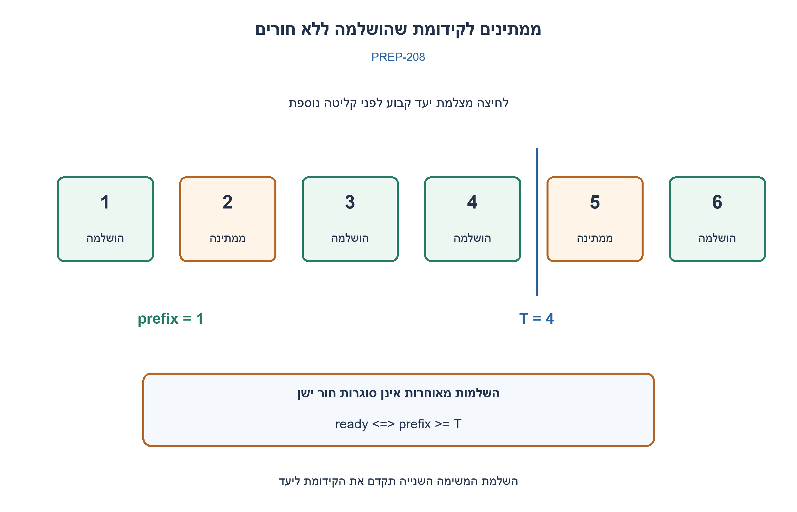
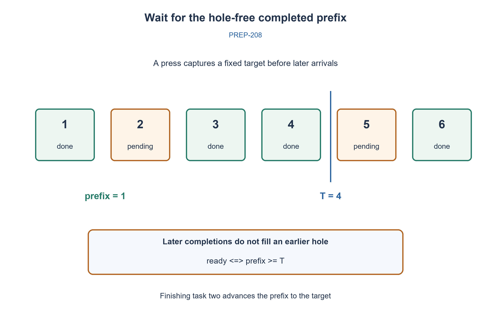

# PREP-208 — מתי הושלמו כל המשימות שנקלטו לפני הלחיצה?

פתרון מוצע בסיוע AI; ביקורת מקצועית אנושית ממתינה. הקושי אינו מכויל.

[צילום מקור פרטי](../sources/2026-10-31-batch21-18.png)

אם יש לנו מערכת שמקבלת משימות ומעבירה אותן ל־ENGINE שמתחיל עבודה לפי המשימה שהוא מקבל, ויש לחצן שברגע שלוחצים עליו צריך להודיע מתי המערכת מסיימת את כל המשימות שנכנסו עד רגע הלחיצה, איך המערכת יכולה לעשות זאת?

## עברית

מערכת מקבלת משימות ושולחת אותן ל־ENGINE. בלחיצה על כפתור צריך לקבל הודעה ברגע שכל המשימות שנקלטו עד הלחיצה הסתיימו; משימות מאוחרות יותר אינן מעכבות את ההודעה. תכננו מעקב שתקף גם כאשר ההשלמות מגיעות שלא לפי סדר הקבלה, והסבירו כיצד מתבצע צילום המצב בלחיצה.

חוזה העבודה: כל משימה מתקבלת פעם אחת עם מזהה סדרה לפני שניתן לשגר אותה; כל השלמה מזוהה וחוזרת פעם אחת. פעולות קבלה, לחיצה והשלמה מסודרות אטומית באותו מנגנון סנכרון. כשל או ביטול צריכים מדיניות מפורשת: במודל complete מסמן מצב סופי שהמערכת החליטה לספור. המונים אינם גולשים. אם ה־ENGINE משלים תמיד FIFO, אפשר פתרון פשוט יותר; אין להניח זאת בלי אישור.

1. בלחיצה צריך לשמור יעד קבוע, ולא לחכות לכך שכל המערכת תהיה ריקה.
2. מספר ההשלמות הכולל אינו מספיק אם משימה חדשה סיימה לפני משימה ישנה. מה מייצג רצף השלמות ללא חורים?
3. מספרו משימות ושמרו את המזהה הגדול ביותר שכל המזהים עד אליו הושלמו. הלחיצה שומרת T, ומודיעים כשהקידומת מגיעה ל־T.

### מקפיאים את היעד, לא את קליטת העבודה
בקבלה מקצים מזהים 1,2,3,...; accepted הוא המזהה האחרון שהתקבל. לחיצה קוראת אותו אטומית ושומרת יעד T. משימות שמתקבלות אחר כך מקבלות מזהה גדול יותר, ולכן אינן חלק מהבקשה הזאת. אם קבלה ולחיצה מתרחשות בו זמנית, אותו מנגנון נעילה או בוררות קובע מי קדמה; זו ההגדרה המדויקת של גבול הצילום.

כשמותרת השלמה מחוץ לסדר, שומרים prefix — המזהה הגדול ביותר שכל המשימות 1..prefix הושלמו — וקבוצה של מזהים שהושלמו מעליו. בהשלמת i מוסיפים אותו לקבוצה; כל עוד prefix+1 נמצא בה, מסירים אותו ומקדמים prefix. האינווריאנט אומר שלפני prefix אין חור, וכל השלמה מעליו שלא נבלעה ברצף נמצאת בקבוצה. בקשה מוכנה בדיוק כאשר prefix≥T.

לדוגמה, משימה 1 התקבלה, נלחץ הכפתור ונשמר T=1, ואז התקבלה והושלמה משימה 2. מונה השלמות כולל כבר 1, אבל משימה 1 עדיין עובדת: שימוש ב־completedCount≥T היה שגוי. במעקב הקידומת prefix נשאר 0. רק השלמת 1 מקדמת אותו דרך 1 וגם 2; ההודעה נכונה, ומשימות מאוחרות שאינן גמורות לא מעכבות אותה.

הקוד משתמש באותה Condition עם נעילה לקבלה, צילום ולהשלמה. ממתינים ב־wait_for על predicate של היעד, ומשדרים notify_all אחרי השלמה. הבדיקה מתבצעת שוב אחרי כל יקיצה, כך שלא מסתמכים על הודעה לבדה ואין צורך לדגום בלולאת busy-wait. dispatch צריך לקרות רק אחרי accept; אחרת השלמה מהירה עלולה להגיע לפני שהמזהה נרשם. ביישום חומרה משתמשים במזהי תג וב־scoreboard מתאים ובפלט done עבור יעד הלחיצה; הקוד הוא מודל תוכנה למצב הזה, לא RTL שסונתז.

ללא חורים, כל מזהה נוסף לקבוצה ומוסר ממנה פעם אחת. בהנחת hash בתוחלת O(1), העבודה הכוללת על n השלמות היא O(n); השלמה אחת יכולה לקדם הרבה מזהים, ולכן אינה O(1) במקרה הגרוע. השוואת יעד, קבלה וצילום דורשות מספר קבוע של פעולות במודל מילים. המקום הוא O(h), כש־h הוא מספר ההשלמות שנאגרו מעל החור הראשון; h עלול להיות Θ(n) גם אם רק משימה ישנה אחת עדיין רצה. אי אפשר לטעון למקום בגודל מספר המשימות הפעילות בלבד. ממתינים ומספר לחיצות מוסיפים מצב בקשות משלהם.

אם יש הבטחת השלמות FIFO, מונה ההשלמות כן מייצג קידומת, ואפשר לשמור יעד של מונה הקבלות. לחיצה על מערכת ללא משימות מוכנה מיד. משימה שלא מסתיימת תשאיר בקשה מתאימה ממתינה; זיהוי מצב מוכן אינו מבטיח liveness של ה־ENGINE.

362,880 בדיקות השוו את המצב להכלת קבוצת כל המזהים עד היעד: כל סדרי ההשלמה ל־0..7 משימות וכל יעד קידומת, וכן דוגמת “החדשה סיימה קודם” ובדיקת wait עם timeout אפס. זהו מודל אירועים מסודר ובדיקת ממשק נעילה, לא ניסוי עומס בתהליכונים או במנוע פיזי.

```python
"""Barrier for accepted tasks, allowing arbitrary completion order.

Methods describe serialized atomic events. In a concurrent implementation all
operations must share a lock/event ordering; dispatch only after accept().
IDs never wrap or repeat. Cancelled/failed work needs an explicit terminal policy.
"""
from threading import Condition, Lock


class SnapshotBarrier:
    def __init__(self):
        self._condition = Condition(Lock())
        self._accepted = 0
        self._prefix = 0
        self._completed_above_prefix = set()

    def accept(self):
        """Assign an ID before the task can be dispatched to the engine."""
        with self._condition:
            self._accepted += 1
            return self._accepted

    def press(self):
        """Snapshot and acceptance are ordered by the same lock."""
        with self._condition:
            return self._accepted

    def complete(self, ident):
        with self._condition:
            if type(ident) is not int or not 1 <= ident <= self._accepted:
                raise ValueError('Unknown completion ID')
            if ident <= self._prefix or ident in self._completed_above_prefix:
                raise ValueError('Duplicate completion')
            self._completed_above_prefix.add(ident)
            while self._prefix + 1 in self._completed_above_prefix:
                self._prefix += 1
                self._completed_above_prefix.remove(self._prefix)
            self._condition.notify_all()

    def ready(self, target):
        with self._condition:
            if type(target) is not int or not 0 <= target <= self._accepted:
                raise ValueError('Invalid snapshot target')
            return self._prefix >= target

    def wait(self, target, timeout=None):
        """Wake on completions; recheck the predicate after every wakeup."""
        with self._condition:
            if type(target) is not int or not 0 <= target <= self._accepted:
                raise ValueError('Invalid snapshot target')
            return self._condition.wait_for(lambda: self._prefix >= target, timeout)
```




## English

Tasks are accepted and sent to an ENGINE. A button press requests notification once every task accepted up to that press has finished; later tasks must not delay it. Design tracking that also works for out-of-order completions, and explain the atomic snapshot boundary.

Contract: acceptance assigns a sequence ID once, before dispatch; each completion identifies its task and occurs once. Acceptance, presses and completions are atomically ordered by one synchronization mechanism. Failure/cancellation needs an explicit policy: complete denotes the terminal condition selected for this model. Counters do not wrap. An engine guaranteed to finish FIFO permits a simpler design; do not assume it silently.

1. Capture a fixed target at the press rather than waiting for the entire system to become empty.
2. A completion count is insufficient if later work finishes first. What represents a completed prefix without holes?
3. Number tasks and track the largest ID whose entire prefix is complete. Capture T on the press and notify when the prefix reaches T.

### Freeze the target, not incoming work
Assign IDs 1,2,3,... at acceptance; accepted is the latest ID. A press atomically captures target T. Later tasks get larger IDs and do not belong to that request. If acceptance and the press coincide, the same lock or arbiter orders them; that defines the snapshot boundary precisely.

For out-of-order completion, track prefix, the largest ID whose entire 1..prefix range is finished, plus a set of finished IDs above it. On completion of i, insert it; repeatedly remove prefix+1 while present and advance prefix. The invariant is a hole-free completed prefix plus every completed higher ID not yet absorbed. A request is ready exactly when prefix≥T.

Suppose task1 is accepted, a press captures T=1, and task2 is then accepted and finishes first. The total completed count is already1 although task1 is unfinished, so completedCount≥T is wrong. The prefix stays 0; finishing task1 advances through 1 and 2. Later unfinished work does not delay the earlier request.

The code uses the same locked Condition for acceptance, snapshots and completions. wait_for checks the target predicate, and completion calls notify_all. The predicate is rechecked after every wakeup; notification alone is not proof, and busy-wait polling is unnecessary. Dispatch must follow accept so a fast completion cannot precede ID registration. A hardware implementation can use tags, a scoreboard and a done output for the captured target; the supplied software is a state model, not synthesized RTL.

Each ID enters and leaves the set once. With expected O(1) hashing, n completions take O(n) aggregate work, but one completion may advance many IDs and is not worst-case O(1). Target checks, acceptance and snapshots use constant word-model operations. Storage is O(h), with h completed IDs buffered beyond the first hole; h can be Θ(n) even if only one old task remains active. Do not bound it by active tasks alone. Waiting threads and multiple request objects add their own state.

With guaranteed FIFO completion, a total completion count really is a prefix and the simpler acceptance/completion-counter design is valid. A press with no tasks is ready immediately. A task that never terminates keeps the corresponding request pending; readiness detection does not ensure engine liveness.

362,880 checks compared readiness with independent prefix-set inclusion for every completion permutation at 0..7 tasks and every target, plus a later-task-finishes-first case and zero-timeout wait checks. This is a serialized-event model with a synchronization interface, not a threaded load test or physical-engine experiment.

```python
"""Barrier for accepted tasks, allowing arbitrary completion order.

Methods describe serialized atomic events. In a concurrent implementation all
operations must share a lock/event ordering; dispatch only after accept().
IDs never wrap or repeat. Cancelled/failed work needs an explicit terminal policy.
"""
from threading import Condition, Lock


class SnapshotBarrier:
    def __init__(self):
        self._condition = Condition(Lock())
        self._accepted = 0
        self._prefix = 0
        self._completed_above_prefix = set()

    def accept(self):
        """Assign an ID before the task can be dispatched to the engine."""
        with self._condition:
            self._accepted += 1
            return self._accepted

    def press(self):
        """Snapshot and acceptance are ordered by the same lock."""
        with self._condition:
            return self._accepted

    def complete(self, ident):
        with self._condition:
            if type(ident) is not int or not 1 <= ident <= self._accepted:
                raise ValueError('Unknown completion ID')
            if ident <= self._prefix or ident in self._completed_above_prefix:
                raise ValueError('Duplicate completion')
            self._completed_above_prefix.add(ident)
            while self._prefix + 1 in self._completed_above_prefix:
                self._prefix += 1
                self._completed_above_prefix.remove(self._prefix)
            self._condition.notify_all()

    def ready(self, target):
        with self._condition:
            if type(target) is not int or not 0 <= target <= self._accepted:
                raise ValueError('Invalid snapshot target')
            return self._prefix >= target

    def wait(self, target, timeout=None):
        """Wake on completions; recheck the predicate after every wakeup."""
        with self._condition:
            if type(target) is not int or not 0 <= target <= self._accepted:
                raise ValueError('Invalid snapshot target')
            return self._condition.wait_for(lambda: self._prefix >= target, timeout)
```




## חומר משלים / Supporting material

```json
{
  "assumptions": {
    "he": [
      "מזהי קבלה ייחודיים בסדר עולה לפני dispatch; השלמה אמינה אחת לכל מזהה; צילום אטומי; אין גלישה."
    ],
    "en": [
      "Unique increasing accepted IDs before dispatch; one reliable completion per ID; atomic snapshots; no wraparound."
    ]
  },
  "optimality": {
    "he": "O(n) עבודה כוללת בתוחלת hash על n השלמות; צעד יחיד O(n) אפשרי. O(h) מצב חורים, לא בהכרח O(מספר פעילים).",
    "en": "Expected O(n) aggregate work for n completions with hashing; one step can be O(n). O(h) hole-buffer state, not necessarily bounded by active tasks."
  },
  "verification": {
    "he": "362,880 בדיקות קידומות מול קבוצת המשימות הנדרשות; אין בדיקת עומס תהליכונים או סינתזת חומרה.",
    "en": "362,880 prefix checks against required-task sets; no threaded stress test or hardware synthesis."
  },
  "edge_cases": {
    "he": [
      "לחיצה ריקה; השלמות מחוץ לסדר; משימה ישנה תקועה; לחיצות מרובות; השלמה כפולה; שיגור שנכשל אחרי הקבלה; גלישת מזהים."
    ],
    "en": [
      "Empty snapshot; reordered completions; stalled old task; multiple presses; duplicate completion; failed dispatch after acceptance; ID wraparound."
    ]
  },
  "common_mistakes": {
    "he": [
      "ספירת כל ההשלמות עלולה לכלול עבודה מאוחרת במקום המשימות הנדרשות.",
      "המתנה לריקון מלא עלולה לא להסתיים כשממשיכות להיכנס משימות.",
      "אי אפשר לצלם מונה קבלה בלי לסנכרן אותו עם הקבלה וההשלמה."
    ],
    "en": [
      "A total completion count may count later work instead of required tasks.",
      "Waiting for global emptiness can fail under continuing arrivals.",
      "Snapshot capture must be synchronized with acceptance and completion."
    ]
  },
  "interview_answer": {
    "he": "בלחיצה שומרים מזהה יעד. מודיעים כשהקידומת השלמה, ללא חורים, מגיעה אליו; משימות מאוחרות אינן משנות את היעד.",
    "en": "Capture a target ID on the press; notify when the hole-free completed prefix reaches it. Later tasks never change that target."
  },
  "source_ambiguities": {
    "he": [
      "הצילום אינו קובע סדר השלמה, אמינות מזהים או מדיניות כשל. FIFO הוא מקרה פשוט נפרד, לא הנחה סמויה."
    ],
    "en": [
      "The source omits completion order, ID reliability and failure policy. FIFO is a separate simpler case, not a hidden assumption."
    ]
  },
  "solution_extensions": {
    "he": {
      "question": "מה משתנה אם מזהים הם ברוחב מוגבל?",
      "direction": "יש למנוע שימוש חוזר לפני שכל הקבלות והבקשות הישנות יצאו מן החלון, או להשתמש בדורות וכללי השוואה מודולרית מוכחים.",
      "integration": "מוכן בתוכן; לא מחובר לתור אינטראקטיבי."
    },
    "en": {
      "question": "What changes with bounded-width IDs?",
      "direction": "Prevent reuse until old tasks/requests leave the window, or use generations and proven modular comparison rules.",
      "integration": "Prepared in content; not connected to the interactive queue."
    }
  },
  "technical_references": {
    "he": [
      {
        "title": "תיעוד Python — Condition והמתנה לפי predicate",
        "url": "https://docs.python.org/3/library/threading.html#condition-objects"
      }
    ],
    "en": [
      {
        "title": "Python documentation — Condition predicate waiting",
        "url": "https://docs.python.org/3/library/threading.html#condition-objects"
      }
    ]
  }
}
```
