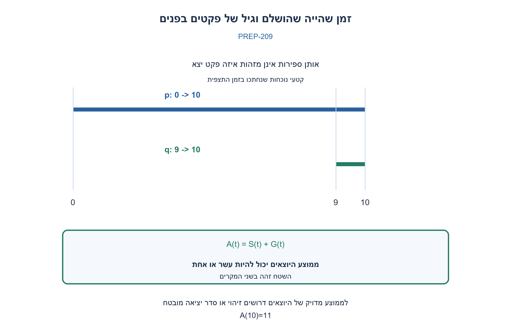
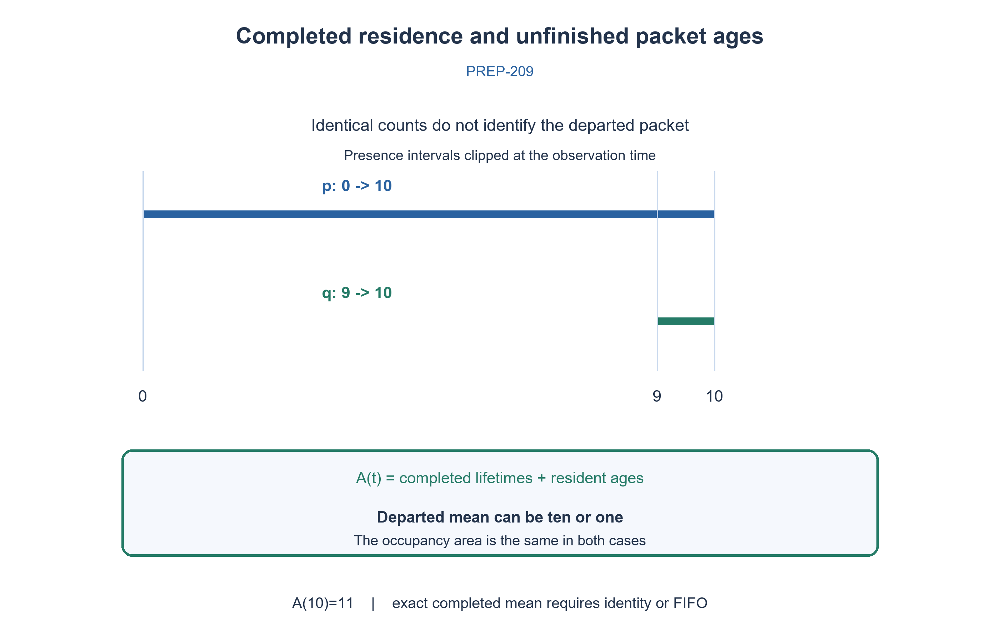

# PREP-209 — מדידת זמן שהייה ממוצע מחוץ לקופסה שחורה

פתרון מוצע בסיוע AI; ביקורת מקצועית אנושית ממתינה. הקושי אינו מכויל.

[צילום מקור פרטי](../sources/2026-10-31-batch21-21.png)

יש קופסה שחורה עם n כניסות שנכנסים אליה פקטים (packages), ורוצים לדעת כמה זמן בממוצע הפקטים היו בפנים. לא יודעים כמה פקטים נכנסו ומתי הם נכנסו, ובכל רגע צריך לדעת את הממוצע. אפשר להוסיף רכיבים שרוצים מחוץ לקופסה.

## עברית

לקופסה שחורה n כניסות של פקטים. רוצים לדעת בכל רגע כמה זמן בממוצע הפקטים שהו בתוכה, ואפשר להוסיף רכיבי מדידה מחוץ לקופסה. אילו אותות והנחות דרושים, וכיצד תבנו מדידה נכונה? הבחינו בין ממוצע הפקטים שכבר יצאו, גיל הפקטים שעדיין בפנים וממוצע ארוך־טווח.

במקור אין ספירת כניסות או זמני כניסה פנימיים, אך לא ברור אם אפשר לצפות באירועי הקבלה והיציאה או לזהות פקט. הפתרון המדויק מצהיר על ממשק חיצוני נוסף: כל קבלה אמיתית וכל יציאה גלויות, עם אותו מזהה פקט קיים וחותמת זמן משותפת. מתחילים ריקים, אין אובדן/שכפול ומזהה אינו משמש שוב בעודו בפנים. אין להניח שאפשר להוסיף תג שעובר דרך הקופסה אם הדבר לא הותר. ננתח גם מה ניתן לדעת כשיש רק אירועים אנונימיים.

1. קודם הגדירו מה נכנס למכנה של הממוצע. פקט שעדיין בפנים עוד לא השלים את זמן השהייה שלו.
2. אם רואים מזהה בכניסה וביציאה, אפשר להחסיר זמני כניסה ויציאה ולצבור סכום ומספר השלמות. מה אפשר לחשב ממספר הפקטים בפנים בלבד?
3. השטח מתחת למספר הפקטים כולל זמני שהייה של פקטים שיצאו וגם גילים של אלה שעדיין בפנים. בלי זיהוי או FIFO אי אפשר תמיד להפריד בין השניים.

### הממוצע צריך להיות מוגדר לפני שבונים מונה
נבחר תחילה את ממוצע זמני השהייה של פקטים שכבר יצאו מאז תחילת המדידה. לפני יציאה ראשונה הוא לא מוגדר, ולא 0. מנטר חיצוני שצופה בכל קבלה אמיתית שומר arrival[id]=time. ביציאה מזוהה מחסירים את זמן הקבלה, מוסיפים את ההפרש לסכום S ומגדילים את מספר היוצאים C. בכל רגע שבו C>0, התשובה המדויקת היא S/C. אירוע valid שחוזר בזמן backpressure אינו קבלה נוספת; צריך לספור handshake אמיתי בכל אחת מ־n הכניסות.

זה עובד גם אם הפקטים יוצאים מחוץ לסדר, בתנאי שהמזהה מזוהה בשני הגבולות. אם מובטח FIFO גלובלי אפשר במקום מזהים להשתמש בתור זמני כניסה ולהוציא את הזמן הישן ביותר בכל יציאה. הבטחת FIFO לכל כניסה בנפרד אינה בהכרח סדר גלובלי. כשאין זיהוי ואין FIFO, המידע יכול להיות חסר: נכנס פקט בזמן 0 ועוד אחד בזמן 9, ובזמן 10 יוצא פקט אחד. אם יצא הראשון ממוצע היוצאים הוא 10; אם השני יצא הוא 1. אירועי הספירה האנונימיים זהים, ולכן אי אפשר להחליט מי משתי התשובות נכונה מתוכם בלבד.

### מה נותן השטח מתחת לתפוסה?
נשמור תפוסה N(t), שמוגדלת בקבלה ומוקטנת ביציאה. בין אירועים נוסיף למונה שטח A את N כפול הזמן שחלף. כאשר המדידה התחילה ריקה, מתקיימת זהות מדויקת: A(t)=סכום זמני השהייה של היוצאים + סכום הגילים הנוכחיים של הפקטים שבפנים. כל פקט תורם 1 לתפוסה בכל רגע שהוא נמצא בפנים, ולכן תרומתו לשטח היא בדיוק אורך הקטע הזה. זו הוכחה לפי קטעי זמן, לא הנחת התפלגות.

בדוגמה הקודמת A(10)=11 בשתי האפשרויות. חלוקה ב־C=1 הייתה מחזירה 11, אף שהתשובה המדויקת היא 10 או 1. חלוקה בתפוסה הרגעית גם אינה פותרת זאת. כשהמערכת שוב ריקה, גילים שטרם הושלמו אינם קיימים ו־A/C הוא ממוצע מדויק לכל הפקטים בתקופת המדידה. בקוד, מאחר ש־S ידוע באמצעות הזהויות, אפשר גם לקבל את ממוצע גיל הפקטים שבפנים בתור (A−S)/N כאשר N>0. גיל נוכחי אינו זמן השהייה הסופי שלהם.

למדידה ארוכת־טווח במערכת יציבה, חוק Little מקשר בין ממוצע תפוסה, קצב מעבר וזמן שהייה ממוצע: L=λW. תחת קיום הגבולות והתנאים המתאימים, W=L/λ. זה אינו היתר להציב את התפוסה הרגעית ואת מספר היוצאים בחלון שרירותי ולדווח על ממוצע יוצאים מדויק בכל רגע. המקורות האקדמיים מקושרים להרחבה על הקשר ארוך־הטווח; הבדיקה הסופית כאן אינה ניסוי שמוכיח יציבות או התכנסות.

המימוש המדויק שומר O(P) חותמות זמן עבור P פקטים פעילים, סכום ומונים, ועושה מספר קבוע של פעולות בתוחלת לכל אירוע בהנחת hash. יש לטפל בארביטרציה של קבלות סימולטניות, רוחבי מונים וגלישת שעון בחומרה. אם אין יכולת לזהות את כל הפקטים שהיו כבר בפנים כשהמדידה מתחילה, דרוש reset ריק או חוזה ניקוז; חיצוניות הרכיבים לבדה אינה משחזרת עבר שלא נצפה.

20,001 בדיקות השוו את הצבירה לחישוב עצמאי לפי חיי כל פקט, כולל 20,000 אירועים/שאילתות עם יציאה מחוץ לסדר וזמנים שווים, ודוגמת חוסר ההבחנה בין ממוצע 10 לבין 1. זו בדיקת מודל לוגי מדויק, לא מערכת תעבורה פיזית.

```python
"""External accepted-arrival/completion monitor with observable packet IDs.

This is a declared interface completion: without IDs/FIFO or complete event
observation, exact completed-packet average may be impossible. Timestamp units
are arbitrary, monotone, exact; all events are serialized. Initially empty.
"""
from fractions import Fraction


class ResidenceMonitor:
    def __init__(self):
        self._pending = {}
        self._time = None
        self._area = 0
        self._total = 0
        self._count = 0

    def _advance(self, time):
        if type(time) is not int or time < 0 or (self._time is not None and time < self._time):
            raise ValueError('Require nonnegative monotone integer timestamps')
        if self._time is not None:
            self._area += len(self._pending) * (time - self._time)
        self._time = time

    def arrive(self, packet_id, time):
        if packet_id in self._pending:
            raise ValueError('Packet ID already pending')
        self._advance(time)
        self._pending[packet_id] = time

    def depart(self, packet_id, time):
        if packet_id not in self._pending:
            raise ValueError('Unknown departure')
        self._advance(time)
        self._total += time - self._pending.pop(packet_id)
        self._count += 1

    def query(self, time):
        """Return exact means for completed packets and currently resident ages."""
        self._advance(time)
        completed_average = Fraction(self._total, self._count) if self._count else None
        pending_age_total = self._area - self._total
        pending_average_age = Fraction(pending_age_total, len(self._pending)) if self._pending else None
        return {'completed_average': completed_average,
                'pending_average_age': pending_average_age,
                'occupancy_area': self._area,
                'completed_count': self._count,
                'pending_count': len(self._pending)}
```




## English

A black box has n packet inputs. You may add external measuring components and want its average packet residence time at every instant. What observations and assumptions are necessary, and how would you measure it correctly? Distinguish the mean of departed packets, the age of resident packets and a long-run mean.

The source supplies no internal arrival count/timestamps and leaves external acceptance/departure visibility and identity unspecified. The exact construction explicitly adds an interface contract: observe every actual accepted arrival and departure with an existing preserved packet ID and a common clock. Start empty, with no loss/duplication or pending-ID reuse. Do not assume permission to insert a tag that traverses the box. Also analyze anonymous event observations.

1. First define the denominator: a resident packet has not finished its residence time.
2. With matching arrival/departure IDs, subtract timestamps and accumulate total delay plus completion count. What does occupancy alone reveal?
3. Occupancy area includes departed lifetimes and current residents’ ages. Without identity or FIFO, those contributions cannot always be separated.

### Define the average before choosing counters
First choose the mean residence time of packets already departed since measurement began. It is undefined before the first departure, not zero. An external monitor observes each actual accepted arrival and stores arrival[id]=time. At a matching departure subtract its arrival time, add the lifetime to S and increment departed count C. Whenever C>0 the exact answer is S/C. Repeated valid under backpressure is not another acceptance; count actual handshakes on all n inputs.

Out-of-order departure is fine when identity is observable at both boundaries. A guaranteed globally FIFO box can instead use an arrival-time queue, popping the oldest timestamp on each departure. Per-input FIFO does not necessarily establish one global order. Without identity or FIFO, information may be missing: arrivals occur at 0 and 9, followed by one departure at 10. If the first packet leaves, the departed mean is 10; if the second leaves, it is 1. Anonymous count events are identical, so they cannot distinguish the correct answer.

### What does occupancy area measure?
Maintain occupancy N(t), incrementing on acceptance and decrementing on departure. Between events add N times elapsed time to area A. From an initially empty system the exact identity is A(t)=sum of departed lifetimes + sum of resident ages. Each packet contributes one unit of occupancy while present, so its area contribution is precisely that interval length. This is an interval argument, not a distributional assumption.

In the counterexample A(10)=11 in both cases. A/C with C=1 would give 11, while the exact departed mean is 10 or 1. Dividing by instantaneous occupancy does not fix it. When the system becomes empty again, resident-age contributions vanish and A/C exactly averages all packets in the observation period. Since identity tracking supplies S, the code can also compute mean resident age as (A−S)/N when N>0. Current age is not those packets’ final lifetime.

For a stable long-run measurement, Little’s law relates average occupancy, throughput and average residence: L=λW, hence W=L/λ when the requisite limits and conditions hold. It does not authorize substituting instantaneous occupancy and a departure count from an arbitrary open window to obtain an exact departed mean at every instant. Academic references support the long-run relationship; these finite tests do not establish traffic stability or convergence.

The exact implementation stores O(P) timestamps for P active packets plus totals/counters. Each event performs a constant expected number of operations under hashing. Hardware must define simultaneous-input arbitration, counter widths and clock-wrap handling. Unknown preexisting packets require an empty reset or a drain contract; merely placing components outside the box cannot recover unobserved history.

20,001 checks compared accumulation with independent explicit lifetimes, including 20,000 event/query pairs with reordered departures and tied times, plus the indistinguishable anonymous trace with departed means 10 versus 1. This is an exact logical model, not a physical traffic experiment.

```python
"""External accepted-arrival/completion monitor with observable packet IDs.

This is a declared interface completion: without IDs/FIFO or complete event
observation, exact completed-packet average may be impossible. Timestamp units
are arbitrary, monotone, exact; all events are serialized. Initially empty.
"""
from fractions import Fraction


class ResidenceMonitor:
    def __init__(self):
        self._pending = {}
        self._time = None
        self._area = 0
        self._total = 0
        self._count = 0

    def _advance(self, time):
        if type(time) is not int or time < 0 or (self._time is not None and time < self._time):
            raise ValueError('Require nonnegative monotone integer timestamps')
        if self._time is not None:
            self._area += len(self._pending) * (time - self._time)
        self._time = time

    def arrive(self, packet_id, time):
        if packet_id in self._pending:
            raise ValueError('Packet ID already pending')
        self._advance(time)
        self._pending[packet_id] = time

    def depart(self, packet_id, time):
        if packet_id not in self._pending:
            raise ValueError('Unknown departure')
        self._advance(time)
        self._total += time - self._pending.pop(packet_id)
        self._count += 1

    def query(self, time):
        """Return exact means for completed packets and currently resident ages."""
        self._advance(time)
        completed_average = Fraction(self._total, self._count) if self._count else None
        pending_age_total = self._area - self._total
        pending_average_age = Fraction(pending_age_total, len(self._pending)) if self._pending else None
        return {'completed_average': completed_average,
                'pending_average_age': pending_average_age,
                'occupancy_area': self._area,
                'completed_count': self._count,
                'pending_count': len(self._pending)}
```




## חומר משלים / Supporting material

```json
{
  "assumptions": {
    "he": [
      "כל אירוע קבלה/יציאה נצפה; מזהה קיים נשמר או FIFO גלובלי מפורש; התחלה ריקה; שעון משותף ללא גלישה; אין אובדן או שכפול."
    ],
    "en": [
      "Every accepted-arrival/departure observed; preserved existing ID or explicit global FIFO; initially empty; common clock without wrap; no loss/duplication."
    ]
  },
  "optimality": {
    "he": "O(P) מקום לחותמות P הפקטים הפעילים ו־O(1) פעולות מילים בתוחלת לכל אירוע תחת hash; זמן אמיתי ורוחבי ביטים דורשים תכן נוסף.",
    "en": "O(P) storage for active-packet timestamps and expected O(1) word operations per event with hashing; hardware timing and bit widths need further design."
  },
  "verification": {
    "he": "20,001 בדיקות מול אורקל חיי פקטים וזהות שטח; דוגמה נגדית לממוצע יוצאים מתוך ספירות בלבד. אין ניסוי תעבורה או בדיקת התכנסות Little.",
    "en": "20,001 checks against lifetime/area oracles and a count-only indistinguishability example. No traffic experiment or Little-law convergence test."
  },
  "edge_cases": {
    "he": [
      "אין פקטים שיצאו; תפוסה אפס; קבלות באותו זמן; backpressure; פקטים קיימים בתחילת המדידה; יציאה לא מזוהה; אובדן; גלישת שעון."
    ],
    "en": [
      "No departures; zero occupancy; simultaneous arrivals; backpressure; initially resident packets; unidentified departure; loss; clock wrap."
    ]
  },
  "common_mistakes": {
    "he": [
      "תפוסה חלקי קצב רגעי אינה ממוצע יוצאים מדויק.",
      "ספירה של valid בכל מחזור עלולה לספור אותו פקט כמה פעמים.",
      "אין להוסיף תג שחוצה את הקופסה בלי שהממשק מרשה זאת."
    ],
    "en": [
      "Instantaneous occupancy divided by an instantaneous rate is not an exact departed mean.",
      "Counting valid every cycle can count one stalled packet repeatedly.",
      "Do not invent permission to send a new tag through the box."
    ]
  },
  "interview_answer": {
    "he": "בממשק מזוהה אני מצמיד חותמת בקבלה וסוכם זמני שהייה ביציאה. בלי זיהוי או FIFO אין תמיד מידע מספיק; שטח תפוסה כולל גם גיל של פקטים שעדיין בפנים.",
    "en": "With observable identity, timestamp arrivals and accumulate lifetimes at departures. Without identity or FIFO information can be insufficient; occupancy area also contains resident ages."
  },
  "source_ambiguities": {
    "he": [
      "המילה “ממוצע” אינה מגדירה אוכלוסייה או חלון. גם יכולת תצפית בקבלה, ביציאה ובזהות אינה מצוינת; הפתרון מפריד בין החוזים האפשריים."
    ],
    "en": [
      "“Average” specifies neither population nor observation window; acceptance/departure/identity visibility is also missing. The solution separates these contracts."
    ]
  },
  "solution_extensions": {
    "he": {
      "question": "מתי אפשר לחשב ממוצע מדויק בלי לשמור חותמת לכל פקט?",
      "direction": "בחלון שהתחיל והסתיים ריק, שטח התפוסה חלקי מספר הפקטים נותן את ממוצע כל זמני השהייה בחלון. בחלון פתוח נשאר איבר גילים.",
      "integration": "מוכן בתוכן; לא מחובר לתור אינטראקטיבי."
    },
    "en": {
      "question": "When can an exact mean be computed without per-packet timestamps?",
      "direction": "An empty-to-empty observation interval has mean equal to occupancy area divided by packet count. An open interval retains a resident-age term.",
      "integration": "Prepared in content; not connected to the queue."
    }
  },
  "technical_references": {
    "he": [
      {
        "title": "MIT — חוק Little למערכת יציבה",
        "url": "https://ocw.mit.edu/courses/6-02-introduction-to-eecs-ii-digital-communication-systems-fall-2012/resources/lecture-22-sliding-window-analysis-littles-law/"
      },
      {
        "title": "MIT — הערות תורים וקצב מעבר",
        "url": "https://web.mit.edu/6.02/www/s2012/handouts/16.pdf"
      }
    ],
    "en": [
      {
        "title": "MIT — Little’s law for a stable system",
        "url": "https://ocw.mit.edu/courses/6-02-introduction-to-eecs-ii-digital-communication-systems-fall-2012/resources/lecture-22-sliding-window-analysis-littles-law/"
      },
      {
        "title": "MIT — queueing and throughput notes",
        "url": "https://web.mit.edu/6.02/www/s2012/handouts/16.pdf"
      }
    ]
  }
}
```
