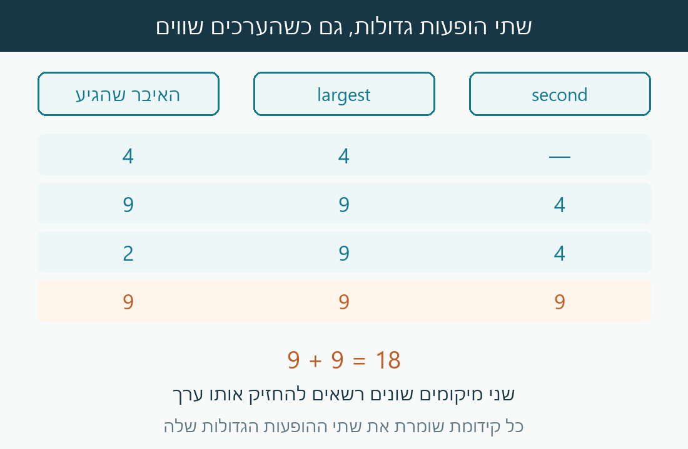
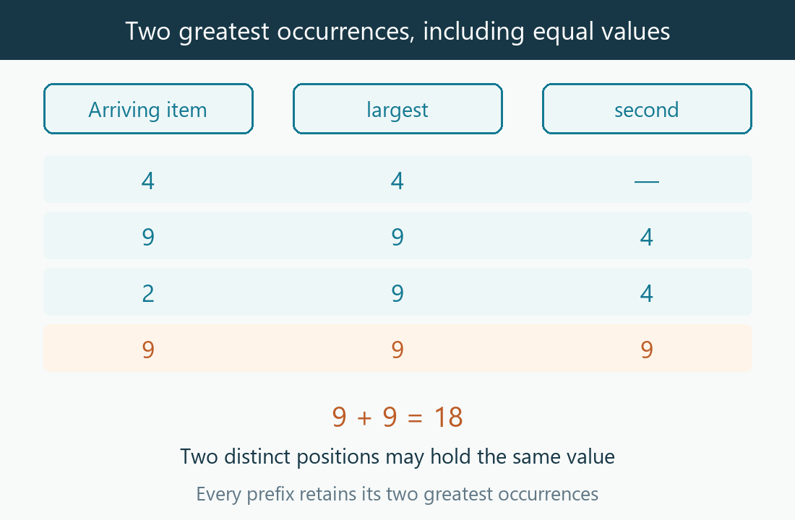

# PREP-211 — הרחבה לסכום שני איברים במעבר יחיד

[צילום מקור](../sources/2026-11-15-batch10c-01.png)

## שני הערכים הגדולים השונים והשכיח במערך לא ממוין

נתון מערך לא ממוין של מספרים שלמים שטווחם אינו ידוע. א. החזירו את שני הערכים השונים הגדולים ביותר ואת מספר ההופעות של כל אחד. ב. החזירו ערך שמופיע בתדירות מרבית ואת תדירותו. נתחו זמן וזיכרון והסבירו מה ההבדל בין שתי המשימות. אין לשנות את המערך.

הגדרות נוספות: “שני הגדולים” פירושו שני ערכים שונים, ולא שני מקומות המכילים אותו מקסימום. חלק א מחזיר זוג תוצאות בסדר יורד; תוצאה חסרה מסומנת None. מערך ריק מחזיר (None,None), וערך שונה יחיד מחזיר ((value,count),None). בחלק ב, בשוויון תדירויות בוחרים בערך המספרי הקטן ביותר; במערך ריק מחזירים None. אין הבטחה שקיים רוב של יותר מחצי. העלות נמדדת בפעולות השוואה ומפה רגילות.

### הרחבה — סכום זוג מיקומים במעבר יחיד
נתון מערך באורך n של מספרים טבעיים, כולל אפס. החזירו את הסכום המרבי של שני איברים במיקומים שונים, במעבר יחיד וללא שינוי הקלט. מותר שערכי שני האיברים יהיו שווים. אם n<2 החזירו None. אין דרישת סמיכות. ביישום Python משתמשים במספרים שלמים מדויקים. במימוש ברוחב קבוע יש לבחור רוחב סכום מתאים או לדווח על גלישה.

### פתרון מוצע

### חלק א: שני מקומות עם אינווריאנט לקידומת
נשמור first ו־second, שני הערכים השונים הגדולים ביותר בקידומת שעובדה, ואת המונים שלהם. None מציין מקום שלא התמלא; הוא אינו סף מספרי ולכן עובד גם כשהמספרים שליליים או גדולים מאוד. אם איבר חדש שווה ל־first, נגדיל רק את המונה הראשון. אם הוא גדול ממנו, נעביר את first והמונה שלו אל second, ונציב את האיבר החדש ב־first עם מונה אחת. אחרת נטפל בהופעה נוספת של second או בערך גדול ממנו, ונזניח ערך קטן משני המועמדים.

הוכחת האינווריאנט באינדוקציה: בקידומת ריקה שני המקומות חסרים. איבר שווה משנה תדירות בלבד. מקסימום חדש דוחק את המקסימום הקודם למקום השני, וכל שאר הערכים קטנים ממנו. ערך שבין שני המועמדים מחליף רק את השני, וערך נמוך יותר אינו יכול להשפיע על שתי התוצאות. מונה של ערך שמקודם נשמר במלואו. ערך שנדחה בעבר אינו יכול פתאום להפוך לאחד משני הגדולים, כי הסף השני אינו יורד. לכן בסיום גם הערכים וגם המונים מדויקים.

### חלק ב: מספרי הופעות, לא סדר מספרי
לשכיח צריך לעקוב אחר תדירויות כל הערכים השונים. נשתמש במפת counts; על כל איבר נגדיל את ספירתו. רק ספירה זו השתנתה, ולכן מספיק להשוות את אותו ערך אל best: תדירות גבוהה יותר מנצחת; בשוויון הערך הקטן יותר מנצח. זה שומר באינדוקציה על השכיח של כל קידומת לפי כלל השוויון שנבחר. במערך ריק לא קיים שכיח, והתשובה None.

בדוגמה [5,5,4,4,2] שתי התוצאות של חלק א הן (5,2) ו־(4,2). בשכיח יש תיקו בין 4 לבין 5, ולכן חלק ב מחזיר (4,2). בדוגמה [-4,-2,-4,-2], הערך הגדול הוא -2 והשני -4; השכיח שנבחר הוא דווקא -4. כך רואים ששני החלקים מודדים דברים שונים.

### עלות וחלופות
חלק א עושה מעבר יחיד, O(n) זמן ו־O(1) זיכרון נוסף. Ω(n) זמן נדרש במקרה הגרוע: איבר שלא נקרא עשוי להיות מקסימום חדש או לשנות את מונה המקסימום. לכן הזמן Θ(n) אופטימלי. חלק ב מבצע O(n) פעולות מפה בתוחלת תחת הנחת hash רגילה, ושומר O(k) רשומות עבור k ערכים שונים; זוהי טענת תוחלת, לא חסם זמן גרוע קבוע לכל hash. ערכים שלמים ארוכים עדיין כרוכים בעלות השוואה וחישוב hash התלויה באורך הביטים אם מנתחים מודל ביטים.

חלופה דטרמיניסטית היא למיין עותק ולסרוק רצפים, עם O(n log n) השוואות ו־O(n) מקום לעותק השומר על המקור; אפשר גם עץ מאוזן עם O(n log k) פעולות ו־O(k) זיכרון. אי אפשר להקצות מערך תדירויות לפי טווח שלא הוגדר. Boyer–Moore מוצא מועמד לרוב חמור של יותר מחצי, אם קיים; הוא אינו אלגוריתם כללי לשכיח. לדוגמה, ברשימה [1,1,2,2,3] שכיחים 1 ו־2 אך אין רוב, והמועמד של ביטול זוגות יכול להיות 3. גם אימות שמועמד אינו רוב לא מחזיר את השכיח.

### בדיקה, טעויות והמשך
10,046 מערכים נבדקו מול אורקל עצמאי של מיון ערכים שונים וספירות: כל 9,841 המערכים מעל -2,0,3 באורכים אפס עד שמונה, 200 דגימות קבועות זרע ועוד חמישה מקרי גבול. נבדקו תיקו, ערך שונה יחיד, שליליים, מספרים ברוחב מאות ביטים ושמירת הקלט.

תשובה קצרה: “לשני הגדולים אשמור שני ערכים שונים ומונים במעבר אחד ובזיכרון קבוע. לשכיח אספור כל ערך במפה, ואבחר לפי תדירות ואחריה הערך הקטן ביותר.” בהמשך: אם מובטח רוב של יותר מחצי, אפשר Boyer–Moore במעבר ובזיכרון קבוע, ואז מעבר אימות כשנדרש. ההבטחה החדשה היא שמאפשרת את החיסכון.

```python
"""Nonmutating algorithms for an unsorted array of integers of unknown range."""


def top_two_distinct(values):
    """Return ((largest, count), (second_distinct, count)); missing = None."""
    first = second = None
    first_count = second_count = 0
    for value in values:
        if first is not None and value == first:
            first_count += 1
        elif first is None or value > first:
            second, second_count = first, first_count
            first, first_count = value, 1
        elif second is not None and value == second:
            second_count += 1
        elif second is None or value > second:
            second, second_count = value, 1
    return ((first, first_count) if first is not None else None,
            (second, second_count) if second is not None else None)


def mode_with_count(values):
    """Return (mode, frequency), ties resolved to the smallest integer; empty=None."""
    counts = {}
    best = None
    best_count = 0
    for value in values:
        count = counts.get(value, 0) + 1
        counts[value] = count
        if count > best_count or (count == best_count and (best is None or value < best)):
            best, best_count = value, count
    return (best, best_count) if best is not None else None
```


### שומרים את שתי ההופעות הגדולות
כאן צריך את שני האיברים הגדולים לפי מיקום, ולכן [7,1,7] מחזיר 14 ו־[5,5] מחזיר 10. שומרים largest ו־second של ההופעות שנראו. כאשר value גדול או שווה ל־largest, מעבירים את largest הישן ל־second ומציבים value בראש. כאשר value קטן מראש הרשימה אך גדול מ־second, מחליפים רק את second. ערכים שווים שייכים למיקומים שונים, ולכן אינם מסוננים. None מסמן מקום שטרם התמלא, כדי שאפס יישאר ערך חוקי. בסיום מחברים את שני הערכים, או מחזירים None אם המקום השני חסר.

אינווריאנט: אחרי כל קידומת שני המשתנים מכילים את שתי ההופעות הגדולות שלה בסדר יורד, עם ריבוי. איבר חדש משתלב לפני הראשון, בין השניים או אחריהם, וכך האינווריאנט נשמר. סכום שתי ההופעות הגבוהות לפחות כסכום כל זוג אחר, כי אין להחלפת אחד מהן בערך קטן יותר יכולת להגדיל את הסכום.

יש מעבר אחד, Θ(n) השוואות ו־O(1) מילות עבודה. לולאה על iterable חד־פעמי אינה חוזרת להתחלה. במשפחה הכללית n≥2 כל איבר עשוי לשנות את התשובה, ולכן Ω(n) קריאות נחוצות במקרה הגרוע. גודל המספרים משפיע על עלות פעולות במספרים גדולים. עבור איברים לא מסומנים ברוחב w, הסכום עשוי לדרוש w+1 ביטים. [0,0] מחזיר 0; קלט ריק או יחיד מחזיר None. בדוגמה [4,9,2,9] שני המיקומים שערכם 9 נותנים 18.

ההרחבה מחזירה סכום בלבד. אפשר לשמור גם את שני האינדקסים אם רוצים להחזיר זוג, עם כלל הכרעה מפורש בשוויון. הגרסה הקודמת של שני ערכים שונים עדיין עונה למשימת הדירוג המקורית, ודרישת השכיחות נשארת סעיף נפרד. בדיקות התוצאה משוות לאורקל שמונה כל זוג אינדקסים, ובדיקה ייעודית מוודאת מעבר יחיד ושמירת הקלט.

```python
"""Largest sum at two distinct positions in a single input traversal.

Natural values include zero. Exact Python integers avoid arithmetic overflow.
Return None when fewer than two values exist. The input iterable is not mutated.
"""


def maximum_pair_sum(values):
    largest = second = None
    for value in values:
        if type(value) is not int or value < 0:
            raise ValueError("nonnegative exact integers required")
        if largest is None or value >= largest:
            second, largest = largest, value
        elif second is None or value > second:
            second = value
    return None if second is None else largest + second
```



## Two largest distinct values and the mode of an unsorted array

Given an unsorted array of integers whose range is unknown: (a) return the two largest distinct values and the frequency of each; (b) return a most frequent value and its frequency. Explain the difference between the tasks and analyze time and space. Do not modify the array.

Additional definitions: “two largest” means distinct values, rather than two positions containing the same maximum. Part(a) returns two descending result slots, using None for an absent value: an empty array returns (None,None), and one distinct value returns ((value,count),None). For part(b), break frequency ties by choosing the smallest numeric value; return None on empty input. No strict majority is promised. Costs count ordinary comparison/map operations.

### Extension — two-position maximum sum in one pass
Given n natural numbers including zero, return the largest sum of elements at two distinct positions in one traversal without changing the input. Equal values at different positions are allowed. Return None for n<2. The positions need not be adjacent. Python uses exact integers. A fixed-width implementation must choose a sufficient result width or report overflow.

### Proposed solution

### Part(a): two slots with a prefix invariant
Maintain first and second, the two largest distinct values in the processed prefix, together with their counts. None denotes an absent slot rather than a numeric threshold, so negatives and very large integers work. If a new element equals first, increment only its count. If it exceeds first, promote the old first and its entire count into second, then set first to the new value with count one. Otherwise increment second when equal, replace second when exceeded, or discard an element below both candidates.

Prove the invariant by induction. Both slots are absent in the empty prefix. Equality changes only a frequency. A new maximum makes the old maximum second-largest, above all other values. A value between the candidates changes only second; a lower value cannot affect either result. Counts travel with promoted values. A value discarded earlier cannot later become a top-two candidate because the second-place threshold never decreases. Thus both final values and their counts are correct.

### Part(b): frequencies rather than numeric rank
The mode needs frequency information for all distinct values. Maintain a counts map and increment the current element. Only its count changed, so compare it against best: larger frequency wins; equal frequency chooses the smaller integer. By induction best is the prefix mode under the declared tie rule. An empty array has no mode, so return None.

For [5,5,4,4,2], part (a) returns (5,2) and (4,2). Values 4 and 5 tie for the mode, so part (b) returns (4,2). For [-4,-2,-4,-2], the largest value is -2 and second-largest is -4, while the selected mode is -4. Numeric rank and frequency rank are different tasks.

### Cost and alternatives
Part(a) takes one pass, O(n) time and O(1) additional space. Worst-case Ω(n) time is necessary because an unread element might be a new maximum or change a returned frequency. Therefore Θ(n) time is optimal. Part(b) performs expected O(n) map operations under ordinary hashing and stores O(k) entries for k distinct values; this is an expected-time claim rather than a worst-case constant-time guarantee for every hash table. In a bit-cost model, comparisons and hashing of arbitrary-width integers also depend on their bit lengths.

A deterministic alternative sorts a copy and scans equal-value runs, taking O(n log n) comparisons and O(n) space for the copy that preserves the input. A balanced tree offers O(n log k) operations and O(k) storage. Do not allocate a direct-address frequency array for an unstated numeric range. Boyer–Moore finds a strict-majority candidate when a value occurs more than half the time; it is not a general mode algorithm. For [1,1,2,2,3], values 1 and 2 are modes, no majority exists, and pair cancellation can leave candidate 3. Discovering that the candidate is not a majority still does not find the mode.

### Verification, pitfalls and continuation
10,046 arrays were checked against an independent sorted-distinct/count oracle: all 9,841 arrays over -2,0,3 of lengths 0..8, 200 reproducible samples and five boundary arrays. Coverage includes ties, a single distinct value, negatives, integers hundreds of bits wide and unchanged input.

Short answer: “Keep two distinct maxima and their counts in one pass and constant space. For the mode, count all values in a map and choose by frequency, then by smallest value.” Follow up by adding a strict-majority promise: Boyer–Moore then uses constant space, with a verification pass when needed. That new promise enables the saving.

```python
"""Nonmutating algorithms for an unsorted array of integers of unknown range."""


def top_two_distinct(values):
    """Return ((largest, count), (second_distinct, count)); missing = None."""
    first = second = None
    first_count = second_count = 0
    for value in values:
        if first is not None and value == first:
            first_count += 1
        elif first is None or value > first:
            second, second_count = first, first_count
            first, first_count = value, 1
        elif second is not None and value == second:
            second_count += 1
        elif second is None or value > second:
            second, second_count = value, 1
    return ((first, first_count) if first is not None else None,
            (second, second_count) if second is not None else None)


def mode_with_count(values):
    """Return (mode, frequency), ties resolved to the smallest integer; empty=None."""
    counts = {}
    best = None
    best_count = 0
    for value in values:
        count = counts.get(value, 0) + 1
        counts[value] = count
        if count > best_count or (count == best_count and (best is None or value < best)):
            best, best_count = value, count
    return (best, best_count) if best is not None else None
```


### Retain the two greatest occurrences
This contract ranks positions, so [7,1,7] returns 14 and [5,5] returns 10. Retain largest and second for the occurrences seen. When value is at least largest, move the old largest into second and put value first. If value falls below largest but above second, replace only second. Equal values at different positions remain eligible. None marks an unfilled slot, allowing zero to be stored normally. Add the two retained values at the end, or return None if the second slot is absent.

Invariant: after each prefix the slots contain its two greatest occurrences in descending order, including multiplicity. A new occurrence belongs before the first, between the two or below both, preserving the invariant. The two greatest occurrences maximize the sum because replacing either by a smaller eligible occurrence cannot increase it.

One traversal uses Θ(n) comparisons and O(1) auxiliary words. It also works on a one-shot iterable. In the general n≥2 problem any unread value can change the answer, giving a worst-case Ω(n) reading lower bound. Arbitrary-size arithmetic has an additional bit cost. Unsigned w-bit input values can require a w+1-bit sum. [0,0] returns 0; empty and singleton input return None. In [4,9,2,9], the two positions holding 9 give 18.

Only the sum is required. Retaining indices as well can return a pair once a tie policy is defined. The original distinct-rank and frequency tasks continue to use their own definitions. Executed checks compare with an independent all-index-pairs oracle; a dedicated input wrapper rejects a second iteration and confirms that the input remains unchanged.

```python
"""Largest sum at two distinct positions in a single input traversal.

Natural values include zero. Exact Python integers avoid arithmetic overflow.
Return None when fewer than two values exist. The input iterable is not mutated.
"""


def maximum_pair_sum(values):
    largest = second = None
    for value in values:
        if type(value) is not int or value < 0:
            raise ValueError("nonnegative exact integers required")
        if largest is None or value >= largest:
            second, largest = largest, value
        elif second is None or value > second:
            second = value
    return None if second is None else largest + second
```



[מימוש](../solutions/prep_211_maximum_pair_sum_1115c.py)

[בדיקות](../checks/check_nov15c_algorithms.py)
