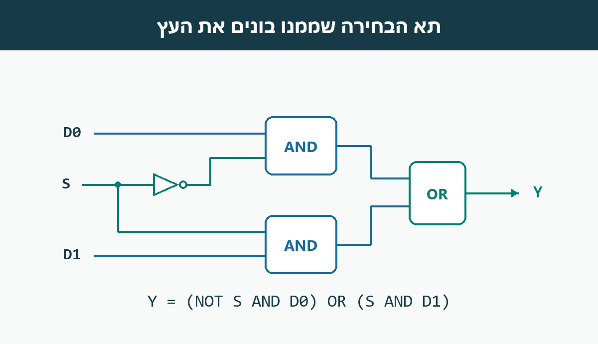
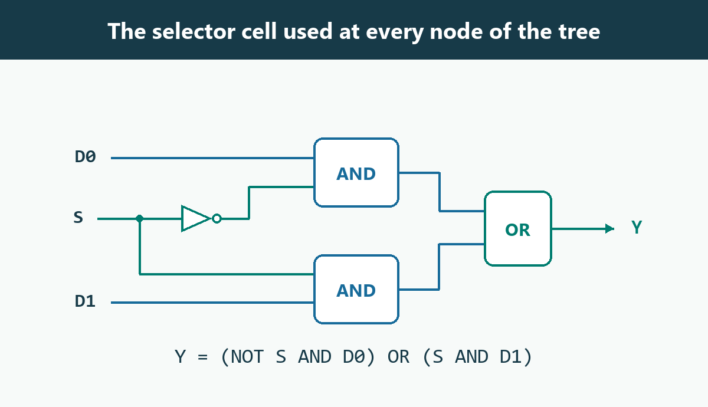

# PREP-214 — מרבב 4:1 משלושה מרבבי 2:1

הצעה לפתרון. ביקורת מקצועית אנושית ממתינה.

## עברית

### הרחבה: בניית תא הבורר בשערים ושימוש בו שלוש פעמים
התחילו בשערי NOT, AND ו־OR ובנו בורר 2:1. העמידו לרשותכם עותקים של התא שבניתם והרכיבו מהם בורר 4:1 בסדר הרגיל D0 עד D3. פרטו את קווי הבחירה ואת סדר הקלטים.

1. כיצד מעבירים ערך רק אם תנאי בחירה מתקיים?
2. כתבו מכפלה אחת ל־S=0 ואחת ל־S=1. חברו את שתי התוצאות.
3. בשלב הראשון חלקו את הכניסות לזוגות סמוכים. איזו סיבית בוחרת בין זוגות?

### תא בסיס ועץ של שתי שכבות

#### כיווני חשיבה להרחבה
1. כיצד מעבירים ערך רק אם תנאי בחירה מתקיים?
2. כתבו מכפלה אחת ל־S=0 ואחת ל־S=1. חברו את שתי התוצאות.
3. בשלב הראשון חלקו את הכניסות לזוגות סמוכים. איזו סיבית בוחרת בין זוגות?

תא יחיד מחשב `M(S,D0,D1)=(¬S∧D0)∨(S∧D1)`. נדרשים מהפך אחד, שני שערי AND ושער OR. בדיוק אחד מאיברי המכפלה יכול להעביר נתון. בשכבה הראשונה חשבו `L=M(S0,D0,D1)` ו־`H=M(S0,D2,D3)`. בשכבה השנייה חברו `Y=M(S1,L,H)`. לכן ערכי S1S0 לפי הסדר 00, 01, 10, 11 בוחרים D0, D1, D2, D3. נתיב נתון עובר בשניים מתוך שלושת התאים. אם מתייחסים לכל תא כקופסה נפרדת, שלושת התאים מכילים יחד 12 שערים בסיסיים. אפשר לשתף את ההיפוך של S0 רק כשמתירים שינוי בתוך התאים.

## English

### Follow-up: Build the selector cell from gates, then reuse it three times
Start from NOT, AND and OR gates to build a 2:1 MUX. Use only copies of the completed cell to build a 4:1 MUX in conventional D0 through D3 order. Specify all selectors and input ordering.

1. How can you pass a value only if a select condition holds?
2. Write one product term for S=0 and one for S=1. Combine their outputs.
3. Start with adjacent input pairs. Which select bit chooses between the pairs?

### The basic cell and its two-level tree

#### Hints for the follow-up
1. How can you pass a value only if a select condition holds?
2. Write one product term for S=0 and one for S=1. Combine their outputs.
3. Start with adjacent input pairs. Which select bit chooses between the pairs?

One cell computes `M(S,D0,D1)=(¬S∧D0)∨(S∧D1)` using one inverter, two AND gates and one OR gate. Exactly one product term is enabled. The first stage produces `L=M(S0,D0,D1)` and `H=M(S0,D2,D3)`. The second stage gives `Y=M(S1,L,H)`. Select values S1S0 in order 00, 01, 10, 11 choose D0, D1, D2, D3. A data path crosses two of the three cells. Treating them as three separate copies gives 12 basic gates. Sharing the S0 inverter requires opening the cells.

[צילום מקור פנימי 19](../sources/2026-11-18-batch21-19.png)
[קובץ המימוש](../solutions/digital1118b.sv)
[תוצאות בדיקות](../checks/digital1118b-verification.json)
