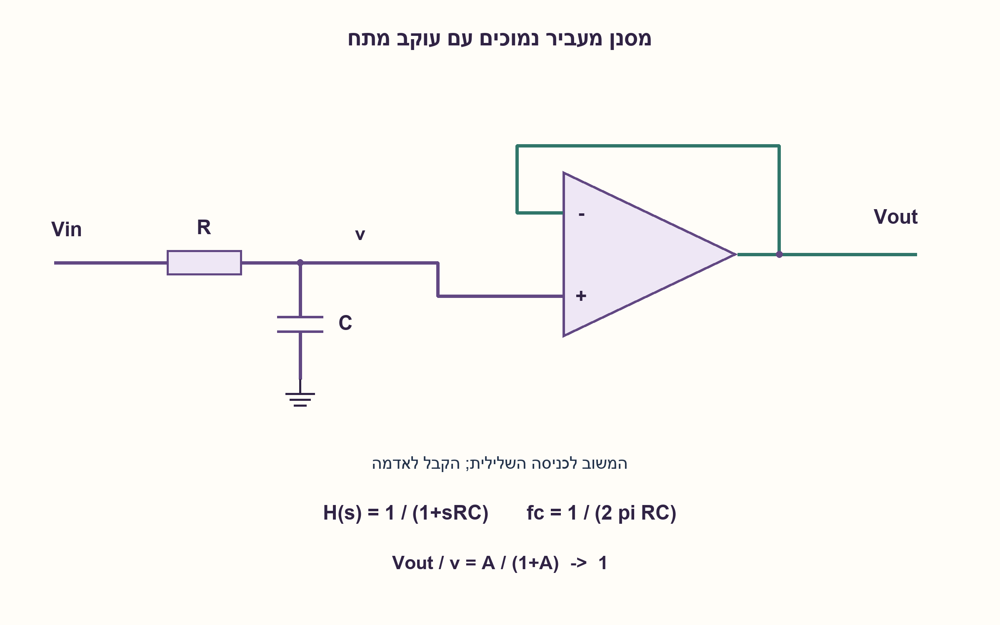
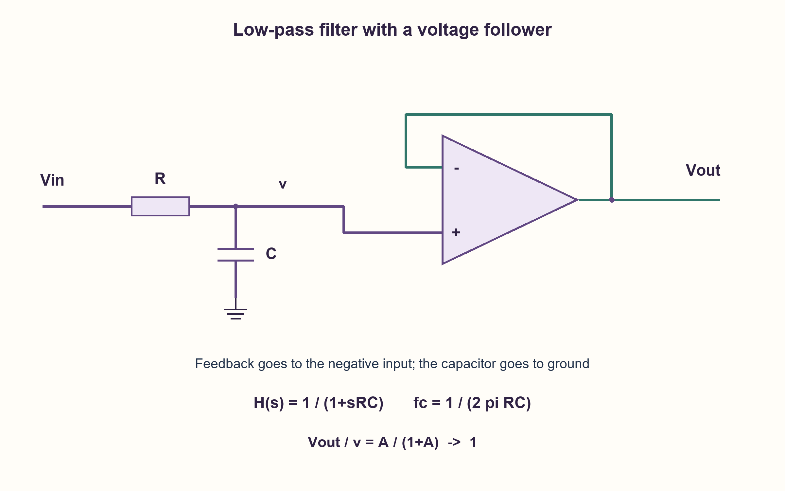

# PREP-221 — מסנן מעביר נמוכים ומגבר עוקב בעל הגבר יחידה

פתרון מוצע בסיוע AI; ביקורת מקצועית אנושית ממתינה. הקושי אינו מכויל.

[צילום מקור פרטי](../sources/2026-10-31-batch22-02.png)

ממש LPF. איך עובד מגבר יחידה?

חברות לפי הדיווח בצילום בלבד: Amazon, Marvell.

## עברית

ממשו מסנן מעביר נמוכים LPF והסבירו כיצד פועל מגבר בעל הגבר יחידה.

הניחו מסנן מסדר ראשון, הגבר DC יחידה, מקור מתח אידאלי ועומס בעל התנגדות כניסה גבוהה. בחרו תדר חיתוך fc>0 והסבירו כיצד לבחור R, C חיוביים; כדוגמה חשבו R=10 kΩ ו־C=10 nF. הוסיפו מגבר עוקב כדי לבודד עומס, ופרטו את המשוב, תפקודו והמגבלות של מגבר אמיתי. אין דרישה לספריית רכיבים או לתדר חיתוך מספרי מסוים.

1. באיזה רכיב העכבה קטנה בתדר גבוה? אם רוצים להחליש תדרים גבוהים, היכן נמדוד את המתח?
2. חברו R בטור והוציאו את המתח מהצומת שבה C לאדמה. כתבו KCL או מחלק מתח עם Zc=1/(sC).
3. למגבר עוקב מחברים את היציאה לכניסה ההופכת ואת צומת המסנן לכניסה הלא־הופכת; פתרו Vout=A(Vin−Vout).

### מתחילים ממחלק מתח שתלוי בתדר
חברו Vin דרך R אל צומת v, ואת C בין v לאדמה. מודדים v על פני הקבל. בתדר נמוך הקבל כמעט אינו מושך זרם ולכן v קרוב ל־Vin; בתדר גבוה הוא מספק מסלול לאדמה והמתח בצומת קטן. לפי KCL: (Vin−v)/R=C·dv/dt. בתנאי התחלה אפסיים מתקבל H(s)=v/Vin=1/(1+sRC).

ההגבר המוחלט בתדר f הוא 1/sqrt(1+(2πfRC)²), והפאזה −atan(2πfRC). ב־fc=1/(2πRC) ההגבר הוא 1/sqrt(2), כלומר כ־−3.01 dB ביחס ל־DC, והפאזה −45°. מעל החיתוך השיפוע האסימפטוטי הוא −20 dB לעשור. זהו מסנן חלק ולא חומה שמוחקת כל תדר מעל fc. בוחרים למשל C ואז R=1/(2πfcC). בדוגמה RC=100 μs ולכן fc≈1591.55 Hz. עבור מדרגה קבועה, v(t)=Vin+(v(0)−Vin)e^(−t/RC); מתח הקבל רציף ו־RC הוא קבוע זמן, לא הזמן שבו הגיע לערכו הסופי.

### מה מגבר יחידה מוסיף אם ההגבר הוא אחד?
חברו v לכניסה + של מגבר השרת, ואת יציאתו ישירות לכניסה −. אין קצר פיזי בין הכניסות. במשוב שלילי ובתחום הליניארי Vout=A(v−Vout), ולכן Vout/v=A/(1+A), המתקרב ל־1 כאשר ההגבר בחוג פתוח גדול. אילו Vout היה נמוך מן הקלט, הפרש חיובי היה דוחף אותו לעלות, ולהפך. הכניסה בעלת עכבה גבוהה והיציאה מסוגלת להניע עומס; האנרגיה מגיעה ממסילות ההזנה. לכן עוקב יכול להעתיק מתח בלי להעמיס מאוד את צומת RC, אף שאינו מגביר את המתח.

המודל H(s) מניח שהעוקב אידאלי. מגבר אמיתי חייב להיות יציב בהגבר יחידה, בתחום common-mode ובטווח היציאה, עם זרם הנעה ו־slew rate מספיקים. תדר חיתוך המסנן צריך להיות בתחום שבו תגובת העוקב קרובה ליחידה; GBW גדול יחסית מסייע אך אינו לבדו אישור יציבות עם עומס קיבולי. בעומס נגדי שמחובר ישירות לצומת RC מתקבלים שינוי הגבר DC וקבוע זמן: אין להמשיך להשתמש באותה נוסחה ללא בדיקת העומס. משוב חיובי או רוויה אינם מקיימים V+=V−.

עלות הבנייה: נגד וקבל, ועוד מגבר שרת והזנתו כשנדרש בידוד. אלה עלויות מבנה, ללא טענת מינימום רעש, הספק או שטח. האימות הוא חישוב ומודל ODE/תדר, לא SPICE או מדידה. רקע למגבר העוקב: [TI, Handbook of Operational Amplifier Applications](https://www.ti.com/lit/an/sboa092b/sboa092b.pdf).

### מודל Python שנבדק

```python
"""First-order RC/filter-follower teaching model; not SPICE or device signoff."""
import cmath
import math


def response(r, c, frequency):
    if r <= 0 or c <= 0 or frequency < 0:
        raise ValueError('R,C positive; frequency nonnegative')
    return 1 / (1 + 2j * math.pi * frequency * r * c)


def cutoff(r, c):
    if r <= 0 or c <= 0:
        raise ValueError('R,C must be positive')
    return 1 / (2 * math.pi * r * c)


def step(r, c, vin, initial, time):
    if r <= 0 or c <= 0 or time < 0:
        raise ValueError('Invalid RC step parameters')
    return vin + (initial - vin) * math.exp(-time / (r * c))


def follower(vin, open_loop_gain):
    if open_loop_gain <= 0:
        raise ValueError('Positive DC open-loop gain required')
    return vin * open_loop_gain / (1 + open_loop_gain)


def magnitude_phase(r, c, frequency):
    value = response(r, c, frequency)
    return abs(value), cmath.phase(value)
```




### assumptions

```json
[
  "מסנן RC מסדר ראשון, מקור אידאלי וכניסת עומס בעלת התנגדות גבוהה.",
  "העוקב פועל במשוב שלילי, יציב וללא רוויה; רכיבים חיוביים ותנאי התחלה מפורשים."
]
```

### optimality

R ו־C ועוקב אופציונלי; אין טענת אופטימליות פיזית. דרגות סינון נוספות נדרשות אם המפרט דורש שיפוע חד יותר.

### verification

נבדקו KCL בתדר, נקודת החיתוך ותגובת מדרגה מול אינטגרציית ODE עצמאית. אין SPICE, בדיקת יציבות מגבר מסוים או חומרה.

### edge_cases

```json
[
  "f=0 נותן הגבר יחידה במודל הלא־עמוס.",
  "בתנאי התחלה שאינם אפס חייבים להוסיף את תגובת המצב ההתחלתי.",
  "עומס נמוך או רוויה פוסלים את העתקת נוסחת המודל."
]
```

### common_mistakes

```json
[
  "למדוד על הנגד ולקבל HPF במקום LPF.",
  "לחשוב שהמגבר מפיק אנרגיה בלי אספקה.",
  "להניח שכל מגבר שרת יציב בהגבר יחידה או מגיע עד המסילות."
]
```

### interview_answer

נגד בטור וקבל לאדמה נותנים H=1/(1+sRC), עם fc=1/(2πRC). עוקב במשוב שלילי שומר הגבר מתח קרוב ליחידה ומבודד את העומס, בכפוף למגבלות המגבר.

### source_ambiguities

סדר המסנן, תדר החיתוך, העומס וההזנה לא הוגדרו; המימוש הראשי מגדיר חוזה מסדר ראשון. מגבר יחידה מפורש כעוקב מתח.

### solution_extensions

```json
[
  {
    "question": "מה משתנה אם עומס RL מחובר ישירות לצומת הקבל?",
    "answer_direction": "הגבר DC הוא RL/(R+RL), וקבוע הזמן (R||RL)C. עוקב אידאלי מבודד את RL מהצומת.",
    "principle": "עומס משנה את המעגל ולא רק את הזרם ביציאה."
  }
]
```

## English

Implement a low-pass filter, LPF, and explain a unity-gain amplifier.

Assume a first-order filter, unity DC gain, an ideal voltage source and a high-input-resistance load. Choose fc>0 and show how positive R, C determine it; use R=10 kΩ and C=10 nF as a worked example. Add a voltage follower for load isolation, specifying feedback, operation and real-device limits. No particular component library or numerical cutoff is required.

1. Which component has lower impedance at high frequency? Where should voltage be measured to attenuate high frequencies?
2. Use a series R and a capacitor from the output node to ground. Apply KCL or the divider with Zc=1/(sC).
3. For a follower, feed output back to the inverting input and drive the noninverting input from the filter node; solve Vout=A(Vin−Vout).

### Start with a frequency-dependent voltage divider
Connect Vin through R to node v and C from v to ground. Measure across the capacitor. At low frequency little current flows through C, so v approaches Vin; at high frequency the capacitor shunts the node toward ground. KCL gives (Vin−v)/R=C·dv/dt. With zero initial conditions, H(s)=v/Vin=1/(1+sRC).

At frequency f, magnitude is 1/sqrt(1+(2πfRC)²) and phase is −atan(2πfRC). At fc=1/(2πRC), magnitude is 1/sqrt(2), about −3.01 dB relative to DC, and phase is −45°. The high-frequency asymptotic slope is −20 dB per decade. This is gradual attenuation, not a brick wall deleting everything above fc. Choose C and set R=1/(2πfcC), for example. Here RC=100 μs and fc≈1591.55 Hz. For a constant step, v(t)=Vin+(v(0)−Vin)e^(−t/RC): capacitor voltage is continuous, and RC is a time constant rather than a finite settling endpoint.

### Why use an amplifier whose voltage gain is one?
Connect v to the op-amp's + input and output directly back to its − input. The inputs are not physically shorted. Under negative feedback in the linear operating region, Vout=A(v−Vout), so Vout/v=A/(1+A), approaching 1 for large open-loop gain. If output is too low, positive input error drives it upward, and conversely. High input impedance and low output impedance let the follower copy voltage while driving a load; energy comes from the supply rails. It therefore isolates the RC node even without voltage amplification.

The stated H(s) assumes an ideal follower. A real amplifier must be unity-gain stable, satisfy input common-mode and output-swing limits, and provide adequate output current and slew rate. Operate where the follower remains close to unity; relatively high GBW helps but alone does not certify stability under capacitive load. A resistor loading the RC node directly changes DC gain and the time constant, so the unloaded formula must be rederived. Positive feedback or saturation does not justify V+=V−.

Construction cost is one resistor and capacitor, plus an op-amp and supplies when isolation is required. No global noise, power or area minimum is claimed. Verification uses frequency and ODE models, not SPICE or measurement. Follower background: [TI, Handbook of Operational Amplifier Applications](https://www.ti.com/lit/an/sboa092b/sboa092b.pdf).

### Verified Python teaching model

```python
"""First-order RC/filter-follower teaching model; not SPICE or device signoff."""
import cmath
import math


def response(r, c, frequency):
    if r <= 0 or c <= 0 or frequency < 0:
        raise ValueError('R,C positive; frequency nonnegative')
    return 1 / (1 + 2j * math.pi * frequency * r * c)


def cutoff(r, c):
    if r <= 0 or c <= 0:
        raise ValueError('R,C must be positive')
    return 1 / (2 * math.pi * r * c)


def step(r, c, vin, initial, time):
    if r <= 0 or c <= 0 or time < 0:
        raise ValueError('Invalid RC step parameters')
    return vin + (initial - vin) * math.exp(-time / (r * c))


def follower(vin, open_loop_gain):
    if open_loop_gain <= 0:
        raise ValueError('Positive DC open-loop gain required')
    return vin * open_loop_gain / (1 + open_loop_gain)


def magnitude_phase(r, c, frequency):
    value = response(r, c, frequency)
    return abs(value), cmath.phase(value)
```




### assumptions

```json
[
  "First-order RC, ideal source and high-resistance load input.",
  "Follower uses stable negative feedback without saturation; positive components and explicit initial conditions."
]
```

### optimality

R and C with an optional follower; no physical optimum. A steeper specified rolloff requires additional filtering order.

### verification

Checked frequency-domain KCL, the cutoff and step response against an independent ODE integration. No SPICE, particular-amplifier stability check or hardware test.

### edge_cases

```json
[
  "At f=0 the unloaded model has unity gain.",
  "Nonzero initial voltage adds an initial-state response.",
  "Heavy loading or saturation invalidates copying the ideal formula."
]
```

### common_mistakes

```json
[
  "Measuring across R produces a high-pass response instead.",
  "Assuming the amplifier creates power without supplies.",
  "Assuming every op-amp is unity-gain stable or reaches both rails."
]
```

### interview_answer

A series resistor and shunt capacitor give H=1/(1+sRC), fc=1/(2πRC). A negative-feedback follower keeps near-unity voltage gain while isolating the load, subject to device limits.

### source_ambiguities

Order, cutoff, load and supplies were unspecified; the main construction states a first-order contract. Unity gain is interpreted as a voltage follower.

### solution_extensions

```json
[
  {
    "question": "What if RL directly loads the capacitor node?",
    "answer_direction": "DC gain is RL/(R+RL), with time constant (R||RL)C. An ideal follower isolates RL from that node.",
    "principle": "Loading changes the transfer function, not just output current."
  }
]
```
