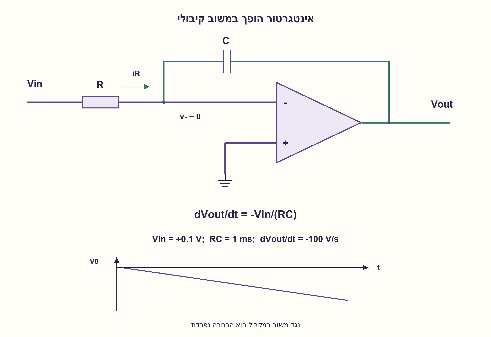
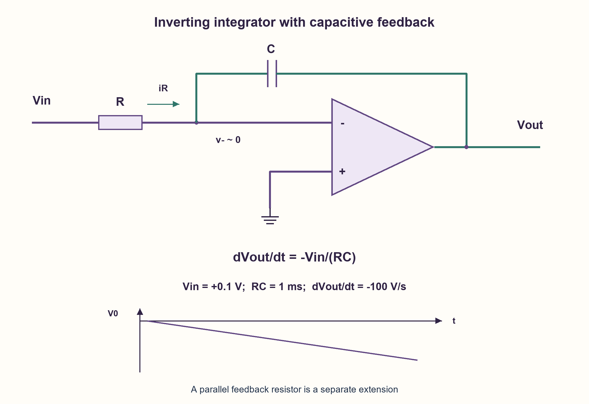

# PREP-222 — מגבר שרת עם קבל במשוב: אינטגרטור הופך

פתרון מוצע בסיוע AI; ביקורת מקצועית אנושית ממתינה. הקושי אינו מכויל.

[צילום מקור פרטי](../sources/2026-10-31-batch22-03.png)

נתון מעגל עם מגבר שרת וצריך לתאר מה המעגל הזה עושה. [בשרטוט: Vin דרך R לכניסה העליונה של מגבר השרת, הכניסה התחתונה להארקה וקבל C במשוב מן המוצא לכניסה העליונה.]

חברות לפי הדיווח בצילום בלבד: Elbit.

## עברית

נתון Vin דרך נגד R אל כניסה אחת של מגבר שרת, קבל C מהיציאה אל אותה כניסה, והכניסה השנייה מוארקת. תארו את פעולת המעגל, את תגובתו למתח קבוע ולאות סינוסי ואת מגבלותיו.

לניתוח הניחו שהכניסה שאליה מגיע R היא הכניסה ההופכת −, ושהכניסה המוארקת היא +, כך שהמשוב שלילי. R, C חיוביים, המגבר אידאלי ופועל בתחום הליניארי. יש לשמור את תנאי ההתחלה Vout(0), ולא להניחו אפס בלי לציין זאת. דונו גם בנגד RF במקביל לקבל כהרחבה מעשית נפרדת.

1. במשוב שלילי אידאלי, מה מתח צומת הכניסה ההופכת ומה הזרם שנכנס למגבר?
2. הזרם בנגד צריך לעבור בקבל. כתבו את כיוון זרם הקבל כ־C·d(V−−Vout)/dt.
3. מתקבל dVout/dt=−Vin/(RC). בצעו אינטגרציה בזמן עם תנאי התחלה; מתח קבוע נותן שיפוע ולא ערך יציאה קבוע.

### זרם בנגד הופך לשינוי מטען
הכניסה + מוארקת. כאשר המשוב שלילי והמגבר עדיין ליניארי, צומת − היא אדמה וירטואלית: מתח קרוב לאפס, בלי חיבור קצר לאדמה ובלי זרם כניסה במודל האידאלי. בנגד זורם Vin/R אל הצומת. הזרם ממשיך לקבל, ולכן Vin/R=C·d(0−Vout)/dt. מכאן dVout/dt=−Vin/(RC), או Vout(t)=Vout(0)−(1/RC)∫₀ᵗVin(u)du.

### דוגמאות ותנאי התחלה
ב־R=10 kΩ, C=100 nF מתקבל RC=1 ms. אם Vin=0.1 V ו־Vout(0)=0, השיפוע −100 V/s והיציאה אחרי 2 ms היא −0.2 V. אות שלילי נותן שיפוע חיובי; Vin=0 שומר את המצב ההתחלתי במודל האידאלי. עבור Vin=Vp sin(ωt), הפתרון הוא Vout(0)+(Vp/(ωRC))(cos(ωt)−1). האיבר הקבוע חשוב: קוסינוס בלבד אינו מקיים בדרך כלל את תנאי ההתחלה. עבור תיאור סינוסי של המצב המחזורי, הגבר החוג הוא −1/(jωRC), שגודלו 1/(ωRC) ופאזתו +90° ביחס לסינוס. אין בכך השמטת ההיפוך: הסימן כבר כלול בפונקציית התמסורת.

פונקציית התמסורת H(s)=−1/(sRC) מניחה תנאי התחלה אפסיים. זהו אינטגרטור, ולא מגבר DC בעל הגבר סופי. אפילו מתח DC קטן או מתח היסט של מגבר אמיתי מצטברים עד לרוויה. למשל, במסילות ±5 V ובאות הדוגמה, המודל הליניארי מגיע מ־0 למסילה התחתונה אחרי 50 ms; מעבר לכך אסור להמשיך את הרמפה כאילו המגבר אידאלי ללא גבול. זמן התאוששות, זרמי כניסה, רוחב פס ו־slew rate דורשים נתוני רכיב.

### הרחבה: אינטגרטור דולף
נגד RF במקביל לקבל מספק נתיב משוב ב־DC. עכבת המשוב היא RF/(1+sRF C), ולכן H(s)=−(RF/R)/(1+sRF C). ב־DC זהו מגבר הופך בעל הגבר −RF/R; בתדרים שבהם ωRF C גדול מאחד, אך עדיין בתוך תחום פעולת המגבר, הוא קרוב לאינטגרטור. ההרחבה משנה את המעגל המקורי ויש לציירה בנפרד. היא מגבילה סחיפת DC אך אינה מבטיחה שכל עומס או מגבר יהיו יציבים.

הנכונות נובעת מ־KCL ויחס המטען של הקבל. עלות המבנה היא נגד וקבל במשוב ומגבר, ועוד RF בהרחבה; אין טענת אופטימום פיזי. בוצע אימות מספרי של משוואות המודל, לא SPICE או מדידת מגבר. ראו גם [TI, Integrator circuit](https://www.ti.com/tool/CIRCUIT060027).

### מודל Python שנבדק

```python
"""Ideal inverting integrator and explicit leaky-integrator extension."""
import math


def constant_input(r, c, vin, initial, time):
    if r <= 0 or c <= 0 or time < 0:
        raise ValueError('Invalid integration parameters')
    return initial - vin * time / (r * c)


def piecewise_constant(r, c, initial, segments):
    out = initial
    for duration, vin in segments:
        out = constant_input(r, c, vin, out, duration)
    return out


def sinusoid(r, c, amplitude, omega, initial, time):
    if r <= 0 or c <= 0 or omega <= 0 or time < 0:
        raise ValueError('Invalid sinusoid parameters')
    return initial + amplitude * (math.cos(omega * time) - 1) / (omega * r * c)


def practical_response(r, c, rf, frequency):
    if min(r, c, rf) <= 0 or frequency < 0:
        raise ValueError('Invalid practical integrator parameters')
    return -(rf / r) / (1 + 2j * math.pi * frequency * rf * c)


def dc_rail_time(r, c, vin, initial, lower, upper):
    """Ideal time to first rail; says nothing about post-saturation recovery."""
    if not lower < initial < upper or r <= 0 or c <= 0:
        raise ValueError('Initial output must lie strictly inside rails')
    if vin == 0:
        return math.inf
    target = lower if vin > 0 else upper
    return (initial - target) * r * c / vin
```




### assumptions

```json
[
  "R מגיע לכניסה −, הקבל במשוב שלילי והכניסה + מוארקת.",
  "מגבר אידאלי בתחום ליניארי, ללא רוויה; מתח התחלתי נשמר במפורש."
]
```

### optimality

נגד, קבל ומגבר; RF הוא הרחבה נפרדת. אין הוכחת מינימום רכיבים או טענה על דיוק של מעגל פיזי.

### verification

אינטגרציה של קלטים קבועים ומקטעיים וסינוס נבדקה מול אינטגרציה נומרית עצמאית; נבדקו DC ותדרים במודל RF. אין SPICE או מדידה.

### edge_cases

```json
[
  "Vin=0 שומר תנאי התחלה במודל אידאלי.",
  "הסימן משתנה עם קוטביות הקלט.",
  "במסילה נגמר תוקף הניתוח הליניארי."
]
```

### common_mistakes

```json
[
  "להשמיט Vout(0).",
  "להתייחס לאדמה וירטואלית כאל קצר פיזי.",
  "לכנות את האינטגרטור האידאלי LPF עם הגבר DC יחידה.",
  "להוסיף RF בלי לומר שהמבנה השתנה."
]
```

### interview_answer

לפי KCL בכניסה − מתקבל dVout/dt=−Vin/(RC). לכן הפלט הוא אינטגרל הופכי עם תנאי התחלה. DC מצטבר לרוויה; RF במקביל לקבל מגביל הגבר DC.

### source_ambiguities

סימוני הקוטביות אינם חד־משמעיים; החוזה מגדיר כניסה הופכת ומשוב שלילי. חיבור לקבל בכניסה + דורש ניתוח שונה ואינו אותו אינטגרטור.

### solution_extensions

```json
[
  {
    "question": "מה התגובה למדרגה אם מוסיפים RF במקביל לקבל?",
    "answer_direction": "זו תגובת מסדר ראשון למתח הסופי −RF*Vin/R, עם קבוע זמן RF*C ותנאי התחלה.",
    "principle": "נתיב DC סופי הופך צבירה בלתי מוגבלת להתכנסות."
  }
]
```

## English

Vin enters through resistor R into one op-amp input; capacitor C feeds output back to the same input, and the other input is grounded. Explain the operation, response to DC and sinusoidal input, and limitations.

Assume the R-connected input is inverting − and the grounded input is +, giving negative feedback. R, C are positive and the op-amp is ideal within its linear range. Retain Vout(0), rather than silently setting it to zero. Discuss a parallel feedback resistor RF as a separate practical extension.

1. With ideal negative feedback, what are the inverting-node voltage and amplifier input current?
2. Resistor current must flow through the capacitor. Write its direction as C·d(V−−Vout)/dt.
3. Thus dVout/dt=−Vin/(RC). Integrate with the initial condition; a DC input gives a ramp rather than a constant output.

### Resistor current becomes changing charge
The + input is grounded. While negative feedback keeps the amplifier linear, the − node is a virtual ground: near zero voltage without a physical ground short and with zero input current in the ideal model. Resistor current Vin/R flows into the capacitor, so Vin/R=C·d(0−Vout)/dt. Thus dVout/dt=−Vin/(RC), or Vout(t)=Vout(0)−(1/RC)∫₀ᵗVin(u)du.

### Examples and the initial condition
With R=10 kΩ, C=100 nF, RC=1 ms. Vin=0.1 V and Vout(0)=0 give slope −100 V/s and output −0.2 V after 2 ms. Negative input reverses the slope; zero input preserves the initial output in the ideal model. For Vin=Vp sin(ωt), the solution is Vout(0)+(Vp/(ωRC))(cos(ωt)−1). The constant term matters: a cosine alone generally fails the initial condition. In sinusoidal periodic analysis, H(jω)=−1/(jωRC), with magnitude 1/(ωRC) and phase +90° relative to the input sine. This does not omit inversion: its sign is already included in the transfer function.

H(s)=−1/(sRC) assumes zero initial conditions. This is an integrator, not a finite-DC-gain amplifier. A small DC input or real op-amp offset accumulates until saturation. For example, with ±5 V rails the stated input ramps from zero to the lower rail after 50 ms in the linear model; it must not be extrapolated beyond that point as unlimited output. Recovery, bias current, bandwidth and slew rate require actual device data.

### Extension: a leaky integrator
Putting RF in parallel with C supplies a DC feedback path. Feedback impedance becomes RF/(1+sRF C), giving H(s)=−(RF/R)/(1+sRF C). At DC this is an inverting amplifier with gain −RF/R; where ωRF C is much greater than one, while remaining within amplifier limits, it approximates integration. This is a changed circuit and is shown separately. It limits DC drift but does not certify stability for every load and amplifier.

KCL and the capacitor charge relation prove the teaching model. Construction uses a resistor, feedback capacitor and op-amp, with RF added only in the extension; no physical optimum is claimed. Numerical equation checks are not SPICE or device measurements. See also [TI, Integrator circuit](https://www.ti.com/tool/CIRCUIT060027).

### Verified Python teaching model

```python
"""Ideal inverting integrator and explicit leaky-integrator extension."""
import math


def constant_input(r, c, vin, initial, time):
    if r <= 0 or c <= 0 or time < 0:
        raise ValueError('Invalid integration parameters')
    return initial - vin * time / (r * c)


def piecewise_constant(r, c, initial, segments):
    out = initial
    for duration, vin in segments:
        out = constant_input(r, c, vin, out, duration)
    return out


def sinusoid(r, c, amplitude, omega, initial, time):
    if r <= 0 or c <= 0 or omega <= 0 or time < 0:
        raise ValueError('Invalid sinusoid parameters')
    return initial + amplitude * (math.cos(omega * time) - 1) / (omega * r * c)


def practical_response(r, c, rf, frequency):
    if min(r, c, rf) <= 0 or frequency < 0:
        raise ValueError('Invalid practical integrator parameters')
    return -(rf / r) / (1 + 2j * math.pi * frequency * rf * c)


def dc_rail_time(r, c, vin, initial, lower, upper):
    """Ideal time to first rail; says nothing about post-saturation recovery."""
    if not lower < initial < upper or r <= 0 or c <= 0:
        raise ValueError('Initial output must lie strictly inside rails')
    if vin == 0:
        return math.inf
    target = lower if vin > 0 else upper
    return (initial - target) * r * c / vin
```




### assumptions

```json
[
  "R drives −, the capacitor forms negative feedback, and + is grounded.",
  "Ideal linear amplifier without saturation; initial voltage is explicit."
]
```

### optimality

Resistor, capacitor and op-amp; RF is a separate extension. No component-minimum proof or physical accuracy claim.

### verification

Constant, piecewise and sinusoidal inputs were checked against independent numerical integration; RF DC/frequency behavior was checked. No SPICE or measurement.

### edge_cases

```json
[
  "Zero input preserves ideal initial state.",
  "Input polarity changes the ramp sign.",
  "The linear analysis ends at a rail."
]
```

### common_mistakes

```json
[
  "Dropping Vout(0).",
  "Treating virtual ground as a physical short.",
  "Calling the ideal integrator a unity-DC-gain LPF.",
  "Adding RF without acknowledging a changed circuit."
]
```

### interview_answer

KCL at − gives dVout/dt=−Vin/(RC): inverted integration with an initial condition. DC accumulates toward saturation; RF across C limits DC gain.

### source_ambiguities

Polarity labels are indistinct; the contract explicitly chooses the inverting input and negative feedback. Feedback to + is a different circuit and not this integrator.

### solution_extensions

```json
[
  {
    "question": "What is the step response with RF across C?",
    "answer_direction": "A first-order response toward −RF*Vin/R, time constant RF*C, retaining the initial state.",
    "principle": "A finite DC path replaces unlimited accumulation with convergence."
  }
]
```
