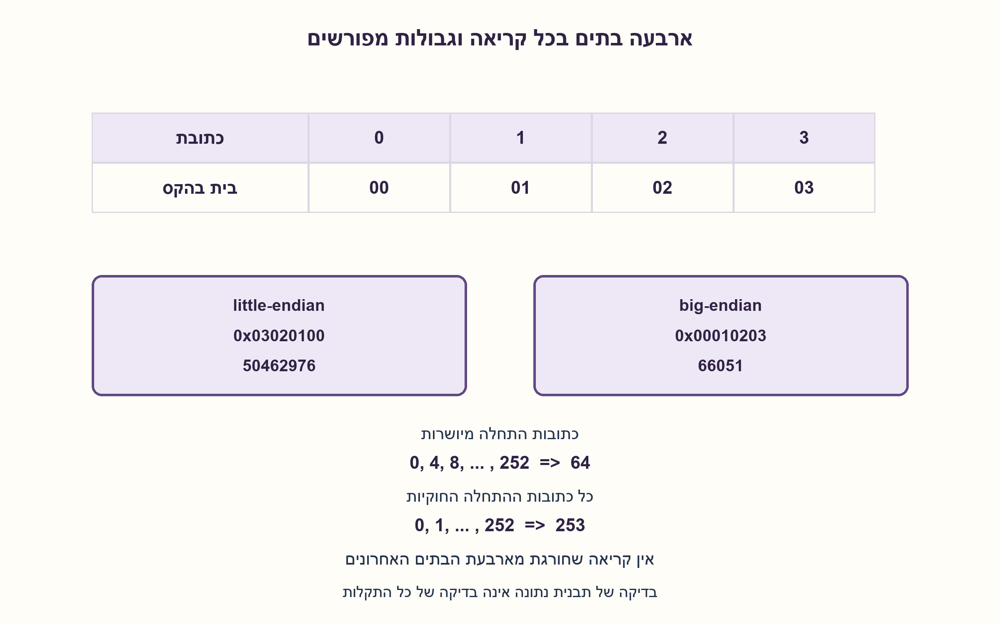
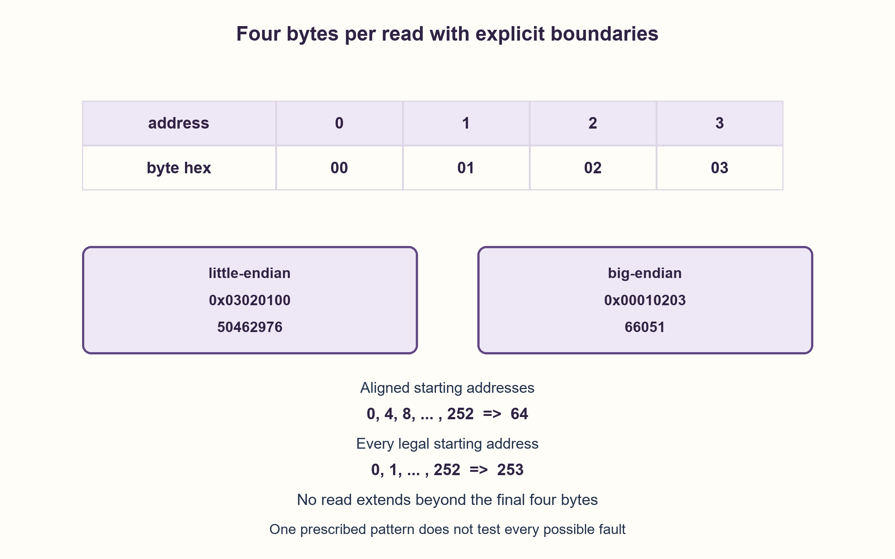

# PREP-223 — קריאת ארבעה בתים ובדיקת זיכרון ramp

פתרון מוצע בסיוע AI; ביקורת מקצועית אנושית ממתינה. הקושי אינו מכויל.

[צילום מקור פרטי](../sources/2026-10-31-batch22-04.png)

רוצים לבדוק זכרון בגודל של 256 בתים (כל בית=8 ביטים). לשם כך יש לנו רק פונקציה אחת: int read(adress). הפונקציה קוראת מהזכרון 4 בתים (32 ביטים), בכתובת השווה לערך המשתנה adress. הזכרון צריך להיות מאותחל לפונקציית ramp, כלומר הבתים מסודרים כך: 00000000 00000001 00000010 00000011... א. מה מחזיר read(0)? ב. כתוב קוד שבודק את כל הזכרון.

חברות לפי הדיווח בצילום בלבד: Amazon.

## עברית

זיכרון בן 256 בתים אמור להכיל m[i]=i לכל כתובת בית i מ־0 עד 255. הפונקציה היחידה היא int read(address), שקוראת ארבעה בתים רצופים החל מכתובת הבית שנמסרה ומחזירה את 32 הביטים שלהם. א. מה מחזיר read(0)? ב. כתבו בדיקה לכל הזיכרון.

יש להציג בנפרד little-endian ו־big-endian, ולא להסיק סדר בתים מהכתיב של רצף הבתים. הניחו שתוכן הזיכרון יציב, קריאות חסומות שאינן נגללות וסמנטיקת 32 ביטים. המימוש הראשי משתמש בכתובות מיושרות ל־4; אם מותרת כל כתובת, הסבירו כיצד בודקים גם כל חלון בן ארבעה בתים. אין פונקציית כתיבה ואין דרישה לתקן זיכרון פגום.

1. לפני החישוב, הגדירו איזה בית נכנס לביטים 7..0. האם כתובת 255 היא תחילת קריאה חוקית של ארבעה בתים?
2. צרו את המילה הצפויה מארבעת הערכים a, a+1, a+2, a+3 באמצעות הזזות בלתי מסומנות.
3. השוו בכתובות 0,4,...,252 לכיסוי כל הבתים. לבדיקה של כל כתובת התחלה מותרת עברו 0..252 בצעד אחד.

### אותה סדרת בתים, שתי מילים שונות
בכתובות 0,1,2,3 שמורים 00,01,02,03 בהקסדצימלי. ב־little-endian הבית הראשון הוא הפחות משמעותי: read(0)=`0x03020100`=50462976. ב־big-endian הוא המשמעותי ביותר: `0x00010203`=66051. ללא חוזה סדר בתים אין תשובה מספרית יחידה. זו שאלה על ייצוג, לא על היפוך סדר הביטים בתוך בית.

### בונים ערך צפוי ולא משתמשים בזיכרון כבאורקל של עצמו
לכל התחלה a, ערכי הבתים הצפויים הם a+j עבור j=0,1,2,3. ב־little-endian המילה היא Σ((uint32_t)(a+j) << (8 j)); ב־big-endian משתמשים ב־8(3−j). יש לבצע cast לטיפוס בלתי מסומן לפני ההזזה: למשל 255<<24 בטיפוס int מסומן עלול לחרוג מן המותר ב־C. גם ערך read נשווה כ־uint32_t, כך שמילה עם ביט 31 דלוק אינה כישלון בגלל סימן. ההנחה היא ש־read אכן מחזיר את אותם 32 ביטים לפי החוזה.

כיסוי כל הבתים דורש רק 64 קריאות מיושרות: a=0,4,...,252. כל קריאה מכסה ארבעה בתים שאינם מופיעים בקריאה אחרת. 64 הוא גם חסם תחתון לכיסוי 256 בתים דרך קריאות של ארבעה בתים, כי 63 קריאות יכולות לחשוף לכל היותר 252 בתים. משווים כל מילה לצפוי ועוצרים בכישלון. אם המטרה רחבה יותר — לבדוק את פעולת read לכל התחלה, וקריאות לא מיושרות חוקיות — יש 253 כתובות התחלה 0..252. במקרה זה נדרשות 253 קריאות כדי לבדוק כל פעולת התחלה במפורש. אין לקרוא ב־253,254,255 ואין להניח גלילה או גישה מעבר לזיכרון.

דוגמה: ב־little-endian המילה האחרונה היא `0xFFFEFDFC`, אשר read מסומן יכול להציג כ־−66052; לאחר המרה בלתי מסומנת ההשוואה עדיין תקינה. הקוד המוצע משתמש בפרמטר המגדיר את סדר הבתים ואת סוג הכיסוי. קביעה אוטומטית של סדר הבתים באמצעות אותה זיכרון שנמצא בבדיקה מחלישה את הבדיקה: תקלה יכולה להיראות כבחירת פרשנות. עדיף חוזה חיצוני; אם מבצעים כיול, יש לציין מה הוא אינו יכול להוכיח.

### מה הבדיקה כן ולא מוכיחה
הצלחה מוכיחה שהקריאות שבוצעו החזירו את תבנית ramp הנדרשת בתנאי הבדיקה. היא אינה בודקת כתיבה, שמירת נתונים אחרים, כל תקלה בתזמון או תקלות תלויות דפוס. חוסר התאמה מזהה כישלון אך אינו מזהה לבדו את שורש התקלה. לזיכרון שמשתנה במקביל דרוש snapshot או מנגנון ייצוב. הסיבוכיות המוכללת O(N) זמן ו־O(1) מקום עזר; כאן N=256 קבוע. מספר הקריאות הוא מדד העלות המדויק לחוזי הכיסוי האלה, לא אישור זיכרון מלא בכל מודל תקלות.

### מודל Python שנבדק

```python
"""Read-only fixed-pattern coverage, with explicit endian and boundary rules."""


def expected_word(address, endian):
    if not 0 <= address <= 252 or endian not in ('little', 'big'):
        raise ValueError('Four-byte reads must stay inside 256 bytes')
    shifts = range(0, 32, 8) if endian == 'little' else range(24, -1, -8)
    return sum((address + offset) << shift for offset, shift in enumerate(shifts))


def validate(read, endian, all_offsets=False):
    """Return (pass,read_count); read may return a signed 32-bit representation."""
    addresses = range(253) if all_offsets else range(0, 253, 4)
    count = 0
    for address in addresses:
        count += 1
        if (read(address) & 0xffffffff) != expected_word(address, endian):
            return False, count
    return True, count
```


### קוד C מוצע; אינו חלק מבדיקת מודל Python

```c
/* Proposed C99 reference; requires a platform contract for endian/alignment.
 * The supplied read() returns the bits of a 32-bit word in int32_t form.
 * This source was not compiled in the local Python verification run. */
#include <stdint.h>
#include <stdbool.h>

extern int32_t read(unsigned address);

bool check_ramp(bool little_endian, bool all_offsets) {
    const unsigned stride = all_offsets ? 1u : 4u;
    for (unsigned a = 0; a <= 252u; a += stride) {
        uint32_t expected = 0;
        for (unsigned j = 0; j < 4u; ++j) {
            unsigned shift = little_endian ? 8u * j : 8u * (3u - j);
            expected |= (uint32_t)(a + j) << shift;
        }
        if ((uint32_t)read(a) != expected) return false;
    }
    return true;
}
```




### assumptions

```json
[
  "כתובת היא כתובת בית; כל קריאה מכסה ארבעה בתים, ללא גלילה.",
  "מיפוי סדר בתים וחוקיות קריאות לא מיושרות ניתנים מבחוץ.",
  "ערכי הזיכרון יציבים ו־read מספק 32 ביטים לפי החוזה."
]
```

### optimality

64 קריאות הן מינימום לכיסוי 256 בתים בארבעה בכל קריאה. בדיקת כל התחלה חוקית היא חוזה אחר עם 253 קריאות. O(N) זמן, O(1) מקום.

### verification

מודל Python נבדק מול int.from_bytes, שתי קוטביות סדר בתים, החזרה מסומנת וכל ביט פגום ב־256 בתים. קוד C מוצע נכלל בנפרד; אין כאן בדיקת חומרת RAM.

### edge_cases

```json
[
  "הקריאה האחרונה מתחילה ב־252.",
  "ביט הסימן של המילה האחרונה אינו פגם.",
  "כישלון בקריאה אחת גורר fail ואינו ממשיך כהצלחה."
]
```

### common_mistakes

```json
[
  "להניח little-endian ללא חוזה.",
  "לקרוא ב־255 ארבעה בתים.",
  "להשתמש ב־int מסומן לבניית 255<<24.",
  "לטעון שבדיקת תבנית אחת מוכיחה שכל הכתיבות תקינות."
]
```

### interview_answer

אגדיר סדר בתים ואבנה מילים צפויות מארבעת אינדקסי הבתים. אקרא 0,4,...,252 לכיסוי מלא בלי חריגה, או את כל 253 ההתחלות אם בודקים גם קריאות לא מיושרות.

### source_ambiguities

סדר בתים, יישור ומשמעות int אינם מוגדרים. שתי האפשרויות מוצגות, ומימוש C משתמש בחוזה int32_t/uint32_t מפורש.

### solution_extensions

```json
[
  {
    "question": "האם הצלחה מוכיחה שאין שני כתובות שממופות לאותו תא פיזי בכל מצב?",
    "answer_direction": "היא בודקת את הקריאות והדפוס הנתונים בלבד. לבדיקת aliasing כללית תחת מפת read/write עקבית נדרש מודל ויכולת כתיבה; אין להסיק אותם מממשק קריאה בלבד.",
    "principle": "כיסוי כתובות אינו כיסוי של כל מודלי התקלה."
  }
]
```

## English

A 256-byte memory should contain m[i]=i for byte addresses 0 through 255. Its only function is int read(address), returning the 32 bits of four consecutive bytes starting at that byte address. A. What does read(0) return? B. Write a check covering the memory.

Give little-endian and big-endian cases separately; displayed byte order does not establish endianness. Assume stable contents, bounded nonwrapping reads and 32-bit semantics. The main implementation uses four-byte-aligned addresses; if arbitrary starts are allowed, also explain how to test every four-byte window. No write function or fault-repair requirement exists.

1. Define which byte becomes bits 7..0 before calculating. Can address 255 legally begin a four-byte read?
2. Construct the expected word from a, a+1, a+2, a+3 with unsigned shifts.
3. Compare starts 0,4,...,252 to cover every byte. Testing all permitted starts instead uses 0..252 with stride one.

### The same bytes can represent two different words
Addresses 0,1,2,3 contain hexadecimal bytes 00,01,02,03. In little-endian the first byte is least significant: read(0)=`0x03020100`=50462976. In big-endian it is most significant: `0x00010203`=66051. Endianness must therefore be specified before giving one numeric answer. This is byte ordering, not bit reversal inside each byte.

### Build an independent expected value
For start a, expected bytes are a+j for j=0,1,2,3. A little-endian word is Σ((uint32_t)(a+j) << (8 j)); big-endian uses shifts 8(3−j). Cast to an unsigned type before shifting: an expression such as signed-int 255<<24 can exceed C's permitted signed range. Compare read's result as uint32_t too, so a set bit 31 is not mistaken for failure. This assumes the supplied read function returns those 32 bits according to its contract.

Covering every byte needs only 64 aligned reads at a=0,4,...,252. Each exposes four bytes disjoint from all other reads. This is also a lower bound for byte coverage because 63 four-byte reads expose at most 252 bytes. Compare each word with its expected value and fail on mismatch. A broader goal—checking read for every starting address, when unaligned accesses are permitted—has 253 starts, 0..252. Checking each such operation explicitly requires 253 reads. Never start at 253,254,255 or silently assume wrapping or out-of-range access.

For example, the final little-endian word is `0xFFFEFDFC`, which a signed read may present as −66052; unsigned conversion still permits a correct comparison. The proposed code accepts explicit endian and coverage parameters. Learning endianness solely from the same memory under test weakens the oracle: a fault might look like another interpretation. Prefer an external contract, and state the limits if calibration is used.

### What passing does and does not establish
A pass means the exercised reads returned the required ramp pattern under the test conditions. It does not test writes, other stored patterns, every timing fault or pattern-dependent failures. A mismatch detects a failure without proving its root cause. Concurrently changing memory requires snapshot or stabilization semantics. Generalized cost is O(N) time and O(1) auxiliary space; here N=256 is fixed. Read counts are exact for these coverage contracts, not a universal memory-certification claim.

### Verified Python teaching model

```python
"""Read-only fixed-pattern coverage, with explicit endian and boundary rules."""


def expected_word(address, endian):
    if not 0 <= address <= 252 or endian not in ('little', 'big'):
        raise ValueError('Four-byte reads must stay inside 256 bytes')
    shifts = range(0, 32, 8) if endian == 'little' else range(24, -1, -8)
    return sum((address + offset) << shift for offset, shift in enumerate(shifts))


def validate(read, endian, all_offsets=False):
    """Return (pass,read_count); read may return a signed 32-bit representation."""
    addresses = range(253) if all_offsets else range(0, 253, 4)
    count = 0
    for address in addresses:
        count += 1
        if (read(address) & 0xffffffff) != expected_word(address, endian):
            return False, count
    return True, count
```


### Proposed C; separate from Python-model verification

```c
/* Proposed C99 reference; requires a platform contract for endian/alignment.
 * The supplied read() returns the bits of a 32-bit word in int32_t form.
 * This source was not compiled in the local Python verification run. */
#include <stdint.h>
#include <stdbool.h>

extern int32_t read(unsigned address);

bool check_ramp(bool little_endian, bool all_offsets) {
    const unsigned stride = all_offsets ? 1u : 4u;
    for (unsigned a = 0; a <= 252u; a += stride) {
        uint32_t expected = 0;
        for (unsigned j = 0; j < 4u; ++j) {
            unsigned shift = little_endian ? 8u * j : 8u * (3u - j);
            expected |= (uint32_t)(a + j) << shift;
        }
        if ((uint32_t)read(a) != expected) return false;
    }
    return true;
}
```




### assumptions

```json
[
  "Addresses are byte addresses; reads cover four bytes without wrapping.",
  "Endianness and unaligned-read legality are externally specified.",
  "Memory is stable and read supplies 32-bit contents according to contract."
]
```

### optimality

64 reads are minimal for 256-byte coverage at four bytes per read. Testing every legal start is a different 253-read contract. O(N) time, O(1) space.

### verification

Python was checked against int.from_bytes, both endiannesses, signed returns and every single-bit corruption across 256 bytes. Proposed C is separate; no RAM hardware was tested.

### edge_cases

```json
[
  "The final read starts at 252.",
  "The last word having a sign bit is not corruption.",
  "One mismatching read causes failure rather than a successful result."
]
```

### common_mistakes

```json
[
  "Assuming little-endian without a contract.",
  "Reading four bytes starting at 255.",
  "Constructing 255<<24 in signed int.",
  "Claiming one read-only pattern proves all writes work."
]
```

### interview_answer

Define byte order and assemble expected words from byte indices. Read 0,4,...,252 for full bounded coverage, or all 253 starts when unaligned read operations are also being tested.

### source_ambiguities

Byte order, alignment and int width are unspecified. Both endian cases are shown; proposed C uses an explicit int32_t/uint32_t contract.

### solution_extensions

```json
[
  {
    "question": "Does passing prove two addresses can never share a physical cell?",
    "answer_direction": "It checks the exercised reads and pattern only. General alias testing under a stable read/write map needs its own model and write capability, neither implied by a read-only interface.",
    "principle": "Address coverage is not coverage of every fault model."
  }
]
```
