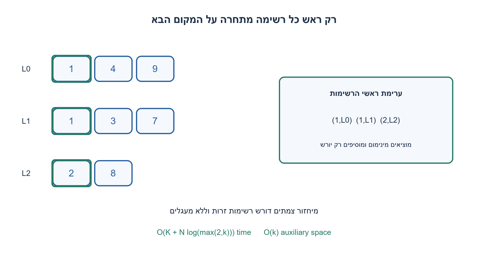
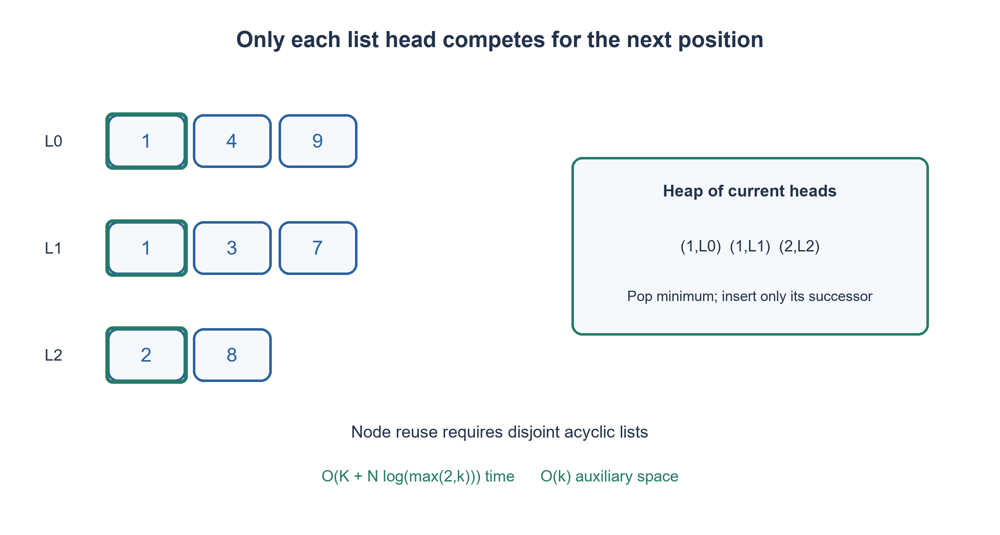

# PREP-224 — מיזוג K רשימות מקושרות ממוינות באמצעות חזית קטנה

פתרון מוצע בסיוע AI; ביקורת מקצועית אנושית ממתינה. הקושי אינו מכויל.

## עברית

נתונות K רשימות מקושרות חד־כיווניות ממוינות בסדר עולה לא־מחמיר, המכילות יחד N צמתים. החזירו רשימה ממוינת אחת. הסבירו אילו צמתים צריכים להשתתף בבחירת האיבר הבא, ומה העלות בזמן ובמקום.

החוזה: רשימות של מספרים שלמים, ללא מעגלים וללא צמתים משותפים; ייתכנו רשימות ריקות וערכים כפולים. מותר לשנות next ולמחזר את הצמתים, והקורא מוותר על מבנה הרשימות המקוריות. בערכים שווים נעדיף את הרשימה שמספרה קטן יותר ונשמור סדר בתוך כל רשימה. הציגו גם את ההבדל מול דרישה לשמר את כל הקלט. ממשק ההרצה המצרף מערכים הוא מתאם לבדיקת ערכים בלבד; הפתרון הראשי ממזג צמתים אמיתיים.

1. בכל רשימה ממוינת, אף צומת פנימי אינו יכול להיות קטן מהראש שטרם נלקח ממנה.
2. שמרו רק את הראש הפעיל של כל רשימה במבנה שמחזיר מינימום במהירות.
3. הוציאו ראש מערימת מינימום, חברו אותו לפלט והכניסו רק את היורש מאותה רשימה. הוסיפו מספר רשימה לשבירת שוויון.

### לא צריך להשוות את כל הצמתים בכל צעד
דמיינו K תורים מסודרים. המועמד הקטן ביותר בכל תור הוא האדם שבחזיתו; כל מי שמאחוריו יכול להמתין. לכן נכניס לערימת מינימום את ראשי הרשימות הלא־ריקות בלבד, בצירוף מספר הרשימה. בכל צעד נוציא את המינימום, נשמור תחילה את next שלו, נחבר את הצומת לזנב הפלט, ונכניס לערימה את היורש ששמרנו, אם קיים. לבסוף ננתק את next של הזנב.

אינווריאנט: הערימה מכילה בדיוק את הראש הבא של כל רשימה שנותר בה תוכן; הפלט מכיל את כל הצמתים שכבר הוצאו, בסדר המבוקש. כל צומת שאינו בערימה נמצא מאחורי ראש שאינו גדול ממנו. לכן המינימום בערימה הוא המינימום בכל הקלט שטרם נצרך. החלפת הראש ביורשו משמרת את האינווריאנט, וכאשר הערימה ריקה לא נותר צומת. כל צומת נכנס ויוצא פעם אחת.

לדוגמה, [1,4], [1,3] ורשימה ריקה הופכות ל־[1,1,3,4]. זוג המפתח (ערך, מספר רשימה) קובע שה־1 מהרשימה הראשונה קודם. לעולם אין בערימה שני צמתים מאותה רשימה, ולכן אין צורך להשוות אובייקטי Node כששני ערכים שווים. בלי מספר הרשימה heapq עלול לנסות להשוות צמתים שאין להם יחס סדר.

נסמן ב־k את מספר הרשימות הלא־ריקות. סריקת K הראשים ובניית הערימה עולות O(K); המיזוג עולה O(N log(max(2,k))), עם O(k) זיכרון עזר ומספר קבוע של מצביעים. עבור k=1 העבודה לינארית. O(N) צמתי הפלט הם אותם צמתי קלט, לא הקצאה נוספת. אם אסור לפגוע בקלט, נקצה עותקים, במחיר O(N) מקום לפלט. זו עלות האלגוריתם הנתון, לא הוכחת אופטימליות לכל מודל קלט.

הנחות הבעלות חיוניות: זנב משותף עלול להכניס אותו צומת פעמיים, ומעגל עלול למנוע סיום. הבדיקות בנו צמתים נפרדים והשוו גם את זהותם וסדרם, לא רק את רשימת הערכים; הבטחת אי־שיתוף ואי־מעגליות היא חלק מהקלט, ולא בדיקה שהממזג מבצע בעצמו.

```python
"""Destructively merge disjoint, acyclic sorted integer lists.

Node identity is preserved. Equal values prefer the lower input-list index;
within each input list order is preserved. The caller relinquishes the old
independent-list topology. Sortedness, disjointness and acyclicity are promises.
"""
import heapq


class Node:
    def __init__(self, value, next_node=None):
        self.value = value
        self.next = next_node


def merge_k_lists(heads):
    heap = [(node.value, index, node) for index, node in enumerate(heads) if node is not None]
    heapq.heapify(heap)
    sentinel = Node(None)
    tail = sentinel
    while heap:
        _, index, node = heapq.heappop(heap)
        successor = node.next
        tail.next = node
        tail = node
        if successor is not None:
            heapq.heappush(heap, (successor.value, index, successor))
    tail.next = None
    return sentinel.next


def merge_sorted_lists(values):
    """Execution adapter: build list nodes from nested arrays, return values."""
    heads = []
    for sequence in values:
        head = None
        for value in reversed(sequence):
            head = Node(value, head)
        heads.append(head)
    out, node = [], merge_k_lists(heads)
    while node is not None:
        out.append(node.value)
        node = node.next
    return out
```




## English

Given K singly linked lists sorted in nondecreasing order, containing N nodes in total, return one sorted linked list. Explain which nodes participate in choosing the next item and analyze time and auxiliary space.

Contract: integer values, acyclic lists with no shared nodes; empty lists and duplicate values are allowed. You may rewrite next links and reuse nodes; the caller relinquishes the original separate topology. Break equal-value ties by lower source-list index while preserving order within a list. Contrast this with preserving every input list. The array execution adapter checks values only; the main solution merges actual nodes.

1. An interior node cannot precede the unconsumed head of its own sorted list.
2. Store only one active head per nonempty list in a structure that extracts a minimum efficiently.
3. Pop the minimum head, append that node, and insert only its successor. Include the source-list index to break ties.

### A small frontier represents the entire remaining input
Think of K ordered queues. Only the person at each front can be next; anyone behind that person can wait. Heapify the nonempty list heads, including their source indices. Repeatedly pop the smallest head, save its successor, append the node to the output, and insert that successor if present. Finally clear the output tail’s next link.

Invariant: the heap contains exactly the next unconsumed node of every nonexhausted list, and the output consists of the consumed nodes in the required order. Every node outside the heap lies behind a head no larger than itself. The smallest heap head is therefore the smallest remaining input node. Replacing it with its successor preserves the invariant; an empty heap means no nodes remain. Each node is inserted and removed once.

For [1,4], [1,3] and an empty list, the result is [1,1,3,4]. The pair (value, source index) places the first list’s 1 before the second’s. At most one node per list is in the heap, so heapq never needs to compare Node objects after equal value/index keys. Omitting the index may otherwise cause a comparison error on equal values.

Let k be the number of nonempty lists. Scanning K heads and heap construction take O(K); merging takes O(N log(max(2,k))) time, O(k) auxiliary heap storage and a constant number of pointers. One active list gives linear work. The N output nodes are reused input nodes, not extra allocation. Preserving the inputs instead requires O(N) new output nodes. These are bounds for the displayed algorithm, not a global optimality proof for every input model.

Ownership matters: a shared tail can insert one node twice, while a cycle can prevent termination. Tests compare exact node identities and ordering as well as values. Disjointness and acyclicity are input promises, not properties checked by the merger itself.

```python
"""Destructively merge disjoint, acyclic sorted integer lists.

Node identity is preserved. Equal values prefer the lower input-list index;
within each input list order is preserved. The caller relinquishes the old
independent-list topology. Sortedness, disjointness and acyclicity are promises.
"""
import heapq


class Node:
    def __init__(self, value, next_node=None):
        self.value = value
        self.next = next_node


def merge_k_lists(heads):
    heap = [(node.value, index, node) for index, node in enumerate(heads) if node is not None]
    heapq.heapify(heap)
    sentinel = Node(None)
    tail = sentinel
    while heap:
        _, index, node = heapq.heappop(heap)
        successor = node.next
        tail.next = node
        tail = node
        if successor is not None:
            heapq.heappush(heap, (successor.value, index, successor))
    tail.next = None
    return sentinel.next


def merge_sorted_lists(values):
    """Execution adapter: build list nodes from nested arrays, return values."""
    heads = []
    for sequence in values:
        head = None
        for value in reversed(sequence):
            head = Node(value, head)
        heads.append(head)
    out, node = [], merge_k_lists(heads)
    while node is not None:
        out.append(node.value)
        node = node.next
    return out
```




## חומר משלים / Supporting material

```json
{
  "assumptions": {
    "he": [
      "K יכול להיות אפס; רשימות ממוינות, חד־כיווניות, ללא שיתוף או מעגלים.",
      "מיחזור צמתים מותר; סדר שוויון הוא מספר רשימה ואז סדר מקורי."
    ],
    "en": [
      "K may be zero; sorted singly linked lists are disjoint and acyclic.",
      "Nodes may be reused; ties follow source index and original within-list order."
    ]
  },
  "optimality": {
    "he": "O(K + N log(max(2,k))) זמן, כאשר k הוא מספר הרשימות הלא־ריקות; O(k) מקום עזר. שימור קלט מחייב פלט מוקצה בנפרד.",
    "en": "O(K + N log(max(2,k))) time for k nonempty lists; O(k) auxiliary space. Preserving input topology needs separately allocated output."
  },
  "verification": {
    "he": "8,421 צירופי רשימות ממוינות באורכים עד שלושה, עבור K=0..3, מול מיון עצמאי של ערך/מספר רשימה/מיקום; נבדקו זהויות, סדר והיעדר מעגל בפלט.",
    "en": "8,421 combinations of sorted lists up to length three, K=0..3, compared with independent value/source/position sorting; identities, order and output acyclicity checked."
  },
  "edge_cases": {
    "he": [
      "אין רשימות; כולן ריקות; רשימה יחידה; כפילויות ושליליים; רשימות באורכים שונים."
    ],
    "en": [
      "No lists; all empty; one list; duplicates and negatives; unequal list lengths."
    ]
  },
  "common_mistakes": {
    "he": [
      "סריקה של כל K הראשים בכל צעד מגדילה עלות ל־O(NK).",
      "מחיקת next לפני ששומרים את היורש מאבדת קלט.",
      "שימוש בצמתים משותפים בלי מדיניות בעלות מפר את המודל."
    ],
    "en": [
      "Scanning all K heads each time can cost O(NK).",
      "Clearing next before saving the successor loses input.",
      "Shared nodes without an ownership policy violate the model."
    ]
  },
  "interview_answer": {
    "he": "אשמור בערימה ראש אחד לכל רשימה פעילה. אוציא מינימום ואחליפו ביורשו, תוך חיבור אותו צומת לפלט; כך כל צומת מטופל פעם אחת מול ערימה קטנה.",
    "en": "Keep one head per active list in a heap. Extract the minimum, replace it with its successor, and append the same node; each node is handled once against a small frontier."
  },
  "source_ambiguities": {
    "he": "המקור אינו קובע מדיניות בעלות או שוויון; נבחרו מיחזור צמתים ורשימות זרות עם שוויון לפי מספר רשימה.",
    "en": "The source leaves ownership and ties unspecified; this version reuses disjoint nodes and breaks ties by source index."
  },
  "solution_extensions": {
    "he": [
      {
        "question": "מתי עדיף מיזוג זוגי מאוזן?",
        "answer_direction": "מיזוג זוגי לאורך עץ מאוזן נותן גם O(N log K); משווים קבועים, locality ושימור צמתים. מיזוג רציף לרשימה הולכת וגדלה עלול לחזור על עבודה.",
        "principle": "מבנה שילוב העבודה קובע כמה פעמים כל איבר עובר."
      }
    ],
    "en": [
      {
        "question": "When might balanced pairwise merging be preferable?",
        "answer_direction": "A balanced merge tree also gives O(N log K); compare constants, locality and ownership. Sequentially merging into one growing list can repeat work.",
        "principle": "The combination tree determines how often each item is processed."
      }
    ]
  }
}
```
