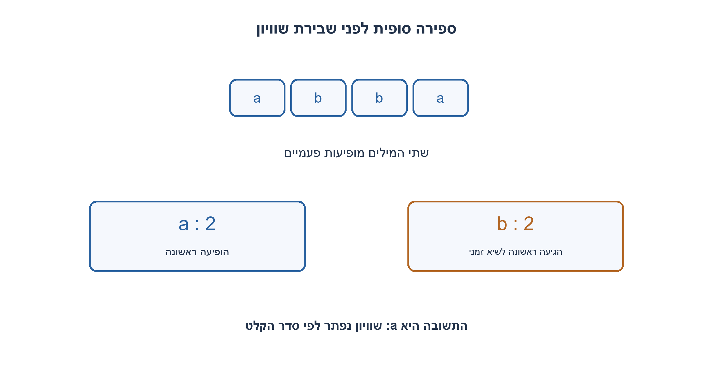
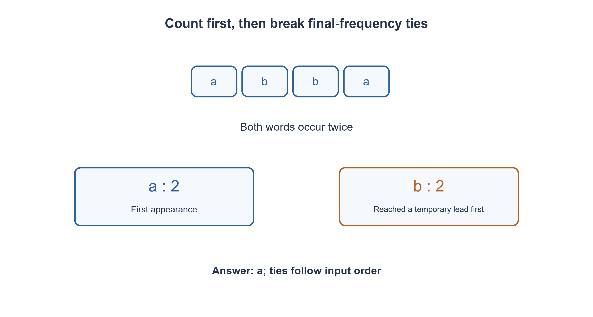

# PREP-225 — המילה השכיחה ברשימה ושבירת שוויון לפי הופעה ראשונה

פתרון מוצע בסיוע AI; ביקורת מקצועית אנושית ממתינה. הקושי אינו מכויל.

## עברית

נתונה רשימת מילים. החזירו את המילה המופיעה בה הכי הרבה פעמים ואת מספר הופעותיה. הרשימה עשויה להכיל כפילויות, ובשוויון החזירו את המילה שהופיעה ראשונה ברשימה. רשימה ריקה תחזיר None.

מילה כאן היא מחרוזת שכבר התקבלה כאיבר ברשימה: ההשוואה מדויקת ותלויה ברישיות, ולכן Cat ו־cat שונות. אין לפצל טקסט, להסיר פיסוק או לנרמל שפה. מחרוזת ריקה היא ערך מותר. אין לשנות את רשימת הקלט.

1. כדי לבחור מילה צריך לדעת את מספר ההופעות הכולל שלה, ולא רק את הספירה ברגע שפגשתם אותה.
2. במעבר אחד ספרו לכל מילה במילון. במעבר שני אפשר להכריע שוויון לפי סדר הקלט.
3. אתחלו best למילה הראשונה והחליפו אותה רק כאשר למועמדת ספירה גדולה ממש. שוויון משאיר את הראשונה.

### ספירה ובחירה הן שתי החלטות נפרדות
במעבר ראשון נבנה counts: בכל מילה נגדיל את המונה המתאים. לאחר מכן נסרוק שוב את הרשימה לפי הסדר, כאשר best מתחיל במילה הראשונה. נחליף את best רק אם counts[word] גדול ממש מהספירה של best. בסוף נחזיר [best, counts[best]]. עבור רשימה ריקה נחזיר None לפני גישה לאיבר הראשון.

מדוע שני מעברים? הספירה הראשונה מספקת שכיחות סופית; המעבר השני פותר את שובר השוויון בלי לשמור אינדקסים נוספים. לאחר כל קידומת במעבר השני, best היא המילה המוקדמת ביותר מבין בעלות השכיחות הסופית המרבית שנראו עד כה. מועמדת עם שכיחות גדולה יותר חייבת להחליף אותה; מועמדת שוות־שכיחות אינה יכולה להיות מוקדמת ממנה. האינווריאנט מוכיח את הבחירה בסיום.

לדוגמה [a,b,b,a]: לשתיהן שתי הופעות, ולכן התשובה [a,2]. שמירת מובילה בזמן הספירה והחלפתה רק כשהספירה הנוכחית עולה על השיא עלולה להשאיר b: היא מגיעה לשתי הופעות ראשונה, אף ש־a הופיעה מוקדם יותר. ניתן לפתור גם במעבר אחד באמצעות ספירה ומידע על אינדקס ראשון, אך צריך להשוות את שני חלקי מפתח ההכרעה בכל עדכון.

אם N הוא מספר המילים ו־U מספר המילים השונות, נשמרים U מונים והפניות למילים. בהנחת גיבוב תקין פעולות המילון עולות O(N) בתוחלת במודל מפתחות יחידה; אם L הוא סך התווים שצריך לקרוא ולגבש, נכלול O(L+N) עבודה. אין הבטחת זמן גרוע־ביותר קבוע למילון hash. המונים הם O(log N) ביטים כל אחד; החזרת המילה אינה מחייבת להעתיק את הטקסט שלה.

אין כאן NLP: [Cat,cat,Cat] מחזירה [Cat,2], ו־["",a,""] מחזירה ["",2]. נרמול אותיות או פיסוק ישנה את הגדרת השאלה. בדיקות ממצות מול count ומקסימום לפי סדר הקלט אימתו גם שוויונות ושמירת הקלט.

```python
"""Exact, case-sensitive words; frequency ties prefer first appearance."""


def most_frequent_word(words):
    if not words:
        return None
    counts = {}
    for word in words:
        counts[word] = counts.get(word, 0) + 1
    best = words[0]
    for word in words:
        if counts[word] > counts[best]:
            best = word
    return [best, counts[best]]
```




## English

Given a list of words, return its most frequent word and occurrence count. Duplicates are allowed; break equal-frequency ties by earliest appearance in the list. Return None for an empty list.

A word is an already supplied string element: equality is exact and case-sensitive, so Cat and cat differ. No tokenization, punctuation removal or language normalization is requested. An empty string is a valid value. Do not mutate the input list.

1. Selection depends on final counts, not only the count when a word is first encountered.
2. Count words in one dictionary pass, then scan the original order to decide ties.
3. Initialize best to the first word and replace it only for a strictly larger final count; equality preserves the earlier word.

### Counting and selecting are separate decisions
First build counts by incrementing the dictionary entry for each word. Then scan the original list in order, initializing best to its first element. Replace best only when counts[word] is strictly greater than counts[best]. Return [best, counts[best]], or None before indexing an empty list.

The first pass supplies final frequencies; the second resolves ties without storing first indices. After each second-pass prefix, best is the earliest word among those having the greatest final frequency encountered so far. A strictly higher-frequency candidate must replace it; an equal-frequency candidate cannot be earlier. This invariant proves the final choice.

For [a,b,b,a], both counts are two, so the answer is [a,2]. Updating an online leader only when a running count exceeds the current maximum can incorrectly retain b: it reaches two occurrences first even though a appeared earlier. A one-pass version is possible with counts and first positions, but it must compare both parts of the selection key on each update.

For N words and U distinct words, storage holds U counters and word references. Under standard expected hashing, dictionary work is O(N) in a unit-key model; including L characters that must be read/hashed gives O(L+N) expected work. Hash tables do not promise worst-case constant access. Counters require O(log N) bits each; returning a word need not copy its text.

This is not a tokenization problem: [Cat,cat,Cat] returns [Cat,2], and ["",a,""] returns ["",2]. Case folding or punctuation removal changes the contract. Exhaustive comparison with independent list counting and first-order maximum selection checks ties and input preservation.

```python
"""Exact, case-sensitive words; frequency ties prefer first appearance."""


def most_frequent_word(words):
    if not words:
        return None
    counts = {}
    for word in words:
        counts[word] = counts.get(word, 0) + 1
    best = words[0]
    for word in words:
        if counts[word] > counts[best]:
            best = word
    return [best, counts[best]]
```




## חומר משלים / Supporting material

```json
{
  "assumptions": {
    "he": [
      "קלט הוא רשימת מחרוזות; שוויון מדויק ורישיות נשמרת.",
      "בשכיחות שווה נבחרת ההופעה הראשונה; קלט ריק מחזיר None."
    ],
    "en": [
      "Input is a list of strings with exact case-sensitive equality.",
      "Equal frequencies select the first appearance; empty input returns None."
    ]
  },
  "optimality": {
    "he": "O(N) פעולות מילון בתוחלת במודל מפתחות יחידה, או O(L+N) עם עבודת תווים; O(U) רשומות ומונים.",
    "en": "Expected O(N) dictionary operations for unit-size keys, or O(L+N) including characters; O(U) entries and counters."
  },
  "verification": {
    "he": "5,463 מקרים מול ספירה עצמאית: כל הרשימות באורכים 0..6 מעל ארבע מילים, ועוד מקרי שוויון ורישיות; נבדק שהקלט לא השתנה.",
    "en": "5,463 cases against independent counting: every list of lengths 0..6 over four words plus directed tie/case tests; input preservation checked."
  },
  "edge_cases": {
    "he": [
      "רשימה ריקה; מילה אחת; כל המילים שונות; שוויון; רישיות; מחרוזת ריקה."
    ],
    "en": [
      "Empty list; one word; all unique; ties; case sensitivity; empty string."
    ]
  },
  "common_mistakes": {
    "he": [
      "שובר שוויון לפי מי שהגיע ראשון לשיא זמני.",
      "שימוש ב־>= שמעדיף את ההופעה האחרונה.",
      "פיצול או נרמול מילים ללא דרישה."
    ],
    "en": [
      "Breaking ties by who first reaches a temporary maximum.",
      "Using >= and thereby preferring a later appearance.",
      "Tokenizing or normalizing words without a requirement."
    ]
  },
  "interview_answer": {
    "he": "אספור במילון ואז אבחר לפי סדר הקלט, עם החלפה רק עבור שכיחות גדולה יותר. כך שוויון נשאר אצל המילה הראשונה.",
    "en": "Count with a dictionary, then select in input order with strictly greater replacement; ties remain with the first word."
  },
  "source_ambiguities": {
    "he": "המקור מבקש שכיחות של מילים ברשימה ולא קובע שוויון וריק; מדיניות אלה הוגדרו במפורש, בלי להרחיב לעיבוד טקסט.",
    "en": "The source asks for word-list frequency and omits ties/empty behavior; these are explicit policies without expanding into text processing."
  },
  "solution_extensions": {
    "he": [
      {
        "question": "מה משתנה בזרם שאי אפשר לקרוא שוב?",
        "answer_direction": "שומרים גם אינדקס ראשון לכל מילה ומשווים שכיחות סופית ואינדקס, או מסיימים בסריקת רשומות המילון. ספירה מדויקת עדיין עשויה לדרוש מקום לכל הערכים השונים.",
        "principle": "מגבלת מעבר משנה את המידע שצריך לזכור."
      }
    ],
    "en": [
      {
        "question": "What changes for a stream that cannot be reread?",
        "answer_direction": "Store the first index per word and compare final count/index, or scan dictionary entries at completion. Exact frequency can still require all distinct keys.",
        "principle": "A pass restriction changes which information must be retained."
      }
    ]
  }
}
```


## הרחבה ושמירת מקור — 07.11.2026, מקבץ לילה 30

[צילום מקור פרטי 19](../sources/2026-11-07-night30-19.png)

בהינתן string = 'aaa aaa bbb ccc ddd aaa', מצא את המילה שמופיעה הכי הרבה פעמים בפייתון; אפשר להיעזר בכל מבנה נתונים.

שיוכי מקור מדווחים: Mobileye.

נוספה וריאציה בשתי השפות; הנוסח, הפתרון והרמזים הקודמים נשמרו. הפתרון המורחב ממתין לביקורת מקצועית.

[הווריאציה המלאה / Full variant](prep-225-text_words-1107n30-addendum.md)
