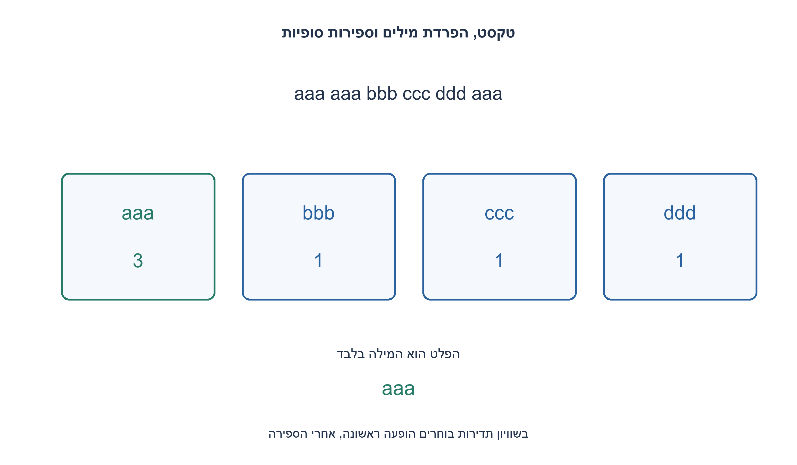
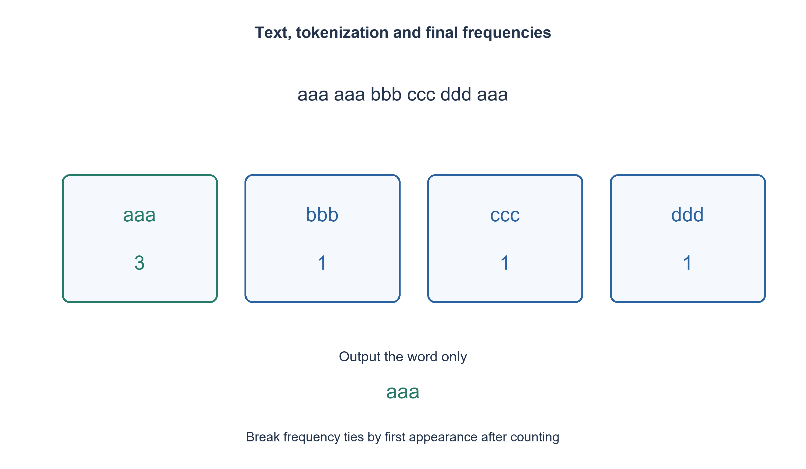

# PREP-225 — המילה השכיחה ברשימה ושבירת שוויון לפי הופעה ראשונה

פתרון מוצע בסיוע AI; ביקורת מקצועית אנושית ממתינה. הקושי אינו מכויל.

## עברית

### וריאציה: המילה השכיחה בטקסט גולמי
נתונה מחרוזת, למשל "aaa aaa bbb ccc ddd aaa". החזירו את המילה שמופיעה הכי הרבה פעמים באמצעות Python; מותר כל מבנה נתונים.

השלמת חוזה: מילה היא token שאינו ריק אחרי split על רווחים לפי כללי Python, כולל טאב וירידת שורה. ההשוואה רגישה לאות גדולה/קטנה וסימני פיסוק נשארים חלק מהמילה. בשוויון מחזירים את המילה שהופיעה ראשונה; קלט ריק או רווחים בלבד מחזיר None. פונקציית הווריאציה most_frequent_text_word מחזירה את המילה בלבד. החוזה הישן של רשימת מילים שמחזיר [word, count] נשמר בנפרד.

1. לפני שסופרים, הגדירו מה נחשב מילה והאם סימני פיסוק ואותיות גדולות נשמרים.
2. טבלת גיבוב יכולה לספור כל token, אבל הכרעה בשוויון צריכה להתבסס על סדר ההופעה המקורי.
3. אחרי שסיימתם לספור, עברו על ה־ tokens בסדר המקורי והחליפו מועמד רק כשהספירה גדולה ממש. בדקו ריק לפני גישה לאיבר הראשון.

### קלט טקסט דורש שלב שאין ברשימת מילים
split בלי פרמטר מפרידה לפי רווחים של Python ומדלגת על מקטעים ריקים. לכן רווחים כפולים אינם יוצרים "מילים" ריקות. "Cat" ו־"cat" שונים, וגם "a" ו־"a, " שונים, כי לא ביקשנו normalization או הסרת פיסוק.

לאחר הפיצול בונים מילון ספירות. בסריקה שנייה בסדר ה־ tokens בוחרים מילה רק אם הספירה הסופית שלה גדולה ממש מזו של המועמד. כך בשוויון נשמרת ההופעה הראשונה. בדוגמה הספירה של aaa היא שלוש והתוצאה היא המחרוזת aaa, בלי צירוף הספירה לפלט.

### למה לא מספיק לעדכן שיא תוך כדי ספירה
בטקסט "a b b a", המילה b מגיעה ראשונה לספירה שתיים, אבל a הופיעה קודם והתוצאה הנכונה היא a. סריקה שנייה עם הספירות הסופיות פותרת זאת. לחלופין אפשר לשמור לכל מילה את ההופעה הראשונה ולהשוות זוג מפתחות מתאים בכל עדכון, אך זו אינה דרישה.

אינווריאנט הסריקה השנייה: אחרי כל קידומת המועמד הוא המילה הראשונה בעלת הספירה הסופית המרבית בין המילים שכבר נראו. שיפור ממש מחליף אותו, ושוויון אינו יכול להביא מילה מוקדמת יותר. בסיום זהו המקסימום המבוקש.

אם L הוא מספר תווי הטקסט, N מספר ה־ tokens ו־ U מספר המילים השונות, פיצול וקריאה/גיבוב תווים נותנים עבודה צפויה O(L+N) בהנחות גיבוב רגילות. אחסון הפיצול יכול להגיע ל־ O(L), ונוספים U מונים והפניות; מונים עצמם דורשים O(log N) ביטים. אין זו הבטחת זמן גרוע־ביותר בלתי מותנה של טבלת גיבוב. לפתרון זרימה ללא רשימת tokens מלאה צריך להגדיר סורק מילים וסדר שוויון ולהתאים את הניתוח.

הממשק הזה אינו מחליף את most_frequent_word של השאלה המקורית: רשימה שסופקה מראש יכולה להכיל גם מחרוזת ריקה כערך, ואילו הווריאציה החדשה מפיקה מילים מן הטקסט ומחזירה רק מילה אחת.

```python
"""Whitespace-token text variant; the older list-returning API is unchanged."""


def most_frequent_text_word(text):
    if not isinstance(text, str):
        raise TypeError("text must be a string")
    words = text.split()
    if not words:
        return None
    counts = {}
    for word in words:
        counts[word] = counts.get(word, 0) + 1
    best = words[0]
    for word in words:
        if counts[word] > counts[best]:
            best = word
    return best
```




## English

### Variant: most frequent word in raw text
Given a string such as "aaa aaa bbb ccc ddd aaa", use Python to return its most frequent word. Any data structure is allowed.

Chosen contract: words are nonempty tokens from Python whitespace split, including tabs/newlines. Equality is case-sensitive and punctuation remains attached. Ties prefer first occurrence; empty/whitespace-only text returns None. The new most_frequent_text_word function returns only the word. The older pre-tokenized list API returning [word, count] remains separate.

1. Before counting, define tokenization, punctuation and case handling.
2. A hash table counts tokens, but frequency ties must respect original appearance order.
3. After counting, scan tokens in their original order and replace the candidate only on a strictly greater count. Check empty input before indexing its first word.

### Raw text needs a stage absent from a word-list input
Python split with no argument separates whitespace and omits empty spans. Repeated spaces therefore do not create empty words. Cat differs from cat, and a token ending in a comma differs from plain a, because no normalization or punctuation removal was requested.

Count tokens in a dictionary, then rescan their original order. Replace the candidate only when a token has a strictly greater final count. This preserves the earliest occurrence on ties. The source example has aaa three times and returns the string aaa, without a count in the output.

### Why an online running maximum can mishandle ties
In "a b b a", b reaches a running count of two first, yet a appeared earlier and is the required answer. A second scan using final counts fixes this. Alternatively track first positions and compare an appropriate pair on each update; that is optional.

The second-scan invariant says the candidate is the first word with maximum final frequency among words seen so far. Strict improvements replace it; equality cannot supply an earlier word. At termination this is the required global answer.

For L text characters, N tokens and U distinct words, splitting and reading/hashing characters give expected O(L+N) work under ordinary hash assumptions. Split token storage can occupy O(L), with U counters/references in addition; counters need O(log N) bits. This is not an unconditional hash-table worst-case guarantee. Streaming without a full token list needs an explicitly defined tokenizer and tie policy.

This interface does not replace the original most_frequent_word: an already supplied list can contain an empty string as a value, whereas this variant extracts tokens from text and returns only one word.

```python
"""Whitespace-token text variant; the older list-returning API is unchanged."""


def most_frequent_text_word(text):
    if not isinstance(text, str):
        raise TypeError("text must be a string")
    words = text.split()
    if not words:
        return None
    counts = {}
    for word in words:
        counts[word] = counts.get(word, 0) + 1
    best = words[0]
    for word in words:
        if counts[word] > counts[best]:
            best = word
    return best
```




## חומר משלים / Supporting material

```json
{
  "assumptions": {
    "he": [
      "split של Python, אותיות ופיסוק נשמרים, שוויון לפי הופעה ראשונה, פלט מילה בלבד או None."
    ],
    "en": [
      "Python whitespace split, exact case/punctuation, earliest ties, word-only output or None."
    ]
  },
  "optimality": {
    "he": "עבודה צפויה O(L+N); אחסון פיצול O(L) ומילון U מונים, בנוסף לעלות הביטית של המונים.",
    "en": "Expected O(L+N) work; O(L) split storage and U counters, with counter bit widths accounted for."
  },
  "verification": {
    "he": "129 טקסטים מול אורקל עצמאי של list.count והופעה ראשונה; דוגמת המקור, שוויון, פיסוק, אות גדולה, טאב, שורה חדשה וריק.",
    "en": "129 texts against independent list.count/first-maximum selection, including the source example, ties, punctuation, case, tabs/newlines and empty input."
  },
  "edge_cases": {
    "he": [
      "ריק, רווחים בלבד, שוויון, פיסוק, אותיות גדולות וטקסט Unicode."
    ],
    "en": [
      "Empty/whitespace-only, ties, punctuation, case and Unicode text."
    ]
  },
  "common_mistakes": {
    "he": [
      "לא להתבלבל בין ספירה סופית לבין שיא זמני; לא לשנות את כללי המילה בלי להצהיר; לא להחליף את פלט API הרשימה הקודם."
    ],
    "en": [
      "Do not confuse final counts with an online leader, silently normalize tokens, or replace the older list API output."
    ]
  },
  "interview_answer": {
    "he": "מגדירים tokenization, סופרים במילון ובוחרים בסריקה לפי ספירה סופית וסדר ההופעה.",
    "en": "Define tokenization, count with a dictionary and select by final count and appearance order."
  },
  "source_ambiguities": {
    "he": "המקור נותן טקסט ולא רשימה. הפיצול, שוויון וקלט ריק הוגדרו במפורש.",
    "en": "The source provides raw text rather than a token list; splitting, ties and empty behavior are explicit."
  },
  "solution_extensions": {
    "he": [
      {
        "question": "מה משתנה בקובץ גדול שלא רוצים לטעון כולו?",
        "answer_direction": "הפיקו tokens בזרימה ושמרו ספירות והופעה ראשונה; הטיפול בגבולות chunks הוא חלק מממשק הסורק.",
        "principle": "הרחבת חוזה באופן מפורש"
      }
    ],
    "en": [
      {
        "question": "What changes for a file too large to load fully?",
        "answer_direction": "Stream tokens and store counts/first positions; chunk-boundary handling belongs to the tokenizer contract.",
        "principle": "Make an extension explicit"
      }
    ]
  }
}
```
