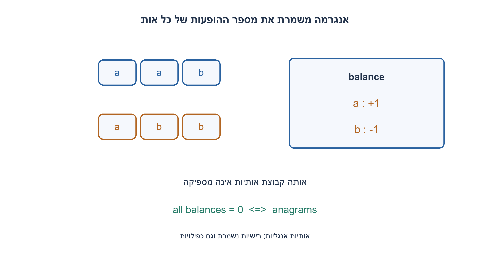
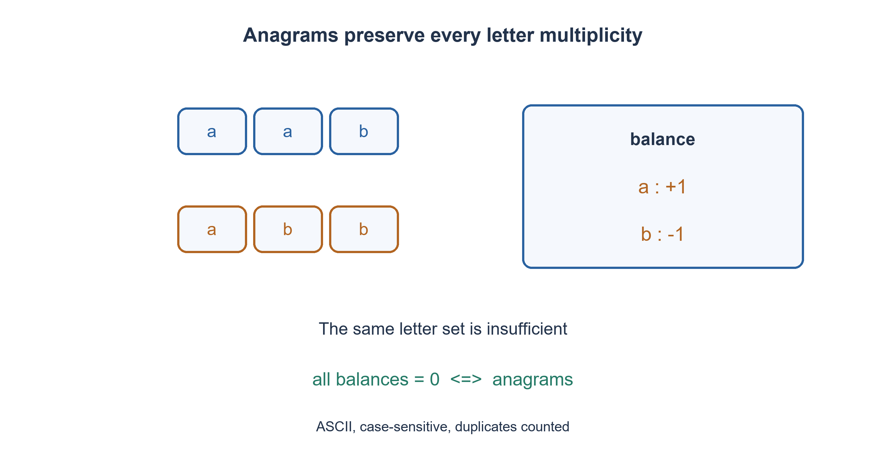

# PREP-226 — האם שתי מילים הן אנגרמות? משווים כמויות ולא קבוצות

פתרון מוצע בסיוע AI; ביקורת מקצועית אנושית ממתינה. הקושי אינו מכויל.

## עברית

כתבו פונקציה שמקבלת שתי מילים באנגלית ומחזירה Boolean: האם אפשר לקבל אחת מהשנייה רק בסידור מחדש של האותיות?

בחוזה זה הקלט כולל רק אותיות ASCII באנגלית A–Z ו־a–z, ההשוואה רגישה לרישיות, והאותיות החוזרות נספרות. שתי מילים ריקות הן אנגרמות. מילה עם רווח, ספרה או תו שאינו אות ASCII אינה בתחום הקלט; מימוש הייחוס מחזיר שגיאת ValueError עבורה. אין לשנות את הקלט. הראו פתרון לינארי ללא מיון.

1. שתי מילים יכולות להכיל אותה קבוצת אותיות אבל מספר שונה מכל אות.
2. אם האורכים שונים התשובה שלילית; אחרת ספרו הפרש הופעות לכל תו.
3. הגדילו מונה לכל תו במילה הראשונה והקטינו לכל תו בשנייה. כל המונים צריכים להסתיים באפס.

### סידור משתנה, המלאי נשאר
אנגרמה היא שימוש בדיוק באותו מלאי אותיות. למשל listen ו־silent מתאימות, ואילו aab ו־abb אינן מתאימות אף שקבוצת האותיות שלהן זהה. לאחר אימות התחום נשווה אורכים. אם הם שווים, נשתמש במערך balance בגודל 128: לכל זוג תווים באותו מיקום נגדיל את המונה של הראשון ונקטין את המונה של השני. בסוף נחזיר האם כל המונים אפס.

לאחר עיבוד i תווים מכל מילה, balance[c] שווה למספר ההופעות של c בקידומת הראשונה פחות מספר הופעותיו בקידומת השנייה. כל עדכון משמר זאת. בסיום אפסים בכל התאים שקולים לשוויון שכיחויות לכל אות. זה תנאי הכרחי כי תמורה לא משנה ספירות; הוא גם מספיק, כי ניתן להתאים לכל עותק של כל אות עותק זהה במילה השנייה. כך מתקבלת תמורה מלאה.

האורכים נבדקים לפני zip כדי שלא נתעלם מסיומת של המילה הארוכה. אימות תחום הקלט נעשה לפני הכרעת האורך, ולכן קלט לא חוקי גורם לשגיאה באופן עקבי. הקוד אינו מנרמל רישיות: Ab ו־ba אינן אנגרמות בחוזה זה. אם המראיין מבקש להתעלם מרישיות, יש לשנות במפורש גם את אימות התחום וגם את הפיכת האותיות; זהו חוזה אחר.

זמן הריצה O(|a|+|b|+128), כלומר לינארי באורך הקלט, ומקום עזר קבוע כי האלפבית קבוע. מיון כל מילה והשוואת התוצאות הוא אורקל פשוט, אך עולה O(n log n) במיון השוואתי רגיל. מעבר ל־Unicode כללי מחייב הגדרה של יחידת השוואה ונרמול, ואין להעתיק את מערך ASCII כמות שהוא.

נבדקו כל זוגות המילים באורכים עד ארבע מעל a,A,b מול אורקל מיון עצמאי, וגם תווים שמחוץ לתחום. הבדיקה מכסה שוויון ספירות, כפילויות ורישיות; היא אינה בדיקה של כללי שפה טבעית.

```python
"""Case-sensitive ASCII A..Z/a..z only; empty strings are valid words."""


def are_anagrams(left, right):
    if any(not ('A' <= ch <= 'Z' or 'a' <= ch <= 'z') for word in (left, right) for ch in word):
        raise ValueError('ASCII letters only')
    if len(left) != len(right):
        return False
    balance = [0] * 128
    for a, b in zip(left, right):
        balance[ord(a)] += 1
        balance[ord(b)] -= 1
    return all(count == 0 for count in balance)
```




## English

Write a Boolean function deciding whether two English words can be obtained from each other by rearranging their letters.

Contract: ASCII letters A–Z and a–z only, case-sensitive comparison, and repeated letters count. Two empty words are anagrams. Spaces, digits and non-ASCII letters are outside the contract; the reference raises ValueError for them. Do not mutate inputs. Give a linear-time solution without sorting.

1. Two words can have the same set of letters but different quantities of each letter.
2. Different lengths imply false; otherwise count the difference for each character.
3. Increment for the first word and decrement for the second; every balance must end at zero.

### Rearrangement changes order, not inventory
An anagram uses precisely the same inventory of letters. listen and silent match; aab and abb do not, despite identical letter sets. Validate the alphabet, compare lengths, then maintain 128 character balances: increment for each character from the first word and decrement for the corresponding character from the second. Return whether every balance is zero.

After processing i characters from each word, balance[c] equals its count in the first prefix minus its count in the second. Each update preserves this statement. At completion, zero balances are equivalent to equal multiplicities for every letter. This is necessary because permutations preserve counts, and sufficient because each occurrence can be paired with an identical occurrence in the other word, forming a complete permutation.

Check lengths before zip so the longer word’s suffix cannot be ignored. Alphabet validation precedes the length decision, making out-of-contract input consistently raise an error. The code does not case-fold: Ab and ba are not anagrams here. Ignoring case requires an explicit revised alphabet and normalization contract.

Time is O(|a|+|b|+128), linear in the input, with constant auxiliary space for the fixed alphabet. Sorting both words gives a useful independent oracle but generally takes O(n log n) comparison-sort time. General Unicode requires a definition of comparison units and normalization; a fixed ASCII array cannot be transferred unchanged.

All pairs of words up to length four over a,A,b were compared against independent sorting, plus out-of-alphabet cases. These checks cover counts, duplicates and case; they are not natural-language normalization tests.

```python
"""Case-sensitive ASCII A..Z/a..z only; empty strings are valid words."""


def are_anagrams(left, right):
    if any(not ('A' <= ch <= 'Z' or 'a' <= ch <= 'z') for word in (left, right) for ch in word):
        raise ValueError('ASCII letters only')
    if len(left) != len(right):
        return False
    balance = [0] * 128
    for a, b in zip(left, right):
        balance[ord(a)] += 1
        balance[ord(b)] -= 1
    return all(count == 0 for count in balance)
```




## חומר משלים / Supporting material

```json
{
  "assumptions": {
    "he": [
      "ASCII אותיות בלבד; רישיות נשמרת; כפילויות נספרות.",
      "שני קלטים ריקים מתאימים; קלט מחוץ לתחום מעלה ValueError במודל Python."
    ],
    "en": [
      "ASCII letters only, case-sensitive, counting duplicates.",
      "Two empty inputs match; out-of-domain input raises ValueError in the Python reference."
    ]
  },
  "optimality": {
    "he": "O(|a|+|b|+128) זמן ו־O(128) מונים; האלפבית הקבוע הופך את המקום ל־O(1).",
    "en": "O(|a|+|b|+128) time and O(128) counters, constant auxiliary space for the fixed alphabet."
  },
  "verification": {
    "he": "14,645 מקרים: כל זוגות 121 המילים באורכים 0..4 מעל a,A,b וארבעה מקרי תחום שגוי, מול מיון עצמאי.",
    "en": "14,645 cases: all pairs of 121 words of lengths 0..4 over a,A,b plus four invalid-alphabet cases, against independent sorting."
  },
  "edge_cases": {
    "he": [
      "אורכים שונים; ריק וריק; אותיות חוזרות; הבדל רישיות; אות לא־ASCII."
    ],
    "en": [
      "Different lengths; empty/empty; repeated letters; case difference; non-ASCII letter."
    ]
  },
  "common_mistakes": {
    "he": [
      "השוואת set מאבדת שכיחויות.",
      "zip בלי בדיקת אורך מתעלם מסיומת.",
      "ספירה רק של אותיות קטנות משנה את החוזה."
    ],
    "en": [
      "Set equality loses multiplicities.",
      "zip without a length check ignores suffixes.",
      "Counting lowercase letters only changes the contract."
    ]
  },
  "interview_answer": {
    "he": "תמורה משמרת מלאי אותיות. אבדוק אורכים ואאזן ספירות; אפס בכל תא הוא תנאי הכרחי ומספיק לאנגרמה.",
    "en": "A permutation preserves the letter inventory. Check lengths and balance counts; zero in every cell is necessary and sufficient."
  },
  "source_ambiguities": {
    "he": "המקור אינו מגדיר רישיות, אלפבית או ריק; הוגדר חוזה ASCII מפורש, ללא רווחים ונרמול.",
    "en": "The source omits case, alphabet and empty behavior; this version explicitly chooses ASCII without spaces or normalization."
  },
  "solution_extensions": {
    "he": [
      {
        "question": "מה משתנה אם אין אלפבית חסום?",
        "answer_direction": "אפשר מילון שכיחויות בגודל מספר התווים השונים; העלות תלויה בייצוג התווים ובחוזה הנרמול.",
        "principle": "מקום קבוע נשען על תחום סמלים קבוע."
      }
    ],
    "en": [
      {
        "question": "What changes without a bounded alphabet?",
        "answer_direction": "Use a frequency dictionary sized by distinct symbols; costs depend on symbol representation and normalization.",
        "principle": "Constant storage relies on a fixed symbol domain."
      }
    ]
  }
}
```
