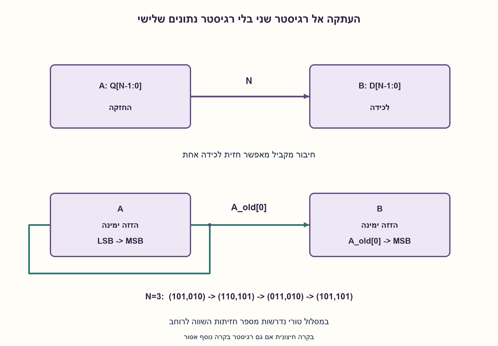
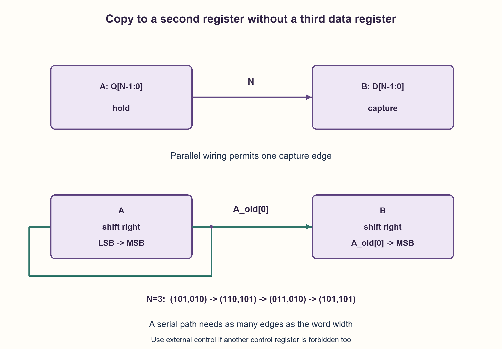

# PREP-227 — העתקה בין שני רגיסטרים ללא רגיסטר נתונים נוסף

פתרון מוצע בסיוע AI; ביקורת מקצועית אנושית ממתינה. הקושי אינו מכויל.

[צילום מקור פרטי](../sources/2026-10-31-batch22-13.png)

ברשותך שני רגיסטרים בעלי n סיביות. עליך להעביר את המידע מהרגיסטר הראשון לשני ללא רגיסטר עזר. איך תבצע זאת?

חברות לפי הדיווח בצילום בלבד: Apple.

## עברית

ברשותכם שני רגיסטרים A, B, כל אחד בן N ביטים, N≥1. העבירו את המידע המקורי ב־A אל B בלי רגיסטר נתונים שלישי. יש להבדיל בין העתקה לבין החלפה: המטרה היא B=A המקורי, ואין צורך לשמור את B הישן.

במימוש הראשי מותר לחבר את כל יציאות Q של A לכניסות D של B ולטעון את B בחזית שעון, בעוד A מחזיק. כהרחבה נפרדת, הניחו שרגיסטרים יכולים רק להזיז ימינה וניתן לקרוא את ביט 0 ולחברו חזרה ל־MSB. הציעו העתקה טורית שמחזירה את A למצבו המקורי. אין להוסיף מונה נסתר אם האיסור כולל גם רגיסטרי בקרה; במקרה כזה מספר חזיתות ההעברה מסופק מבחוץ.

1. האם באמת צריך מקום זמני כדי להעתיק, או רק כדי להחליף שני ערכים?
2. בממשק מקביל אפשר לחבר D_B[i]=Q_A[i] ולכתוב רק ל־B בחזית אחת.
3. בגרסה טורית שדרו את ה־LSB הישן של A גם אל MSB של B וגם בחזרה אל MSB של A. לאחר N חזיתות הסיבוב שומר את A.

### העתקה מקבילית היא חיבור, לא אלגוריתם החלפה
ברגיסטרים נפרדים עם כניסות D ויציאות Q מקבילות, חברו D_B[i]=Q_A[i] לכל i. שימו enable של B באחד ושל A באפס, ועמדו ב־setup/hold לפני ואחרי חזית הטעינה. אחרי החזית B מכיל את A המקורי, ו־A לא השתנה. הערך הישן של B נדרס בכוונה. אין צורך ברגיסטר זמני או בשלוש פעולות XOR. במודל רוחב קבוע נדרשים N חיבורים ואירוע לכידה אחד; חיווט ורוחב אפיק הם משאב גם כאשר סופרים רק מחזורי שעון. אין מכאן הבטחת תדר או השהיה פיזית אפסית.

### אם קיים רק ממשק הזזה טורי
לפני כל חזית קחו bit=A_old[0]. בצעו בו־זמנית A_next=(A_old>>1)|(bit<<(N−1)) ו־B_next=(B_old>>1)|(bit<<(N−1)). A מסתובב, ו־B מכניס את הביט היוצא ממנו. חובה להשתמש בערך הישן של A לשתי ההשמות; אין להזיז את A ורק אחר כך לקרוא את ביט 0 החדש.

אחרי k צעדים נשלחו k הביטים הנמוכים המקוריים של A לפי סדרם. כל ביט חדש נכנס ל־MSB של B, ובהמשך מוזז ימינה. לאחר N צעדים הביט המקורי i של A מגיע בדיוק אל מיקום i ב־B, וכל N הביטים הישנים של B יצאו. A עבר סיבוב מלא ולכן חזר למילה המקורית. לדוגמה N=3, A=101, B=010: אחרי חזיתות עוקבות מתקבלים (110,101), אחר כך (011,010), ולבסוף (101,101). גם N=1, אפס, אחדות מלאות ו־A=B תקינים.

הגרסה הטורית דורשת N חזיתות. אם הנתיב היחיד ל־B יכול להכניס לכל היותר ביט חדש אחד בחזית, ולא קיים ידע מוקדם על A או דחיסה נוספת, יש N ביטים בלתי תלויים להעביר ולכן N הוא חסם תחתון למקרה הגרוע במודל הזה. זו אינה הוכחת מינימום עבור ממשק מקביל, שבו מספיקה חזית אחת. מעבר עצמי בין תחומי שעון אינו נפתר על ידי חיבור חוטים: צריך חוזה סנכרון או handshake לעסקה רב־ביטית.

מספר צעדי ההעברה נדרש כבקרה. מונה פנימי רגיל תופס גם הוא FF, ולכן אינו מותר אם האיסור הוא על כל רגיסטר נוסף. אפשר לקבל N חזיתות enable מבקר חיצוני, או להתיר במפורש מונה בקרה קטן, בלי להסתיר זאת. לאחר ההעתקה יש להפסיק את ה־enable; חזיתות טוריות נוספות עלולות לסובב את B שוב. המודל מאמת את שינויי המילים בלבד ואינו תחליף לסינתזה או לבדיקת תזמון.

### מודל Python שנבדק

```python
"""Old-state capture models: parallel copy and LSB-first recirculating copy."""


def parallel(a, b, width):
    mask = (1 << width) - 1
    if width < 1 or (a | b) & ~mask:
        raise ValueError('Positive width and unsigned words required')
    return a, a


def serial(a, b, width):
    mask = (1 << width) - 1
    if width < 1 or (a | b) & ~mask:
        raise ValueError('Positive width and unsigned words required')
    trace = [(a, b)]
    for _ in range(width):
        bit = a & 1
        a, b = (a >> 1) | (bit << (width - 1)), (b >> 1) | (bit << (width - 1))
        trace.append((a, b))
    return a, b, trace
```




### assumptions

```json
[
  "A, B הם רגיסטרים נפרדים, N חיובי והקלטים נלכדים מאותו מצב ישן.",
  "העתקה אינה משמרת את B הישן.",
  "הגרסה המקבילית והטורית משתמשות בחוזי פורטים שונים; מספר חזיתות טוריות נשלט מבחוץ אם אין אחסון בקרה."
]
```

### optimality

מקבילי: N חיבורים וחזית לכידה אחת. טורי: N חזיתות וחיבורים לביט יחיד. חסם N חל רק על נתיב של ביט אחד לחזית, ללא ידע קודם.

### verification

כל זוג מילים ברוחבים 1..6 נבדק: ההעתקה הטורית מסיימת ב־(A, A), ו־A חוזר למקור; נבדקו גם מקרי רוחב גדולים. אין HDL, סינתזה או מדידת תזמון.

### edge_cases

```json
[
  "N=1 תקין.",
  "A=B אינו מקרה מיוחד.",
  "אפס ואחדות מלאות נשמרים.",
  "צריכים לעצור בדיוק לאחר N חזיתות טוריות."
]
```

### common_mistakes

```json
[
  "לפתור swap במקום copy.",
  "להוסיף משתנה זמני בן N ביטים.",
  "לעדכן A לפני שקוראים את הביט המשותף הישן.",
  "להוסיף מונה ואז לומר שלא נוסף אף רגיסטר."
]
```

### interview_answer

אם יש חיבור מקביל, B טוען את A בחזית אחת ו־A מחזיק. בממשק טורי אפשר לסובב את A ולהזין את אותו ביט יוצא ל־B במשך N חזיתות, כך ש־A משוחזר.

### source_ambiguities

סוג הפורטים, חובת שימור A והיתר בקרה לא הוגדרו. המימוש הראשי מגדיר העתקה מקבילית משמרת, והטורי הוא חוזה חלופי מפורש.

### solution_extensions

```json
[
  {
    "question": "מה אם גם את B הישן חייבים לשמר?",
    "answer_direction": "אז מדובר בהחלפה או בגיבוי של שני ערכים; חיבור העתקה פשוט אינו מספיק. יש להגדיר ALU והיתרי כתיבה לפני פתרון כמו XOR swap.",
    "principle": "שימור מידע משנה את הבעיה ואת המשאבים הדרושים."
  }
]
```

## English

Two N-bit registers A, B are available, with N≥1. Transfer A’s original information into B without a third data register. Distinguish copying from swapping: the target is B=original A and old B need not survive.

The main interface permits connecting every A Q output to the corresponding B D input and capturing B on a clock edge while A holds. As a separate extension, suppose registers can only shift right and expose bit 0 for feedback to the MSB. Give a serial copy that restores A. Do not hide a control counter if all additional registers are forbidden; then the N transfer edges are supplied externally.

1. Is temporary storage needed for copying, or only for preserving two values during a swap?
2. With a parallel interface, connect D_B[i]=Q_A[i] and capture only B at one edge.
3. In the serial version, send A’s old LSB both to B’s MSB and back to A’s MSB. After N edges the circulation restores A.

### Parallel copying is wiring, not a swap algorithm
For separate registers with parallel D inputs and Q outputs, connect D_B[i]=Q_A[i] for every i. Enable B, hold A, and satisfy setup/hold around the capture edge. After the edge B holds original A, while A is unchanged. Old B is intentionally overwritten. No temporary register or three-XOR exchange is needed. This fixed-width construction uses N connections and one capture event; bus width and wiring are resources even when cost is expressed in clock cycles. It implies neither a frequency guarantee nor zero physical delay.

### A serial shift-only interface
Before each edge take bit=A_old[0]. Simultaneously set A_next=(A_old>>1)|(bit<<(N−1)) and B_next=(B_old>>1)|(bit<<(N−1)). A recirculates while its departing bit enters B. Both updates must use old A: shifting A first and then reading its new bit zero sends the wrong stream.

After k steps, k original low bits of A have been sent in order. Every incoming bit enters B’s MSB and shifts right on later edges. After N steps original A bit i reaches B bit i, and all old B bits are gone. A has completed one full rotation, restoring its original word. For example N=3, A=101, B=010 gives successive pairs (110,101), then (011,010), then (101,101). N=1, zero, all ones and A=B also work.

Serial copying takes N edges. If the only input path to B carries at most one new bit per edge, with no prior information about arbitrary A or extra compression, N independent bits must pass, so N is a worst-case lower bound in that model. It is not a bound for a parallel interface, which takes one edge. Crossing unrelated clock domains is not solved by direct wiring; a multibit synchronization or handshake contract is needed.

Transfer count is control state. An internal counter also uses FFs and is forbidden if every additional register is banned. Supply N enabled edges externally or explicitly permit a small control counter. Disable shifting after completion: later serial edges can rotate B again. The model checks word-state updates only, not synthesis or physical timing.

### Verified Python teaching model

```python
"""Old-state capture models: parallel copy and LSB-first recirculating copy."""


def parallel(a, b, width):
    mask = (1 << width) - 1
    if width < 1 or (a | b) & ~mask:
        raise ValueError('Positive width and unsigned words required')
    return a, a


def serial(a, b, width):
    mask = (1 << width) - 1
    if width < 1 or (a | b) & ~mask:
        raise ValueError('Positive width and unsigned words required')
    trace = [(a, b)]
    for _ in range(width):
        bit = a & 1
        a, b = (a >> 1) | (bit << (width - 1)), (b >> 1) | (bit << (width - 1))
        trace.append((a, b))
    return a, b, trace
```




### assumptions

```json
[
  "A and B are separate registers, N positive, and captures use the same old state.",
  "Copying does not preserve old B.",
  "Parallel and serial versions have different port contracts; external control supplies serial edge count when extra control storage is forbidden."
]
```

### optimality

Parallel: N wires and one edge. Serial: N edges and a one-bit path. The N-edge bound applies only to one new bit per edge without prior information.

### verification

Every word pair at widths 1..6 was checked: serial copying ends at (A, A) with A restored; larger widths were sampled too. No HDL, synthesis or timing measurement.

### edge_cases

```json
[
  "N=1 is valid.",
  "A=B requires no special handling.",
  "Zero and all-one values are preserved.",
  "Stop after exactly N serial edges."
]
```

### common_mistakes

```json
[
  "Solving a swap instead of a copy.",
  "Adding an N-bit temporary.",
  "Updating A before reading the shared old outgoing bit.",
  "Adding a counter while claiming no extra registers."
]
```

### interview_answer

With parallel connections B captures A in one edge while A holds. With serial ports, recirculate A and send its outgoing bit into B for N edges, restoring A.

### source_ambiguities

Ports, preservation of A and control-storage permission were unspecified. The main contract preserves A through parallel copying; serial operation is an explicit alternative.

### solution_extensions

```json
[
  {
    "question": "What if old B must also survive?",
    "answer_direction": "That becomes swapping or preserving two values. Simple copying is insufficient; define the ALU and write controls before suggesting XOR swap.",
    "principle": "Information-preservation requirements change the problem and its resources."
  }
]
```
