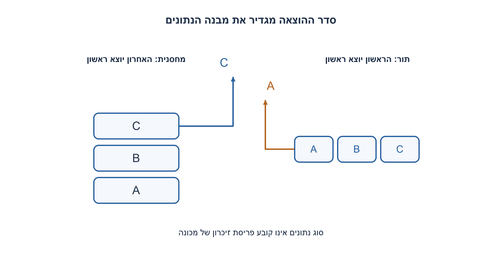
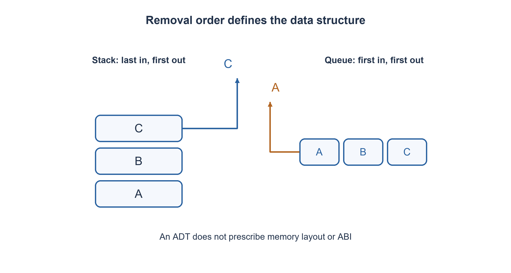

# PREP-228 — למה משמשת מחסנית? LIFO, קריאות לפונקציות ופתרון בעיות

פתרון מוצע בסיוע AI; ביקורת מקצועית אנושית ממתינה. הקושי אינו מכויל.

## עברית

הסבירו מהי מחסנית ומהו כלל LIFO. תנו דוגמה להפעלת push, pop ו־top, והסבירו לפחות שלושה שימושים מעשיים: קריאות לפונקציות, חזרה לאחור או undo, ואחד מבין DFS, התאמת סוגריים או חישוב ביטוי postfix.

הבחינו בין מחסנית כמבנה נתונים אבסטרקטי לבין מחסנית הקריאות של סביבת הריצה. ציינו מה קורה ב־pop ממחסנית ריקה, כיצד עומק רקורסיה משפיע על זיכרון, ומה אי אפשר להסיק על פריסת הזיכרון בלי לדעת את השפה וה־ABI. אין הנחה שיש פעולת CPU מסוימת או שמחסנית חייבת לגדול לכיוון כתובות מסוים.

1. איזה איבר צריך לצאת ראשון אם הכנסנו A ואז B ואז C?
2. חשבו על פעולות מקוננות: הפעולה האחרונה שהתחילה היא הראשונה שצריכה להסתיים.
3. בקריאה לפונקציה נשמר מידע לחזרה; ב־undo נשמרת הפעולה האחרונה; ב־DFS נשמרת חזית שצריך לחזור אליה. לא כל שימוש מחייב את מחסנית המכונה.

### האחרון שנכנס הוא הראשון שיוצא
מחסנית היא ממשק: push מוסיף בראש, top קורא את הראש בלי להסירו, ו־pop מסיר ומחזיר את הראש. אם נדחוף A,B,C ואז נבצע שני pop, נקבל C ואז B; יישאר A. ב־FIFO היינו מקבלים A ואז B, ולכן תור ומחסנית אינם שמות חלופיים. בקוד ההדגמה מחסנית ריקה גורמת ל־IndexError; בממשק אחר אפשר להחזיר זוג success/value. אסור לבלבל ערך נתונים כמו אפס עם סימון ריק.

בקריאות מקוננות f שקוראת ל־g שקוראת ל־h, צריך לחזור מ־h ל־g ורק אחר כך ל־f. סביבת ריצה טיפוסית שומרת במסגרות קריאה מידע הדרוש לחזרה, ולעיתים פרמטרים, משתנים מקומיים ורגיסטרים שמורים. הפרטים תלויים במהדר וב־ABI: חלק מהערכים יכולים להיות ברגיסטרים, קריאה יכולה להיטמע ב־inline, ואופטימיזציה עשויה להסיר מסגרת. אין להסיק שכל אובייקט מקומי ממוקם פיזית במחסנית או ש־push בשפת תכנות ממופה לפקודת CPU אחת.

שימושים נוספים נובעים מאותה הקננה. ב־undo מבטלים תחילה את הפעולה האחרונה, אך יש לשמור די מידע להפיכתה ולא רק את שמה. ב־backtracking שומרים מצבי בחירה וחוזרים לניסיון האחרון שלא הושלם. ב־DFS איטרטיבי מחסנית מפורשת מחליפה את מצב הרקורסיה. בהתאמת סוגריים סוגר סוגר חייב להתאים דווקא לפותח האחרון, וב־postfix שני האופרנדים האחרונים משמשים לפעולה הבאה; בחיסור סדר ה־pop חשוב.

אם עומק הקריאות d וגודל מסגרת חסום ב־s, מצב הקריאות דורש O(d·s) מקום. רקורסיה עמוקה עלולה לחרוג ממגבלת סביבת הריצה. מחסנית מפורשת יכולה להעביר את האחסון למבנה שמנוהל בקוד, אך אינה מבטלת את הזיכרון הדרוש לאותו מצב. במערך דינמי push הוא לרוב O(1) אמורטי, לא בהכרח לכל פעולה בזמן הגרוע; pop ו־top בקצה הם O(1). ברשימה מקושרת בראש ניתן להשיג O(1) לפעולה בכפוף לעלות הקצאה.

קוד העזר מאמת עקבת LIFO ותת־זרימה בלבד. הוא אינו סימולטור של ABI, בוחן ביצועי מעבד או הוכחה על פריסת מחסנית מכונה.

```python
"""Stack ADT trace; this does not model a particular machine ABI or CPU stack."""


def stack_trace(operations):
    items, removed = [], []
    for action, value in operations:
        if action == 'push':
            items.append(value)
        elif action == 'pop':
            if not items:
                raise IndexError('empty stack')
            removed.append(items.pop())
        else:
            raise ValueError('unknown operation')
    return {'removed': removed, 'remaining_bottom_to_top': items}
```




## English

Explain a stack and the LIFO rule. Trace push, pop and top, then give at least three uses: function calls, backtracking or undo, and one of DFS, bracket matching or postfix evaluation.

Distinguish the abstract data type from a runtime call stack. Define empty-pop behavior, explain recursive-depth memory costs, and identify what cannot be inferred about memory layout without the language and ABI. Do not assume a particular CPU instruction or stack growth direction.

1. Which item leaves first after pushing A, then B, then C?
2. Nested work finishes in reverse start order.
3. Function calls retain return context, undo retains the latest action, and DFS retains pending work. Not every use requires the machine call stack.

### Last in, first out
A stack is an interface: push adds at the top, top reads without removing, and pop removes and returns the top. Pushing A,B,C followed by two pops returns C then B, leaving A. FIFO would return A then B, so a queue is a different abstraction. The demonstration raises IndexError on empty pop/top; another API could return success/value. Do not use a legitimate data value such as zero as an empty marker.

For nested calls f→g→h, control returns from h to g before returning to f. A typical runtime call stack retains return context and may contain arguments, locals and saved registers. Exact contents depend on compiler and ABI: values may be in registers, calls may be inlined, and optimization may eliminate frames. A local object is not necessarily physically stack-allocated, and a language-level push is not necessarily one CPU instruction.

Other uses have the same nesting pattern. Undo reverses the latest action first, but must retain enough information to invert it rather than merely an action name. Backtracking stores choice states and resumes the latest unfinished branch. Iterative DFS uses an explicit stack instead of recursive control state. Bracket matching pairs a closing bracket with the latest unmatched opener. Postfix evaluation consumes the two most recent operands; subtraction requires preserving their pop order.

With depth d and frame size bounded by s, call state costs O(d·s) storage. Deep recursion may exceed runtime limits. An explicit stack changes how storage is managed but does not erase the memory needed for the same state. A dynamic-array push is generally amortized O(1), not necessarily worst-case per operation; end pop/top are O(1). A linked stack can provide O(1) head operations subject to allocation costs.

The executable illustration checks LIFO traces and underflow only. It is not an ABI simulator, CPU benchmark or proof of machine-stack layout.

```python
"""Stack ADT trace; this does not model a particular machine ABI or CPU stack."""


def stack_trace(operations):
    items, removed = [], []
    for action, value in operations:
        if action == 'push':
            items.append(value)
        elif action == 'pop':
            if not items:
                raise IndexError('empty stack')
            removed.append(items.pop())
        else:
            raise ValueError('unknown operation')
    return {'removed': removed, 'remaining_bottom_to_top': items}
```




## חומר משלים / Supporting material

```json
{
  "assumptions": {
    "he": [
      "מחסנית היא ADT בעל LIFO; קוד העזר משתמש ברשימת Python.",
      "פרטי מסגרות קריאה ופריסת זיכרון תלויים בשפה, במהדר וב־ABI."
    ],
    "en": [
      "A stack is a LIFO ADT; the illustration uses a Python list.",
      "Call frames and memory layout depend on language, compiler and ABI."
    ]
  },
  "optimality": {
    "he": "מצב בגודל עומק d דורש O(d) איברים; מסגרות בגודל s דורשות O(d·s). push במערך דינמי אמורטי O(1), לא חסם לכל פעולה.",
    "en": "Depth d stores O(d) items; size-s frames cost O(d·s). Dynamic-array push is amortized O(1), not a per-operation worst-case guarantee."
  },
  "verification": {
    "he": "ארבע עקבות מכוונות מאמתות LIFO, מצב ריק ותת־זרימה. זהו אימות הדוגמה האבסטרקטית בלבד, ללא מדידת ABI או CPU.",
    "en": "Four directed traces check LIFO, empty state and underflow. This verifies the abstract illustration only, without ABI or CPU measurements."
  },
  "edge_cases": {
    "he": [
      "pop/top בריק; עומק גדול; undo של פעולה שאינה הפיכה; הבדל מתור FIFO."
    ],
    "en": [
      "Empty pop/top; large depth; undo of an irreversible action; contrast with FIFO."
    ]
  },
  "common_mistakes": {
    "he": [
      "להגדיר LIFO כתור FIFO.",
      "לטעון שכל משתנה מקומי תמיד במחסנית הפיזית.",
      "להחליף רקורסיה במחסנית מפורשת ולטעון שמקום העזר נהיה קבוע."
    ],
    "en": [
      "Confusing LIFO with FIFO.",
      "Claiming every local variable is always on the physical stack.",
      "Replacing recursion with an explicit stack and claiming constant auxiliary storage."
    ]
  },
  "interview_answer": {
    "he": "מחסנית מתאימה לעבודה מקוננת: מסיימים את האחרונה לפני שחוזרים לקודמת. זה מסביר קריאות, undo ו־DFS; הממשק אינו קובע את פריסת הזיכרון.",
    "en": "A stack fits nested work: finish the latest before resuming the previous one. This explains calls, undo and DFS, while the ADT does not prescribe physical memory layout."
  },
  "source_ambiguities": {
    "he": "המקור שואל על שימושי מחסנית בקצרה; נוספו עקבה, חוזה ריק והבחנה בין ADT למחסנית קריאות כדי להפוך את הדיון לבדיקה ברורה.",
    "en": "The short source asks about stack uses; a trace, empty contract and ADT/call-stack distinction make the discussion concrete."
  },
  "solution_extensions": {
    "he": [
      {
        "question": "מדוע תור מתאים ל־BFS ומחסנית ל־DFS?",
        "answer_direction": "FIFO מעבד קודם חזיתות ותיקות ומשמר שכבות; LIFO ממשיך קודם בענף החדש ביותר. סדר ההוצאה, ולא רק האחסון, קובע את החיפוש.",
        "principle": "מדיניות תזמון מגדירה את סדר החיפוש."
      }
    ],
    "en": [
      {
        "question": "Why does BFS use a queue while DFS uses a stack?",
        "answer_direction": "FIFO processes older frontier nodes first and preserves layers; LIFO explores the latest branch first. Removal order determines traversal.",
        "principle": "Scheduling policy defines search order."
      }
    ]
  }
}
```
