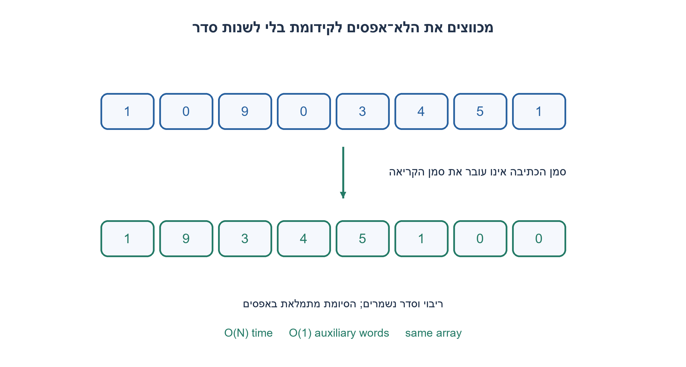
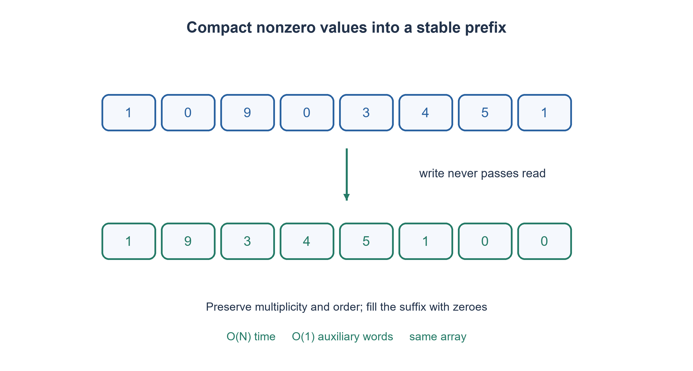

# PREP-229 — העברת אפסים לסוף במקום, בלי לשנות את סדר שאר האיברים

פתרון מוצע בסיוע AI; ביקורת מקצועית אנושית ממתינה. הקושי אינו מכויל.

## עברית

נתון מערך של מספרים שלמים. העבירו את כל האפסים לסופו, תוך שמירה על הסדר היחסי של כל האיברים שאינם אפס ועל ריבוי ההופעות. יש לשנות את אותו מערך, ללא מערך עזר, בזמן O(N).

לדוגמה [1,0,9,0,3,4,5,1] יהפוך ל־[1,9,3,4,5,1,0,0]. האחד מופיע פעמיים ושתיהן נשמרות; אין להניח שהערכים שונים. מערך ריק תקין, וגם מספרים שליליים. הפונקציה תחזיר את אותו אובייקט מערך לאחר העדכון.

1. אפשר לחשוב על כתיבת תת־הרצף של האיברים שאינם אפס בתחילת המערך.
2. החזיקו סמן קריאה וסמן כתיבה. כשקוראים ערך שאינו אפס, כותבים אותו למקום הפנוי הבא.
3. סמן הכתיבה לעולם אינו עובר את הקריאה, ולכן אין דריסה של קלט עתידי. בסיום מלאו באפס את הסיומת שנותרה.

### מכווצים את המידע הרצוי לקידומת
נאתחל write=0 ונסרוק את כל האיברים משמאל לימין. לכל value שאינו אפס נכתוב values[write]=value ונקדם write. אחרי הסריקה, write הוא מספר האיברים שאינם אפס, והקידומת עד אליו מכילה אותם בסדר המקורי. נמלא את כל התאים מ־write ועד סוף המערך באפס.

האינווריאנט לפני קריאת התא read: הקידומת values[:write] היא בדיוק תת־הרצף הלא־אפסי של קידומת הקלט המקורית שנסרקה, ו־write≤read. אם התא הנוכחי אפס לא כותבים; אם אינו אפס, הכתיבה היא לתא הנוכחי או לתא שכבר נקרא. לכן אי אפשר לפגוע בתא שעוד נצטרך לקרוא. אחרי העתקה נשמר גם סדר האיברים כי הכתיבה מתקדמת לפי סדר הקריאה. מילוי הסיומת אינו מוחק איבר שנדרש לפלט, כי כל האיברים הלא־אפסיים כבר בקידומת.

בדוגמה, הקידומת נבנית כך: 1; אחר כך 1,9; ובהמשך 1,9,3,4,5,1. write=6 ולכן שני התאים האחרונים מתאפסים. החלפת אפס באיבר האחרון של המערך הייתה חוסכת תזוזות מסוימות אך משנה את הסדר, ולכן אינה עונה לדרישת היציבות.

זמן O(N): קריאה אחת של כל הקלט ועוד לכל היותר N כתיבות מילוי. מקום עזר O(1) מילים, והאובייקט והאורך נשארים זהים. זו אינה הבטחת מינימום כתיבות; אם רוצים לצמצם כתיבות למערך שכבר מסודר אפשר לבדוק אם יעד הכתיבה שונה מן הערך הקיים, או להשתמש בהחלפות מבוקרות. עדיין צריך לשמור על הוכחת היציבות.

כל המערכים באורכים עד שמונה מעל −1,0,1 נבדקו מול בניית פלט עצמאית, כולל זהות האובייקט, אורך והפעלת האלגוריתם פעמיים. שימוש ברשימת פלט באורקל אינו חלק ממקום העזר של הפתרון.

```python
"""Move integer zeroes to the end in place, preserving nonzero order."""


def move_zeroes(values):
    write = 0
    for read in range(len(values)):
        if values[read] != 0:
            values[write] = values[read]
            write += 1
    for index in range(write, len(values)):
        values[index] = 0
    return values
```




## English

Given an integer array, move all zeroes to its end while preserving the relative order and multiplicity of every nonzero item. Mutate the same array without an auxiliary array in O(N) time.

For example [1,0,9,0,3,4,5,1] becomes [1,9,3,4,5,1,0,0]. Both copies of one remain; values need not be distinct. Empty arrays and negative integers are valid. Return the same array object after mutation.

1. Think of compacting the nonzero subsequence into the array prefix.
2. Keep read and write positions; copy each nonzero value to the next output position.
3. The write position never passes the read position, so unread input is safe. Fill the remaining suffix with zeroes.

### Compact the desired information into a prefix
Set write=0 and scan left to right. For each nonzero value, assign values[write]=value and increment write. At the end, write counts the nonzero items and the prefix contains them in original order. Fill positions write through the end with zeroes.

Before reading position read, the prefix values[:write] is exactly the nonzero subsequence of the original consumed prefix, and write≤read. A zero causes no write. A nonzero is written either at the current cell or an already consumed cell, so unread input is never overwritten. Writing in read order preserves relative order. Final suffix filling cannot erase required output because every nonzero is already in the prefix.

In the example, the prefix becomes 1, then 1,9, and eventually 1,9,3,4,5,1. write=6, so the last two cells become zero. Replacing a zero with the array’s last item may reduce movement in some cases but breaks stability and does not satisfy this contract.

Time is O(N): one input scan and at most N suffix assignments. Auxiliary space is O(1) words, and object identity/length remain unchanged. This does not claim a minimum number of writes. To reduce writes on already compacted input, compare destination contents before assigning or use carefully controlled swaps while retaining the stability proof.

Every array up to length eight over −1,0,1 was compared with independently constructed expected output, checking object identity, length and idempotence. Allocating expected output in the oracle does not contribute to the solution’s auxiliary space.

```python
"""Move integer zeroes to the end in place, preserving nonzero order."""


def move_zeroes(values):
    write = 0
    for read in range(len(values)):
        if values[read] != 0:
            values[write] = values[read]
            write += 1
    for index in range(write, len(values)):
        values[index] = 0
    return values
```




## חומר משלים / Supporting material

```json
{
  "assumptions": {
    "he": [
      "מערך מספרים שלמים; אפס הוא ערך הנתונים 0.",
      "יציבות, כפילויות וזהות המערך נשמרות; מותר לשנות את התאים."
    ],
    "en": [
      "Integer array, with numeric zero as the special value.",
      "Preserve stability, duplicates and array identity; cells may be mutated."
    ]
  },
  "optimality": {
    "he": "O(N) זמן, O(1) מילות עזר; אין טענת מינימום כתיבות.",
    "en": "O(N) time and O(1) auxiliary words; no minimum-write claim."
  },
  "verification": {
    "he": "9,842 מקרים: כל המערכים באורכים 0..8 מעל −1,0,1 ודוגמת המקור, מול סינון עצמאי; נבדקו יציבות, ריבוי, זהות ואידמפוטנטיות.",
    "en": "9,842 cases: every array of lengths 0..8 over −1,0,1 plus the source example, against independent filtering; stability, multiplicity, identity and idempotence checked."
  },
  "edge_cases": {
    "he": [
      "ריק; הכול אפסים; אין אפסים; אפסים בהתחלה ובסוף; כפילויות; שליליים."
    ],
    "en": [
      "Empty; all zeroes; no zeroes; leading/trailing zeroes; duplicates; negatives."
    ]
  },
  "common_mistakes": {
    "he": [
      "החלפה עם האיבר האחרון משנה סדר.",
      "מחיקה תוך כדי איטרציה מדלגת על תאים ומשנה אורך.",
      "בניית מערך חדש מפרה דרישת עדכון במקום."
    ],
    "en": [
      "Swapping with the last item changes order.",
      "Deleting while iterating can skip items and changes length.",
      "Building a new array violates the in-place requirement."
    ]
  },
  "interview_answer": {
    "he": "אעתיק כל איבר שאינו אפס לקידומת עם סמן כתיבה שאינו עובר את הקריאה. אחר כך אאפס את הסיומת; סדר וריבוי נשמרים.",
    "en": "Copy nonzero values into a prefix with a write cursor that never passes the read cursor, then zero the suffix; order and multiplicity are preserved."
  },
  "source_ambiguities": {
    "he": "למרות אזכור ערכים שונים, בדוגמה יש פעמיים 1. החוזה שומר כפילויות ואינו מסתמך על ייחודיות.",
    "en": "The source mentions distinct values but its example repeats one; the contract preserves duplicates and does not assume uniqueness."
  },
  "solution_extensions": {
    "he": [
      {
        "question": "איך מצמצמים כתיבות כשהקלט כבר מסודר?",
        "answer_direction": "כותבים רק אם תא היעד שונה, וגם במילוי הסיומת בודקים אם כבר אפס. זו אופטימיזציה של כתיבות, לא שינוי בחסם סריקת הקלט.",
        "principle": "עלות מעבר ועלות כתיבה הן מדדים שונים."
      }
    ],
    "en": [
      {
        "question": "How can writes be reduced when input is already compacted?",
        "answer_direction": "Assign only when the destination differs, including suffix zeroing. This optimizes writes without removing the input-scan bound.",
        "principle": "Traversal cost and write cost are different measures."
      }
    ]
  }
}
```
