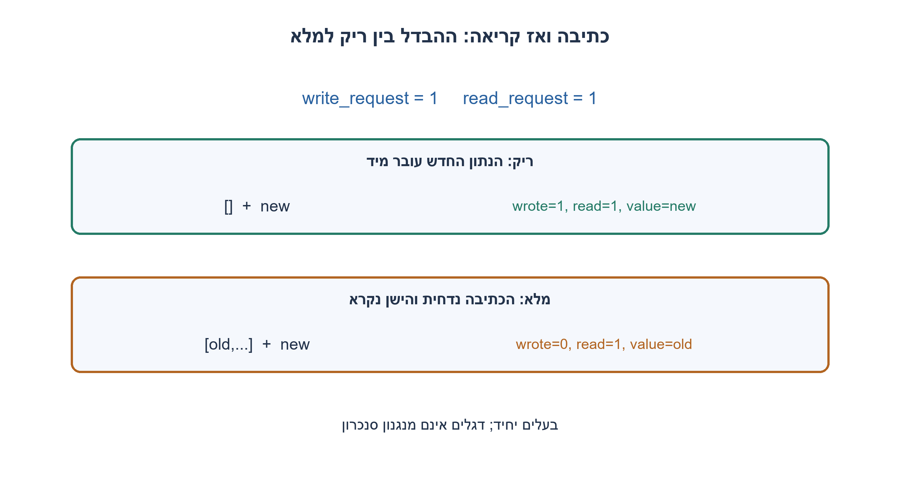
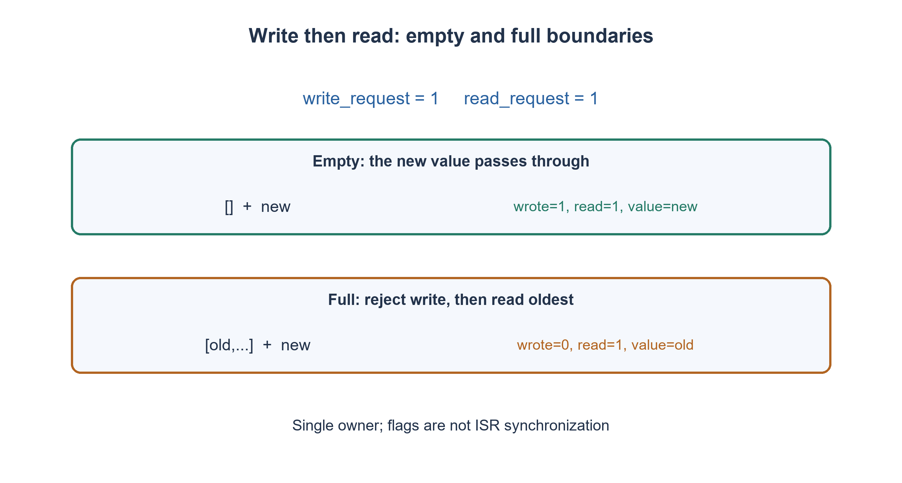

# PREP-230 — תור מעגלי ב־C: בקשות כתיבה וקריאה באותה הפעלה

פתרון מוצע בסיוע AI; ביקורת מקצועית אנושית ממתינה. הקושי אינו מכויל.

## עברית

ממשו ב־C פונקציה שמנהלת תור FIFO במערך נתון בעל capacity תאים, עם read_head, write_head והדגלים ISFULL ו־ISEMPTY. הפונקציה מקבלת snapshot של בקשת כתיבה, נתון לכתיבה ובקשת קריאה. כתיבה מוצלחת מחזירה wrote; קריאה מוצלחת מסירה את הישן ביותר ומחזירה read ו־value. אין להקצות זיכרון.

מדיניות מפורשת: מטפלים קודם בכתיבה ואז בקריאה, וניתן לבצע שתיהן באותה הפעלה. בתור ריק עם שתי בקשות הנתון החדש נכתב ונקרא מיד. בתור מלא עם שתיהן הכתיבה נכשלת, ואז נקרא הישן ביותר. פעולה שלא התבקשה אינה מבוצעת. הקיבולת חיובית, האינדקסים בטווח ו־value תקף רק אם read=true.

זהו תור, גם אם מכנים אותו במקור מחסנית FIFO. בעלים יחיד מעדכן את התור; דגלי בקשה שנוצרו בפסיקה נמסרים כערכים שנדגמו מראש. אין להניח ש־volatile או דגלים לבדם מגינים על עדכון מקביל מתוך ISR. הסבירו איזה סנכרון נדרש אם כמה הקשרים נוגעים במצב התור.

1. ראשי קריאה וכתיבה יכולים להיות שווים גם כשהתור ריק וגם כשהוא מלא; איזה מידע נוסף מבדיל?
2. הגדירו קודם מה קורה כששתי הבקשות פעילות, במיוחד בריק ובמלא.
3. אם הכתיבה מותרת, כתבו וקידמו write_head, עדכנו דגלים; רק אחר כך בדקו קריאה מול המצב החדש. קידום אינדקס חוזר לאפס בקצה.

### סדר הפעולות הוא חלק מממשק התור
נחזיק את הנתון הבא לקריאה ב־read_head ואת התא הבא לכתיבה ב־write_head. בריק שני הראשים שווים, empty=true ו־full=false. במלא הם שוב שווים אבל הדגלים הפוכים. כשהראשים שונים שני הדגלים כבויים. גודל התור אינו נקבע מהפרש הראשים לבדו בלי ההבחנה הזאת.

תחילה מאמתים את תיאור התור: מצביעים תקפים, קיבולת חיובית, ראשים בטווח ודגלים עקביים. מצביעי הבקרה נפרדים זה מזה ומאזור הנתונים. אם write_request ו־!full, כותבים בתא write_head, מקדמים אותו עם חזרה לאפס בקצה, מכבים empty וקובעים full לפי שוויון הראשים. רק לאחר מכן, אם read_request ו־!empty, קוראים בתא read_head, מקדמים אותו, מכבים full וקובעים empty לפי שוויון הראשים. תוצאת valid=false מציינת תיאור מבני לא חוקי; wrote/read מציינים פעולות שבוצעו בפועל.

בקיבולת אחת ובריק, שתי בקשות כותבות וקוראות אותו ערך ומשאירות תור ריק. במלא, שתי בקשות אינן מחליפות את הערך הישן בחדש: הכתיבה נבדקת ראשונה ונכשלת, ואחר כך הישן נקרא. זו מדיניות שנבחרה במפורש. מימוש read-then-write היה מאפשר פינוי ושימוש חוזר מידי במלא, אך לא מעבר נתון בריק באותה צורה. אין תשובה נכונה בלי לקבע את הסדר.

האינווריאנט: התאים החיים מתחילים ב־read_head בסדר מעגלי ומסתיימים לפני write_head, עם full המבדיל סיבוב מלא. כתיבה מוסיפה רק כשהתא הבא אינו חי, וקריאה מוציאה רק את החי הישן ביותר. כל קידום משמר סדר FIFO והדגלים נגזרים מהמצב אחרי הפעולה. השארת ביטים בתא שנקרא אינה הופכת אותו לאיבר חי; הוצאה לוגית אינה מחיקה מאובטחת.

בכל הפעלה מתבצע מספר קבוע של בדיקות ושתי פעולות לכל היותר: O(1) זמן במודל מילים, O(1) מצב בקרה ו־O(capacity) אחסון נתונים שסופק בידי הקורא. הקוד אינו חוסם ואינו ממתין לבקשה. דגל בקשה Boolean אינו מונה אירועים: כמה פסיקות לפני snapshot עלולות להתלכד לבקשה אחת. אם אסור לאבד אירועים צריך תור בקשות או מונה וחוזה גלישה.

אם ISR ותוכנית ראשית שניהם מעדכנים את הראשים, יש להגן על כל רצף הקריאה־שינוי־כתיבה, למשל קטע קריטי מותאם פלטפורמה או פרוטוקול SPSC מוכח עם אטומיות וסדרי זיכרון מתאימים. volatile לבדו אינו מספק אותם. גם snapshot/ניקוי דגלים צריך להיות אטומי מול יוצר הבקשות כדי לא למחוק בקשה חדשה. המודל והקוד כאן חד־בעלים; הם אינם טוענים למימוש lock-free מקביל.

מודל Python נבדק מול deque עצמאי בכל 21,844 עקבות הבקשות באורכים עד שישה ובקיבולות 1..4, כולל תוכן, ראשים ודגלים. לקוד C יש רתמת בדיקה נפרדת; בדיקת המודל אינה תחליף להידור הקוד או לאימות תזמון פסיקות אמיתי.

```c
/* C99, single owner; caller supplies capacity valid int slots and distinct
 * control objects. Requests are snapshots passed by value. No allocation,
 * waiting or implicit ISR synchronization. Operations are WRITE then READ.
 */
#include <stdbool.h>
#include <stddef.h>

typedef struct {
    bool valid;
    bool wrote;
    bool read;
    int value; /* meaningful only when read is true */
} FifoResult;

FifoResult fifo_step(int *data, size_t capacity, size_t *read_head,
                     size_t *write_head, bool *is_full, bool *is_empty,
                     bool write_request, int write_value, bool read_request) {
    FifoResult result = {false, false, false, 0};
    if (!data || !read_head || !write_head || !is_full || !is_empty || capacity == 0)
        return result;
    if (*read_head >= capacity || *write_head >= capacity) return result;
    if (*read_head == *write_head ? (*is_full == *is_empty) : (*is_full || *is_empty))
        return result;
    result.valid = true;
    if (write_request && !*is_full) {
        data[*write_head] = write_value;
        *write_head = *write_head + 1 == capacity ? 0 : *write_head + 1;
        *is_empty = false;
        *is_full = *write_head == *read_head;
        result.wrote = true;
    }
    if (read_request && !*is_empty) {
        result.value = data[*read_head];
        *read_head = *read_head + 1 == capacity ? 0 : *read_head + 1;
        *is_full = false;
        *is_empty = *read_head == *write_head;
        result.read = true;
    }
    return result;
}
```


```python
"""Single-owner ring FIFO; each call snapshots requests and writes before read.

Empty+both passes the newly written value through. Full+both rejects the write,
then reads the oldest value. Rejected operations leave their own effect absent.
This model is not an ISR lock-free implementation.
"""


class RequestFifo:
    def __init__(self, capacity):
        if type(capacity) is not int or capacity <= 0:
            raise ValueError('positive capacity required')
        self.data = [0] * capacity
        self.capacity = capacity
        self.read_head = self.write_head = 0
        self.is_full, self.is_empty = False, True

    def step(self, write_request, write_value, read_request):
        wrote = bool(write_request and not self.is_full)
        if wrote:
            self.data[self.write_head] = write_value
            self.write_head = (self.write_head + 1) % self.capacity
            self.is_empty = False
            self.is_full = self.write_head == self.read_head
        read = bool(read_request and not self.is_empty)
        value = None
        if read:
            value = self.data[self.read_head]
            self.read_head = (self.read_head + 1) % self.capacity
            self.is_full = False
            self.is_empty = self.read_head == self.write_head
        return {'wrote': wrote, 'read': read, 'value': value}

    def contents(self):
        size = self.capacity if self.is_full else (self.write_head - self.read_head) % self.capacity
        return [self.data[(self.read_head + i) % self.capacity] for i in range(size)]


def fifo_trace(capacity, operations):
    queue = RequestFifo(capacity)
    events = [queue.step(bool(w), value, bool(r)) for w, value, r in operations]
    return {'events': events, 'remaining': queue.contents(), 'read_head': queue.read_head,
            'write_head': queue.write_head, 'is_full': queue.is_full, 'is_empty': queue.is_empty}
```




## English

Implement a C FIFO over caller-supplied storage of capacity cells, read_head/write_head indices and ISFULL/ISEMPTY flags. Each call receives snapshotted write request, write value and read request. A successful write reports wrote; a successful read removes and returns the oldest value with read=true. Do not allocate memory.

Explicit policy: WRITE THEN READ; both may occur in one call. Empty plus both requests writes and immediately reads the new value. Full plus both rejects the write, then reads the oldest item. Unrequested operations do not occur. Capacity is positive, indices are in range, and value is meaningful only when read=true.

This is a queue even if the source calls it a FIFO stack. A single owner mutates queue state; interrupt-generated request flags arrive as value snapshots. Neither volatile nor flags alone protect concurrent ISR mutation. Explain synchronization if multiple contexts can access the queue.

1. Equal read/write indices can mean either empty or full; which extra state distinguishes them?
2. Define simultaneous-request semantics first, especially for empty and full queues.
3. If allowed, write and advance write_head, then update flags; only afterward evaluate the read against the new state. Wrap indices at capacity.

### Operation order is part of the queue interface
read_head identifies the next live item; write_head identifies the next writable cell. Empty has equal heads, empty=true and full=false. Full also has equal heads but opposite flags. Unequal heads require both flags false. Head difference alone cannot distinguish a full wrap from empty.

Validate the descriptor first: nonnull pointers, positive capacity, in-range heads and consistent flags. Control objects must be distinct from one another and from payload storage. If write_request and not full, write at write_head, advance with wrap, clear empty and derive full from head equality. Only then, if read_request and not empty, read at read_head, advance it, clear full and derive empty from equality. valid=false reports a structurally invalid descriptor; wrote/read report operations actually performed.

At capacity one and initially empty, both requests write and read the same new value, leaving empty. When full, both requests do not replace the old value: the write is tested first and fails, then the oldest value is read. This is an explicit choice. Read-then-write would allow immediate reuse when full but different empty behavior. Correctness requires settling this policy first.

Invariant: live cells start at read_head in circular order and end before write_head, with full distinguishing a complete wrap. Writes append only when the next cell is not live; reads remove only the oldest live cell. Advancing heads preserves FIFO order and derives flags after each operation. Stale payload bits in a removed cell do not make it a live item; logical removal is not secure erasure.

Each call performs a fixed number of checks and at most two operations: O(1) word-model time, O(1) control state and caller-supplied O(capacity) payload storage. It does not block or wait. A Boolean request flag is not an event counter: multiple interrupts before a snapshot may coalesce. Preserving all events requires a request queue or counter with a wrap/overflow contract.

If both an ISR and main context mutate queue heads, protect the entire read-modify-write sequence using a platform-appropriate critical section or a proven SPSC protocol with required atomics and memory ordering. volatile alone supplies neither. Snapshot/flag clearing must also be atomic with request producers so a new request is not erased. This reference has one state owner and makes no concurrent lock-free claim.

The Python model was checked against an independent deque for all 21,844 request histories through length six at capacities 1..4, including contents, heads and flags. A separate native C harness is supplied; model checks do not replace compiling the C source or validating physical interrupt timing.

```c
/* C99, single owner; caller supplies capacity valid int slots and distinct
 * control objects. Requests are snapshots passed by value. No allocation,
 * waiting or implicit ISR synchronization. Operations are WRITE then READ.
 */
#include <stdbool.h>
#include <stddef.h>

typedef struct {
    bool valid;
    bool wrote;
    bool read;
    int value; /* meaningful only when read is true */
} FifoResult;

FifoResult fifo_step(int *data, size_t capacity, size_t *read_head,
                     size_t *write_head, bool *is_full, bool *is_empty,
                     bool write_request, int write_value, bool read_request) {
    FifoResult result = {false, false, false, 0};
    if (!data || !read_head || !write_head || !is_full || !is_empty || capacity == 0)
        return result;
    if (*read_head >= capacity || *write_head >= capacity) return result;
    if (*read_head == *write_head ? (*is_full == *is_empty) : (*is_full || *is_empty))
        return result;
    result.valid = true;
    if (write_request && !*is_full) {
        data[*write_head] = write_value;
        *write_head = *write_head + 1 == capacity ? 0 : *write_head + 1;
        *is_empty = false;
        *is_full = *write_head == *read_head;
        result.wrote = true;
    }
    if (read_request && !*is_empty) {
        result.value = data[*read_head];
        *read_head = *read_head + 1 == capacity ? 0 : *read_head + 1;
        *is_full = false;
        *is_empty = *read_head == *write_head;
        result.read = true;
    }
    return result;
}
```


```python
"""Single-owner ring FIFO; each call snapshots requests and writes before read.

Empty+both passes the newly written value through. Full+both rejects the write,
then reads the oldest value. Rejected operations leave their own effect absent.
This model is not an ISR lock-free implementation.
"""


class RequestFifo:
    def __init__(self, capacity):
        if type(capacity) is not int or capacity <= 0:
            raise ValueError('positive capacity required')
        self.data = [0] * capacity
        self.capacity = capacity
        self.read_head = self.write_head = 0
        self.is_full, self.is_empty = False, True

    def step(self, write_request, write_value, read_request):
        wrote = bool(write_request and not self.is_full)
        if wrote:
            self.data[self.write_head] = write_value
            self.write_head = (self.write_head + 1) % self.capacity
            self.is_empty = False
            self.is_full = self.write_head == self.read_head
        read = bool(read_request and not self.is_empty)
        value = None
        if read:
            value = self.data[self.read_head]
            self.read_head = (self.read_head + 1) % self.capacity
            self.is_full = False
            self.is_empty = self.read_head == self.write_head
        return {'wrote': wrote, 'read': read, 'value': value}

    def contents(self):
        size = self.capacity if self.is_full else (self.write_head - self.read_head) % self.capacity
        return [self.data[(self.read_head + i) % self.capacity] for i in range(size)]


def fifo_trace(capacity, operations):
    queue = RequestFifo(capacity)
    events = [queue.step(bool(w), value, bool(r)) for w, value, r in operations]
    return {'events': events, 'remaining': queue.contents(), 'read_head': queue.read_head,
            'write_head': queue.write_head, 'is_full': queue.is_full, 'is_empty': queue.is_empty}
```




## חומר משלים / Supporting material

```json
{
  "assumptions": {
    "he": [
      "בעלים יחיד; הבקשות הן ערכי snapshot; WRITE THEN READ.",
      "אחסון וראשים תקפים, קיבולת חיובית, מצביעי בקרה נפרדים ודגלים עקביים.",
      "אין אובדן אירועי בקשה מובטח בלי מונה או תור בקשות."
    ],
    "en": [
      "Single owner, snapshotted request values, WRITE THEN READ.",
      "Valid storage/heads, positive capacity, distinct control objects and consistent flags.",
      "Boolean request flags do not guarantee lossless event accumulation."
    ]
  },
  "optimality": {
    "he": "O(1) זמן להפעלה ומצב בקרה קבוע; O(capacity) תאי נתונים שסופקו מראש. אין הבטחת סנכרון ISR או זמן תגובה RT.",
    "en": "O(1) time per call and constant control state; O(capacity) caller-supplied payload cells. No ISR synchronization or real-time latency guarantee."
  },
  "verification": {
    "he": "21,844 עקבות ממצות במודל Python מול deque, בקיבולות 1..4 ואורכים 0..6. רתמת C נפרדת משתמשת באורקל מערך; הידור ותוצאתו מתועדים בנפרד.",
    "en": "21,844 exhaustive Python histories against deque, capacities 1..4 and lengths 0..6. A separate C harness uses an array oracle; compilation and results are recorded separately."
  },
  "edge_cases": {
    "he": [
      "קיבולת אחת; ריק/מלא ושתי בקשות; wrap; אין בקשות; ראש מחוץ לטווח; דגלים סותרים."
    ],
    "en": [
      "Capacity one; empty/full with both requests; wrap; no requests; out-of-range head; inconsistent flags."
    ]
  },
  "common_mistakes": {
    "he": [
      "שימוש ב־else if מונע קריאה וכתיבה באותה הפעלה.",
      "החלפת סדר הפעולות בלי לשנות את החוזה.",
      "קריאת value כאשר read=false.",
      "הנחה ש־volatile הוא מנעול או שדגל אחד סופר כמה פסיקות."
    ],
    "en": [
      "Using else if prevents two operations in one call.",
      "Changing operation order without changing the contract.",
      "Reading value when read=false.",
      "Treating volatile as a lock or one flag as an interrupt counter."
    ]
  },
  "interview_answer": {
    "he": "אגדיר FIFO מעגלי עם שני ראשים ודגלי ריק/מלא. אבצע כתיבה אם מותר, ואחריה קריאה לפי המצב החדש; אדווח הצלחה בנפרד לכל פעולה. סנכרון פסיקות הוא חוזה נוסף.",
    "en": "Use a circular FIFO with two heads and empty/full flags. Attempt write, then read against the resulting state, reporting each success separately. Interrupt synchronization is a separate contract."
  },
  "source_ambiguities": {
    "he": "המקור מכנה FIFO מחסנית ואינו מגדיר פעולות יחד או בעלות על מצב. הוגדרו תור, סדר כתיבה־קריאה ובעלים יחיד; הרחבת ISR מחייבת סנכרון מפורש.",
    "en": "The source calls a FIFO a stack and leaves simultaneous actions/state ownership unspecified. This version defines a queue, write-before-read and single ownership; ISR extension needs explicit synchronization."
  },
  "solution_extensions": {
    "he": [
      {
        "question": "מה משתנה אם רוצים לאפשר כתיבה באותה הפעלה שבה תור מלא נקרא?",
        "answer_direction": "בוחרים read-then-write או מדיניות החלטה סימולטנית, ומשנים במקביל את התנהגות ריק+שתיהן ואת האורקל. לא משנים רק תנאי full בודד.",
        "principle": "התנהגות גבול נובעת מסדר commit של הפעולות."
      }
    ],
    "en": [
      {
        "question": "What if a full queue must accept a write when the same call reads?",
        "answer_direction": "Choose read-then-write or a simultaneous decision policy and revise empty/both semantics and the oracle too. Do not change only one full check.",
        "principle": "Boundary behavior follows the operation commit order."
      }
    ]
  }
}
```
