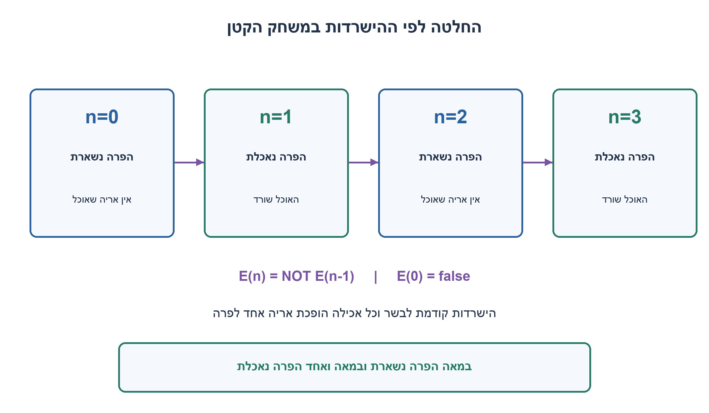
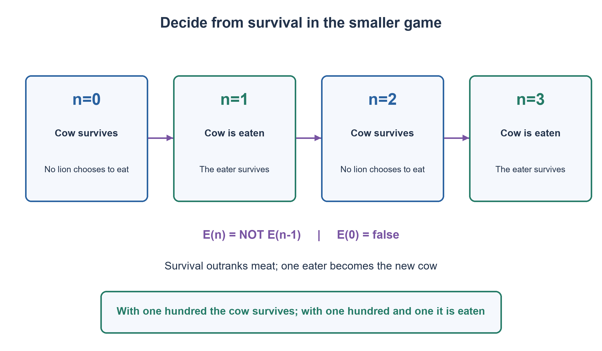

# PREP-231 — מאה אריות ופרה: הישרדות לפני ארוחה

פתרון מוצע בסיוע AI; ביקורת מקצועית אנושית ממתינה. הקושי אינו מכויל.

[צילום מקור פרטי](../sources/2026-10-31-batch22-18.png)

באי בודד יש 100 אריות ופרה אחת. כל אריה יכול לאכול דשא כדי לשרוד (יש מקום בלתי מוגבל של דשא) אבל הם יעדיפו לאכול את הפרה. האריה שאוכל את הפרה בעצמו הופך לפרה; הוא יודע שאחרי שהוא יאכל אותה שאר האריות יכולים לאכול אותו. הם יודעים כמה אריות יש, כולם חכמים וחושבים בהיגיון ויעשו הכל כדי לשרוד. האם הפרה תאכל ולמה?

## עברית

באחו נמצאים 100 אריות ופרה אחת. עשב זמין ללא הגבלה, ואכילתו מאפשרת לאריות להישאר בחיים. אריה מעדיף לאכול את הפרה על פני עשב, אבל הישרדות חשובה לו יותר מהעדפת המזון. אריה שאוכל את הפרה הופך בעצמו לפרה, ושאר האריות יכולים לאכול אותה באותם תנאים.

כל האריות רציונליים, יודעים כמה אריות נשארו, ויודעים שגם האחרים יודעים ומסיקים כך. האם הפרה המקורית תיאכל? נמקו באמצעות מקרים קטנים והוכחה למספר כללי של אריות.

המודל הוא סדרתי: בכל פעולה אריה אחד אוכל פרה אחת והופך לפרה החדשה; אין אכילה בו־זמנית, שיתוף ארוחה, תקיפת אריה שלא הפך לפרה או הסכמי שיתוף פעולה. פרה שלא נאכלת ממשיכה לחיות. מי שיכול לאכול ולשרוד מעדיף זאת על פני עשב, ומי שצפוי להיאכל בוחר בעשב. לכל מצב בעל פעולה מועדפת ניתנת הזדמנות לבצע אותה.

1. אל תתחילו ממאה. מה יקרה אם אין אריות, ואם יש אריה אחד בלבד?
2. אם אריה יאכל, הוא יהפוך לפרה מול אריה אחד פחות. בדקו אם הפרה החדשה תשרוד במשחק הקטן הזה.
3. השוו אריה אחד, שניים ושלושה. בכל צעד ההחלטה מתהפכת: אכילה בטוחה בדיוק כאשר הפרה במשחק עם אריה אחד פחות אינה נאכלת.

### עם מאה אריות הפרה אינה נאכלת
הסיבה אינה שאין רעב, אלא שאף אריה אינו יכול לשפר את ארוחתו בלי לאבד את חייו במודל הזה. כדי להבין את האיום, מחשבים את התגובה של האחרים אחרי אכילה אפשרית.

* אפס אריות: אין מי שיאכל את הפרה, והיא שורדת.
* אריה אחד: הוא אוכל והופך לפרה. אין אריות שיאכלו אותו, ולכן האכילה בטוחה ועדיפה לו.
* שני אריות: מי שיאכל יישאר כפרה מול אריה אחד. לפי המקרה הקודם האריה השני יאכל אותו. כל אחד מעדיף להישאר חי עם עשב, ולכן איש אינו אוכל.
* שלושה אריות: הראשון שיאכל יהפוך לפרה מול שני אריות. כבר ראינו ששניים אינם אוכלים, ולכן הראשון שורד ומעדיף לאכול.

### אינדוקציה לאחור
נסמן E(n) בתשובה לשאלה אם הפרה נאכלת כשנשארו n אריות. הבסיס E(0)=false. אם אריה אוכל, נשארת מולו כפרה קבוצה של n−1 אריות. הוא שורד בדיוק כאשר E(n−1)=false. במקרה הזה אכילה משפרת את מזונו בלי לפגוע בהישרדות, ולכן מתבצעת. כאשר E(n−1)=true, אכילה תגרום למותו, ולכן כל אריה דוחה אותה. מכאן E(n)=not E(n−1): במספר אי־זוגי הפרה נאכלת והאוכל שורד; במספר זוגי הפרה אינה נאכלת.

100 זוגי, ולכן התוצאה היא שאין אכילה. אילו היו 99 או 101 אריות, הפרה המקורית הייתה נאכלת, והאוכל היה שורד כפרה. זהות האוכל אינה נקבעת מהנתונים, אך התוצאה כן. מצב עם פרה ו־99 אריות הוא איום אמין על מי שהיה אוכל ראשון במצב של 100; אין צורך שאיום זה יתממש במסלול בפועל.

### מה חשוב בהנחות
רציונליות לבדה אינה מגדירה העדפות. אם בשר חשוב מהישרדות, גם אריה שיודע שימות עשוי לאכול, ומסקנת הזוגיות אינה תקפה. אם מותר לכמה אריות לחלוק את הפרה, או אם ההפיכה אינה מיידית, זה משחק אחר. הידיעה המשותפת מאפשרת להסתמך שוב ושוב על ההסקה של הקבוצה הקטנה יותר; לא משתמשים בהסתברות שאריה אקראי יטעה.

אפשר לחשב את טבלת ההחלטות עד n בזמן O(n) ועם ביט זיכרון אחד. לאחר הוכחת האינדוקציה די בבדיקת זוגיות: מספר קבוע של פעולות במודל מילה. עבור מספר שלם באורך בלתי חסום, גם ייצוג הקלט וקריאתו הם חלק מהעלות; אין טענה לזמן קבוע באורך הכתיב.

הבדיקה מנתה החלטות וזהויות לכל הגדלים 0..8 והשוותה תועלת לקסיקוגרפית של אכילה מול עשב, ללא שימוש בנוסחת הזוגיות באורקל. נבדקו 1,024 החלטות, וכל הגדלים 0..500 הושוו גם בין הרקורסיה לבדיקת הזוגיות. זו בדיקת מודל מתמטי סופי, לא ניסוי באריות אמיתיים.

```python
"""Finite backward induction: survival first, meat second, sequential eating.

All lions know the preferences and remaining count. One lion eating the cow
becomes the new cow; the other lions can then make the same decision. Grass
keeps a lion alive. This is a mathematical preference model, not animal biology.
"""


def cow_is_eaten(lions: int) -> bool:
    if type(lions) is not int or lions < 0:
        raise ValueError("lions must be a nonnegative integer")
    # With zero lions the cow survives. At each next size, eating is safe
    # exactly when the resulting cow survives the smaller subgame.
    smaller_cow_eaten = False
    for _ in range(lions):
        smaller_cow_eaten = not smaller_cow_eaten
    return smaller_cow_eaten


def cow_is_eaten_constant_space_formula(lions: int) -> bool:
    if type(lions) is not int or lions < 0:
        raise ValueError("lions must be a nonnegative integer")
    return lions % 2 == 1


def outcome(lions: int) -> dict:
    eaten = cow_is_eaten_constant_space_formula(lions)
    return {"lions": lions, "initial_cow_eaten": eaten,
            "first_eater_survives": True if eaten else None}
```




## English

A meadow contains 100 lions and one cow. Unlimited grass keeps lions alive. A lion prefers eating the cow to grass, but survival is more important than the food preference. A lion eating the cow becomes the new cow, which the remaining lions may eat under the same rules.

Every lion is rational, knows the remaining count, and knows that the others share this knowledge and reasoning. Will the original cow be eaten? Explain small cases and prove a rule for a general lion count.

This is a sequential model: one lion eats one cow per action and becomes the new cow. There is no simultaneous or shared meal, attack on a lion that has not become a cow, or cooperative agreement. An uneaten cow stays alive. Safe eating is preferred to grass; eating followed by being eaten is worse than grass. A preferred action is eventually given an opportunity.

1. Do not start at one hundred. What happens with zero lions and with one lion?
2. An eater becomes a cow facing one fewer lion. Would that new cow survive the smaller game?
3. Compare one, two and three lions. The decision flips each step: eating is safe exactly when the cow in the one-smaller game is not eaten.

### With one hundred lions the cow is not eaten
The issue is not hunger. No lion can improve its meal without losing its life in this model. Evaluate the other lions' responses after a hypothetical first meal.

* Zero lions: nobody can eat the cow, so it survives.
* One lion: it eats and becomes a cow with no lions left. Eating is safe and preferred.
* Two lions: an eater would become a cow facing one lion. That remaining lion would eat it. Both prefer living on grass, so neither eats.
* Three lions: an eater becomes a cow facing two lions. Those two refrain, so eating is safe and preferred.

### Backward induction
Let E(n) mean that the cow is eaten with n lions remaining. The base is E(0)=false. An eater becomes a cow facing n−1 lions and survives exactly when E(n−1)=false. In that case eating improves the meal without sacrificing survival, so an eater acts. If E(n−1)=true, eating causes death and every lion refuses. Thus E(n)=not E(n−1): with an odd count the cow is eaten and the eater survives; with an even count the cow survives.

Since 100 is even, no lion eats. With 99 or 101 lions the original cow would be eaten and its eater would survive as the new cow. The eater's identity is unspecified, but the outcome is determined. The smaller ninety-nine-lion game is the credible threat discouraging a first eater in the hundred-lion game; it need not occur along the actual outcome.

### Why the assumptions matter
Rationality alone does not specify preferences. If meat outranks survival, a lion may knowingly accept death, invalidating the parity conclusion. Sharing the cow or delaying the transformation also defines a different game. Common knowledge allows each step to rely on the smaller group's reasoning; no probability of a random mistake is used.

Building all decisions through n takes O(n) time and one state bit. After the proof, a parity check uses a constant number of word operations. Reading an unbounded integer's representation still has an input-size cost; this is not a constant-time claim in the written input length.

The check enumerated identity-based utility decisions for counts 0..8, without using parity in that oracle: 1,024 decisions. It also compared the recurrence and parity calculation for every count 0..500. These are finite mathematical model checks, not experiments with real animals.

```python
"""Finite backward induction: survival first, meat second, sequential eating.

All lions know the preferences and remaining count. One lion eating the cow
becomes the new cow; the other lions can then make the same decision. Grass
keeps a lion alive. This is a mathematical preference model, not animal biology.
"""


def cow_is_eaten(lions: int) -> bool:
    if type(lions) is not int or lions < 0:
        raise ValueError("lions must be a nonnegative integer")
    # With zero lions the cow survives. At each next size, eating is safe
    # exactly when the resulting cow survives the smaller subgame.
    smaller_cow_eaten = False
    for _ in range(lions):
        smaller_cow_eaten = not smaller_cow_eaten
    return smaller_cow_eaten


def cow_is_eaten_constant_space_formula(lions: int) -> bool:
    if type(lions) is not int or lions < 0:
        raise ValueError("lions must be a nonnegative integer")
    return lions % 2 == 1


def outcome(lions: int) -> dict:
    eaten = cow_is_eaten_constant_space_formula(lions)
    return {"lions": lions, "initial_cow_eaten": eaten,
            "first_eater_survives": True if eaten else None}
```




## חומר משלים / Supporting material

```json
{
  "assumptions": {
    "he": [
      "הישרדות קודמת לבשר; עשב זמין ללא הגבלה ומאפשר חיים.",
      "אכילה סדרתית יחידנית והפיכה מיידית לפרה, ללא שיתוף או הסכמים.",
      "ידיעה משותפת של ההעדפות ושל מספר האריות; החלטות לפי המשחק הקטן יותר."
    ],
    "en": [
      "Survival outranks meat; unlimited grass supports life.",
      "Sequential single-eater actions and immediate cow transformation; no sharing or contracts.",
      "Common knowledge of preferences and lion count; decisions use the smaller game."
    ]
  },
  "optimality": {
    "he": "הוכחת אינדוקציה נותנת זוגיות. בניית טבלה O(n) זמן ו־O(1) מצב; בדיקת זוגיות היא O(1) פעולות מילה, לא חסם על קריאת כתיב מספר בלתי חסום.",
    "en": "Induction gives parity. Tabulation takes O(n) time and O(1) state; parity needs O(1) word operations, excluding unbounded input-reading cost."
  },
  "verification": {
    "he": "אורקל זהויות ותועלת בדק 1,024 החלטות בגדלים 0..8; כל 501 הגדלים 0..500 התאימו בין ההישנות לזוגיות. נבדק בנפרד שהעדפת בשר על הישרדות משנה את הדוגמה עם שני אריות.",
    "en": "Identity/utility oracle checked 1,024 decisions for counts 0..8; all 501 counts 0..500 matched recurrence and parity. A separate two-lion preference counterexample changes the conclusion."
  },
  "edge_cases": {
    "he": [
      "אפס אריות; אריה יחיד; שניים; מאה לעומת מאה ואחד; זהות אוכל לא קבועה; היעדר הזדמנות לביצוע פעולה."
    ],
    "en": [
      "Zero, one and two lions; one hundred versus one hundred and one; unspecified eater identity; absent action opportunities."
    ]
  },
  "common_mistakes": {
    "he": [
      "להסיק שכל רעב חייב לאכול גם אם ימות.",
      "להתחיל ממאה בלי לבסס את המשחקים הקטנים.",
      "להתיר אכילה משותפת או להניח שאריות טועים בניגוד למודל."
    ],
    "en": [
      "Assuming hunger overrides survival.",
      "Starting at one hundred without establishing smaller games.",
      "Allowing shared eating or mistakes contrary to the model."
    ]
  },
  "interview_answer": {
    "he": "עם אחד אכילה בטוחה, עם שניים האוכל ייאכל, ולכן הם נמנעים; בכל אריה נוסף התוצאה מתהפכת. מאה זוגי ולכן איש אינו אוכל. ההוכחה תלויה בהישרדות לפני בשר ובאכילה סדרתית.",
    "en": "One lion eats safely; with two the eater would be eaten, so both refrain. Each added lion flips the outcome. One hundred is even, so no lion eats, assuming survival-first sequential decisions."
  },
  "source_ambiguities": {
    "he": [
      "המילה רציונלי דורשת יחס העדפות וידע. כאן הישרדות קודמת למזון והידע משותף. אין מסקנה דומה אוטומטית למודל של שיתוף ארוחה או העדפות אחרות."
    ],
    "en": [
      "Rationality needs preferences and knowledge. Here survival comes first and knowledge is common. Shared meals or other preferences need separate analysis."
    ]
  },
  "solution_extensions": {
    "he": [
      {
        "question": "מה יקרה אם האריות מעדיפים בשר אפילו במחיר חייהם?",
        "answer_direction": "אז אכילה אינה נפסלת בגלל הפרה העתידית; מקרה שני האריות כבר סותר את כלל הזוגיות.",
        "principle": "אינדוקציה במשחק נשענת על פונקציית התועלת ולא על המילה רציונלי בלבד."
      }
    ],
    "en": [
      {
        "question": "What if lions prefer meat even at the cost of their lives?",
        "answer_direction": "Future predation no longer rules eating out; the two-lion case already contradicts the parity rule.",
        "principle": "Game induction depends on utility, not the word rational alone."
      }
    ]
  }
}
```
