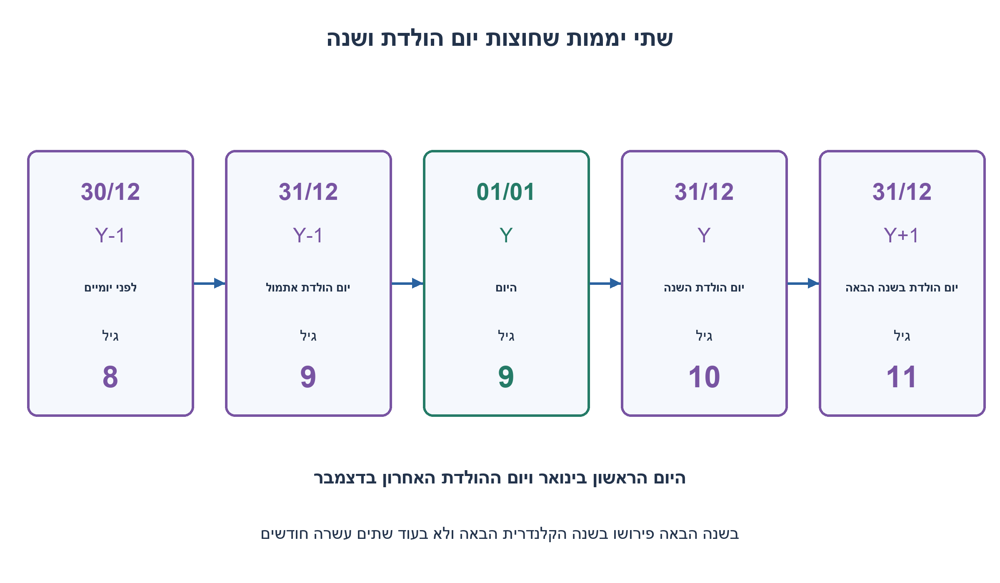
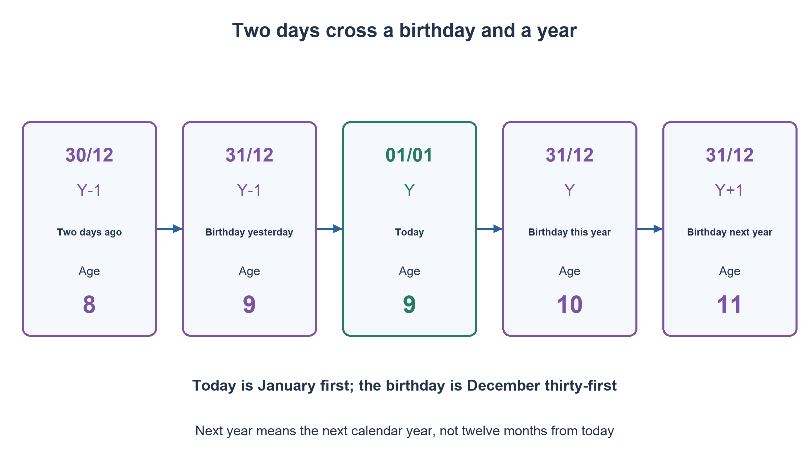

# PREP-232 — בת שמונה לפני יומיים ובת אחת עשרה בשנה הבאה

פתרון מוצע בסיוע AI; ביקורת מקצועית אנושית ממתינה. הקושי אינו מכויל.

[צילום מקור פרטי](../sources/2026-10-31-batch22-20.png)

סוזנה הייתה בת 8 לפני יומיים ובשנה הבאה היא תהיה בת 11. איך זה הגיוני?

## עברית

סוזנה אומרת: לפני יומיים הייתי בת 8, ובשנה הבאה אהיה בת 11. כיצד ייתכן שהאמירה נכונה? הציגו תאריך נוכחי ויום הולדת מתאימים, ועקבו אחרי הגיל בכל נקודה.

הגיל הוא מספר שנות החיים השלמות, והוא גדל ביום ההולדת. 'לפני יומיים' פירושו שני תאריכים קלנדריים לפני היום, ו'בשנה הבאה' פירושו בשנה הקלנדרית הבאה, לא בדיוק בעוד 12 חודשים. משתמשים בלוח שנה רגיל, ללא מעבר אזור זמן או חישוב בשעות.

1. הפרידו בין שנה קלנדרית לבין מספר חודשים שחלפו. האם יומיים יכולים לחצות גם יום הולדת וגם סוף שנה?
2. נסו להציב את היום הראשון בינואר בתור היום, ואת יום ההולדת ביום האחרון בדצמבר.
3. כתבו את הציר: לפני יומיים בת שמונה, אתמול חגגה תשע, השנה תחגוג עשר ובשנה הקלנדרית הבאה אחת עשרה.

### היום הוא 1 בינואר; יום ההולדת ב־31 בדצמבר
לדוגמה, נניח שהיום 1.1.2026 וסוזנה נולדה ב־31.12.2016:

| מועד | תאריך | גיל |
|---|---|---:|
| לפני יומיים | 30.12.2025 | 8 |
| אתמול, יום ההולדת | 31.12.2025 | 9 |
| היום | 1.1.2026 | 9 |
| יום ההולדת בהמשך השנה | 31.12.2026 | 10 |
| יום ההולדת בשנה הבאה | 31.12.2027 | 11 |

אין כאן שלוש שנות הזדקנות ביומיים. אחרי היום עברו עוד כמעט שנתיים עד סוף השנה הבאה. המילה 'בשנה' מצביעה על גבול קלנדרי, לא על משך של שנה בדיוק מהיום.

### איך מוצאים את התאריך ולא רק מנחשים אותו
כדי להתקדם מגיל 8 לגיל 11 צריך לעבור שלושה ימי הולדת. מן התאריך שלפני יומיים ועד סוף השנה הבאה חייבים אפוא להיכנס שלושה מועדי יום הולדת: אחד בשנה הקודמת, אחד השנה ואחד בשנה הבאה. כדי שגם יום הולדת מהשנה הקודמת יהיה אחרי 'לפני יומיים', היום צריך להיות סמוך מאוד לראש השנה.

אם היום 1 בינואר, לפני יומיים היה 30 בדצמבר. יום הולדת ב־31 בדצמבר של השנה הקודמת אכן נכנס בין שני המועדים. אם היום 2 בינואר, לפני יומיים היה 31 בדצמבר; בגיל המלא של אותו תאריך יום ההולדת כבר חל, ולכן נשארים רק ימי ההולדת של השנה ושל השנה הבאה. בתאריכים מאוחרים יותר אין עוד יום הולדת מהשנה הקודמת שיכול לסייע. לכן, במודל גיל לפי תאריכים, מתקבלים 1 בינואר ו־31 בדצמבר.

הדוגמה תקפה בכל שנה שבה התאריכים מוגדרים; אין צורך לבחור דווקא את 2026. לא מסתמכים על 29 בפברואר, על שינוי גיל באמצע היום או על מסע בזמן. אפשר לבנות את ציר התשובה במספר קבוע של פעולות. חיפוש אימות על D תאריכים ו־B ימי הולדת עולה O(D·B), ושמירת כל הפתרונות עולה בהתאם למספרם; זה מחיר החיפוש הבודק, לא מחיר פתרון החידה.

הבדיקה הסופית חיפשה ב־2023, 2024 ו־2025, כולל שנה מעוברת, מול 365 ימי הולדת רגילים שאינם 29 בפברואר: 400,040 זוגות תאריך/יום הולדת. אורקל עצמאי ספר את ימי ההולדת שנכנסים לחלון. בכל שנה נמצא בדיוק אותו פתרון של חודש ויום. נבדקו גם שמונה גבולות של סוף חודש, יום הולדת ו־29 בפברואר כתאריך תצפית. לא נטען שנמנו כל השנים האפשריות או כללי יום הולדת מעובר אחרים.

```python
"""Completed calendar ages and the December/January birthday puzzle.

For an exact date-of-birth model, age increments on the birthday. The finite
search below uses ordinary month/day birthdays (no February 29 convention is
needed for the puzzle's unique December 31 solution).
"""
from datetime import date, timedelta


def age_on(born: date, observed: date) -> int:
    if observed < born:
        raise ValueError("observation precedes birth")
    return observed.year - born.year - ((observed.month, observed.day) < (born.month, born.day))


def age_timeline(year: int) -> dict:
    if type(year) is not int or not 11 <= year <= 9998:
        raise ValueError("year must be in 11..9998")
    born = date(year - 10, 12, 31)
    today = date(year, 1, 1)
    points = {
        "two_days_ago": today - timedelta(days=2),
        "yesterday": today - timedelta(days=1),
        "today": today,
        "birthday_this_year": date(year, 12, 31),
        "birthday_next_year": date(year + 1, 12, 31),
    }
    return {name: {"date": value.isoformat(), "age": age_on(born, value)} for name, value in points.items()}


def find_dates_in_year(year: int) -> list[dict]:
    """Exhaust one supplied calendar year and 365 ordinary birthday dates.

Turning eleven during the following year fixes birth year to year-10. Search
does not assert an exhaustion over all possible years or birthday conventions.
"""
    if type(year) is not int or not 11 <= year <= 9998:
        raise ValueError("year must be in 11..9998")
    ordinary_start = date(2001, 1, 1)
    birthdays = [ordinary_start + timedelta(days=i) for i in range(365)]
    end = date(year + 1, 1, 1)
    today = date(year, 1, 1)
    answers = []
    while today < end:
        ago = today - timedelta(days=2)
        for birthday in birthdays:
            born = date(year - 10, birthday.month, birthday.day)
            if age_on(born, ago) == 8:
                answers.append({"today": today.isoformat(), "birthday": birthday.strftime("%m-%d")})
        today += timedelta(days=1)
    return answers
```




## English

Susanna says: two days ago I was 8, and next year I will be 11. How can both statements be true? Give a current date and a birthday, and trace the ages at the relevant dates.

Age means completed years and increases on the birthday. Two days ago means two calendar dates before today; next year means the next calendar year, not exactly twelve months from now. Use an ordinary calendar without timezone travel or time-of-day tricks.

1. Separate a calendar year from elapsed months. Could two days cross both a birthday and year end?
2. Try January first as today and December last as the birthday.
3. Write the timeline: eight two days ago, nine yesterday, ten later this calendar year, eleven in the following calendar year.

### Today is January first; the birthday is December thirty-first
For example, let today be 1 January 2026 and Susanna's birth date be 31 December 2016:

| Occasion | Date | Age |
|---|---|---:|
| Two days ago | 30 December 2025 | 8 |
| Yesterday, her birthday | 31 December 2025 | 9 |
| Today | 1 January 2026 | 9 |
| Birthday later this year | 31 December 2026 | 10 |
| Birthday next year | 31 December 2027 | 11 |

She has not aged three years in two days. Almost two more years can pass from today to the end of next year. The wording refers to calendar-year boundaries, not exactly one elapsed year from today.

### Deriving the dates
Going from eight to eleven requires three birthday events. Between two days ago and the end of next calendar year, there must therefore be one birthday in the previous year, one this year and one next year. For the previous year's birthday still to lie after two days ago, today must be very close to New Year.

On January first, two days ago was December thirtieth. A December thirty-first birthday lies between those dates. On January second, two days ago was already December thirty-first; that date's completed age already includes its birthday. Only this year's and next year's birthdays remain. Later current dates cannot add a previous-year birthday either. Thus date-based completed ages yield January first and December thirty-first.

The example works in any year supporting the dates; 2026 is not essential. It needs neither a February twenty-ninth birthday nor time-of-day or timezone tricks. Constructing the answer timeline uses a fixed number of operations. An exhaustive verification over D observation dates and B birthdays costs O(D·B), with output storage depending on the solution count. That is verification-search cost, not the puzzle's reasoning cost.

The check exhaustively searched 2023, 2024 and 2025, including a leap year, against 365 ordinary non-February-twenty-ninth birthday dates: 400,040 date/birthday pairs. An independent oracle counted birthday events within the window. Every searched year had exactly the same month/day solution. Eight additional cases checked month ends, birthday boundaries and February twenty-ninth as an observation date. This does not claim exhaustion of all years or alternative leap-birthday conventions.

```python
"""Completed calendar ages and the December/January birthday puzzle.

For an exact date-of-birth model, age increments on the birthday. The finite
search below uses ordinary month/day birthdays (no February 29 convention is
needed for the puzzle's unique December 31 solution).
"""
from datetime import date, timedelta


def age_on(born: date, observed: date) -> int:
    if observed < born:
        raise ValueError("observation precedes birth")
    return observed.year - born.year - ((observed.month, observed.day) < (born.month, born.day))


def age_timeline(year: int) -> dict:
    if type(year) is not int or not 11 <= year <= 9998:
        raise ValueError("year must be in 11..9998")
    born = date(year - 10, 12, 31)
    today = date(year, 1, 1)
    points = {
        "two_days_ago": today - timedelta(days=2),
        "yesterday": today - timedelta(days=1),
        "today": today,
        "birthday_this_year": date(year, 12, 31),
        "birthday_next_year": date(year + 1, 12, 31),
    }
    return {name: {"date": value.isoformat(), "age": age_on(born, value)} for name, value in points.items()}


def find_dates_in_year(year: int) -> list[dict]:
    """Exhaust one supplied calendar year and 365 ordinary birthday dates.

Turning eleven during the following year fixes birth year to year-10. Search
does not assert an exhaustion over all possible years or birthday conventions.
"""
    if type(year) is not int or not 11 <= year <= 9998:
        raise ValueError("year must be in 11..9998")
    ordinary_start = date(2001, 1, 1)
    birthdays = [ordinary_start + timedelta(days=i) for i in range(365)]
    end = date(year + 1, 1, 1)
    today = date(year, 1, 1)
    answers = []
    while today < end:
        ago = today - timedelta(days=2)
        for birthday in birthdays:
            born = date(year - 10, birthday.month, birthday.day)
            if age_on(born, ago) == 8:
                answers.append({"today": today.isoformat(), "birthday": birthday.strftime("%m-%d")})
        today += timedelta(days=1)
    return answers
```




## חומר משלים / Supporting material

```json
{
  "assumptions": {
    "he": [
      "גיל בשנים שלמות לפי תאריך יום הולדת.",
      "שנה הבאה היא שנה קלנדרית; לפני יומיים הוא חיסור שני תאריכים.",
      "אין צורך ביום הולדת מעובר, שעות או אזורי זמן."
    ],
    "en": [
      "Completed years based on birthday dates.",
      "Next year is a calendar year; two days ago subtracts two dates.",
      "No leap birthday, time-of-day or timezone trick is needed."
    ]
  },
  "optimality": {
    "he": "ציר התשובה נבנה במספר קבוע של פעולות. חיפוש אימות סופי על D תאריכים ו־B ימי הולדת עולה O(D·B); אין צורך בו כדי לענות בראיון.",
    "en": "The answer timeline uses a fixed number of operations. Finite verification over D dates and B birthdays costs O(D·B); it is not needed to answer the interview puzzle."
  },
  "verification": {
    "he": "400,040 זוגות נבדקו בשלוש השנים 2023–2025 מול 365 ימי הולדת רגילים, וכן שמונה מקרי גבול. אורקל ספר שלושה אירועי יום הולדת אחרי התאריך המוקדם; בכל שנה הפתרון היה 1 בינואר ו־31 בדצמבר.",
    "en": "400,040 pairs across 2023–2025 and 365 ordinary birthday dates were checked, plus eight boundaries. An independent oracle counted three birthday events after the earlier date; every year yielded January first and December thirty-first."
  },
  "edge_cases": {
    "he": [
      "2 בינואר אינו תחליף ל־1 בינואר במודל הגיל הנתון.",
      "השנה הנוכחית יכולה להיות מעוברת; הפתרון אינו משתמש ב־29 בפברואר.",
      "בשנה הבאה אינו בהכרח בעוד שנה מהיום."
    ],
    "en": [
      "January second does not replace January first under the stated age model.",
      "The current year may be a leap year; the solution does not use February twenty-ninth.",
      "Next calendar year need not mean exactly one year from today."
    ]
  },
  "common_mistakes": {
    "he": [
      "להניח שהיא כבר בת עשר היום.",
      "לפרש בשנה הבאה כבעוד 365 ימים.",
      "לשכוח את יום ההולדת המאוחר בשנה הנוכחית."
    ],
    "en": [
      "Assuming she is already ten today.",
      "Reading next year as exactly 365 days later.",
      "Omitting the late birthday in the current year."
    ]
  },
  "interview_answer": {
    "he": "היום 1 בינואר ויום ההולדת 31 בדצמבר: לפני יומיים הייתה בת שמונה, אתמול תשע, בסוף השנה הזאת עשר ובסוף השנה הבאה אחת עשרה.",
    "en": "Today is January first and the birthday is December thirty-first: eight two days ago, nine yesterday, ten at this year's end and eleven at next year's end."
  },
  "source_ambiguities": {
    "he": [
      "המונח בשנה הבאה מתייחס לגבול השנה בלוח; פירוש של 12 חודשים בדיוק אינו אותו תנאי."
    ],
    "en": [
      "Next year refers to a calendar boundary; exactly twelve elapsed months is a different condition."
    ]
  },
  "solution_extensions": {
    "he": [
      {
        "question": "האם 2 בינואר ויום הולדת ב־31 בדצמבר עדיין מתאימים?",
        "answer_direction": "לא. לפני יומיים כבר היה 31 בדצמבר, ולכן הגיל באותו תאריך כבר גדל; אין שלושה ימי הולדת נוספים עד סוף השנה הבאה.",
        "principle": "גבולות כלולים וסדר אירועים חשובים גם בחידה מילולית."
      }
    ],
    "en": [
      {
        "question": "Would January second with a December thirty-first birthday still work?",
        "answer_direction": "No. Two days ago was already December thirty-first, so that date's completed age includes the birthday. Only two later birthday events remain before next year's end.",
        "principle": "Endpoint inclusion and event order matter in verbal puzzles too."
      }
    ]
  }
}
```
