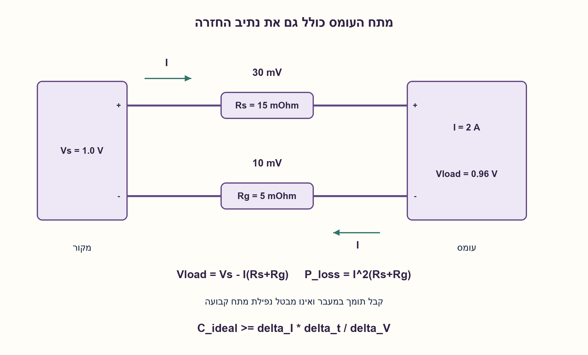
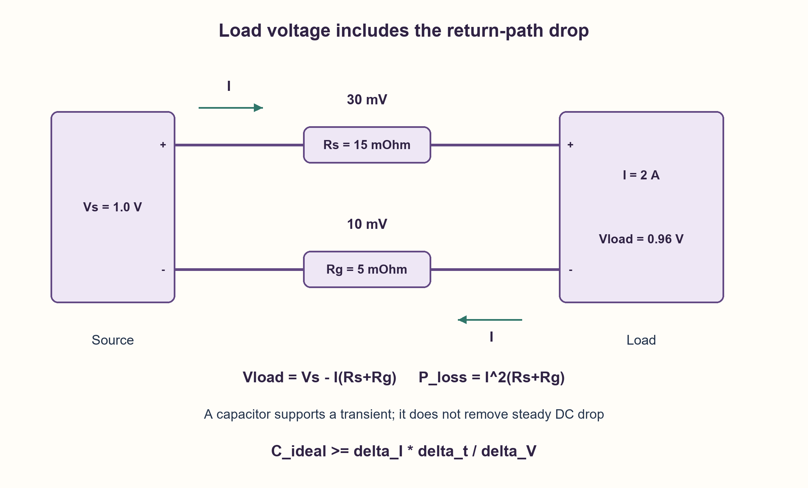

# PREP-233 — נפילת מתח IR drop ברשת האספקה — גורמים ופתרונות

פתרון מוצע בסיוע AI; ביקורת מקצועית אנושית ממתינה. הקושי אינו מכויל.

[צילום מקור פרטי](../sources/2026-11-01-batch20-11.png)

מה זה IRDROP וכיצד ניתן להתגבר על בעיה זו?

חברות לפי הדיווח בצילום בלבד: Amazon.

## עברית

מהי נפילת מתח IR drop וכיצד מצמצמים אותה? הסבירו את ההבדל בין מתח מוצא הספק לבין המתח שבין הדקי האספקה והאדמה של העומס, ואת ההבדל בין נפילה התנגדותית במצב DC לבין שקיעה בזמן שינוי עומס.

לצורך דוגמה בלבד, מקור אידאלי של 1.0 V מזין עומס של 2 A דרך התנגדות אספקה 15 mΩ והתנגדות חזרה 5 mΩ. חשבו את מתח העומס ואת הספק החימום בדרך. אם תקציב הנפילה 30 mV, מה ההתנגדות הכוללת המותרת? הסבירו מתי הרחבת מתכת, מסלולים מקבילים, שינוי מיקום, קבלים ו־remote sense מועילים ומה מגבלותיהם. אין דרישה לתכנון פיזי של שבב מסוים.

1. מה קורה למתח כשזרם עובר במוליך בעל התנגדות שאינה אפס?
2. גם נתיב האספקה וגם נתיב החזרה יוצרים הפרש מתח. הפרידו DC משינוי זרם מהיר.
3. במודל DC השתמשו ב־ΔV=I(Rs+Rg). קבל יכול לספק מטען זמני, אבל אינו עוקף התנגדות לזרם DC קבוע.

### העומס אינו מחובר למקור בחוטים אידאליים
IR פירושו מכפלת הזרם בהתנגדות. נמדוד את מתח העומס ביחס לאדמה המקומית שלו: נתיב האספקה מאבד I·Rs, ואדמת העומס עולה ב־I·Rg ביחס לאדמת המקור. לכן `Vload=Vs−I(Rs+Rg)` והחימום במוליכים הוא `P=I²(Rs+Rg)`. זהו מודל DC מרוכז עם עומס זרם נתון; הוא אינו פותר רשת הסתעפויות של שבב.

בדוגמה ההתנגדות הכוללת 20 mΩ, הנפילה 40 mV, מתח העומס 0.96 V וההפסד 0.08 W. עבור תקציב 30 mV וזרם 2 A צריך לכל היותר 15 mΩ בשני הנתיבים יחד. הקטנת חצי מההתנגדות בלבד אינה בהכרח הקטנת חצי מהנפילה הכוללת.

### לבחור תיקון לפי הסיבה
אפשר להקטין התנגדות באמצעות מתכת קצרה, רחבה או עבה יותר, נתיבים וחיבורי מעבר מקבילים וחיבורי אספקה נוספים, בהתאם לטכנולוגיה. לדוגמה שני נתיבים שווים ומקבילים מחלקים את ההתנגדות שלהם בשניים; קטע משותף לפני ההתפצלות אינו נעלם. יש לבדוק זרמים, חימום וצפיפות זרם, ולשלם בשטח ובמשאבי ניתוב.

מקור עם חישה מרחוק יכול לווסת את המתח בנקודת העומס אם קיימים טווח עבודה, חיווט חישה ומשוב יציב. הוא אינו מסלק חימום במוליכים, אינו מבטיח מתח אחיד בכל ענף ואינו מתיר לחרוג ממתחי רכיב מרביים. הפחתת זרם או פיזור צריכת זרם במרחב ובזמן עשויים לעזור, במחיר ביצועים או שינוי ארכיטקטורה. כיוון נכון תלוי במקום שבו נמדדה הבעיה; אין פתרון יחיד אופטימלי לכל רשת.

### קבל עוזר למעבר, לא למחסור קבוע
בשינוי עומס יש גם השפעות השראות `L·di/dt`, תגובת המווסת, ESR/ESL וקיבול. קבל מקומי יכול לספק מטען בזמן תגובת הספק. במודל אידאלי של חוסר זרם קבוע ΔI למשך Δt, `C≥ΔI·Δt/ΔV`. למשל 1 A במשך 1 µs ותקציב 20 mV נותנים לפחות 50 µF במודל המטען בלבד. אין בכך המלצת רכיב: ESR, השראות, קיבול אפקטיבי ותהודה משנים את התוצאה. במצב DC קבוע זרם הקבל אפס; הוספתו לבדה אינה מתקנת את נפילת ה־IR הקבועה.

בהנחיות [TI לתכנון רשת אספקה](https://www.ti.com/lit/pdf/sprac76) מודגשת ההפרדה בין ניתוח DC לניתוח דינמי והחשיבות של גאומטריית המוליכים ומיקום קבלי הניתוק. [הסבר TI על remote sense](https://www.ti.com/document-viewer/lit/html/SSZTAM1) מוסיף רקע לחישה בנקודת העומס. הערכים כאן הם דוגמה לימודית עצמאית; אין להעתיק תקציב אחוזים של מעבד מסוים לכל רכיב.

### הוכחה, עלות ובדיקה
משוואת DC נובעת מחוק אוהם בכל ענף ומסכימת הפרשי המתח בלולאה; מאזן ההספק נותן `Vs·I=Vload·I+I²R`. חישוב המודל דורש מספר קבוע של פעולות. ברשת אמיתית העלות תלויה במספר הצמתים, הפרזיטים ותנאי ההפעלה. נבדקו משוואות והמרות יחידות, כולל נתיב חזרה ודוגמה נגדית של קבל ב־DC. לא בוצעו SPICE, חילוץ פרזיטים, ניתוח אלקטרומיגרציה או מדידה פיזית.

### מודל Python שנבדק

```python
"""Lumped DC/charge-budget teaching calculations; not a PDN/SPICE solver."""


def dc_rail(source_volts, current_amps, supply_ohms, return_ohms):
    if min(source_volts, current_amps, supply_ohms, return_ohms) < 0:
        raise ValueError('nonnegative DC parameters required')
    total = supply_ohms + return_ohms
    drop = current_amps * total
    return {'drop': drop, 'load_voltage': source_volts - drop,
            'loss_watts': current_amps * current_amps * total}


def allowed_resistance(drop_budget_volts, peak_amps):
    if drop_budget_volts < 0 or peak_amps <= 0:
        raise ValueError('nonnegative budget and positive current required')
    return drop_budget_volts / peak_amps


def ideal_reservoir_capacitance(delta_amps, seconds, drop_budget_volts):
    if min(delta_amps, seconds) < 0 or drop_budget_volts <= 0:
        raise ValueError('nonnegative pulse and positive voltage budget required')
    return delta_amps * seconds / drop_budget_volts
```




### assumptions

```json
[
  "מודל DC מרוכז, מקור אידאלי וזרם עומס נתון; ערכים מספריים הם דוגמה נוספת.",
  "מתח העומס נמדד בין האספקה והאדמה המקומיות שלו."
]
```

### optimality

מודל מרוכז: O(1) פעולות. תיקון פיזי משווה שטח, חימום, ניתוב וביצועים; אין מינימום אוניברסלי.

### verification

בדיקות עצמאיות של חוק אוהם, מאזן הספק ותקציב מטען. אין סימולציית SPICE או בדיקת שבב.

### edge_cases

```json
[
  "זרם אפס או התנגדות אפס נותנים נפילה אפס במודל.",
  "נתיב חזרה לבדו יכול לגרום לנפילה.",
  "המתח המחושב עלול להיות לא אפשרי לעומס הזרם שנבחר; יש לבדוק תחום תוקף."
]
```

### common_mistakes

```json
[
  "להתעלם מהאדמה המקומית.",
  "להציע קבל כפתרון יחיד ל־DC.",
  "להעלות מתח מקור בלי לבדוק מגבלות וענפים אחרים."
]
```

### interview_answer

אחשב נפילה בשני נתיבי הזרם ואבדיל DC ממעבר מהיר. אקטין התנגדות או דרישת זרם; קבלים וחישה מרחוק עוזרים במצבים מוגדרים ואינם מבטלים את כל ההפסדים.

### source_ambiguities

המקור אינו מציין PCB או שבב, מתח או זרם. המודל הוא דוגמת הבהרה ולא תכנון יצרן מסוים.

### solution_extensions

```json
[
  {
    "question": "מדוע שני קבלים בעלי אותו ערך נומינלי יכולים לתת תגובת מעבר שונה?",
    "answer_direction": "ESR/ESL, מיקום, מסלול חזרה וקיבול אפקטיבי שונים משנים את עכבת הרשת כתלות בתדר.",
    "principle": "ערך קיבול יחיד אינו מודל מלא של רשת אספקה."
  }
]
```

## English

What is IR drop, and how can it be reduced? Distinguish the regulator output from the voltage between the load supply and ground pins, and DC resistive drop from droop during a load transition.

As an added numerical example only, an ideal 1.0 V source feeds a 2 A load through 15 mΩ of supply resistance and 5 mΩ of return resistance. Find load voltage and interconnect heating. With a 30 mV drop budget, find allowable total resistance. Discuss wider metal, parallel paths, placement, capacitors and remote sense, including their limits. No particular chip layout is specified.

1. What happens to voltage when current flows through a nonzero conductor resistance?
2. Both supply and return paths contribute. Separate a steady current from a fast current transition.
3. Use ΔV=I(Rs+Rg) at DC. A capacitor can supply temporary charge, but does not bypass steady-state DC resistance.

### The load is not connected by ideal wires
IR denotes current times resistance. Measure load voltage against its own ground: the supply path loses I·Rs and the return path lifts local ground by I·Rg. Thus `Vload=Vs−I(Rs+Rg)` and conductor heating is `P=I²(Rs+Rg)`. This is a lumped DC model with a specified current load, not a full branched chip-grid solver.

The example totals 20 mΩ, giving 40 mV drop, 0.96 V at the load and 0.08 W loss. A 30 mV budget at 2 A permits at most 15 mΩ across both paths together. Halving only one path does not necessarily halve the total drop.

### Match the remedy to the cause
Reduce resistance using shorter, wider or thicker metal, parallel paths/vias and more supply connections where the technology permits. Two identical parallel paths halve their own resistance; an upstream common segment remains. Check current density and heating, and account for area and routing costs.

Remote sensing can regulate the voltage at a chosen load point if the regulator has sufficient range and stable feedback. It does not eliminate conductor heating, guarantee equal voltage at every branch or justify exceeding device voltage limits. Reducing current or spreading activity spatially/temporally may help at a performance or architectural cost. The best tradeoff depends on the actual failing location and conditions.

### A capacitor supports a transient, not a permanent current deficit
Load changes also involve `L·di/dt`, regulator response, capacitor ESR/ESL and capacitance. A local capacitor can provide temporary charge. For an ideal constant current deficit ΔI lasting Δt, `C≥ΔI·Δt/ΔV`. A 1 A deficit for 1 µs with a 20 mV budget needs at least 50 µF in that charge-only model. This is not a component recommendation: effective capacitance, ESR, inductance and resonances matter. At steady DC capacitor current is zero, so adding one alone does not fix persistent resistive drop.

[TI's PDN application note](https://www.ti.com/lit/pdf/sprac76) distinguishes static and dynamic analysis and discusses conductor geometry and decoupling placement. [TI's remote-sense article](https://www.ti.com/document-viewer/lit/html/SSZTAM1) provides background on sensing at the load. The numbers above are independent teaching examples, not a universal processor voltage-budget percentage.

### Correctness, cost and verification
Apply Ohm's law on each path and sum voltages around the loop. Power balance gives `Vs·I=Vload·I+I²R`. The lumped calculation uses a constant number of operations; actual grid-analysis cost depends on node count, parasitics and conditions. Equation/unit checks include return-path drop and the steady-DC capacitor counterexample. No SPICE, parasitic extraction, electromigration signoff or physical measurement was performed.

### Verified Python teaching model

```python
"""Lumped DC/charge-budget teaching calculations; not a PDN/SPICE solver."""


def dc_rail(source_volts, current_amps, supply_ohms, return_ohms):
    if min(source_volts, current_amps, supply_ohms, return_ohms) < 0:
        raise ValueError('nonnegative DC parameters required')
    total = supply_ohms + return_ohms
    drop = current_amps * total
    return {'drop': drop, 'load_voltage': source_volts - drop,
            'loss_watts': current_amps * current_amps * total}


def allowed_resistance(drop_budget_volts, peak_amps):
    if drop_budget_volts < 0 or peak_amps <= 0:
        raise ValueError('nonnegative budget and positive current required')
    return drop_budget_volts / peak_amps


def ideal_reservoir_capacitance(delta_amps, seconds, drop_budget_volts):
    if min(delta_amps, seconds) < 0 or drop_budget_volts <= 0:
        raise ValueError('nonnegative pulse and positive voltage budget required')
    return delta_amps * seconds / drop_budget_volts
```




### assumptions

```json
[
  "Lumped DC model, ideal source and specified load current; numerical values are added examples.",
  "Measure load voltage between its local supply and ground."
]
```

### optimality

Lumped calculation: O(1) operations. Physical remedies trade area, heat, routing and performance; no universal minimum.

### verification

Independent Ohm-law, power-balance and charge-budget checks. No SPICE or silicon verification.

### edge_cases

```json
[
  "Zero current or zero resistance gives zero modeled drop.",
  "The return path alone can cause drop.",
  "A calculated negative voltage can invalidate the chosen current-load operating model."
]
```

### common_mistakes

```json
[
  "Ignoring local-ground rise.",
  "Using only a capacitor to fix DC drop.",
  "Raising the source voltage without checking limits and other branches."
]
```

### interview_answer

Account for both current paths and separate DC from fast transients. Reduce resistance or demand; decoupling and remote sense have specific benefits and do not remove every loss.

### source_ambiguities

The source specifies neither PCB/chip scope nor voltage/current. The model is an explicit illustration, not a device-specific design.

### solution_extensions

```json
[
  {
    "question": "Why can two capacitors with the same nominal value produce different transient responses?",
    "answer_direction": "ESR/ESL, placement, return path and effective capacitance change frequency-dependent network impedance.",
    "principle": "A capacitance number alone is not a complete PDN model."
  }
]
```
