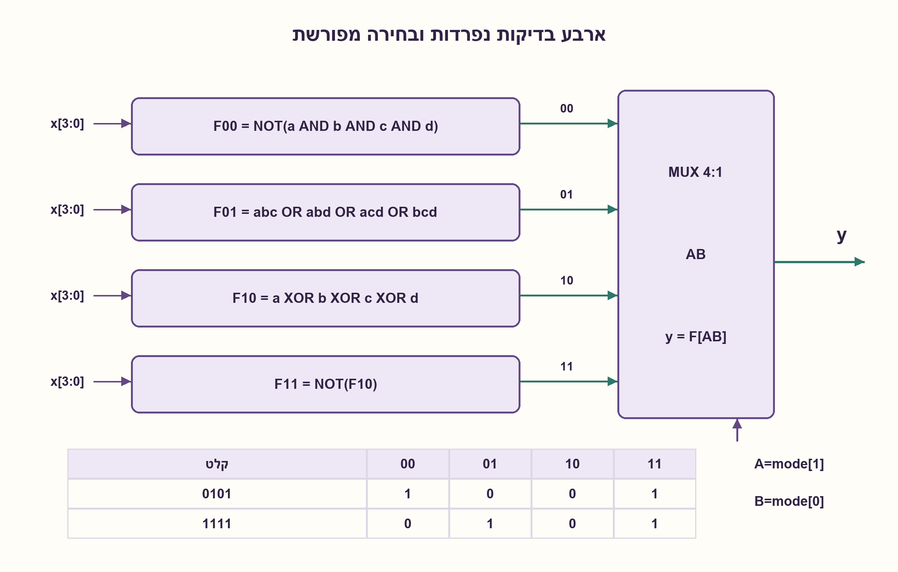
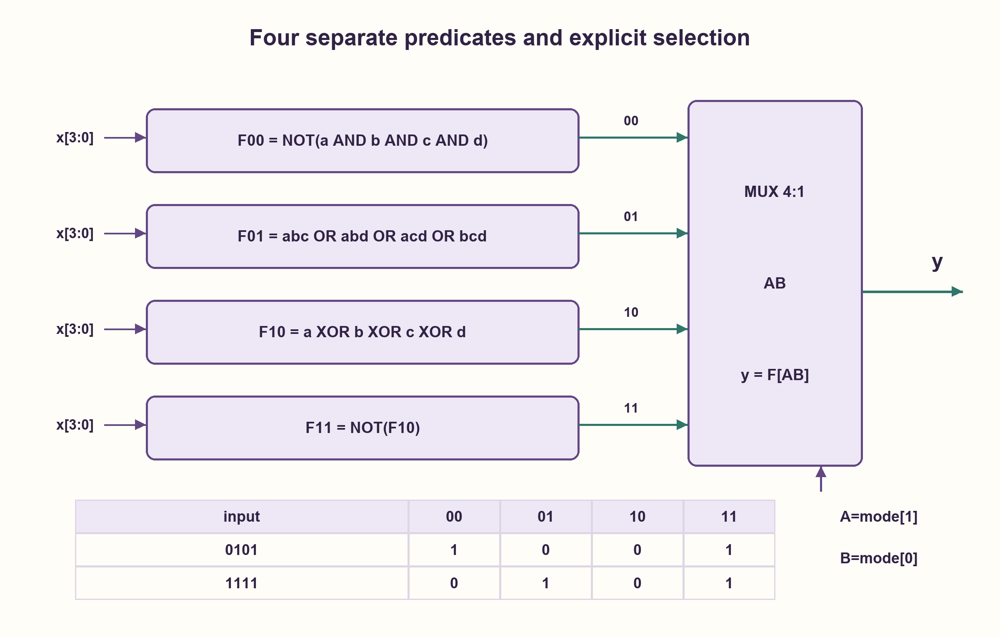

# PREP-234 — ארבעה ביטים ושני ביטי בקרה — אפס, רוב וזוגיות

פתרון מוצע בסיוע AI; ביקורת מקצועית אנושית ממתינה. הקושי אינו מכויל.

[צילום מקור פרטי](../sources/2026-11-01-batch20-12.png)

בנה רכיב המקבל 4 ביטים ו-2 כניסות בקרה A,B ומוציא פלט 1 בהתאם לבקרה: 00 האם יש לפחות 0 אחד במספר; 01 האם מספר ה-1 גדול ממספר ה-0; 10 האם המספר מכיל כמות אי-זוגית של 1; 11 האם המספר מכיל כמות זוגית של 1.

חברות לפי הדיווח בצילום בלבד: .

## עברית

בנו רכיב קומבינטורי שמקבל x[3:0] ושני ביטי בקרה A,B, ומחזיר y=1 בדיוק כאשר התנאי הנבחר מתקיים:

| AB | התנאי |
|---|---|
|00|לפחות ביט אחד בקלט הוא 0|
|01|מספר האחדים גדול ממספר האפסים|
|10|מספר האחדים אי־זוגי|
|11|מספר האחדים זוגי|

הקלטים בינאריים, A הוא ביט הבקרה המשמעותי, והפלט אינו רשום. אפס אחד פירושו ביט שערכו 0; בשוויון שתי אחדות ושני אפסים מצב 01 מחזיר 0. אפשר להשתמש בשערים ובבורר. תנו משוואות והסבר נכונות; אין דרישה למינימום שערים.

1. בדקו כל תנאי בנפרד לפני חיבור הבקרה. מה קורה בקלט 1111 ובקלט 0000?
2. רוב האחדים בארבעה ביטים פירושו לפחות שלושה; זוגיות מתארת את מספר האחדים ולא את ערך המספר.
3. הכינו ארבע תוצאות: NOT של AND כל הביטים, OR של כל מכפלות שלושה ביטים, XOR של הארבעה וההיפוך שלו. בחרו לפי AB.

### מפרידים את התנאים מן הבחירה
נסמן את ארבעת הביטים a,b,c,d. נגדיר:

```text
F00 = NOT(a AND b AND c AND d)
F01 = abc OR abd OR acd OR bcd
F10 = a XOR b XOR c XOR d
F11 = NOT(F10)
y = MUX4(AB; F00,F01,F10,F11)
```

F00 אינו OR של הביטים: הדרישה היא קיום אפס, ולכן הוא 0 רק בקלט 1111. לפי דה־מורגן אפשר גם OR של ארבעת הביטים המהופכים. ב־F01 כל מכפלת שלושה מזהה שלושה אחדים מסוימים. אם יש לפחות שלושה אחדים אחת המכפלות 1; אם יש רק שניים או פחות כולן 0. זה בדיוק יותר אחדים מאפסים בארבעה ביטים, ולא לפחות שני אחדים.

XOR משנה ערך בכל הוספת אחד, ולכן הוא 1 עבור ספירה 1 או 3. ההיפוך 1 עבור 0,2,4; גם אפס הוא מספר זוגי. למשל x=0101 כולל שני אחדים, וארבע התוצאות לפי סדר המצבים הן 1,0,0,1. עבור 1111 הן 0,1,0,1; עבור 0000 הן 1,0,0,1. מילות הקלט 0011 ו־0101 זהות מבחינת ארבעת התנאים אף שערכן המספרי שונה.

הבורר שומר כל תוצאה בענף שלה, ולכן ניתוח ארבע הפונקציות וטבלת הבקרה מוכיחים נכונות לכל 64 צירופי x ו־AB. אפשר לממש את הבורר משלושה תאי 2:1: שניים בשליטת B ואחד בשליטת A. שיתוף F10 עם F11 חוסך חישוב זוגיות מחדש.

### עלות וגבולות
במיפוי המחשה לשערי AND/OR/XOR בעלי שתי כניסות ו־NOT: F00 דורש 3 AND ו־NOT; F01 דורש 8 AND ו־3 OR אם כל מכפלה נבנית בנפרד; הזוגיות דורשת 3 XOR ו־NOT נוסף. עם שלושה תאי MUX, זו בנייה של 11 AND, 3 OR, 3 XOR, 2 NOT ו־3 MUX. אין טענת מינימום; שיתוף מכפלות או ספריית תאים אחרת משנים את הספירה וההשהיה. RTL אינו מודד שטח פיזי.

נבדקו כל 64 הצירופים מול אורקל שסופר אחדים. נדרשת התייצבות קלטים לפני תצפית; שינוי בקרה או נתונים יכול ליצור גליץ' במעגל אמיתי. X/Z ב־HDL אינם חלק מהחוזה הבינארי, ושוויון עם X אינו בדיקת מקור נאותה.

### מודל Python שנבדק

```python
"""Four independent Boolean predicates, selected by mode AB."""


def predicates(x):
    if type(x) is not int or not 0 <= x < 16:
        raise ValueError('unsigned four-bit input required')
    a, b, c, d = [(x >> bit) & 1 for bit in (3, 2, 1, 0)]
    any_zero = 1 - (a & b & c & d)
    majority = (a & b & c) | (a & b & d) | (a & c & d) | (b & c & d)
    odd = a ^ b ^ c ^ d
    return [any_zero, majority, odd, 1 - odd]


def controlled(x, mode):
    if type(mode) is not int or not 0 <= mode < 4:
        raise ValueError('two-bit mode required')
    return predicates(x)[mode]
```


### קוד SystemVerilog; תוצאות סימולציה בדוח נפרד

```systemverilog
module controlled_predicates(input wire [3:0] x, input wire [1:0] mode, output wire y);
  wire any_zero = ~&x;
  wire majority = (x[3]&x[2]&x[1]) | (x[3]&x[2]&x[0]) |
                  (x[3]&x[1]&x[0]) | (x[2]&x[1]&x[0]);
  wire odd = ^x;
  assign y = mode == 2'b00 ? any_zero : mode == 2'b01 ? majority :
             mode == 2'b10 ? odd : ~odd;
endmodule
```




### assumptions

```json
[
  "AB הוא בורר לפי הסדר 00,01,10,11; A משמעותי יותר.",
  "קלט בינארי של ארבעה ביטים, לוגיקה קומבינטורית ללא שעון."
]
```

### optimality

בנייה מפורשת עם שיתוף זוגיות: 11 AND, 3 OR, 3 XOR, 2 NOT ו־3 MUX, בשערים דו־כניסתיים. אין הוכחת מינימום.

### verification

64 קלטים/מצבים מול ספירת אחדים עצמאית; בדיקת HDL נפרדת מתועדת בדוח ההרצה.

### edge_cases

```json
[
  "1111 נכשל בתנאי קיום אפס.",
  "0000 מקיים קיום אפס וזוגיות.",
  "שני אחדים אינם רוב."
]
```

### common_mistakes

```json
[
  "לפרש קיום אפס כקיום אחד.",
  "לבדוק רק LSB כדי לספור זוגיות אחדים.",
  "להחליף בין A ו־B בבורר."
]
```

### interview_answer

אבנה ארבע בדיקות ואבחר לפי AB. קיום אפס הוא היפוך AND, רוב הוא לפחות שלושה, ואי־זוגיות היא XOR; זוגיות היא המשלים שלו.

### source_ambiguities

הנוסח 00 אומר לפחות ביט אחד שערכו אפס. אין במקור דרישת מינימום או שעון.

### solution_extensions

```json
[
  {
    "question": "מה משתנה אם אורך הקלט N ולא ארבעה?",
    "answer_direction": "רוב דורש popcount גדול מ־N/2, זוגיות נשארת XOR וקיום אפס נשאר היפוך reduction AND. עלות ועומק תלויים במבנה המימוש.",
    "principle": "להפריד משמעות פונקציה ממבנה מעגל ברוחב נתון."
  }
]
```

## English

Build a combinational block with x[3:0], control bits A,B and output y. Output one exactly when the selected condition holds:

| AB | Condition |
|---|---|
|00|At least one input bit is zero|
|01|More ones than zeroes|
|10|An odd number of ones|
|11|An even number of ones|

Inputs are binary, A is the most significant control bit, and output is not registered. Two ones and two zeroes do not satisfy mode 01. Gates and a selector are allowed. Give equations and correctness reasoning; minimum gate count is not required.

1. Check each predicate before connecting the control. What happens at 1111 and 0000?
2. A strict majority among four bits requires at least three ones; parity concerns the population count, not the numeric value.
3. Prepare NOT of all-bit AND, OR of the four three-bit products, XOR of all bits and its inverse. Select by AB.

### Separate the predicates from selection
Name the four bits a,b,c,d:

```text
F00 = NOT(a AND b AND c AND d)
F01 = abc OR abd OR acd OR bcd
F10 = a XOR b XOR c XOR d
F11 = NOT(F10)
y = MUX4(AB; F00,F01,F10,F11)
```

F00 is not the OR of the data bits. At least one zero means false only at 1111; De Morgan also gives the OR of complemented bits. Each F01 product recognizes a particular triple of ones. With three or four ones some triple is present; with at most two, every triple is false. This is a strict majority, rather than at least two ones.

XOR toggles for every added one, so F10 is true at counts 1 and 3. Its complement is true at 0,2,4; zero is even. For 0101 the four mode results are 1,0,0,1. For 1111 they are 0,1,0,1; for 0000 they are 1,0,0,1. Inputs 0011 and 0101 have the same predicates despite different integer values.

The selector chooses the corresponding proven predicate. Thus the four proofs and control table cover all 64 input/control combinations. A 4:1 selector can use two 2:1 cells controlled by B followed by one controlled by A. Reuse F10 when forming F11.

### Cost and boundaries
For an illustrative mapping to two-input AND/OR/XOR gates and separate NOT gates: F00 needs 3 AND and 1 NOT; separate F01 products need 8 AND and 3 OR; parity needs 3 XOR and one more NOT. Including selection gives 11 AND,3 OR,3 XOR,2 NOT and 3 MUX cells. This is a construction, not a minimum. Factoring/shared products and other cell libraries change count and delay; RTL does not measure physical area.

All 64 combinations were compared with an independent set-bit-count oracle. Observe after inputs settle. Input/control transitions can glitch in real gates. HDL X/Z values are outside the binary contract.

### Verified Python teaching model

```python
"""Four independent Boolean predicates, selected by mode AB."""


def predicates(x):
    if type(x) is not int or not 0 <= x < 16:
        raise ValueError('unsigned four-bit input required')
    a, b, c, d = [(x >> bit) & 1 for bit in (3, 2, 1, 0)]
    any_zero = 1 - (a & b & c & d)
    majority = (a & b & c) | (a & b & d) | (a & c & d) | (b & c & d)
    odd = a ^ b ^ c ^ d
    return [any_zero, majority, odd, 1 - odd]


def controlled(x, mode):
    if type(mode) is not int or not 0 <= mode < 4:
        raise ValueError('two-bit mode required')
    return predicates(x)[mode]
```


### SystemVerilog; simulation results are in a separate report

```systemverilog
module controlled_predicates(input wire [3:0] x, input wire [1:0] mode, output wire y);
  wire any_zero = ~&x;
  wire majority = (x[3]&x[2]&x[1]) | (x[3]&x[2]&x[0]) |
                  (x[3]&x[1]&x[0]) | (x[2]&x[1]&x[0]);
  wire odd = ^x;
  assign y = mode == 2'b00 ? any_zero : mode == 2'b01 ? majority :
             mode == 2'b10 ? odd : ~odd;
endmodule
```




### assumptions

```json
[
  "AB selects modes00,01,10,11 with A most significant.",
  "Four binary data bits; combinational logic without a clock."
]
```

### optimality

Explicit separate-product construction:11 AND,3 OR,3 XOR,2 NOT and 3 MUX cells using two-input gates. No minimum proof.

### verification

64 data/mode cases against independent population counting; separate HDL execution is recorded in its report.

### edge_cases

```json
[
  "1111 fails the any-zero predicate.",
  "0000 satisfies any-zero and even parity.",
  "Two ones are not a strict majority."
]
```

### common_mistakes

```json
[
  "Replacing any-zero by any-one.",
  "Using only the LSB to decide population parity.",
  "Swapping A and B in mode selection."
]
```

### interview_answer

Build four predicates then select by AB: any-zero is inverted AND, majority means at least three, odd parity is XOR and even parity its complement.

### source_ambiguities

Mode 00 means at least one zero-valued bit. The source gives no minimum-count or clock requirement.

### solution_extensions

```json
[
  {
    "question": "What changes for N data bits?",
    "answer_direction": "Majority requires popcount>N/2; parity remains reduction XOR and any-zero inverted reduction AND. Cost/depth depend on topology.",
    "principle": "Separate predicate semantics from fixed-width construction."
  }
]
```
