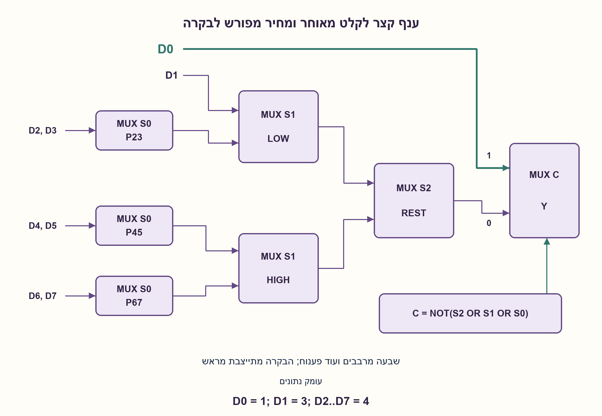
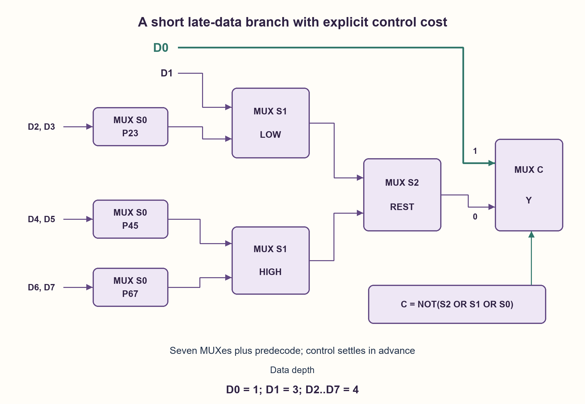

# PREP-235 — מרבב 8:1 מתאי 2:1 וקיצור מסלול לקלט שמגיע מאוחר

פתרון מוצע בסיוע AI; ביקורת מקצועית אנושית ממתינה. הקושי אינו מכויל.

[צילום מקור פרטי](../sources/2026-11-01-batch20-13.png)

1. ממש שער MUX 2:1. 2. בעזרת השער הקודם ממש שער MUX 8:1. 3. לאחת הכניסות של MUX 8:1 יש עיכוב בהגעה. מצא דרך לקצר את המסלול של כניסה זאת.

חברות לפי הדיווח בצילום בלבד: Apple, Intel.

## עברית

א. ממשו מרבב 2:1: Y=D0 כאשר S=0 ו־Y=D1 כאשר S=1.
ב. באמצעות תאי 2:1 בנו מרבב 8:1 הבוחר D[k] כאשר S[2:0]=k.
ג. D0 מגיע מאוחר ביחס לשאר הנתונים. תכננו חלופה שמקצרת את מסלול הנתונים ממנו, בלי לשנות את הבחירה הנדרשת. הסבירו את המחיר במסלולים האחרים ובבקרה.

מודל ההשוואה: אותות הבחירה ותוצאת פענוח שלהם יציבים מספיק מוקדם; לכל תא מרבב השהיית נתונים t, וחיווט מוזנח. בסעיף ג מותרת לוגיקת בקרה מפורשת נוסף על מרבבים. הציגו גם את העלות אם הפענוח ממומש רק במרבבים עם קבועים 0,1. אין היתר להוסיף מחזור השהיה. קלט מאוחר אחר ניתן למפות מחדש תוך שמירה על משמעות S.

1. מרבב בוחר בין שתי אפשרויות; כמה רמות צריך עץ מאוזן עם שמונה עלים?
2. הקלט המאוחר אינו חייב להימצא בעומק זהה לשאר הקלטים. אפשר לתת לו ענף סמוך לפלט.
3. פענחו מראש S=000. במרבב הסופי בחרו D0 במצב זה, וביתר המצבים בחרו תוצאת עץ שמטפל ב־D1..D7. הגדירו גם את התנהגות עץ המשנה במקרה שלא נבחר.

### קודם בונים את הבחירה הרגילה
מרבב יחיד מממש `Y=(NOT S AND D0) OR (S AND D1)`: אפשר NOT אחד, שני AND ושער OR, בהנחת שערים דו־כניסתיים. בעץ 8:1 מאוזן נבחר בזוגות לפי S0, בין זוגות לפי S1 ולבסוף לפי S2. נדרשים 4+2+1=7 מרבבים, וכל נתון עובר בשלושה. בחירה 101 מחזירה D5.

שבעה הוא מינימום למספר תאי 2:1 במודל עץ מיזוג של שמונה עלים תלויי־נתונים, עם בקרה שאינה תלויה בנתונים: כל מיזוג בינארי מאחד לכל היותר שתי קבוצות ולכן שמונה מקורות מחייבים שבעה מיזוגים. זה אינו מינימום טרנזיסטורים או הוכחת שטח פיזי. עץ מאוזן ממזער עומק נתונים מרבי ל־3, כי שתי שכבות מספקות לכל היותר ארבעה עלים.

### נותנים לקלט המאוחר ענף קצר
נסמן `M(s,l,h)` כבחירה ב־l כאשר s=0. נגדיר:

```text
P23 = M(S0,D2,D3)
P45 = M(S0,D4,D5)
P67 = M(S0,D6,D7)
LOW = M(S1,D1,P23)
HIGH = M(S1,P45,P67)
REST = M(S2,LOW,HIGH)
C = NOT(S2 OR S1 OR S0)
Y = M(C,REST,D0)
```

לעץ REST יש שישה מרבבים. כשהבחירה אינה אפס הוא מחזיר את הנתון הנכון D1..D7. במקרה S=000 הוא מחזיר D1, אך הענף הזה אינו נבחר: C=1 מעביר D0. לכן המימוש כולו נכון בכל שמונה הבחירות, בלי להסתמך על ערך לא מוגדר. בענף D0 יש רק מרבב סופי אחד. D1 עובר שלושה, ו־D2..D7 ארבעה. יחד יש שוב שבעה מרבבים, נוסף לפענוח הבקרה; אין להשוות למספר שבע בלי לספור גם אותו.

### מה בדיוק השתפר?
כאשר C כבר יציב, מסלול הנתונים מ־D0 קצר מ־3t ל־t. אם D0 מגיע ב־8 ns, האחרים ב־0, ו־t=1 ns, זמן ההתייצבות במודל הנתונים יורד מ־11 ns ל־9 ns; יתר הנתונים מוכנים לכל המאוחר ב־4 ns. המספרים נועדו להמחשה. אין הבטחה כזאת אם הבחירה מאחרת או מסלול הפענוח הוא הקובע.

פענוח C דורש שני OR דו־כניסתיים ו־NOT, או שער NOR בעל שלוש כניסות אם קיים. עם מרבבים בלבד אפשר `T0=M(S0,1,0)`, `T1=M(S1,T0,0)`, `C=M(S2,T1,0)`: שלושה תאי בקרה נוספים, ובסך הכול עשרה. גם מסלול בקרה זה צריך להתייצב לפני הבחירה הסופית; constants ו־fanout אינם מידע על השהיית תא אמיתי.

מכאן הפשרה: האופטימיזציה מגינה על נתון מאוחר אחד, אך מגדילה עומק לאחרים ומוסיפה לוגיקת בחירה. אם הנתונים מגיעים יחד והבקרה מוקדמת, העץ המאוזן יכול להיות טוב יותר לזמן המרבי. יש לבדוק קשתות בחירה, slew, עומס, ניתוב ו־glitches לפני טענת תזמון פיזית. שינוי שמוסיף FF אינו שקול כאן כי הוא משנה השהיה במחזורים.

הבדיקה השוותה שתי טופולוגיות לכל 256 מילות הנתונים ולכל שמונה הבחירות. זה מוכיח את טבלת הבחירה בתחום הבינארי; מודל העומק אינו STA או מדידת שבב. קוד ההדגמה משתף ארבעה תאים משותפים לשתי היציאות, ולכן מכיל יחד עשרה תאים: כל תכנון בנפרד מכיל שבעה.

### מודל Python שנבדק

```python
"""Counted MUX topology; equal-delay stable-select model, not physical STA."""


def mux(select, low, high):
    return high if select else low


def evaluate(data, select):
    if len(data) != 8 or any(v not in (0, 1) for v in data) or not 0 <= select < 8:
        raise ValueError('eight binary inputs and three-bit select required')
    s0, s1, s2 = [(select >> bit) & 1 for bit in range(3)]
    pairs = [mux(s0, data[i], data[i + 1]) for i in range(0, 8, 2)]
    balanced = mux(s2, mux(s1, *pairs[:2]), mux(s1, *pairs[2:]))
    # Prune the old D0/D1 MUX: D1 is safe when select=0 because the final
    # bypass chooses D0 in precisely that otherwise-don't-care case.
    rest = mux(s2, mux(s1, data[1], pairs[1]), mux(s1, pairs[2], pairs[3]))
    bypass = mux(int(select == 0), rest, data[0])
    return balanced, bypass


def worst_data_arrival(arrivals, cell_delay, optimized=False):
    if len(arrivals) != 8 or cell_delay < 0:
        raise ValueError('eight arrivals and nonnegative delay required')
    depths = [1, 3, 4, 4, 4, 4, 4, 4] if optimized else [3] * 8
    return max(a + depth * cell_delay for a, depth in zip(arrivals, depths))
```


### קוד SystemVerilog; תוצאות סימולציה בדוח נפרד

```systemverilog
module late_mux2(input wire low,high,select, output wire y);
  assign y = select ? high : low;
endmodule

module mux8_late(input wire [7:0] d, input wire [2:0] s,
                 output wire balanced, optimized);
  wire p01,p23,p45,p67,lo,hi;
  late_mux2 b0(d[0],d[1],s[0],p01);
  late_mux2 b1(d[2],d[3],s[0],p23);
  late_mux2 b2(d[4],d[5],s[0],p45);
  late_mux2 b3(d[6],d[7],s[0],p67);
  late_mux2 b4(p01,p23,s[1],lo);
  late_mux2 b5(p45,p67,s[1],hi);
  late_mux2 b6(lo,hi,s[2],balanced);

  // Shared p23,p45,p67,hi are four cells also used by the separate optimized
  // topology. Counting each design in isolation gives seven MUX cells each.
  wire lo_without_d0, rest;
  wire choose_d0 = ~|s;
  late_mux2 o0(d[1],p23,s[1],lo_without_d0);
  late_mux2 o1(lo_without_d0,hi,s[2],rest);
  late_mux2 o2(rest,d[0],choose_d0,optimized);
endmodule
```




### assumptions

```json
[
  "המשמעות D[k] נבחר ב־S=k נשמרת; D0 הוא הנתון המאוחר שנבחר להמחשה.",
  "במודל השהיית הנתונים הבחירה והפענוח יציבים מראש; אין pipeline.",
  "לוגיקת בקרה מותרת בסעיף האופטימיזציה; ניתנת גם חלופת פענוח במרבבים."
]
```

### optimality

מאוזן: 7 MUX ועומק 3. חלופה: 7 MUX ועוד פענוח, עומק D0=1, D1=3 והיתר 4. מינימום התאים והעומק נטען רק במודל עץ בינארי.

### verification

2048 צירופי נתונים ובחירה מול אינדוקס ישיר, וחישוב עצמאי של זמני הגעה. סימולציית RTL מדווחת בנפרד; אין STA פיזי.

### edge_cases

```json
[
  "S=000 בוחר D0 אף ש־REST מחזיר D1.",
  "אם D0 אינו מאוחר, העומק המרבי החדש יכול להזיק.",
  "בקרה מאוחרת מבטלת את הנחת הקיצור."
]
```

### common_mistakes

```json
[
  "להוסיף רק bypass בלי להבטיח בחירה נכונה.",
  "לספור רק מרבבי נתונים ולהתעלם מהמפענח.",
  "להפוך את המערכת לרשומה בלי לדון בהשהיית מחזור."
]
```

### interview_answer

אבנה קודם עץ 7 תאים. לקלט המאוחר אתן כניסה במרבב האחרון לפי פענוח מוקדם, ואת יתר הערכים אמזג בעץ אחר; אוכיח כל בחירה ואשווה זמני הגעה של כל הנתיבים.

### source_ambiguities

המקור אינו מפרט איזה קלט מאוחר או אילו זמני בקרה ורכיבים מותרים. החוזה בוחר D0 ומפרט שתי ספריות בקרה; אין הבטחת שיפור לכל תזמון.

### solution_extensions

```json
[
  {
    "question": "כיצד מטפלים ב־D5 כקלט המאוחר?",
    "answer_direction": "אפשר להגדיר S′=S XOR 101 ולחבר D′[j]=D[j XOR 101]. אז D′0 הוא D5; יש לספור את עלות שינוי הבקרה.",
    "principle": "מיפוי פנימי צריך לשמר את משמעות אינדקס הבחירה החיצוני."
  }
]
```

## English

(a) Implement Y=D0 for S=0 and Y=D1 for S=1. (b) Build an 8:1 MUX from 2:1 cells, selecting D[k] when S[2:0]=k. (c) D0 arrives later than the other data. Shorten its data path without changing the selection function, and explain the costs to other paths and control.

Comparison model: select signals and their predecode are stable sufficiently early; every cell has data delay t and wire delay is ignored. Part(c) allows explicit control logic besides MUXes. Also state the cost of making that predecode from MUXes and constants 0,1 only. Do not add a clock-cycle latency. Another late input may be relabeled internally while preserving external select meaning.

1. A selector chooses between two alternatives. How many levels does a balanced eight-leaf tree need?
2. The late input need not have the same depth as every other input; give it a branch near the output.
3. Predecode S=000. Let the final MUX select D0 then, and a subtree serving D1..D7 otherwise. Define the unused subtree case too.

### Build ordinary selection first
A 2:1 cell implements `Y=(NOT S AND D0) OR (S AND D1)`, using one inverter, two AND gates and one OR gate in a two-input library. A balanced 8:1 tree has four S0-controlled pairs, two S1-controlled cells and one S2-controlled final cell: seven MUXes and three cells per data path. Select 101 returns D5.

Seven is the minimum for a binary merge tree with eight data-dependent leaves and data-independent control: eight sources require seven pairwise merges. This is not a transistor/physical-area minimum. Three is the minimum possible maximum data depth in that tree model, because two levels provide at most four leaves.

### Give the late data a short branch
Write `M(s,l,h)` for low input l at s=0:

```text
P23 = M(S0,D2,D3)
P45 = M(S0,D4,D5)
P67 = M(S0,D6,D7)
LOW = M(S1,D1,P23)
HIGH = M(S1,P45,P67)
REST = M(S2,LOW,HIGH)
C = NOT(S2 OR S1 OR S0)
Y = M(C,REST,D0)
```

REST uses six cells. At every nonzero select it returns the required D1..D7. At 000 it returns D1, but that branch is deselected: C=1 chooses D0. Thus no undefined internal value is needed. D0 crosses only the final cell; D1 crosses three and D2..D7 cross four. The design has seven data MUXes plus select predecode, which must also be counted.

### What improved, under which arrival assumptions?
With C already stable, D0's data delay falls from 3t to t. If D0 arrives at 8 ns, all others at 0 and t=1 ns, the data-arrival bound falls from 11 ns to 9 ns; other paths settle by 4 ns. These are added illustrations. A late select or slow predecode can dominate instead.

C needs two two-input OR gates and an inverter, or an available three-input NOR cell. Using only MUXes and constants, build `T0=M(S0,1,0)`, `T1=M(S1,T0,0)`, `C=M(S2,T1,0)`: three extra control cells, ten overall. Their control paths must settle before the final choice.

The tradeoff protects one late data input while increasing other depths and adding control. With simultaneous data arrivals and early control, the balanced tree can have the better worst-case bound. Real timing requires select-pin arcs, slew, load, routing and glitch analysis. Adding a flip-flop changes cycle latency and is not silently equivalent.

Both topologies were checked on all 256 data words times eight selects. This verifies binary selection, not physical timing or STA. The demonstration RTL shares four common cells between its two outputs and therefore contains ten cells jointly; either design considered separately uses seven.

### Verified Python teaching model

```python
"""Counted MUX topology; equal-delay stable-select model, not physical STA."""


def mux(select, low, high):
    return high if select else low


def evaluate(data, select):
    if len(data) != 8 or any(v not in (0, 1) for v in data) or not 0 <= select < 8:
        raise ValueError('eight binary inputs and three-bit select required')
    s0, s1, s2 = [(select >> bit) & 1 for bit in range(3)]
    pairs = [mux(s0, data[i], data[i + 1]) for i in range(0, 8, 2)]
    balanced = mux(s2, mux(s1, *pairs[:2]), mux(s1, *pairs[2:]))
    # Prune the old D0/D1 MUX: D1 is safe when select=0 because the final
    # bypass chooses D0 in precisely that otherwise-don't-care case.
    rest = mux(s2, mux(s1, data[1], pairs[1]), mux(s1, pairs[2], pairs[3]))
    bypass = mux(int(select == 0), rest, data[0])
    return balanced, bypass


def worst_data_arrival(arrivals, cell_delay, optimized=False):
    if len(arrivals) != 8 or cell_delay < 0:
        raise ValueError('eight arrivals and nonnegative delay required')
    depths = [1, 3, 4, 4, 4, 4, 4, 4] if optimized else [3] * 8
    return max(a + depth * cell_delay for a, depth in zip(arrivals, depths))
```


### SystemVerilog; simulation results are in a separate report

```systemverilog
module late_mux2(input wire low,high,select, output wire y);
  assign y = select ? high : low;
endmodule

module mux8_late(input wire [7:0] d, input wire [2:0] s,
                 output wire balanced, optimized);
  wire p01,p23,p45,p67,lo,hi;
  late_mux2 b0(d[0],d[1],s[0],p01);
  late_mux2 b1(d[2],d[3],s[0],p23);
  late_mux2 b2(d[4],d[5],s[0],p45);
  late_mux2 b3(d[6],d[7],s[0],p67);
  late_mux2 b4(p01,p23,s[1],lo);
  late_mux2 b5(p45,p67,s[1],hi);
  late_mux2 b6(lo,hi,s[2],balanced);

  // Shared p23,p45,p67,hi are four cells also used by the separate optimized
  // topology. Counting each design in isolation gives seven MUX cells each.
  wire lo_without_d0, rest;
  wire choose_d0 = ~|s;
  late_mux2 o0(d[1],p23,s[1],lo_without_d0);
  late_mux2 o1(lo_without_d0,hi,s[2],rest);
  late_mux2 o2(rest,d[0],choose_d0,optimized);
endmodule
```




### assumptions

```json
[
  "Preserve D[k] at S=k; D0 is the chosen illustrative late input.",
  "Data-delay comparison assumes settled select/predecode; no pipeline.",
  "Optimization permits explicit control logic and also gives a MUX-only predecode alternative."
]
```

### optimality

Balanced:7 MUXes, depth3. Alternative:7 plus predecode, depths D0=1,D1=3,others4. Cell/depth lower bounds are scoped to binary merge trees.

### verification

2048 data/select cases against direct indexing and independent arrival arithmetic. RTL simulation is recorded separately; no physical STA.

### edge_cases

```json
[
  "S=000 selects D0 even though REST returns D1.",
  "If D0 is not late, increased maximum depth may hurt.",
  "Late control invalidates the early-predecode assumption."
]
```

### common_mistakes

```json
[
  "Adding a bypass without preserving selection.",
  "Counting data MUXes while omitting predecode.",
  "Adding pipeline latency without agreement."
]
```

### interview_answer

Start with a seven-cell tree. Give the late input a final-cell branch using early predecode, merge the others separately, prove each selection and compare all arrival paths.

### source_ambiguities

The source omits the late index, select arrivals and allowed control primitives. The contract chooses D0 and compares two control libraries; improvement is conditional.

### solution_extensions

```json
[
  {
    "question": "How can D5 be the protected input?",
    "answer_direction": "Use S′=S XOR101 and D′[j]=D[j XOR101], making D′0 the old D5. Count any control-remapping cost.",
    "principle": "Internal relabeling must preserve external selection semantics."
  }
]
```
