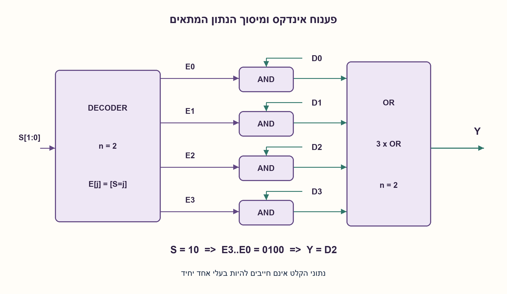
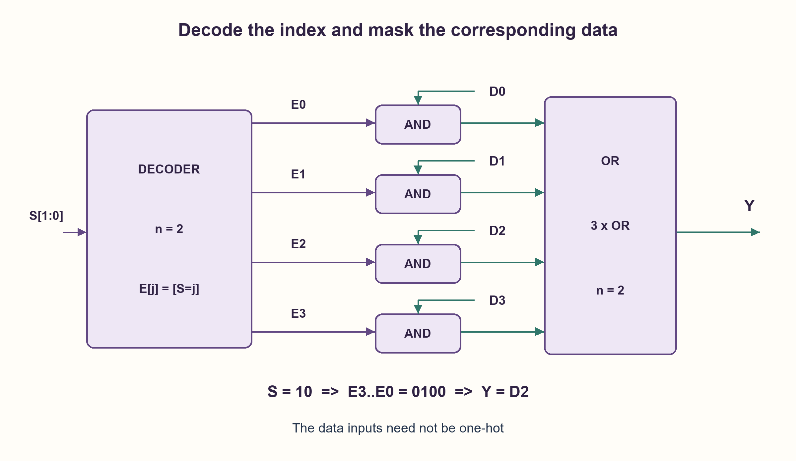

# PREP-236 — מימוש מרבב 2^n:1 באמצעות מפענח ושערים

פתרון מוצע בסיוע AI; ביקורת מקצועית אנושית ממתינה. הקושי אינו מכויל.

[צילום מקור פרטי](../sources/2026-11-01-batch20-21.png)

ממש MUX 2^n:1 באמצעות decoder ושערים לוגיים בסיסיים.

חברות לפי הדיווח בצילום בלבד: Intel.

## עברית

ממשו מרבב בעל 2^n כניסות נתונים של ביט אחד באמצעות מפענח ושערים לוגיים בסיסיים.

הגדירו n≥1 כפרמטר קבוע בבניית המעגל, S[n−1:0] כביטֵי הבחירה ו־D[2^n−1:0] כנתונים. נדרש Y=D[k] כאשר הערך הבינארי של S הוא k. לרשותכם מפענח n ל־2^n בעל יציאות one-hot פעילות בגבוה. אם יש enable הוא פעיל. כתבו משוואה, הוכיחו בחירה נכונה, והציגו דוגמה עבור n=2. הבדילו בין עומק לוגי, ספירת שערים והשהיה אמיתית.

1. מה הפלט של מפענח עבור בחירה מסוימת, וכיצד אפשר להשתמש בו כדי לבודד נתון אחד?
2. חברו כל נתון ל־AND עם קו המפענח התואם לו; רק זוג אחד צריך להיות פעיל.
3. הגדירו Ej=[S=j], ואז Y הוא OR של כל Dj AND Ej. לדוגמה בבחירה 10 רק E2 פעיל.

### מפענח הופך אינדקס לקו בחירה יחיד
נסמן `E[j]=1` אם ורק אם `S=j`. ניצור לכל j את `T[j]=D[j] AND E[j]`, ונחבר את כל T לשער OR או לעץ OR:

```text
Y = OR over j=0..(2^n−1) of (D[j] AND E[j])
```

אם S=k, הגדרת המפענח מבטיחה E[k]=1 וכל E[j] האחרים אפס. לכן T[k]=D[k] וכל יתר האיברים אפס; ה־OR מחזיר בדיוק D[k]. זה מוכיח את המימוש לכל צירוף נתונים, גם כאשר הרבה נתונים הם 1. נתוני הקלט אינם one-hot; רק פלט המפענח הוא כזה.

### דוגמה n=2
נגדיר `E0=~S1 & ~S0`, `E1=~S1 & S0`, `E2=S1 & ~S0`, `E3=S1 & S0`. עבור S=10 ארבע היציאות E3..E0 הן 0100, ולכן `Y=D2`. למשל אם D3..D0=1101, הפלט 1; אם D3..D0=1001, הפלט 0. סדר הביטים והאינדוקס צריכים להיות עקביים, ולא להסתמך על הכיוון שבו הטקסט מודפס.

### עלות, עומק ופרטי ממשק
נסמן M=2^n. אם המפענח הוא בלוק נתון, החלק שאחריו דורש M שערי AND דו־כניסתיים ו־M−1 שערי OR דו־כניסתיים. עץ OR מאוזן נותן n שכבות; בשרשרת יש M−1 שכבות. מסלול נתונים במימוש המאוזן כולל AND ועוד n רמות OR. מסלול בקרה כולל גם את השהיית המפענח. אין להחליף את כל זה ב־n מחזורי שעון: זהו מעגל קומבינטורי.

אם צריך לבנות גם את המפענח באופן ישיר, עבור n≥2 אפשר לשתף n מהפכים ולבנות לכל קו מכפלה של n ליטרלים בעזרת n−1 שערי AND. זו בנייה פשוטה, לא מינימום; מפענח היררכי יכול לשתף חישובים. n=1 הוא מקרה קטן של S והיפוכו. בדומה לכך אין להסיק מספירת בלוקים מהי הבחירה בעלת שטח או השהיה מזעריים בספרייה מסוימת.

מפענח פעיל בנמוך דורש משוואות או שערים מותאמים; אסור להזין את אותן משוואות בלי להפוך את משמעות הקווים. enable כבוי היה נותן כל E=0 ולכן Y=0, ולא את הנתון הנבחר. יציבות one-hot היא הנחה לאחר התייצבות: בזמן החלפת כמה ביטי בחירה ייתכן גליץ', ואין להשתמש ב־Y כשעון נקי רק משום שהטבלה נכונה.

נבדקו כל הנתונים והבחירות עבור n=1,2,3, וב־HDL גם כל 65,536 מילות 16 הביטים וכל 16 הבחירות עבור n=4. נבדקה גם יציאת המפענח one-hot. בדיקות בינאריות ו־RTL אינן סינתזה או מדידת עומס/ניתוב.

### מודל Python שנבדק

```python
"""Active-high one-hot decoder, data masking and reduction OR."""


def decoder_mux(data, select):
    count = len(data)
    if count < 2 or count & (count - 1) or not 0 <= select < count:
        raise ValueError('power-of-two input count and valid select required')
    if any(v not in (0, 1) for v in data):
        raise ValueError('binary data required')
    decoded = [int(select == index) for index in range(count)]
    terms = [bit & enable for bit, enable in zip(data, decoded)]
    out = 0
    for term in terms:
        out |= term
    return out, decoded
```


### קוד SystemVerilog; תוצאות סימולציה בדוח נפרד

```systemverilog
module decoder_mux #(parameter integer N=3)(
  input wire [(1<<N)-1:0] d, input wire [N-1:0] s,
  output wire y, output wire [(1<<N)-1:0] decoded);
  wire [(1<<N)-1:0] terms;
  genvar k;
  generate for(k=0;k<(1<<N);k=k+1) begin: lane
    assign decoded[k] = (s == k);
    assign terms[k] = d[k] & decoded[k];
  end endgenerate
  assign y = |terms;
endmodule
```




### assumptions

```json
[
  "n≥1 קבוע בבנייה; כניסות נתונים של ביט אחד.",
  "המפענח פעיל בגבוה ו־enable שלו, אם קיים, מופעל."
]
```

### optimality

אחרי מפענח נתון: M AND ו־M−1 OR עבור M=2^n. עומק OR מאוזן n; עלות המפענח נפרדת. אין טענת מינימום פיזי.

### verification

כל הנתונים והבחירות ברוחבים קטנים, ובדיקת one-hot; היקף HDL מדויק בדוח ההרצה.

### edge_cases

```json
[
  "n=1 נותן שתי כניסות.",
  "אפסים בכל הנתונים מחזירים אפס; אחדים בכולם מחזירים אחד עם enable.",
  "enable כבוי או פלט פעיל בנמוך הם חוזים אחרים."
]
```

### common_mistakes

```json
[
  "להחליף בין מספר הנתונים למספר ביטי הבחירה.",
  "לחשוב שגם D חייב להיות one-hot.",
  "לספור את המפענח כרכיב ללא השהיה או שטח."
]
```

### interview_answer

אפענח את S לקו פעיל יחיד, אמסך כל Dj בקו Ej ואחבר ב־OR. עבור S=k נשאר רק Dk; זה מוכיח את הבחירה בלי תלות בשאר הנתונים.

### source_ambiguities

המקור אינו מגדיר קוטביות מפענח, enable, רוחב נתון או מודל השהיה. החוזה מגדיר את כולם במפורש.

### solution_extensions

```json
[
  {
    "question": "כיצד משתנה המימוש עבור נתונים ברוחב W ביטים?",
    "answer_direction": "משתפים את המפענח ומשכפלים W רשתות מיסוך/OR; fanout על קווי הבחירה גדל ולכן עומס אינו חינם.",
    "principle": "שיתוף בקרה חוסך שכפול לוגיקה אך משנה עומס."
  }
]
```

## English

Implement a 2^n:1 single-bit-data MUX using a decoder and basic gates.

Let n≥1 be fixed at circuit construction, S[n−1:0] the select and D[2^n−1:0] the data. Require Y=D[k] when S has value k. Use an n-to-2^n active-high one-hot decoder with enable asserted if present. Give an equation and proof, illustrate n=2, and distinguish logical depth, gate count and real delay.

1. Which decoder output is active at a chosen select, and how can it isolate one data input?
2. AND each data bit with its corresponding decoder line; only one such line should be enabled.
3. Define Ej=[S=j], then OR all Dj AND Ej terms. At select 10 only E2 is active.

### Decode an index into one active line
Define `E[j]=1` exactly when `S=j`. Form `T[j]=D[j] AND E[j]`, then OR all terms:

```text
Y = OR over j=0..(2^n−1) of (D[j] AND E[j])
```

If S=k, the decoder gives E[k]=1 and every other E[j]=0. Hence T[k]=D[k] and every other term is zero. The OR therefore returns D[k] for every data word, even with many asserted data bits. The data need not be one-hot; only the decoder output does.

### Example n=2
Use `E0=~S1 & ~S0`, `E1=~S1 & S0`, `E2=S1 & ~S0`, `E3=S1 & S0`. At S=10, E3..E0 is 0100 and Y=D2. Data D3..D0=1101 produces 1; data 1001 produces 0. Keep declared indices consistent rather than inferring them from text display direction.

### Cost, depth and interface details
Let M=2^n. After a supplied decoder, use M two-input AND gates and M−1 two-input OR gates. A balanced OR tree has n levels, whereas a chain has M−1. The balanced data path crosses one AND plus n OR levels. A select path includes decoder delay too. These are not n clock cycles: no clock or storage is present.

If the decoder must also be built directly, for n≥2 one simple construction shares n inverters and uses n−1 AND gates for each n-literal product. This is not minimal; hierarchical predecode can share work. At n=1 the decoder is simply S and its complement. Counts do not establish minimum physical area or delay for a particular library.

An active-low decoder needs adjusted equations/gates. Disabled enable gives all zero enables and Y=0, not the selected data. One-hot is a settled-input property: changing several select bits can glitch. A correct static truth table does not make Y a clean generated clock.

All data/select pairs were checked for n=1,2,3; HDL additionally checks all 65,536 sixteen-bit words and all 16 selects at n=4, including exact one-hot decoder output. Binary/RTL checks are not synthesis or load/routing characterization.

### Verified Python teaching model

```python
"""Active-high one-hot decoder, data masking and reduction OR."""


def decoder_mux(data, select):
    count = len(data)
    if count < 2 or count & (count - 1) or not 0 <= select < count:
        raise ValueError('power-of-two input count and valid select required')
    if any(v not in (0, 1) for v in data):
        raise ValueError('binary data required')
    decoded = [int(select == index) for index in range(count)]
    terms = [bit & enable for bit, enable in zip(data, decoded)]
    out = 0
    for term in terms:
        out |= term
    return out, decoded
```


### SystemVerilog; simulation results are in a separate report

```systemverilog
module decoder_mux #(parameter integer N=3)(
  input wire [(1<<N)-1:0] d, input wire [N-1:0] s,
  output wire y, output wire [(1<<N)-1:0] decoded);
  wire [(1<<N)-1:0] terms;
  genvar k;
  generate for(k=0;k<(1<<N);k=k+1) begin: lane
    assign decoded[k] = (s == k);
    assign terms[k] = d[k] & decoded[k];
  end endgenerate
  assign y = |terms;
endmodule
```




### assumptions

```json
[
  "n≥1 is fixed at construction; single-bit data inputs.",
  "Decoder outputs are active-high and its enable, if any, is asserted."
]
```

### optimality

After a supplied decoder: M AND and M−1 OR gates, M=2^n; balanced OR depth n. Decoder cost is separate; no physical-minimum claim.

### verification

All data/select values at small widths and exact one-hot checks; precise HDL coverage in the execution report.

### edge_cases

```json
[
  "n=1 gives two data inputs.",
  "All-zero data gives zero; all-one data gives one with enable asserted.",
  "Disabled enable or active-low decoding are different contracts."
]
```

### common_mistakes

```json
[
  "Confusing data count with select width.",
  "Requiring data D to be one-hot.",
  "Treating the decoder as physically free."
]
```

### interview_answer

Decode S to one active line, AND each Dj with Ej and OR the terms. At S=k only Dk remains, proving selection independently of the other data.

### source_ambiguities

The source omits decoder polarity/enable, data width and delay model. The edited contract states them explicitly.

### solution_extensions

```json
[
  {
    "question": "How does W-bit-wide data change the implementation?",
    "answer_direction": "Share the decoder and replicate W mask/OR networks. Decoder fanout increases and load is not free.",
    "principle": "Shared control saves logic but changes loading."
  }
]
```
