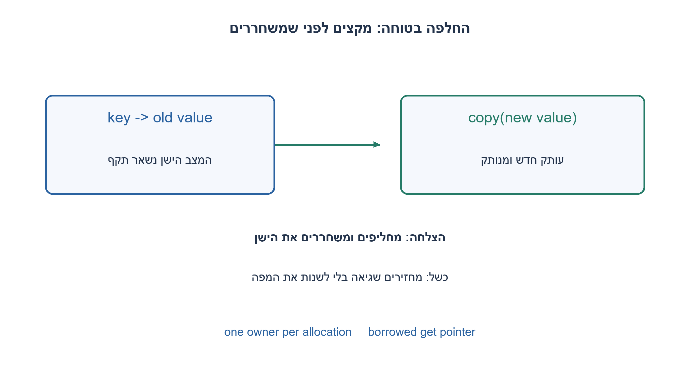
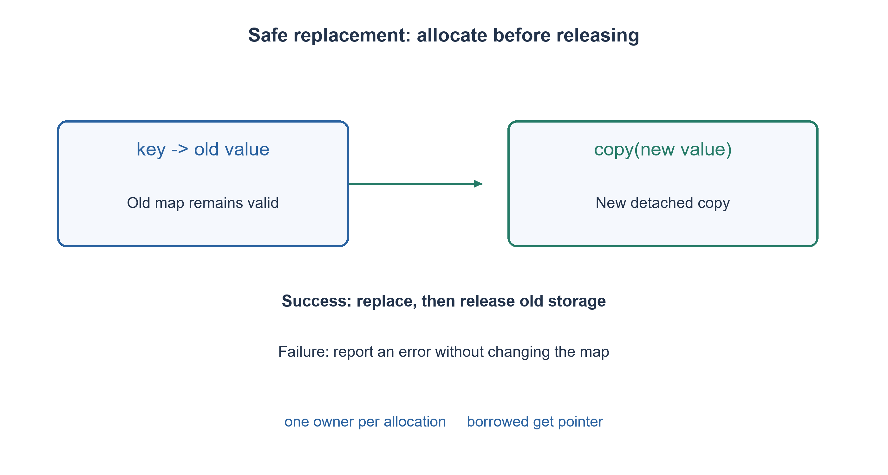

# PREP-237 — מילון ב־C עם רשימה מקושרת ובעלות על מחרוזות

פתרון מוצע בסיוע AI; ביקורת מקצועית אנושית ממתינה. הקושי אינו מכויל.

## עברית

ממשו מילון בעזרת רשימות מקושרות בשפת C: יצירה, הוספה ועדכון רשומה, חיפוש, מחיקת מפתח ומחיקת כל המילון. הסבירו כל הקצאה ושחרור ומה קורה כש־malloc נכשל.

החוזה: מפתחות וערכים הם מחרוזות תקינות המסתיימות ב־NUL, כולל מחרוזת ריקה; ההשוואה מדויקת ורגישה לרישיות. לכל מפתח רשומה יחידה. put מוסיף מפתח חסר ומחליף ערך של מפתח קיים. המילון שומר עותקים בבעלותו; get מחזיר מצביע מושאל שתקף עד עדכון אותו מפתח, מחיקתו או הרס המילון. כישלון הקצאה משאיר את המפה הקיימת ללא שינוי. אין גישה מקבילית. הכוונה לסמנטיקת מיפוי דומה ל־dict, לא למימוש כל תכונות Python או לזמן גיבוב קבוע.

1. לפני next ו־malloc, קבעו מי מחזיק בבעלות על המפתח והערך.
2. בעדכון, מה יקרה אם תשחררו את הערך הישן ואז ההקצאה של החדש תיכשל?
3. הקצו עותק חדש לפני החלפה. בהוספה בנו רשומה שלמה ומנותקת, נקו כל הקצאה חלקית, ורק אז חברו לרשימה. במחיקה עבדו דרך מצביע לקישור.

### מיפוי הוא חוזה; הרשימה היא הייצוג
כל רשומה מחזיקה key, value ו־next. ראש המילון ומספר הרשומות נמצאים במבנה Dict. הממשק הציבורי מסתיר את המבנים, כך שהקורא אינו משנה קישורים או משחרר מחרוזות בבעלות המפה. חיפוש משווה תוכן באמצעות strcmp, לא כתובות. מפתח קיים מעודכן במקום ונשאר יחיד; מפתח חדש מתווסף לראש רק לאחר שכל ההקצאות הצליחו.

בעדכון מקצים תחילה עותק של הערך החדש. אם ההקצאה נכשלת מחזירים DICT_OOM בלי לגעת בערך הישן. אם הצליחה, משחררים את העותק הישן ומחליפים מצביע. כך בטוח גם להעביר ל־put את המצביע המושאל שהחזיר get עבור אותו מפתח: ההעתקה קודמת לשחרור. בהוספה נדרשות הקצאות לרשומה, למפתח ולערך. כל מסלול כשל משחרר את מה שכבר נוצר, ואינו מחבר רשומה חלקית.

למחיקה מחזיקים Entry** שמצביע לשדה המקשר אל המועמד: בתחילה כתובת head, ובהמשך כתובת next של הקודם. כשנמצא המפתח, מפנים את הקישור ליורשו ומשחררים מפתח, ערך ורשומה. מחיקת ראש, אמצע וזנב משתמשת באותו רעיון. בהרס שומרים next לפני free; אין לקרוא מצומת שכבר שוחרר. delete חסר מחזיר NOT_FOUND בלי שינוי. מצביע שאינו NULL אינו בהכרח תקף: הממשק מניח ידיות חיות ומחרוזות תקינות, ואינו מאמת כתובות שרירותיות.

אינווריאנט: השרשרת סופית וללא מעגלים, המפתחות שונים, וכל הקצאה שייכת בדיוק למילון אחד. הוספה מחברת רשומה חדשה שאין ממנה מסלול חזרה; עדכון משנה רק ערך לאחר הצלחת ההעתקה; מחיקה מסירה רשומה אחת בלי לשנות את סדר האחרות. אין שימוש במצביע מושאל אחרי שפג תוקפו ואין העתקה שטחית של Dict לבעלים שני.

ב־n מפתחות שאורך השוואתם חסום ב־L, החיפוש הוא O(nL) במקרה הגרוע. put מוסיף גם עלות העתקת המפתח/הערך; get/remove אינם O(1) בתוחלת כמו טבלת גיבוב. נשמרים O(n) צמתים וסך תווי המחרוזות. עלויות allocator אינן מובטחות קבועות. רתמת C99 עצמאית הזריקה כשלי הקצאה ביצירה, בכל שלב הוספה ובעדכון, בדקה עותקים נפרדים וכינויים, ומיצתה 66,430 עקבות פעולות. היא עברה הידור GCC מחמיר והרצה מבודדת עם אפס בלוקים חיים בסיום; זו אינה ביקורת אנושית או הוכחת בטיחות לכל מצביע.

```c
#ifndef PREP_237_DICTIONARY_H
#define PREP_237_DICTIONARY_H
#include <stddef.h>
typedef struct Dict Dict;
typedef enum { DICT_OK, DICT_OOM, DICT_INVALID, DICT_NOT_FOUND } DictStatus;
/* Live NUL-terminated keys/values; dictionary owns independent copies. */
Dict *dict_create(void);
DictStatus dict_put(Dict *dict, const char *key, const char *value);
/* Borrowed value: valid until that key is updated/removed or map destroyed. */
const char *dict_get(const Dict *dict, const char *key);
DictStatus dict_remove(Dict *dict, const char *key);
size_t dict_size(const Dict *dict);
void dict_destroy(Dict *dict); /* NULL is harmless. */
#endif
```


```c
/* C99 list-backed dictionary, not a hash table or full Python dict clone. */
#include "prep_237_dictionary.h"
#include <stdint.h>
#include <stdlib.h>
#include <string.h>

typedef struct Entry {
    char *key, *value;
    struct Entry *next;
} Entry;
struct Dict { Entry *head; size_t count; };

static char *copy_text(const char *text) {
    size_t length = strlen(text);
    if (length == SIZE_MAX) return NULL;
    char *copy = malloc(length + 1);
    if (copy) memcpy(copy, text, length + 1);
    return copy;
}

Dict *dict_create(void) {
    Dict *dict = malloc(sizeof *dict);
    if (dict) { dict->head = NULL; dict->count = 0; }
    return dict;
}

DictStatus dict_put(Dict *dict, const char *key, const char *value) {
    if (!dict || !key || !value) return DICT_INVALID;
    for (Entry *entry = dict->head; entry; entry = entry->next) {
        if (strcmp(entry->key, key) == 0) {
            char *replacement = copy_text(value);
            if (!replacement) return DICT_OOM;
            free(entry->value);
            entry->value = replacement;
            return DICT_OK;
        }
    }
    if (dict->count == SIZE_MAX) return DICT_OOM;
    Entry *entry = malloc(sizeof *entry);
    if (!entry) return DICT_OOM;
    entry->key = copy_text(key);
    if (!entry->key) { free(entry); return DICT_OOM; }
    entry->value = copy_text(value);
    if (!entry->value) { free(entry->key); free(entry); return DICT_OOM; }
    entry->next = dict->head;
    dict->head = entry;
    ++dict->count;
    return DICT_OK;
}

const char *dict_get(const Dict *dict, const char *key) {
    if (!dict || !key) return NULL;
    for (const Entry *entry = dict->head; entry; entry = entry->next)
        if (strcmp(entry->key, key) == 0) return entry->value;
    return NULL;
}

DictStatus dict_remove(Dict *dict, const char *key) {
    if (!dict || !key) return DICT_INVALID;
    Entry **link = &dict->head;
    while (*link && strcmp((*link)->key, key) != 0) link = &(*link)->next;
    if (!*link) return DICT_NOT_FOUND;
    Entry *removed = *link;
    *link = removed->next;
    free(removed->key); free(removed->value); free(removed);
    --dict->count;
    return DICT_OK;
}

size_t dict_size(const Dict *dict) { return dict ? dict->count : 0; }

void dict_destroy(Dict *dict) {
    if (!dict) return;
    Entry *entry = dict->head;
    while (entry) {
        Entry *next = entry->next;
        free(entry->key); free(entry->value); free(entry);
        entry = next;
    }
    free(dict);
}
```




## English

Implement a C dictionary using linked lists: create, insert/update, lookup, remove a key and destroy the whole map. Explain every allocation/release and malloc failure.

Contract: valid NUL-terminated string keys and values, including empty strings; exact case-sensitive equality and one entry per key. put inserts a missing key or replaces an existing value. The map owns copies; get returns a borrowed pointer valid until that key is updated/removed or the map is destroyed. Allocation failure leaves the existing map unchanged. Access is serialized. This models dictionary semantics, not every Python dict feature or hash-table performance.

1. Set key/value ownership before writing next or malloc.
2. What happens if the old value is freed before allocation of its replacement fails?
3. Allocate before replacing. Build a complete detached entry, clean up partial failures, then link it. Remove through a pointer to the incoming link.

### Mapping is the contract; a list is the representation
Each entry holds key, value and next; Dict holds head/count. An opaque public interface prevents clients from rewriting links or freeing map-owned strings. Lookup compares content with strcmp rather than pointer identity. An existing key is updated without duplication; a new entry is linked only after every allocation succeeds.

For replacement, allocate the new value first. Failure returns DICT_OOM with the old value intact. Success frees the old copy and changes the pointer. Passing a borrowed get result back into put for the same key is safe because copying precedes release. Insertion allocates an entry, key copy and value copy; every failure path releases partial allocations without attaching an incomplete entry.

Removal uses Entry** pointing to the incoming link: initially &head, then a predecessor's next field. Redirect it to the successor and free key/value/node. The same operation handles head, middle and tail. Destruction saves next before free and never dereferences a released node. A missing key returns NOT_FOUND unchanged. Nonnull does not prove pointer validity: the API assumes live handles and valid strings rather than validating arbitrary addresses.

Invariant: a finite acyclic chain has unique keys and each allocation has one owner. Insertion adds a detached node without a backward path; replacement changes a value only after successful copying; removal excises one node. Borrowed pointers must not outlive their validity, and shallow-copying Dict does not create another valid owner.

For n keys with comparison length bounded by L, worst-case search is O(nL). put additionally copies the new key/value; get/remove do not provide hash-table expected O(1). Storage includes O(n) nodes plus all owned characters. Allocator calls have no assumed constant worst-case latency. An independent C99 harness injects create/insertion/replacement allocation failures, checks copies and aliasing, and exhausts 66,430 operation histories. Strict isolated GCC compilation/execution passed with zero live blocks at completion. This is not human review or a proof for arbitrary invalid pointers.

```c
#ifndef PREP_237_DICTIONARY_H
#define PREP_237_DICTIONARY_H
#include <stddef.h>
typedef struct Dict Dict;
typedef enum { DICT_OK, DICT_OOM, DICT_INVALID, DICT_NOT_FOUND } DictStatus;
/* Live NUL-terminated keys/values; dictionary owns independent copies. */
Dict *dict_create(void);
DictStatus dict_put(Dict *dict, const char *key, const char *value);
/* Borrowed value: valid until that key is updated/removed or map destroyed. */
const char *dict_get(const Dict *dict, const char *key);
DictStatus dict_remove(Dict *dict, const char *key);
size_t dict_size(const Dict *dict);
void dict_destroy(Dict *dict); /* NULL is harmless. */
#endif
```


```c
/* C99 list-backed dictionary, not a hash table or full Python dict clone. */
#include "prep_237_dictionary.h"
#include <stdint.h>
#include <stdlib.h>
#include <string.h>

typedef struct Entry {
    char *key, *value;
    struct Entry *next;
} Entry;
struct Dict { Entry *head; size_t count; };

static char *copy_text(const char *text) {
    size_t length = strlen(text);
    if (length == SIZE_MAX) return NULL;
    char *copy = malloc(length + 1);
    if (copy) memcpy(copy, text, length + 1);
    return copy;
}

Dict *dict_create(void) {
    Dict *dict = malloc(sizeof *dict);
    if (dict) { dict->head = NULL; dict->count = 0; }
    return dict;
}

DictStatus dict_put(Dict *dict, const char *key, const char *value) {
    if (!dict || !key || !value) return DICT_INVALID;
    for (Entry *entry = dict->head; entry; entry = entry->next) {
        if (strcmp(entry->key, key) == 0) {
            char *replacement = copy_text(value);
            if (!replacement) return DICT_OOM;
            free(entry->value);
            entry->value = replacement;
            return DICT_OK;
        }
    }
    if (dict->count == SIZE_MAX) return DICT_OOM;
    Entry *entry = malloc(sizeof *entry);
    if (!entry) return DICT_OOM;
    entry->key = copy_text(key);
    if (!entry->key) { free(entry); return DICT_OOM; }
    entry->value = copy_text(value);
    if (!entry->value) { free(entry->key); free(entry); return DICT_OOM; }
    entry->next = dict->head;
    dict->head = entry;
    ++dict->count;
    return DICT_OK;
}

const char *dict_get(const Dict *dict, const char *key) {
    if (!dict || !key) return NULL;
    for (const Entry *entry = dict->head; entry; entry = entry->next)
        if (strcmp(entry->key, key) == 0) return entry->value;
    return NULL;
}

DictStatus dict_remove(Dict *dict, const char *key) {
    if (!dict || !key) return DICT_INVALID;
    Entry **link = &dict->head;
    while (*link && strcmp((*link)->key, key) != 0) link = &(*link)->next;
    if (!*link) return DICT_NOT_FOUND;
    Entry *removed = *link;
    *link = removed->next;
    free(removed->key); free(removed->value); free(removed);
    --dict->count;
    return DICT_OK;
}

size_t dict_size(const Dict *dict) { return dict ? dict->count : 0; }

void dict_destroy(Dict *dict) {
    if (!dict) return;
    Entry *entry = dict->head;
    while (entry) {
        Entry *next = entry->next;
        free(entry->key); free(entry->value); free(entry);
        entry = next;
    }
    free(dict);
}
```




## חומר משלים / Supporting material

```json
{
  "assumptions": {
    "he": [
      "מחרוזות חיות עם NUL; מפתחות ייחודיים ורגישים לרישיות; עותקים בבעלות המפה.",
      "הידיות אינן מועתקות לבעלות כפולה; גישה סדרתית; מצביע get מושאל."
    ],
    "en": [
      "Live NUL-terminated strings; unique case-sensitive keys; map-owned copies.",
      "No duplicated handle ownership; serialized access; get returns a borrowed pointer."
    ]
  },
  "optimality": {
    "he": "חיפוש O(nL) במקרה הגרוע, בתוספת תווי ההעתקה ב־put; O(n) צמתים ותוכן המחרוזות. אין טענת ביצועי hash או allocator.",
    "en": "Worst-case O(nL) search plus copied characters in put; O(n) nodes and string contents. No hash-table or allocator latency guarantee."
  },
  "verification": {
    "he": "C99 הודר והורץ ב־GCC עם אזהרות כשגיאות: 66,430 עקבות מילון, הזרקת OOM ושחרור מלא. הרתמה המשולבת בדקה 2,454,609 assertions בכל שלושת נושאי C; אין sanitizer או ביקורת אנושית.",
    "en": "C99 passed GCC with warnings as errors: 66,430 map histories, OOM injection and complete cleanup. The combined three-topic C harness checked 2,454,609 assertions; no sanitizer or human review is claimed."
  },
  "edge_cases": {
    "he": [
      "מפה ריקה; מפתח/ערך ריק; עדכון עצמי דרך get; כשל בכל הקצאה; מחיקת ראש וזנב; מפתח חסר."
    ],
    "en": [
      "Empty map/key/value; self-update through get; every allocation failure point; head/tail removal; missing key."
    ]
  },
  "common_mistakes": {
    "he": [
      "לשמור מצביע למערך מקומי של הקורא בלי חוזה בעלות.",
      "free לפני הצלחת החלפה; דליפה במסלול כשל חלקי.",
      "להשוות כתובות מחרוזות או לאפשר מפתחות כפולים.",
      "לטעון לזמן קבוע רק כי שם המבנה הוא מילון."
    ],
    "en": [
      "Keeping caller-local string pointers without an ownership contract.",
      "Freeing before successful replacement; leaking partial allocations.",
      "Comparing string addresses or allowing duplicate keys.",
      "Claiming constant time merely because the abstraction is a dictionary."
    ]
  },
  "interview_answer": {
    "he": "אעתיק מפתח וערך ואשמור בעלות אחת לכל הקצאה. אכין רשומה או ערך חדש לפני commit, ואשתמש במצביע לקישור למחיקה; הרשימה נשארת עקבית גם בכשל הקצאה.",
    "en": "Own independent key/value copies. Prepare a complete entry or replacement before committing, and remove through a pointer to a link; allocation failures leave the map consistent."
  },
  "source_ambiguities": {
    "he": "סוגי מפתח וערך, התנהגות עדכון וסדר איטרציה לא הוגדרו. נבחרו מחרוזות מועתקות ו־upsert; אין הבטחה לסדר הכנסה או למימוש Python המלא.",
    "en": "Key/value types, update policy and iteration order were unspecified. This version chooses copied strings and upsert, without insertion-order or full Python implementation guarantees."
  },
  "solution_extensions": {
    "he": [
      {
        "question": "איך מקצרים חיפוש בלי לשנות את חוזה הבעלות?",
        "answer_direction": "אפשר טבלת buckets עם רשימות שרשור וגיבוב מוגדר. נשמרים כללי העתקה ו־OOM, אך מתווספים מערך buckets, התנגשויות ו־rehash אטומי.",
        "principle": "ייצוג ביצועי אינו מחליף חוזה בעלות."
      }
    ],
    "en": [
      {
        "question": "How can lookup be accelerated without changing ownership?",
        "answer_direction": "Use hash buckets with linked chains and a defined hash. Copy/OOM rules remain, while buckets, collisions and atomic rehash add costs.",
        "principle": "A faster representation does not replace ownership semantics."
      }
    ]
  }
}
```
