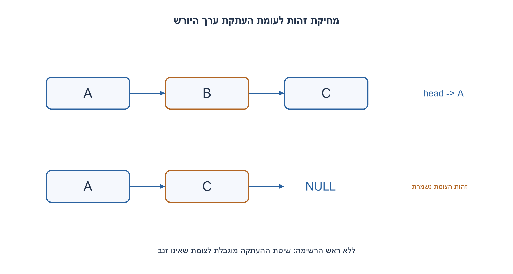
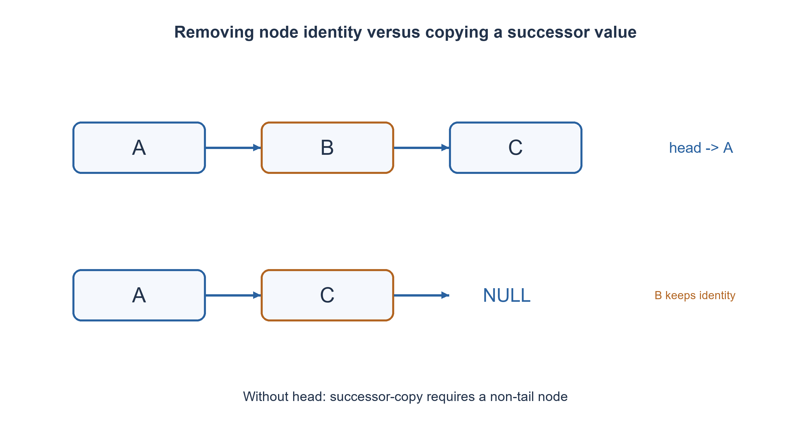

# PREP-238 — היפוך רשימה מקושרת במקום בלי לאבד את ההמשך

פתרון מוצע בסיוע AI; ביקורת מקצועית אנושית ממתינה. הקושי אינו מכויל.

## עברית

### סעיפים נוספים: הסרת צומת עם head ועם מצביע יחיד
 היפוך הרשימה שבסעיף המקורי נשמר. כעת, ברשימה חד־כיוונית סופית וללא מעגלים: ב. הסירו צומת כאשר נתונים כתובת משתנה head ומצביע לצומת שיש להסיר. ג. מה אפשר לעשות כאשר נתון רק מצביע לצומת, ללא head וללא קודמו? דונו גם בצומת האחרון.

 בחרו צמתים שהוקצו ב־ malloc ועם int כערך. פעולת המחיקה עם head מסירה ומשחררת בדיוק את הצומת שנמסר, בלי לשנות ערכי אחרים. NULL או צומת חי שאינו שייך לרשימה מחזירים false בלי שינוי. מצביעים תלויים אינם קלט תקין. ללא head יש להפריד בין הסרת זהות צומת לבין הסרת הערך הלוגי באמצעות העתקת היורש: זו חלופה מותנית לצומת שאינו זנב בלבד, כאשר אין דרישה לשמר זהויות, כינויים או בעלות מורכבת על payload.

1. איזה קישור מצביע אל הצומת שצריך להסיר, ומי יכול לשנות אותו?
2. כתובת head ושדה next של קודמו ממלאים אותו תפקיד: הם הקישור הנכנס לצומת. האם יש גישה לקישור הזה בלי head או קודמו?
3. עם head עברו באמצעות Node**ושנו את הקישור הנכנס ליורש לפני free. בלי head אפשר להעתיק את ערך היורש ולעקוף אותו רק כאשר יש יורש; זה משחרר את היורש, לא את הצומת המקורי.

### כדי להסיר צומת צריך לשנות את הקישור שמגיע אליו
נחזיק link שמצביע לכתובת של קישור: בהתחלה&head ובהמשך&previous->next. נחפש לפי זהות מצביע, לא לפי שוויון ערכים. כש־*link הוא target נבצע*link=target->next ונשחרר את target. מחיקת הראש, האמצע והזנב הן אותה פעולה; ההבדל היחיד הוא היכן שמור הקישור. אם מגיעים ל־ NULL בלי למצוא את הצומת, לא משנים דבר. יש לשמור או לקרוא next לפני free, ולא לקרוא מהצומת ששוחרר.

האינווריאנט בסריקה הוא שכל הצמתים שלפני link נבדקו ונשמרו ללא שינוי, ו־ link מכיל את הכתובת שממנה נגיע למועמד הבא. העקיפה מחברת את כל הקידומת ליורש המקורי, ולכן מסירה בדיוק צומת אחד ושומרת את סדר וזהות יתר הצמתים. זמן O(n) במקרה הגרוע ומקום O(1); מציאת הקודם נחוצה אם הוא אינו נתון. אם ידוע שהצומת הוא הראש, הפעולה O(1).

### מה אפשר כשיש רק target?
אי אפשר בדרך כלל להסיר את זהותו מהרשימה: הקישור של קודמו נמצא בזיכרון שאין דרך להגיע אליו בכיוון next. במיוחד, z שהוא זנב נותן z->next=NULL בלי לחשוף אם יש קודמו, מי הוא או היכן נמצא head. אין אלגוריתם מקומי שיכול לשנות קישור לא נגיש בכל רשימה אפשרית.

אם הדרישה חלשה יותר, שלא יופיע עוד הערך שבמיקום הזה, ויש יורש s, אפשר להעתיק target->value=s->value, לחבר target->next=s->next ולשחרר את s. למשל A→B→C→D נעשה A→C→D מבחינת ערכים כאשר מצביע B עצמו נשאר חי ומכיל כעת C. ההקצאה של C היא ששוחררה. מצביע חיצוני ל־ B יראה ערך אחר, ומצביע ל־ C נהיה תלוי; זו אינה שקילות כאשר זהות או כינויים חשובים. המימוש המוצע מחזיר false בזנב וב־ NULL, ומניח int ללא משאבים בבעלות. במחרוזות או באובייקטים כלליים העתקה ושחרור מחייבים חוזה בעלות/חריגות חדש.

הרחבת המחיקה אינה משנה את איסור ההקצאה/מחיקה בסעיף ההיפוך. אלה פעולות נפרדות; אסור לקרוא לרשימה הפוכה מתודה שמשחררת צמתים ואז לטעון שכל הזהויות נשמרו.

רתמת C נפרדת הוכנה לכל מיקום ברשימות באורכים 1..12: היא בודקת סדר וזהויות לאחר מחיקה מדויקת, ערך וזהות לאחר העתקת יורש, סירוב לזנב, צומת זר וספירת שחרורים. GCC C99 מחמיר והרצה מבודדת עברו עם 234,489 טענות בדיקה ברתמה המשולבת ואפס בלוקים חיים בסיום; אין טענה שהממשק מזהה מצביעים תלויים שרירותיים.

```c
/* C99. Live caller-owned malloc nodes, int payload, serialized mutation.
 * Exact removal frees the supplied node; logical removal frees its successor.
 * NULL is accepted as a failure. Dangling pointers cannot be validated here. */
#include <stdbool.h>
#include <stddef.h>
#include <stdlib.h>
#ifndef NODE_FREE
#define NODE_FREE free
#endif

typedef struct DeleteNode { int value; struct DeleteNode *next; } DeleteNode;

bool remove_node(DeleteNode **head, DeleteNode *target) {
    DeleteNode **link;
    if (head == NULL || target == NULL) return false;
    link = head;
    while (*link != NULL && *link != target) link = &(*link)->next;
    if (*link == NULL) return false;
    *link = target->next;
    NODE_FREE(target);
    return true;
}

bool remove_value_at_non_tail(DeleteNode *target) {
    DeleteNode *successor;
    if (target == NULL || target->next == NULL) return false;
    successor = target->next;
    target->value = successor->value;
    target->next = successor->next;
    NODE_FREE(successor);
    return true;
}
```




## English

### Additional parts: removing with head and with only one node pointer
The original reversal task remains unchanged. For a finite acyclic singly linked list: B. Remove a node given the address of head and the node pointer. C. What can be done given only that node, without head or predecessor? Include the tail case.

Choose malloc-allocated nodes with int payloads. With head, remove and free exactly the supplied node without changing other payloads. NULL or a live nonmember returns false unchanged. Dangling pointers are outside the contract. Without head distinguish actual node-identity removal from logical-value removal by copying a successor: the latter requires a non-tail node and permission to change identities/aliases and trivial payload ownership.

1. Which link points into the node, and who can update it?
2. The address of head and a predecessor’s next field play the same role: an incoming link. Is that link accessible without head or predecessor?
3. With head traverse using Node**and bypass the target before free. Without head, copying/bypassing a successor requires one to exist; it frees the successor, not the original node.

### Removing a node requires changing its incoming link
Keep link as the address of a link: initially &head, then &previous->next. Search by pointer identity, not equal values. When *link equals target, set *link=target->next and free target. Head, middle and tail removal use the same operation; only the incoming-link location differs. Reaching NULL means no mutation. Read/save next before free; never inspect a released node.

During traversal, nodes before link have been checked and preserved, while link addresses the path to the next candidate. Bypassing joins the prefix to the original successor, removing exactly one node and preserving every other node's identity/order. Worst-case time is O(n), space O(1); discovering an unknown predecessor requires traversal. A target known to be the head can be removed in O(1).

### What is possible with only target?
Actual node-identity removal is generally impossible: the predecessor's incoming link is unreachable through forward next pointers. In particular a tail z reveals only z->next=NULL, not whether/where a predecessor or head exists. No local operation can update an inaccessible incoming link in every possible list.

If the weaker goal permits removing the logical value at that position and successor s exists, copy s->value into target, bypass s and free s. Thus values A→B→C→D become A→C→D while the original B allocation survives holding C. The original C allocation was freed. An outside B pointer observes changed data and an outside C pointer dangles; this is not equivalent when identities or aliases matter. The proposed helper rejects tail/NULL and assumes resource-free int payloads. General strings/objects require a new ownership/exception contract for copying/release.

Deletion does not relax the original reversal section's no-allocation/no-deletion contract. These are separate operations; a reversal cannot free nodes while claiming every identity is preserved.

A separate C harness covers every position in lengths 1..12: exact-removal identities/order, successor-copy value/identity, tail refusal, foreign node and release counts. Strict isolated GCC C99 compilation/execution passed, with 234,489 assertions in the combined harness and zero live blocks at completion. No ability to detect arbitrary dangling pointers is claimed.

```c
/* C99. Live caller-owned malloc nodes, int payload, serialized mutation.
 * Exact removal frees the supplied node; logical removal frees its successor.
 * NULL is accepted as a failure. Dangling pointers cannot be validated here. */
#include <stdbool.h>
#include <stddef.h>
#include <stdlib.h>
#ifndef NODE_FREE
#define NODE_FREE free
#endif

typedef struct DeleteNode { int value; struct DeleteNode *next; } DeleteNode;

bool remove_node(DeleteNode **head, DeleteNode *target) {
    DeleteNode **link;
    if (head == NULL || target == NULL) return false;
    link = head;
    while (*link != NULL && *link != target) link = &(*link)->next;
    if (*link == NULL) return false;
    *link = target->next;
    NODE_FREE(target);
    return true;
}

bool remove_value_at_non_tail(DeleteNode *target) {
    DeleteNode *successor;
    if (target == NULL || target->next == NULL) return false;
    successor = target->next;
    target->value = successor->value;
    target->next = successor->next;
    NODE_FREE(successor);
    return true;
}
```




## חומר משלים / Supporting material

```json
{
  "assumptions": {
    "he": [
      "רשימה סופית ללא מעגלים; צמתים חיים מוקצים באמצעות malloc עם int; גישה סדרתית.",
      "מחיקה מדויקת מקבלת כתובת head. העתקת יורש מוגבלת לצומת שאינו זנב ולחוזה המתיר שינוי זהות לוגית."
    ],
    "en": [
      "Finite acyclic list; live malloc nodes with int payloads; serialized access.",
      "Exact removal takes the address of head. Successor-copy requires a non-tail and permission to change logical identity."
    ]
  },
  "optimality": {
    "he": "מחיקה עם head דורשת O(n) לחיפוש קישור נכנס ו־ O(1) מקום. העתקת יורש O(1) אך אינה מסירה את אותה הזהות ואינה תומכת בזנב.",
    "en": "With head: O(n) incoming-link search and O(1) space. Successor-copy is O(1) but removes another identity and cannot handle tails."
  },
  "verification": {
    "he": "GCC C99 מחמיר עבר 156 מקרי מחיקה לפי מיקום ובדיקות זהות ושחרורים;234,489 בדיקות ברתמה המשולבת ואפס בלוקים חיים. אין בדיקת מצביעים תלויים.",
    "en": "Strict GCC C99 native run passed 156 position-based removal cases with identity/release-count checks;234,489 combined assertions and zero live blocks. No dangling-pointer validation."
  },
  "edge_cases": {
    "he": [
      "ראש, זנב, רשימה של צומת יחיד, ערכים שווים, צומת זר, head ריק, NULL וכינויים חיצוניים."
    ],
    "en": [
      "Head, tail, one-node list, equal payloads, foreign node, empty head, NULL and external aliases."
    ]
  },
  "common_mistakes": {
    "he": [
      "free לפני קריאת next.",
      "לחפש על פי ערך במקום זהות.",
      "להציג העתקת יורש כמחיקת אותו הצומת.",
      "להתעלם ממקרה הזנב או מהבעלות על payload."
    ],
    "en": [
      "Freeing before reading next.",
      "Searching by payload instead of identity.",
      "Presenting successor-copy as removal of the same node.",
      "Ignoring tails or payload ownership."
    ]
  },
  "interview_answer": {
    "he": "עם head אמצא את כתובת הקישור שמגיע לצומת, אעקוף ואשחרר אותו. בלי ראש לרוב אי אפשר לשנות את הקודם; העתקת יורש היא תחליף מוגבל לערכים בלבד, לא לזהות.",
    "en": "With head locate the incoming-link address, bypass and free the target. Without it the predecessor is generally inaccessible; successor-copy is a limited value-level workaround, not identity removal."
  },
  "source_ambiguities": {
    "he": "המקור אינו מגדיר בעלות או זהות.העריכה מפרידה בין הסרת הקצאה מדויקת להסרת ערך ומבהירה שזנב ללא head אינו ניתן להסרה כללית.",
    "en": "The source omits ownership/identity. This edition separates exact allocation removal from value-level removal and explains why tail-only removal is generally impossible."
  },
  "solution_extensions": {
    "he": [
      {
        "question": "איך תשתנה העלות ברשימה דו כיוונית?",
        "answer_direction": "כאשר לכל צומת יש prev וגם next אפשר לעדכן את השכנים בזמן קבוע, אך עדיין צריך עדכון head כאשר מוחקים את הראש וחוזה בעלות תקין.",
        "principle": "מידע הקישוריות הקיים קובע את הפעולות האפשריות."
      }
    ],
    "en": [
      {
        "question": "What changes for a doubly linked list?",
        "answer_direction": "With prev and next the neighbors can be updated in constant time, but head removal still needs a head-update contract and valid ownership.",
        "principle": "Available connectivity determines possible operations."
      }
    ]
  }
}
```
