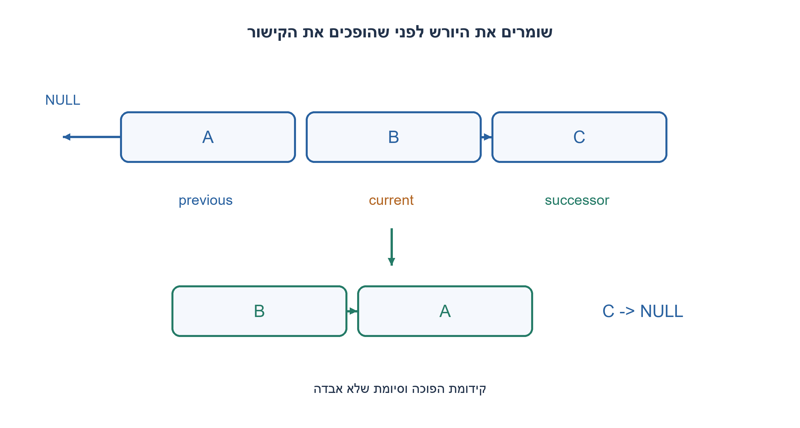
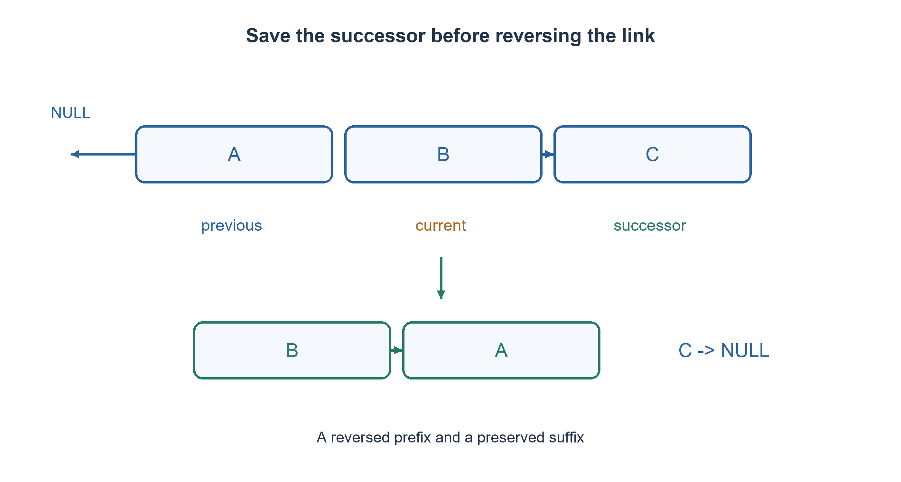

# PREP-238 — היפוך רשימה מקושרת במקום בלי לאבד את ההמשך

פתרון מוצע בסיוע AI; ביקורת מקצועית אנושית ממתינה. הקושי אינו מכויל.

## עברית

ממשו פונקציה שמקבלת ראש של רשימה מקושרת חד־כיוונית ומחזירה את הראש לאחר היפוך קישורי הרשימה: A→B→C→D הופך ל־D→C→B→A.

הקלט סופי וללא מעגלים, כל next תקף, ומותר לשנות את הקישורים בבעלות בלעדית. אין להקצות או למחוק צמתים, לשנות ערכי payload או להשתמש ברקורסיה. נדרש O(N) זמן ו־O(1) מילות עזר. רשימה ריקה וצומת יחיד תקינים. אין דרישה לשמר את הטופולוגיה הישנה; מי שמחזיק מצביע נוסף לצומת יראה את הקישורים שהשתנו.

1. ברגע שתהפכו current.next, כיצד תגיעו לצומת שעדיין לא טופל?
2. שמרו את ההמשך לפני השינוי, והחזיקו ראש לקידומת שכבר התהפכה.
3. בכל צעד: successor=current.next; current.next=previous; previous=current; current=successor. בסיום previous הוא הראש החדש.

### שומרים את הדרך קדימה לפני שמפנים אותה אחורה
נחזיק previous=None ו־current=head. בכל איטרציה נשמור successor=current.next לפני כל שינוי. נהפוך current.next ל־previous, נקדם previous לצומת הנוכחי ו־current ליורש ששמרנו. כש־current ריק מחזירים previous. בהתחלה previous ריק, ולכן הקישור של הראש הישן מתאפס והופך לזנב תקין.

לפני כל צעד previous הוא ראש של קידומת הקלט המקורית כשהיא הפוכה, ו־current הוא ראש הסיומת שטרם טופלה. שתי הקבוצות זרות ומכסות את כל הצמתים; כל ערכי הנתונים וזהויות הצמתים נשמרים. שמירת successor משאירה גישה לכל הסיומת. הצומת הנוכחי עובר פעם אחת מתחילת הסיומת לראש הקידומת ההפוכה, ולכן האינווריאנט נשמר. גודל הסיומת קטן באחד בכל צעד, ומבטיח עצירה אחרי N צעדים.

בדוגמה A→B→C, נבנות הקידומות A→None, אחר כך B→A→None, ולבסוף C→B→A→None. החזרת head הישן תהיה טעות: הוא כעת הזנב. רשימה ריקה מחזירה None וצומת יחיד חוזר עם next ריק. ערכים שווים אינם מחליפים זהויות: לא בונים רשימה חדשה של אותם ערכים ולא ממיינים אותם.

זמן O(N), מקום עזר קבוע ושלושה מצביעים; זו אינה רקורסיה הצורכת מחסנית בעומק N. העברת N הצמתים בין הקידומת לסיומת מוכיחה את עלות האלגוריתם. ברשימה כללית שמאפשרת גישה רק דרך next חייבים להגיע לכל קישור שצריך לשנות, ולכן הסדר הלינארי מתאים למודל. מעגל או שינוי מקביל אינם כלולים בחוזה; רשימה המשתפת זנב עם בעלים אחרים מחייבת הסכם בעלות לפני שינוי.

בדיקות Python מיצו 9,841 רשימות באורכים עד שמונה מעל שלושה ערכים, והשוו זהות וסדר צמתים והיפוך כפול שמחזיר כל קישור למקור. קוד C99 הודר והורץ בנפרד מול 511 דפוסי רשימות בינאריות, כולל NULL. מתאם ההרצה של רשימות ערכים בודק תוכן בלבד; הוא אינו מוכיח בעצמו שאין הקצאה או שהזהויות נשמרו.

```python
"""Destructive reversal of a caller-owned, finite acyclic singly linked list."""


class Node:
    def __init__(self, value, next_node=None):
        self.value, self.next = value, next_node


def reverse_list(head):
    previous, current = None, head
    while current is not None:
        successor = current.next
        current.next = previous
        previous, current = current, successor
    return previous


def reverse_values(values):
    """Array adapter checks values only; node identity is tested separately."""
    head = None
    for value in reversed(values):
        head = Node(value, head)
    node, result = reverse_list(head), []
    while node is not None:
        result.append(node.value)
        node = node.next
    return result
```


```c
/* C99: valid acyclic chain, exclusive mutation, no node allocation/free. */
#include <stddef.h>
typedef struct ReverseNode { int value; struct ReverseNode *next; } ReverseNode;
ReverseNode *reverse_list(ReverseNode *head) {
    ReverseNode *previous = NULL;
    while (head) {
        ReverseNode *successor = head->next;
        head->next = previous;
        previous = head;
        head = successor;
    }
    return previous;
}
```




## English

Given the head of a singly linked list, reverse its links in place and return the new head: A→B→C→D becomes D→C→B→A.

Input is finite and acyclic, next pointers are valid, and links are exclusively mutable. Do not allocate/delete nodes, change payloads or recurse. Require O(N) time and O(1) auxiliary words. Empty and one-node lists are valid. Original topology need not survive; other retained node pointers observe the changed links.

1. After reversing current.next, how will you reach the untouched suffix?
2. Save the successor first, retaining the head of the already reversed prefix.
3. At each step save successor=current.next, set current.next=previous, then advance previous=current and current=successor. Return previous.

### Preserve the forward path before pointing backward
Keep previous=None and current=head. Save successor=current.next before changing it, set current.next=previous, then advance previous to current and current to successor. When current is empty, return previous. The initial empty previous makes the original head a correctly terminated tail.

Before each step, previous heads the reversed original prefix and current heads the untouched suffix. The chains are disjoint and cover all original nodes; identities and payloads remain intact. Saving successor preserves access to the suffix. One node moves from the suffix front to the reversed-prefix front, preserving the invariant. The suffix loses one node each step, proving termination after N iterations.

For A→B→C, prefixes become A→None, B→A→None, then C→B→A→None. Returning the old head is wrong because it is now the tail. Empty input returns None; a single node returns itself with empty next. Equal payloads do not replace identities: allocating new nodes with reversed values is a different operation.

Time is O(N), with three pointers and constant auxiliary storage. Recursive reversal instead retains N call frames. Each node moves once between the invariant's chains. A general next-only list requires visiting every link that must change, consistent with linear work. Cycles and concurrent mutation are outside the contract; a tail shared with another owner requires an explicit mutation agreement.

Python exhausted 9,841 lists through length eight over three values, checking exact identities and a second reversal restoring every link. C99 was separately compiled/executed over 511 binary-valued list patterns, including NULL. The array execution adapter checks values only, not allocation, identity or auxiliary-space guarantees.

```python
"""Destructive reversal of a caller-owned, finite acyclic singly linked list."""


class Node:
    def __init__(self, value, next_node=None):
        self.value, self.next = value, next_node


def reverse_list(head):
    previous, current = None, head
    while current is not None:
        successor = current.next
        current.next = previous
        previous, current = current, successor
    return previous


def reverse_values(values):
    """Array adapter checks values only; node identity is tested separately."""
    head = None
    for value in reversed(values):
        head = Node(value, head)
    node, result = reverse_list(head), []
    while node is not None:
        result.append(node.value)
        node = node.next
    return result
```


```c
/* C99: valid acyclic chain, exclusive mutation, no node allocation/free. */
#include <stddef.h>
typedef struct ReverseNode { int value; struct ReverseNode *next; } ReverseNode;
ReverseNode *reverse_list(ReverseNode *head) {
    ReverseNode *previous = NULL;
    while (head) {
        ReverseNode *successor = head->next;
        head->next = previous;
        previous = head;
        head = successor;
    }
    return previous;
}
```




## חומר משלים / Supporting material

```json
{
  "assumptions": {
    "he": [
      "שרשרת חד־כיוונית סופית וללא מעגלים; בעלות בלעדית על שינוי הקישורים.",
      "אין שינוי ערכים, הקצאה או שחרור; הראש החדש מוחזר."
    ],
    "en": [
      "Finite acyclic singly linked chain with exclusive link mutation.",
      "No payload change, allocation or freeing; return the new head."
    ]
  },
  "optimality": {
    "he": "O(N) זמן ו־O(1) מילות עזר; רקורסיה אינה עומדת באותו חסם מחסנית. אין הקצאת צמתי פלט.",
    "en": "O(N) time and O(1) auxiliary words; recursion would not have the same stack bound. No output nodes are allocated."
  },
  "verification": {
    "he": "9,841 מקרי זהות וקישורים ב־Python; 511 מקרי C99 שהודרו והורצו ב־GCC מחמיר. בדיקות כוללות היפוך כפול ושמירת ערכים, לא שינוי מקביל.",
    "en": "9,841 Python identity/link cases and 511 strictly compiled/executed C99 cases, including double reversal and payload preservation; no concurrent mutation test."
  },
  "edge_cases": {
    "he": [
      "ריק; צומת יחיד; שני צמתים; כל הערכים זהים; זנב שצריך להתאפס."
    ],
    "en": [
      "Empty; one/two nodes; identical payloads; the old head must terminate as the tail."
    ]
  },
  "common_mistakes": {
    "he": [
      "דריסת next לפני שמירתו.",
      "החזרת הראש הישן.",
      "החלפת ערכים או בניית רשימה חדשה במקום שינוי קישורים.",
      "התעלמות מכינויים חיצוניים או ממעגל."
    ],
    "en": [
      "Overwriting next before saving it.",
      "Returning the original head.",
      "Reversing payloads or allocating new nodes instead of links.",
      "Ignoring external aliases or cycles."
    ]
  },
  "interview_answer": {
    "he": "אחלק לקידומת הפוכה וסיומת לא מטופלת. אשמור את היורש, אהפוך קישור ואקדם את שני הראשים; בסוף ראש הקידומת הוא התשובה.",
    "en": "Maintain a reversed prefix and untouched suffix. Save the successor, reverse one link and advance; the final prefix head is the answer."
  },
  "source_ambiguities": {
    "he": "המקור אינו קובע סוג רשימה, בעלות או טיפול בריק. נבחרה רשימה חד־כיוונית ללא מעגלים והיפוך צמתים במקום, בלי להחליף את ממשק הרשימה האבסטרקטית.",
    "en": "The source omits list type, ownership and empty handling. This version chooses an acyclic singly linked list with in-place node reversal, distinct from an immutable abstract-list interface."
  },
  "solution_extensions": {
    "he": [
      {
        "question": "מה משתנה אם אסור לשנות אף next?",
        "answer_direction": "צריך ליצור מבנה פלט נפרד או לעבוד בממשק בלתי משתנה. זהות הצמתים והעלות אינן עוד אותן דרישות; ראו את חוזה Head/Tail/concat.",
        "principle": "שינוי בעלות ויכולת כתיבה משנה את הבעיה."
      }
    ],
    "en": [
      {
        "question": "What if no next pointer may be changed?",
        "answer_direction": "Allocate separate output or use an immutable interface. Node identities and costs then differ; compare the Head/Tail/concat contract.",
        "principle": "Ownership and mutation permissions change the problem."
      }
    ]
  }
}
```


## מקור נוסף — 03.11.2026, מקבץ 20

[צילום מקור פרטי 5](../sources/2026-11-03-batch20-05.png)

נתונה רשימה מקושרת ומצביע head. א. הפוך את הרשימה: החוליה הראשונה תהפוך לאחרונה ותצביע ל-NULL, וה-head יצביע לחוליה האחרונה המקורית. ב. הסר חוליה כאשר נתון head ומצביע לאיבר להסרה. ג. ללא head, אלא רק מצביע לאיבר שאותו צריך להסיר.

שיוכי מקור מדווחים: Intel.

[צילום מקור פרטי 7](../sources/2026-11-03-batch20-07.png)

יש רשימה מקושרת: start מצביע לרכיב הראשון ו-next לרכיב הבא. next של הרכיב האחרון מצביע ל-NULL. הפוך את כיוון הרשימה כך ש-start יצביע לרכיב שהיה אחרון, ו-next של הרכיב שהיה ראשון יצביע ל-NULL.

שיוכי מקור מדווחים: Mellanox.

[צילום מקור פרטי 8](../sources/2026-11-03-batch20-08.png)

יש רשימה מקושרת: start מצביע לרכיב הראשון ו-next לרכיב הבא. next של הרכיב האחרון מצביע ל-NULL. הפוך את כיוון הרשימה כך ש-start יצביע לרכיב שהיה אחרון, ו-next של הרכיב שהיה ראשון יצביע ל-NULL.

שיוכי מקור מדווחים: Mellanox.

נוספה וריאציה בשתי השפות; הנוסח, הפתרון והרמזים הקודמים נשמרו. הפתרון המורחב ממתין לביקורת מקצועית.

[הווריאציה המלאה / Full variant](prep-238-deletion-batch1103-addendum.md)
