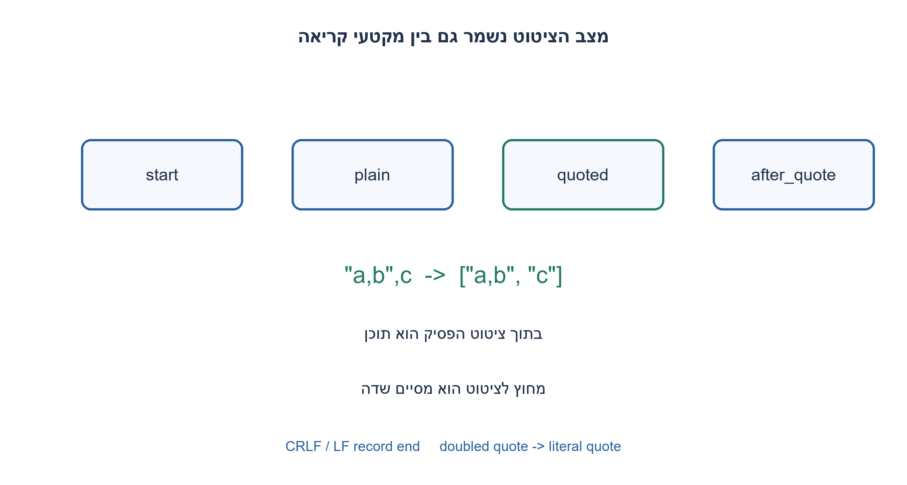
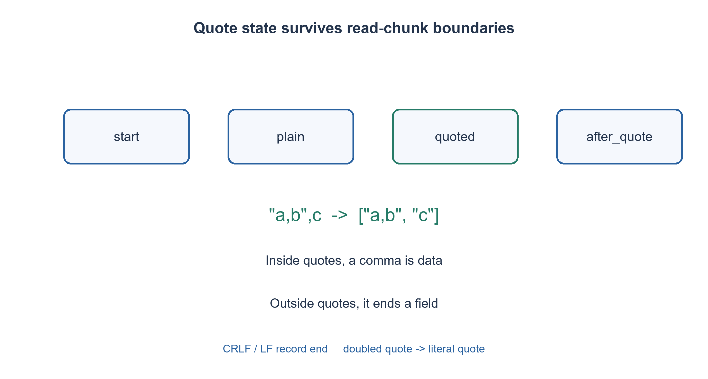

# PREP-239 — קורא CSV בזרימה ללא חבילת csv

פתרון מוצע בסיוע AI; ביקורת מקצועית אנושית ממתינה. הקושי אינו מכויל.

## עברית

כתבו בפייתון קורא קובץ CSV בלי להשתמש בחבילת csv במימוש. עליו להפיק שורות של מחרוזות, לתמוך בפסיק בתוך שדה מצוטט, במירכאות מוכפלות ובמעברי שורה בתוך ציטוט, ולעבוד גם כאשר גבול מקטע קריאה חוצה רצף כזה.

חוזה הפורמט: פסיק הוא מפריד; מירכאות כפולות פותחות שדה רק בתחילתו, ו־"" בתוך שדה מצוטט מייצג מירכאה. מחוץ לציטוט CRLF או LF מסיימים רשומה, ו־CR בודד הוא שגיאה; בתוך ציטוט CR/LF נשמרים כתוכן. אחרי סגירת ציטוט מותר רק מפריד, סוף רשומה או EOF. אין קיצוץ רווחים, המרת מספרים או טיפול מיוחד בכותרת. קלט ריק מפיק אפס שורות; שורה ריקה מפיקה שדה ריק אחד. סיומת ללא מעבר שורה תקינה. ציטוט שלא נסגר או תו אסור גורמים ValueError. שורות שכבר הופקו לפני שגיאה מאוחרת אינן מבוטלות. מעטפת הקובץ משתמשת ב־UTF-8 וב־newline="".

1. split(",") אינו יודע אם הפסיק נמצא בתוך מירכאות. איזה מצב צריך לזכור בין תווים?
2. הבדילו תחילת שדה, שדה רגיל, בתוך ציטוט ואחרי מירכאה. CR עשוי להמתין ל־LF במקטע הבא.
3. בתוך ציטוט פסיקים ומעברי שורה הם תוכן. אחרי מירכאה, מירכאה נוספת מחזירה לציטוט; מפריד מסיים שדה, וסוף רשומה מפיק שורה. בדקו גם EOF בכל מצב.

### קוראים תווים לפי הקשר, לא שורות פיזיות
הטקסט `"a,b",c` מכיל שני שדות, לא שלושה. גם שדה מצוטט יכול להמשיך לשורה הבאה, ולכן פיצול לפי פסיקים או לפי כל newline אינו מנתח CSV. נשמור מצב בין מקטעי קריאה: start, plain, quoted ו־after_quote, לצד field, row ודגל CR ממתין.

ב־quoted כל תו מלבד מירכאה מצורף לתוכן, כולל פסיק ו־CR/LF. מירכאה עוברת ל־after_quote. אם גם התו הבא מירכאה, נצרף מירכאה אחת ונחזור ל־quoted. אחרת רק פסיק, סוף רשומה או סוף קלט חוקיים. מחוץ לציטוט פסיק מצרף שדה ל־row, ו־LF מצרף את השדה ומפיק שורה. ב־CR נשמור שהשורה הסתיימה ונחכה ל־LF, גם אם הוא מגיע במקטע הבא. פתיחת ציטוט בתוך שדה רגיל אסורה בחוזה המחמיר הזה.

האינווריאנט הוא שכל התווים שנצרכו הומרו לתוכן שדות או לסימני מבנה בדיוק לפי המצב הנוכחי. המצב מתאר את ההקשר שהתו הבא זקוק לו, בלי תלות בגבול המקטע. שדה מצוטט פתוח או CR ממתין ב־EOF הם שגיאה. דגל record_started מבדיל קובץ ריק מרשומה ריקה, ומונע יצירת רשומה נוספת אחרי newline מסיים. פסיק מסיים משאיר שדה ריק שצריך להפיק גם ב־EOF.

הליבה היא generator המפיקה רשומה בכל פעם. עבור C תווים העבודה O(C), כי כל תו מעובד פעם אחת וה־join הכולל לינארי בתוכן. נשמרת הרשומה הנוכחית, ולכן המקום O(R) עבור רשומה ארוכה מרבית R, ועוד מקטע הקריאה K במעטפת. זו אינה הבטחת זיכרון קבוע אם שדה אחד עצום. `parse_csv` מממשת את כל הפלט כרשימה רק כמתאם בדיקה, במחיר מקום הפלט כולו. שגיאה מאוחרת אינה יכולה להחזיר לאחור שורות שכבר נמסרו לצרכן.

הדיאלקט מוגדר במפורש: הוא מאמץ כללי ציטוט מרכזיים המתוארים ב־[RFC 4180](https://www.rfc-editor.org/rfc/rfc4180), ומאפשר גם LF ותוכן שדה כללי. אין טענה לתמיכה בכל CSV בעולם או לבדיקת מספר שדות אחיד. במעטפת Python נבחר `newline=""` כדי לשמר מעברי שורה לקורא, לפי [תיעוד open](https://docs.python.org/3.12/library/functions.html#open). מחרוזת BOM אינה מוסרת בשקט; מדיניות אחרת דורשת encoding מתאים.

האימות יצר 8,191 מסמכים חוקיים בעזרת writer עצמאי, וביצע 32,764 הרצות במקטעים באורכים 1,2,5 ובמסמך שלם. נוספו קלטים ריקים, סיומות ושגיאות בכל נקודת חיתוך. חבילת csv משמשת באורקל הבדיקות בלבד; היא אינה מיובאת בקורא.

```python
"""Strict comma/double-quote CSV reader without the csv module.

Input is an iterable of text chunks, not necessarily lines. CRLF and LF end
records outside quotes; a bare CR outside quotes is rejected. Embedded CR/LF
inside quoted fields is preserved. Quotes only begin an empty field; after a
closing quote only comma, record end, or EOF is valid. No implicit trimming,
header conversion or type coercion. Empty input produces no records.
"""


def iter_csv_rows(chunks):
    state, pending_cr = 'start', False
    field, row = [], []
    record_started = False
    for chunk in chunks:
        if not isinstance(chunk, str):
            raise TypeError('text chunks required')
        for char in chunk:
            if pending_cr:
                if char != '\n':
                    raise ValueError('bare CR outside quoted field')
                pending_cr = False
                yield row
                row, field, state = [], [], 'start'
                record_started = False
                continue
            if state == 'quoted':
                if char == '"':
                    state = 'after_quote'
                else:
                    field.append(char)
                continue
            if state == 'after_quote' and char == '"':
                field.append('"')
                state = 'quoted'
                continue
            if char == ',':
                row.append(''.join(field))
                field, state = [], 'start'
                record_started = True
            elif char in '\r\n':
                row.append(''.join(field))
                field = []
                if char == '\r':
                    pending_cr = True
                else:
                    yield row
                    row, state = [], 'start'
                    record_started = False
            elif char == '"':
                if state != 'start':
                    raise ValueError('quote inside unquoted field')
                state = 'quoted'
                record_started = True
            else:
                if state == 'after_quote':
                    raise ValueError('unexpected character after closing quote')
                field.append(char)
                state = 'plain'
                record_started = True
    if pending_cr:
        raise ValueError('bare CR at EOF')
    if state == 'quoted':
        raise ValueError('unterminated quoted field')
    if record_started:
        row.append(''.join(field))
        yield row


def read_csv_file(path, chunk_size=4096):
    if type(chunk_size) is not int or chunk_size <= 0:
        raise ValueError('positive chunk size required')
    with open(path, encoding='utf-8', newline='') as source:
        yield from iter_csv_rows(iter(lambda: source.read(chunk_size), ''))


def parse_csv(text):
    """Execution adapter materializes output; core parser yields one row."""
    return list(iter_csv_rows([text]))
```




## English

Write a Python CSV file reader without using the csv module in the implementation. Yield rows of strings, supporting quoted commas, doubled quotes and embedded line breaks even across read-chunk boundaries.

Dialect: comma separator; double quotes open a quoted field only at its beginning, and doubled quotes inside it encode one quote. Outside quotes, CRLF or LF ends a record and bare CR is an error; inside quotes preserve CR/LF as content. Only separator, record end or EOF may follow a closing quote. Do not trim whitespace, coerce numbers or specially process headers. Empty input yields no records; a blank record yields one empty field. A final record without a newline is valid. Unclosed quotes or forbidden characters raise ValueError. Earlier yielded records are not rolled back after a later error. The file wrapper uses UTF-8 and newline="".

1. split(",") cannot tell whether a comma is quoted. Which state must survive between characters?
2. Distinguish field start, plain field, quoted field and after-quote; CR may await LF in the next chunk.
3. Quoted commas/newlines are data. After a quote, another quote escapes it, a separator ends the field, and a record boundary yields the row. Check EOF in every state.

### Characters need context rather than physical-line splitting
`"a,b",c` contains two fields, not three. A quoted field may also cross a physical line, so splitting every comma or newline cannot parse this format. Retain start/plain/quoted/after_quote state across chunks, plus the current field/row and a pending-CR flag.

Inside quoted state, commas and CR/LF are data. A quote enters after_quote. Another quote appends one literal quote and resumes quoted state; otherwise only a separator, record boundary or EOF is legal. Outside quotes, a comma appends the field, while LF appends the field and yields the row. CR requires LF, possibly in the next chunk. A quote inside an already plain field is invalid under this strict contract.

Invariant: consumed characters have become field content or structural tokens according to the current state; that state contains precisely the context needed for the next character, independent of chunk boundaries. Open quoted state or pending CR at EOF is an error. record_started distinguishes an empty file from an empty record and prevents an extra record after a final newline. A trailing comma leaves an empty field that must still be emitted at EOF.

The core generator yields one record at a time. C characters take O(C) work: each is processed once, and total joining work is linear. Storage is O(R) for the largest current record R, plus wrapper chunk size K. A huge single field therefore prevents a constant-memory guarantee. The parse_csv adapter materializes all output for execution checks and has correspondingly larger storage. Earlier rows cannot be withdrawn after a later parse error.

This declared dialect adopts core quoting rules from [RFC 4180](https://www.rfc-editor.org/rfc/rfc4180) and additionally accepts LF and general field text. It does not claim all CSV dialects or equal field counts. Python's wrapper uses newline="" to retain line endings as documented for [open](https://docs.python.org/3.12/library/functions.html#open). It does not silently remove a BOM; that requires an explicit encoding policy.

Verification generated 8,191 valid documents with an independent writer and ran 32,764 chunked parses at sizes 1,2,5 and whole document. Directed empty/trailing/error cases were tested at every split. The csv module is used only by the oracle, never imported by the reader.

```python
"""Strict comma/double-quote CSV reader without the csv module.

Input is an iterable of text chunks, not necessarily lines. CRLF and LF end
records outside quotes; a bare CR outside quotes is rejected. Embedded CR/LF
inside quoted fields is preserved. Quotes only begin an empty field; after a
closing quote only comma, record end, or EOF is valid. No implicit trimming,
header conversion or type coercion. Empty input produces no records.
"""


def iter_csv_rows(chunks):
    state, pending_cr = 'start', False
    field, row = [], []
    record_started = False
    for chunk in chunks:
        if not isinstance(chunk, str):
            raise TypeError('text chunks required')
        for char in chunk:
            if pending_cr:
                if char != '\n':
                    raise ValueError('bare CR outside quoted field')
                pending_cr = False
                yield row
                row, field, state = [], [], 'start'
                record_started = False
                continue
            if state == 'quoted':
                if char == '"':
                    state = 'after_quote'
                else:
                    field.append(char)
                continue
            if state == 'after_quote' and char == '"':
                field.append('"')
                state = 'quoted'
                continue
            if char == ',':
                row.append(''.join(field))
                field, state = [], 'start'
                record_started = True
            elif char in '\r\n':
                row.append(''.join(field))
                field = []
                if char == '\r':
                    pending_cr = True
                else:
                    yield row
                    row, state = [], 'start'
                    record_started = False
            elif char == '"':
                if state != 'start':
                    raise ValueError('quote inside unquoted field')
                state = 'quoted'
                record_started = True
            else:
                if state == 'after_quote':
                    raise ValueError('unexpected character after closing quote')
                field.append(char)
                state = 'plain'
                record_started = True
    if pending_cr:
        raise ValueError('bare CR at EOF')
    if state == 'quoted':
        raise ValueError('unterminated quoted field')
    if record_started:
        row.append(''.join(field))
        yield row


def read_csv_file(path, chunk_size=4096):
    if type(chunk_size) is not int or chunk_size <= 0:
        raise ValueError('positive chunk size required')
    with open(path, encoding='utf-8', newline='') as source:
        yield from iter_csv_rows(iter(lambda: source.read(chunk_size), ''))


def parse_csv(text):
    """Execution adapter materializes output; core parser yields one row."""
    return list(iter_csv_rows([text]))
```




## חומר משלים / Supporting material

```json
{
  "assumptions": {
    "he": [
      "דיאלקט מפורש עם פסיק ומירכאות כפולות; קלט טקסט, ללא המרת טיפוסים.",
      "מצב נשמר בין מקטעים; שגיאה מאוחרת אינה מבטלת שורות שכבר הופקו."
    ],
    "en": [
      "Explicit comma/double-quote dialect over text, without type coercion.",
      "State survives chunks; late errors do not roll back already yielded rows."
    ]
  },
  "optimality": {
    "he": "O(C) זמן עבור C תווים; O(R+K) מקום פעיל לרשומה ולמקטע, בלי הפלט שנשמר אצל הצרכן. מתאם parse_csv שומר פלט מלא.",
    "en": "O(C) time for C characters; O(R+K) active storage for the record and chunk, excluding consumer-retained output. parse_csv materializes all results."
  },
  "verification": {
    "he": "8,191 מסמכים שנוצרו באופן עצמאי, 32,764 הרצות חיתוך, שמונה קלטי גבול ושמונה קלטים פגומים בכל נקודת חיתוך. נבדק prefix שהופק לפני שגיאה מאוחרת.",
    "en": "8,191 independently generated documents, 32,764 chunked runs, eight directed boundaries and eight malformed inputs at every split; checked a yielded prefix before a later error."
  },
  "edge_cases": {
    "he": [
      "ריק ושורה ריקה שונים; שדה אחרון ריק; CRLF שחוצה מקטע; מירכאה מוכפלת; newline בתוך שדה; EOF בלי newline."
    ],
    "en": [
      "Empty file versus blank record; empty final field; split CRLF; doubled quote; quoted newline; final EOF without newline."
    ]
  },
  "common_mistakes": {
    "he": [
      "split לפי פסיק או newline בלבד.",
      "איפוס מצב בכל מקטע.",
      "קבלת טקסט נוסף אחרי סגירת מירכאות.",
      "טענה לזיכרון קבוע או לתמיכה בכל דיאלקט."
    ],
    "en": [
      "Splitting only on commas/newlines.",
      "Resetting state per chunk.",
      "Accepting arbitrary text after a closing quote.",
      "Claiming constant memory or every dialect."
    ]
  },
  "interview_answer": {
    "he": "אשתמש במכונת מצבים על תווים, ואבדיל מירכאה סוגרת ממירכאה מוכפלת. אשמור מצב בין מקטעים ואפיק רשומה רק בגבול מחוץ לציטוט.",
    "en": "Use a character-state machine, distinguish closing from escaped quotes, retain context across chunks, and yield records only at unquoted boundaries."
  },
  "source_ambiguities": {
    "he": "CSV אינו דיאלקט יחיד. הוגדרו מפריד, ציטוט, מעברי שורה, ריק ושגיאות; הכותרת אינה מומרת למילון אוטומטית.",
    "en": "CSV has multiple dialects. Separator, quoting, line endings, empties and errors are explicit; headers are not automatically converted to a map."
  },
  "solution_extensions": {
    "he": [
      {
        "question": "איך מבטיחים שלא יהיה פלט חלקי מקובץ פגום?",
        "answer_direction": "צריך קודם לאמת את כל הקלט או לשמור פלט עד commit, בזיכרון או באחסון זמני. זו תוספת משאבים וחוזה אחר מזרימה מיידית.",
        "principle": "אטומיות קובץ שלם וזרימה מיידית הן דרישות שונות."
      }
    ],
    "en": [
      {
        "question": "How can a malformed file produce no partial output?",
        "answer_direction": "Validate the entire input first or stage output until commit in memory or temporary storage. That adds resources and changes the immediate-streaming contract.",
        "principle": "Whole-file atomicity and immediate streaming are different requirements."
      }
    ]
  }
}
```
