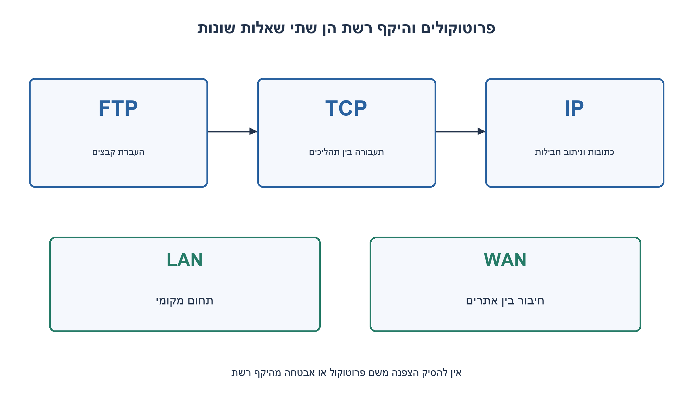
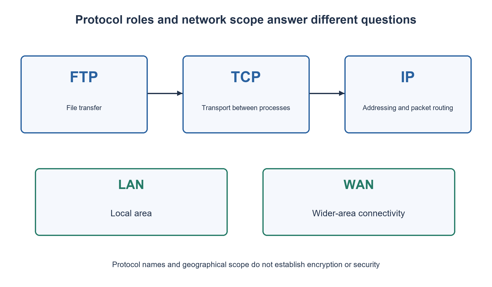

# PREP-240 — יסודות רשת ותשובות אישיות בראיון

פתרון מוצע בסיוע AI; ביקורת מקצועית אנושית ממתינה.

[מקור פרטי](../sources/2026-11-01-batch20-16.png)

מה זה IP? מה זה FTP? מה ההבדל בין WAN ל-LAN? למה אתה רואה את עצמך מתאים לעבודה? איזה שכר אתה מבקש?


## עברית

מהם IP ו־FTP? מה ההבדל בין LAN ל־WAN? הפרידו בין תפקיד פרוטוקול לבין היקף רשת, והסבירו מה FTP רגיל אינו מבטיח מבחינת אבטחה. לאחר מכן הכינו מסגרת לתשובות ״מדוע אתם מתאימים לתפקיד?״ ו״מה ציפיות השכר שלכם?״. השתמשו רק בעובדות אישיות שהמועמד מספק; אין להמציא ניסיון, פרויקט או סכום שכר. אין לבצע חיבור לרשת או להזין פרטי גישה אמיתיים.

1. האם שם מתאר פרוטוקול שמעביר חבילות, יישום להעברת קבצים או היקף חיבור בין אתרים?
2. IP אינו מבטיח לבדו מסירה אמינה, ו־FTP רגיל אינו מצפין סיסמאות. LAN יכול להיות אלחוטי, ו־WAN אינו בהכרח האינטרנט.
3. בנו תשובה אישית מדרישת תפקיד, ראיה אמיתית וקישור לתרומה. לשכר השאירו שדה למילוי וציינו מטבע ותקופת תשלום.

### קודם מפרידים בין ארבעה מושגים
IP הוא פרוטוקול בשכבת האינטרנט: כתובות וחבילות מאפשרות להעביר מידע בין רשתות באמצעות ניתוב. IPv4 ו־IPv6 הם גרסאות שונות. IP לבדו אינו מבטיח הגעה, סדר או מניעת כפילויות; אין להסיק ממנו את האחריות של TCP או של היישום.

FTP הוא פרוטוקול יישום להעברת קבצים. בגרסה הקלאסית יש חיבור בקרה וחיבורי נתונים נפרדים מעל TCP. פורט 21 הוא ברירת המחדל לבקרה; אין לומר שכל חיבור נתונים משתמש תמיד בפורט 20, משום שמצב החיבור משנה את התהליך. FTP רגיל אינו מספק הצפנה של סיסמאות או נתונים. FTPS ו־SFTP אינם פשוט שני שמות ל־FTP הרגיל. התרגיל אינו מבקש להפעיל שירות או למסור סיסמה.

LAN מתאר רשת בתחום מקומי, כגון משרד או קמפוס; WAN מחבר תחומים רחבים או אתרים מרוחקים. זו אינה החלוקה ״כבל לעומת אלחוט״ או ״פרטי לעומת ציבורי״: בשני ההיקפים ייתכנו טכנולוגיות ובעלויות שונות. WAN פרטי יכול לחבר כמה LANs בלי להיות האינטרנט הציבורי. מספר מחשבים לבדו אינו מגדיר את ההבדל.

### תשובות אישיות הן מסגרת למילוי
התאמה לתפקיד: ״הדרישה [דרישה אמיתית מהתפקיד] מתחברת ל־[ניסיון, לימוד או פרויקט אמיתי שלי]. ביצעתי [פעולה שבאמת עשיתי], והתוצאה או הלמידה הייתה [עובדה שניתן להסביר]. מכאן אוכל לתרום ב־[קישור ממוקד לתפקיד].״ אם חסר ניסיון, אומרים זאת ומסבירים כיצד לומדים; אין להציג פרויקט דמיוני כניסיון תעסוקתי.

שכר: ״כדי לדייק, אשמח להבין את היקף האחריות ואת מבנה התגמול. הציפייה שלי היא [הטווח שהמועמד בחר], ב־[מטבע], [ברוטו לחודש או לשנה], בהתחשב ב־[רכיבי החבילה שרלוונטיים לי].״ השדות הם מצייני מקום, ולא נתונים על המשתמש או המלצה לטווח שוק. בלי העדפה אישית ונתוני תפקיד אין סכום נכון יחיד.

הבדיקה היא יכולת להסביר תפקידים, לתת דוגמה עקבית ולהבחין בגבולות אבטחה ועובדות אישיות. אין כאן אלגוריתם למזעור זמן, בדיקת רשת חיה או הוכחת התאמה של מועמד מסוים.

[IP: RFC 791](https://www.rfc-editor.org/rfc/rfc791)
[IPv6: RFC 8200](https://www.rfc-editor.org/rfc/rfc8200)
[FTP: RFC 959](https://www.rfc-editor.org/rfc/rfc959)
[גבולות אבטחת FTP: RFC 2577](https://datatracker.ietf.org/doc/html/rfc2577)
[הגדרת LAN של Cisco](https://www.cisco.com/site/us/en/learn/topics/networking/what-is-a-lan-local-area-network.html)



## English

What are IP and FTP? How do LAN and WAN differ? Separate a protocol's role from a network's scope, and explain the security limits of ordinary FTP. Then prepare answer structures for “Why are you suitable for this role?” and “What are your salary expectations?” Use only facts supplied by the candidate; do not invent experience, a project or a salary amount. No network connection or real credentials are needed.

1. Does each name describe packet delivery, a file-transfer application protocol, or the scope of connected sites?
2. IP alone is not reliable delivery, and ordinary FTP does not encrypt passwords. A LAN may be wireless, and a WAN need not be the Internet.
3. Structure personal fit around a role requirement, true evidence and contribution. Leave salary to be filled in, including currency and payment period.

### Separate four different kinds of term
IP is an Internet-layer protocol: addressing and packets allow routing between networks. IPv4 and IPv6 are different versions. IP by itself does not guarantee arrival, order or duplicate suppression; do not silently assign TCP's or an application's responsibilities to it.

FTP is an application protocol for transferring files. Classic FTP uses a control connection and separate data connections over TCP. Port 21 is the default control port; data connections do not always use port 20, since connection mode matters. Ordinary FTP does not encrypt passwords or data. FTPS and SFTP are not interchangeable names for ordinary FTP. This exercise requires neither operating a service nor supplying a password.

A LAN serves a local area, such as an office or campus; a WAN joins wider areas or distant sites. This is not “wired versus wireless” or “private versus public”: technologies and ownership vary. A private WAN can connect several LANs without being the public Internet. Device count alone does not define the distinction.

### Personal answers are structures to fill in
Role fit: “The requirement [actual role requirement] connects to [my true experience, study or project]. I performed [an action I really took], with [a result or learning I can explain]. This helps me contribute to [a specific responsibility].” If experience is missing, state that and explain the learning approach. Do not turn a fictional project into claimed employment.

Salary: “To be precise, I would like to understand the responsibilities and compensation structure. My expectation is [the candidate's chosen range], in [currency], [gross per month or per year], considering [the package elements relevant to me].” Brackets mark placeholders, not user facts or a suggested market range. Without personal preferences and role details there is no single correct amount.

Verification is explaining the roles, giving a consistent example and identifying security and personal-evidence boundaries. There is no time-minimization algorithm, live network test or proof of a particular candidate's suitability.

[IP: RFC 791](https://www.rfc-editor.org/rfc/rfc791)
[IPv6: RFC 8200](https://www.rfc-editor.org/rfc/rfc8200)
[FTP: RFC 959](https://www.rfc-editor.org/rfc/rfc959)
[FTP security: RFC 2577](https://datatracker.ietf.org/doc/html/rfc2577)
[Cisco LAN definition](https://www.cisco.com/site/us/en/learn/topics/networking/what-is-a-lan-local-area-network.html)



## Supporting material / חומר משלים

```json
{
  "assumptions": {
    "he": "IP פירושו Internet Protocol; FTP פירושו File Transfer Protocol. השאלות האישיות נענות לפי מידע אמיתי שהמועמד בוחר לספק.",
    "en": "IP means Internet Protocol; FTP means File Transfer Protocol. Personal prompts use true information voluntarily supplied by the candidate."
  },
  "optimality": {
    "he": "הסבר מושגים ולא בעיית אופטימיזציה. תעבורת FTP וביצועי רשת תלויים במימוש ובסביבה; לא נמדדו כאן.",
    "en": "Conceptual explanation, not an optimization problem. FTP traffic and network performance depend on implementation and environment; none were measured."
  },
  "verification": {
    "he": "נבדקו הגדרות מול RFCs ותיעוד רשת ראשוני; נבדקה נוכחות מסגרת אישית ללא סכומי שכר או ביוגרפיה מומצאים. לא נשלחו חבילות או פרטי גישה.",
    "en": "Definitions were reviewed against primary RFC/network documents, and the personal template checked for invented biography or salary values. No packets or credentials were sent."
  },
  "edge_cases": {
    "he": "LAN יכול לכלול אלפי מכשירים; WAN יכול להיות פרטי. IP אינו זהה לכתובת IP, ו־FTP אינו שם של כל העברת קובץ.",
    "en": "A LAN may contain thousands of devices; a WAN may be private. IP is not merely an IP address, and FTP is not the name of every file-transfer mechanism."
  },
  "common_mistakes": {
    "he": "בלבול בין פרוטוקול להיקף גאוגרפי; הבטחת הצפנה ב־FTP רגיל; המצאת שנות ניסיון או ציפיית שכר.",
    "en": "Confusing protocol with geographical scope; claiming encryption for ordinary FTP; inventing years of experience or salary expectations."
  },
  "interview_answer": {
    "he": "IP מנתב חבילות; FTP מעביר קבצים; LAN מקומי ו־WAN מחבר אתרים. להתאמה ולשכר אתן תשובה אישית מבוססת עובדות, לא ערך מומצא.",
    "en": "IP routes packets, FTP transfers files, LAN is local and WAN connects sites. Fit and salary answers require actual candidate facts, not invented values."
  },
  "source_ambiguities": {
    "he": "לא נמסרו תפקיד, מדינה, ניסיון או שכר. אין להפוך את שאלת המקור לדיווח על המשתמש; פרטי המועמד נשארים שדות למילוי.",
    "en": "The source supplies no role, country, experience or salary. It is not a statement about the user; candidate details remain fill-in fields."
  },
  "solution_extensions": {
    "he": "כיצד תסבירו LAN עם אלפי מכשירים ו־WAN פרטי? הציגו דוגמה אמיתית קצרה להתאמה לתפקיד בלי להוסיף עובדות חסרות.",
    "en": "Explain a LAN with thousands of devices and a private WAN. Give a short true role-fit example without filling missing facts."
  },
  "technical_references": {
    "he": [
      "[IP: RFC 791](https://www.rfc-editor.org/rfc/rfc791)",
      "[IPv6: RFC 8200](https://www.rfc-editor.org/rfc/rfc8200)",
      "[FTP: RFC 959](https://www.rfc-editor.org/rfc/rfc959)",
      "[גבולות אבטחת FTP: RFC 2577](https://datatracker.ietf.org/doc/html/rfc2577)",
      "[הגדרת LAN של Cisco](https://www.cisco.com/site/us/en/learn/topics/networking/what-is-a-lan-local-area-network.html)"
    ],
    "en": [
      "[IP: RFC 791](https://www.rfc-editor.org/rfc/rfc791)",
      "[IPv6: RFC 8200](https://www.rfc-editor.org/rfc/rfc8200)",
      "[FTP: RFC 959](https://www.rfc-editor.org/rfc/rfc959)",
      "[FTP security: RFC 2577](https://datatracker.ietf.org/doc/html/rfc2577)",
      "[Cisco LAN definition](https://www.cisco.com/site/us/en/learn/topics/networking/what-is-a-lan-local-area-network.html)"
    ]
  }
}
```
