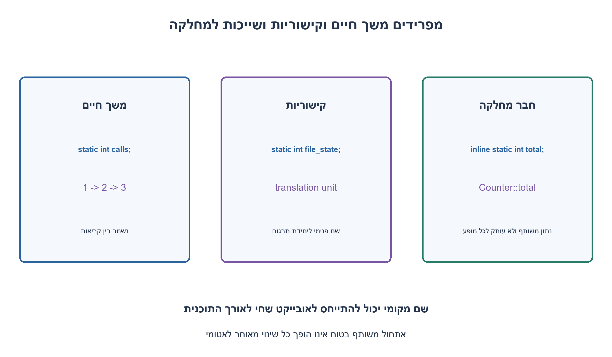
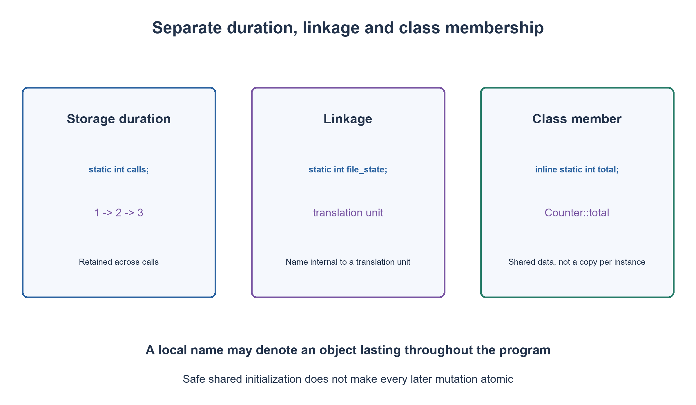

# PREP-241 — המשמעויות של static בשפות C ו־C++

פתרון מוצע בסיוע AI; ביקורת מקצועית אנושית ממתינה.

[מקור פרטי](../sources/2026-11-01-batch20-18.png)

מה זה סטאטיק ב-C? מה זה סטאטיק ב-C++?


## עברית

הסבירו את static ב־C וב־C++. הבדילו בין משך חיים, תחום שם וקישוריות; השוו משתנה מקומי static למשתנה אוטומטי, ומשתנה או פונקציה ברמת הקובץ למשתנה או פונקציה חברי מחלקה ב־C++. השתמשו בדוגמאות קצרות וציינו גרסת שפה. האם static מבטיח חסינות לתחרות בין תהליכונים?

1. משך חיים עונה ״כמה זמן האובייקט קיים״; תחום שם עונה ״איפה ניתן לכתוב את שמו״. אלו שאלות שונות.
2. השוו מונה מקומי שמוגדר מחדש בכל קריאה למונה static. ברמת הקובץ חשבו על שימוש בשם מיחידת תרגום אחרת.
3. ב־C++ חבר נתונים static משותף למחלקה; לפונקציה סטטית אין this. אתחול בטוח של static מקומי אינו הופך כל הגדלה שלו לאטומית.

### שלוש שאלות נפרדות
משך אחסון מתאר כמה זמן האחסון של האובייקט קיים; תחום שם מתאר היכן השם נגיש במקור; קישוריות מתארת האם הכרזות בהקשרים שונים מתייחסות לאותה ישות. משתנה יכול לחיות לכל אורך התוכנית בלי ששמו יהיה נגיש מחוץ לפונקציה.

ב־C17, בתוך פונקציה `static int calls;` מאותחל לאפס ונשמר בין כניסות לבלוק. `int calls=0;` אוטומטי נוצר ומאותחל מחדש בכל קריאה. לכן שתי קריאות רצופות למונה הראשון מחזירות 1 ואז 2, ולמונה האוטומטי 1 ואז 1. השם המקומי נשאר בתחום הבלוק; static אינו הופך אותו למשתנה גלובלי נגיש בכל מקום. לאובייקט מקומי כזה אין linkage.

ברמת הקובץ, `static int state;` מעניק לשם קישוריות פנימית ליחידת התרגום. כך גם `static int helper(void)` מסתיר את שם הפונקציה מיחידות תרגום אחרות; פונקציה אינה משתנה שמקבל ״חיים ארוכים יותר״. גם למשתנה רגיל ברמת הקובץ יש משך אחסון סטטי, ולכן ״חיים לכל התוכנית״ לבדו אינו מסביר את תוספת static. אין לבלבל יחידת תרגום עם namespace או מנגנון הרשאות אבטחה.

### מה מתווסף ב־C++17?
יש משתנים מקומיים סטטיים וגם שימושי namespace עם קישוריות פנימית. בנוסף, `inline static int total=0;` כחבר מחלקה הוא נתון משותף, לא עותק נפרד בכל אובייקט; `inline` מאפשר את ההגדרה בתוך המחלקה ב־C++17. חבר לא־סטטי כגון `local` נמצא בכל אובייקט בנפרד. שינוי total דרך אובייקט אחד נראה דרך האחר, אך local שלהם יכול להיות שונה.

פונקציית חבר static ניתנת לקריאה בשם המחלקה ואין לה this. היא אינה יכולה לגשת ישירות לחבר לא־סטטי בלי אובייקט נתון; היא עדיין כפופה לכללי public/private. אין ב־C מחלקות או פונקציות חבר מהסוג הזה.

ב־C++11 ואילך אתחול דינמי של static מקומי מתבצע בפעם הראשונה שהבקרה מגיעה להכרזה, עם תיאום הנדרש לאתחול מקביל. אין להסיק מכך ש־`++calls` בטוח במקביל: פעולות על הנתון דורשות סנכרון מתאים. C אינו מקבל מכך את כללי האתחול של C++. גם הצורה C99 `int a[static 10]` בפרמטר מערך היא שימוש נפרד: היא דורשת גישה לפחות לעשרה איברים, ואינה הופכת את המערך למשתנה בעל משך אחסון סטטי.

המונח אינו מבטיח יעילות, thread safety, מגורים דווקא במקטע פיזי מסוים או גישה ציבורית. הקוד המצורף הוא דוגמה סמנטית; לא נטענת כאן קומפילציה שלו.

```c
/* C17 illustrative source. No compiler execution is claimed by Python checks. */
static int file_private;

static int next_call(void) {
    static int calls;
    return ++calls;
}

int automatic_call(void) {
    int calls = 0;
    return ++calls;
}

int static_demonstration(void) {
    file_private = next_call();
    return next_call(); /* first invocation of this function returns 2 */
}
```


```cpp
// C++17 illustrative source. Static is not a synchronization primitive.
struct Counter {
    inline static int total = 0;
    int local = 0;
    void add() { ++total; ++local; }
    static int shared() { return total; } // no this pointer
};

int call_count() {
    static int value = 0;
    return ++value;
}
```


[משך אחסון ב־C](https://learn.microsoft.com/en-us/cpp/c-language/c-storage-classes?view=msvc-170)
[קישוריות ב־C++](https://eel.is/c++draft/basic.link)
[משך אחסון סטטי](https://eel.is/c++draft/basic.stc.static)
[חברי מחלקה סטטיים](https://eel.is/c++draft/class.static)
[אתחול משתנה מקומי סטטי](https://eel.is/c++draft/stmt.dcl)



## English

Explain static in C and C++. Separate storage duration, name scope and linkage. Compare a static local with an automatic local, and file-scope variables/functions with C++ static class data/functions. Use short examples and state the language version. Does static ensure race-free multithreaded access?

1. Duration asks how long an object exists; scope asks where its name can be used. They are different questions.
2. Compare a fresh local counter on every call with a static one. At file scope consider use from another translation unit.
3. A C++ static data member belongs to the class; a static function has no this. Safe local-static initialization does not make every later increment atomic.

### Separate three questions
Storage duration concerns how long an object's storage exists; scope concerns where its name is usable in source; linkage concerns whether declarations in different contexts denote the same entity. An object can last throughout a program while its name is usable only inside one function.

In C17, a function-local `static int calls;` is zero-initialized and retains its value between block entries. An automatic `int calls=0;` is created and initialized afresh on each call. Two successive calls to the static counter therefore return 1 then 2; the automatic counter returns 1 then 1. The local name remains block-scoped rather than becoming globally accessible. That local object's name has no linkage.

At file scope, `static int state;` gives the name internal linkage within the translation unit. A `static int helper(void)` similarly keeps its function name internal; a function is not a variable acquiring a longer lifetime. An ordinary file-scope variable already has static storage duration, so lifetime alone does not explain the added keyword. A translation unit is not an access-control security boundary.

### What C++17 adds
C++ also has static locals and namespace-scope internal-linkage uses. In addition, an `inline static int total=0;` class member is shared rather than copied into every instance; C++17 inline variables permit its definition in the class. A nonstatic member such as `local` belongs to each object separately. Changing total through one object is visible through another, while their local values may differ.

A static member function can be called through the class name and has no this pointer. Direct access to nonstatic members requires an explicit object; ordinary public/private rules still apply. C has no equivalent class-member facility.

Since C++11, dynamic initialization of a function-local static occurs when execution first reaches its declaration, with the required synchronization for concurrent initialization. This does not make subsequent `++calls` operations race-free: access to shared state still needs suitable synchronization. Do not apply C++ initialization guarantees to C automatically. C99's separate array-parameter form `int a[static 10]` promises access to at least ten elements; it does not give the array static storage duration.

The keyword does not by itself promise efficiency, thread safety, a particular physical memory segment or public access. The attached code illustrates semantics; no compilation of it is claimed here.

```c
/* C17 illustrative source. No compiler execution is claimed by Python checks. */
static int file_private;

static int next_call(void) {
    static int calls;
    return ++calls;
}

int automatic_call(void) {
    int calls = 0;
    return ++calls;
}

int static_demonstration(void) {
    file_private = next_call();
    return next_call(); /* first invocation of this function returns 2 */
}
```


```cpp
// C++17 illustrative source. Static is not a synchronization primitive.
struct Counter {
    inline static int total = 0;
    int local = 0;
    void add() { ++total; ++local; }
    static int shared() { return total; } // no this pointer
};

int call_count() {
    static int value = 0;
    return ++value;
}
```


[C storage classes](https://learn.microsoft.com/en-us/cpp/c-language/c-storage-classes?view=msvc-170)
[C++ linkage](https://eel.is/c++draft/basic.link)
[Static storage duration](https://eel.is/c++draft/basic.stc.static)
[Static class members](https://eel.is/c++draft/class.static)
[Local static initialization](https://eel.is/c++draft/stmt.dcl)



## Supporting material / חומר משלים

```json
{
  "assumptions": {
    "he": "דוגמאות C17 ו־C++17; אין תחרות בפועל בדוגמאות המונים. דוגמת האתחול המקביל מתייחסת במפורש ל־C++11 ואילך.",
    "en": "Examples use C17/C++17; the counter examples are sequential. Concurrent local-static initialization refers specifically to C++11 and later."
  },
  "optimality": {
    "he": "זו הבחנה סמנטית, לא טענת אופטימום. אין להסיק על layout, זמן גישה או מחיר סנכרון מהמילה static בלבד.",
    "en": "This is a semantic distinction, not an optimum claim. Layout, access time and synchronization cost do not follow from static alone."
  },
  "verification": {
    "he": "ההבחנות נבדקו מול תיעוד C וטיוטת תקן C++; קטעי C/C++ נקראו אך לא קומפלו. אין בדיקת תהליכונים או ABI.",
    "en": "The distinctions were reviewed against C documentation and the C++ draft. C/C++ snippets were read but not compiled; no threading or ABI test was performed."
  },
  "edge_cases": {
    "he": "קריאה ראשונה ושנייה; משתנה אוטומטי לעומת static; שתי יחידות תרגום; שני אובייקטים; אתחול לעומת שינוי לאחר האתחול.",
    "en": "First/second call; automatic versus static; two translation units; two objects; initialization versus later mutation."
  },
  "common_mistakes": {
    "he": "לומר static משמעו גלובלי או thread-safe; לייחס internal linkage למשתנה מקומי; לשכוח שאין this בפונקציה סטטית.",
    "en": "Calling static global or thread-safe; giving a static local internal linkage; forgetting the absence of this in a static member function."
  },
  "interview_answer": {
    "he": "בבלוק static שומר מצב בין קריאות; בקובץ הוא משפיע על linkage; במחלקת C++ הוא שייך למחלקה. תמיד אבחין בין משך חיים, scope ו־linkage.",
    "en": "In a block static preserves state; at file scope it affects linkage; in a C++ class it belongs to the class. I separate duration, scope and linkage."
  },
  "source_ambiguities": {
    "he": "לא צוינה גרסת שפה או צורת הכרזה. לכן מוצגים שימושים נפרדים ולא משמעות יחידה לכל מופע של static.",
    "en": "The source specifies neither a language version nor a declaration form, so distinct uses are compared rather than assigning one meaning to every static."
  },
  "solution_extensions": {
    "he": "מה יקרה אם שני תהליכונים יגדילו את המונה אחרי האתחול? כיצד תשתנה הדוגמה לפני C++17 ללא inline static?",
    "en": "What if two threads increment after initialization? How would the class-data example change before C++17 without inline static?"
  },
  "technical_references": {
    "he": [
      "[משך אחסון ב־C](https://learn.microsoft.com/en-us/cpp/c-language/c-storage-classes?view=msvc-170)",
      "[קישוריות ב־C++](https://eel.is/c++draft/basic.link)",
      "[משך אחסון סטטי](https://eel.is/c++draft/basic.stc.static)",
      "[חברי מחלקה סטטיים](https://eel.is/c++draft/class.static)",
      "[אתחול משתנה מקומי סטטי](https://eel.is/c++draft/stmt.dcl)"
    ],
    "en": [
      "[C storage classes](https://learn.microsoft.com/en-us/cpp/c-language/c-storage-classes?view=msvc-170)",
      "[C++ linkage](https://eel.is/c++draft/basic.link)",
      "[Static storage duration](https://eel.is/c++draft/basic.stc.static)",
      "[Static class members](https://eel.is/c++draft/class.static)",
      "[Local static initialization](https://eel.is/c++draft/stmt.dcl)"
    ]
  }
}
```
