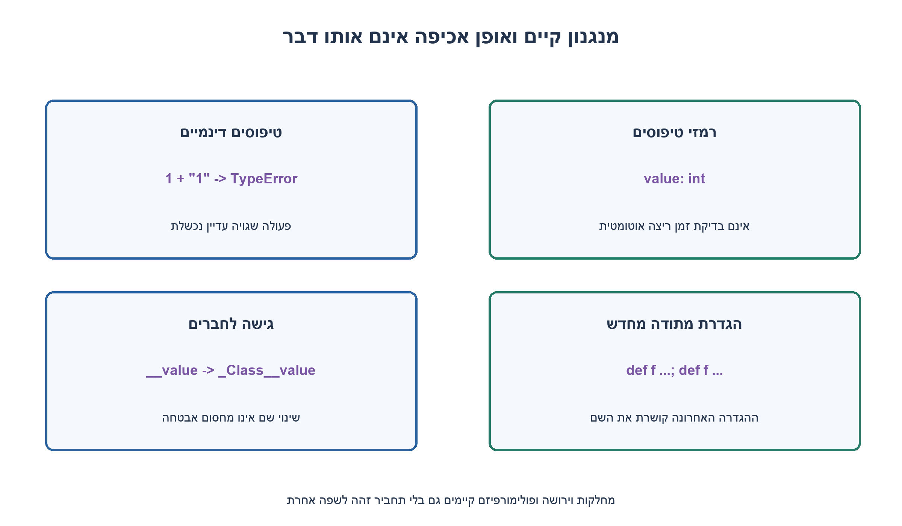
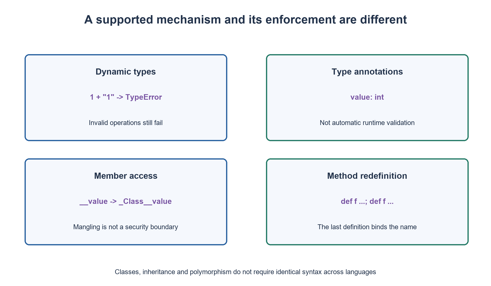

# PREP-242 — תכנות מונחה עצמים ב־Python מול C++, Java ו־C#

פתרון מוצע בסיוע AI; ביקורת מקצועית אנושית ממתינה.

[מקור פרטי](../sources/2026-11-01-batch20-19.png)

למי שמכיר שפות OOP כמו JAVA C# C++ ותוכן PYTHON, צריך להשוות בין OOP ב-PYTHON לשאר השפות: מה לא קיים ומה קיים אבל באופן מוחלש.


## עברית

השוו תכנות מונחה עצמים ב־Python 3.12 למנגנונים המוכרים מ־C++, Java ו־C#. הבחינו בין תכונה חסרה, כלל שמקובל בקונבנציה ותכונה שנאכפת בזמן ריצה או בכלי בדיקה. דונו במחלקות וירושה, פולימורפיזם, גישה לחברים, טיפוסים, overload/override, מחלקות אבסטרקטיות ונתוני מחלקה. הביאו דוגמאות נגד לטענות גורפות כגון ״ל־Python אין OOP״ או ״הטיפוסים שלו חלשים״.

1. חפשו תחילה מנגנונים שקיימים: מחלקה, ירושה, override וקריאה דינמית. היעדר מילת מפתח אינו בהכרח היעדר יכולת.
2. נגישות עם קו תחתון היא קונבנציה; __name מבצע name mangling. רמזי טיפוסים אינם נאכפים אוטומטית בזמן ריצה.
3. השוו overload לפי חתימות להגדרה חוזרת שדורסת שם, ואל תבלבלו זאת עם העמסת אופרטורים. הדגימו ABC וחבר מחלקה שמשתנה מוצל באובייקט.

### אין צורך להכריז על שפה כ״פחות מונחית עצמים״
ב־Python יש מחלקות, מופעים, ירושה, override ופולימורפיזם. אובייקט עם המתודה הדרושה יכול להתאים גם בלי לרשת בסיס משותף — duck typing. הגרסה המורצת מדגימה Child שמחליף speak, ו־Duck שמספק speak בלי ירושה. זהו שימוש בממשק התנהגותי, לא הבטחה שכל קריאה לכל אובייקט תצליח.

| נושא | Python 3.12 | השוואה שימושית |
|---|---|---|
| ירושה | תומך בירושה מרובה; MRO קובע חיפוש | C++ תומך בירושה מרובה; למחלקת Java או C# בסיס מחלקה יחיד, לצד ממשקים |
| שיגור | מתודות מופע נפתרות דינמית, בלי virtual | ב־C++ וב־C# מנגנוני virtual/override חשובים; אין להעתיק כלל אחד לכל השפות |
| גישה | _name לא־ציבורי לפי קונבנציה; __name משנה שם | public/private/protected ב־C++/Java/C# נאכפים בכללים של אותן שפות |
| טיפוסים | דינמיים; annotations מסייעים לכלים | אין פירוש הדבר שפעולות שגויות על טיפוסים יתקבלו |
| הפשטה | ABC ו־abstractmethod יכולים למנוע יצירת מופע | אין צורך במילת המפתח C++ pure virtual כדי לבנות חוזה אבסטרקטי |

### דוגמאות שמבדילות בין הסברים דומים
`1 + "1"` מעלה TypeError: אין כאן חיבור אוטומטי של כל שני ערכים. לעומת זאת פונקציה שמסומנת `value: int` יכולה להחזיר מחרוזת אם מימושה אינו בודק אותה; annotation אינו בדיקת זמן ריצה. Dynamic typing ו־weak typing אינם אותו תיאור.

`__value` אינו סוד או מחסום אבטחה: שמו משתנה, ובדוגמה אפשר לגשת אל `_Parent__value`. קו תחתון יחיד מציין API לא־ציבורי. ניתן לכבד כימוס ולהציע properties בלי לומר שיש אותה אכיפת private כמו ב־C++.

שתי הגדרות `def f` באותה מחלקה אינן יוצרות overload לפי חתימת פרמטרים: האחרונה מחליפה את קישור השם. אפשר להשתמש בברירות מחדל, args או dispatch מפורש לפי החוזה. `typing.overload` מציג חתימות לכלי טיפוסים ודורש מימוש זמן ריצה; הוא אינו בורר אוטומטי של גופי מתודות. העמסת אופרטורים באמצעות מתודות מיוחדות היא תכונה אחרת, שכן קיימת ב־Python.

נתון מחלקה יכול להיות משותף. רשימה משתנה שמוגדרת בגוף המחלקה אינה הופכת אוטומטית לרשימה פרטית בכל מופע. השמה `obj.shared=...` יכולה ליצור נתון מופע שמצל את שם המחלקה, ואינה מחליפה את הנתון של כל שאר המופעים. ב־ABC אפשר לספק גוף למתודה אבסטרקטית ועדיין לחייב override כדי ליצור מופע רגיל; רק ירושה מ־ABC בלי מתודות אבסטרקטיות אינה אוסרת יצירת מופע.

ההשוואה אינה דירוג ביצועים או מיפוי אחד־לאחד בין כל גרסאות השפות. דוגמאות Python הורצו; C++, Java ו־C# כאן נבדקו מול תיעוד ולא הורצו. יש לבדוק חוזה וגרסה בכל השוואה.

```python
"""Small Python 3.12 demonstrations; no claim to execute other languages."""
from abc import ABC, abstractmethod
from typing import ClassVar


def examples():
    class Speaker:
        def speak(self):
            return 'base'

    class Child(Speaker):
        def speak(self):
            return 'child'

    class Duck:
        def speak(self):
            return 'duck'

    def hear(value):
        return value.speak()

    class Parent:
        shared: ClassVar[list[str]] = []

        def __init__(self):
            self.local = []
            self.__value = 7

    left, right = Parent(), Parent()
    left.shared.append('shared')
    left.local.append('local')
    shared_before_shadow = list(right.shared)
    left.shared = ['shadow']

    def annotated(value: int) -> int:
        return value

    class Overwritten:
        def f(self, value):
            return value

        def f(self, first, second):  # noqa: F811 - intentional language example
            return first + second

    class Required(ABC):
        @abstractmethod
        def run(self):
            return 'base implementation'

    class Complete(Required):
        def run(self):
            return super().run() + ' then concrete'

    def error_name(operation):
        try:
            operation()
        except (TypeError, AttributeError) as error:
            return type(error).__name__
        return None

    class Root:
        pass

    class First(Root):
        pass

    class Second(Root):
        pass

    class Diamond(First, Second):
        pass

    return {
        'override': hear(Child()), 'duck_without_inheritance': hear(Duck()),
        'class_attribute_shared': shared_before_shadow,
        'instance_attribute_separate': list(right.local),
        'shadow_does_not_replace_class_attribute': list(Parent.shared),
        'mangled_name_accessible': left._Parent__value,
        'annotation_not_enforced': annotated('text'),
        'incompatible_addition': error_name(lambda: 1 + '1'),
        'last_definition_replaces_first': error_name(lambda: Overwritten().f(1)),
        'last_definition_works': Overwritten().f(1, 2),
        'abstract_instantiation': error_name(Required),
        'concrete_calls_abstract_body': Complete().run(),
        'mro': [item.__name__ for item in Diamond.__mro__],
    }


if __name__ == '__main__':
    import json
    print(json.dumps(examples(), indent=2))
```


[מחלקות Python 3.12](https://docs.python.org/3.12/tutorial/classes.html)
[מחלקות בסיס אבסטרקטיות](https://docs.python.org/3.12/library/abc.html)
[רמזי טיפוסים ו־overload](https://docs.python.org/3.12/library/typing.html)
[ירושה ב־Java, מדריך JDK 8](https://docs.oracle.com/javase/tutorial/java/IandI/subclasses.html)
[virtual ב־C#](https://learn.microsoft.com/en-us/dotnet/csharp/language-reference/keywords/virtual)



## English

Compare Python 3.12 OOP with familiar C++, Java and C# mechanisms. Distinguish missing syntax, conventions, runtime enforcement and external checking tools. Discuss classes/inheritance, polymorphism, access, typing, overload/override, abstract classes and class data. Give counterexamples to blanket claims such as “Python has no OOP” or “its types are weak.”

1. Start with mechanisms that do exist: classes, inheritance, overriding and dynamic calls. A missing keyword does not necessarily mean a missing capability.
2. An underscore is a convention; __name uses name mangling. Type annotations are not automatically enforced at runtime.
3. Compare signature overloading with a repeated definition replacing a name, separately from operator overloading. Show an ABC and instance shadowing of a class attribute.

### Avoid ranking languages by how “object oriented” they seem
Python has classes, instances, inheritance, overriding and polymorphism. An object providing the required method may work without inheriting a shared base: duck typing. The executed example shows Child overriding speak and Duck providing speak without inheritance. This is a behavioral interface, not a promise that every call on every object succeeds.

| Topic | Python 3.12 | Useful comparison |
|---|---|---|
| Inheritance | Multiple bases supported; lookup follows MRO | C++ supports multiple inheritance; Java/C# classes have one class base, alongside interfaces |
| Dispatch | Instance methods resolve dynamically without virtual | C++ and C# virtual/override rules matter; do not copy one language's rules into all others |
| Access | _name is nonpublic by convention; __name is mangled | C++/Java/C# enforce their own public/private/protected rules |
| Typing | Dynamic; annotations assist tools | This does not mean invalid operations on types are accepted |
| Abstraction | ABC/abstractmethod can prevent instantiation | C++ pure-virtual syntax is not needed to express an abstract contract |

### Counterexamples separate similar-sounding claims
`1 + "1"` raises TypeError: arbitrary values are not automatically added. Conversely, a function annotated `value: int` may return a string if its body does not validate it; annotation is not runtime enforcement. Dynamic typing and weak typing are different descriptions.

`__value` is not a secret or security boundary: its name is transformed, and `_Parent__value` remains accessible in the example. A single underscore denotes a nonpublic API. Encapsulation and properties remain useful without claiming C++-style access enforcement.

Two definitions of `def f` in one class do not form a signature-selected overload set: the later definition replaces the name's binding. Defaults, args or explicit dispatch can implement the intended API. `typing.overload` describes alternatives to type checkers and needs a runtime implementation; it does not select between multiple method bodies automatically. Operator overloading through special methods is a different feature that Python does support.

Class data may be shared. A mutable list in a class body does not automatically become a private list per instance. Assigning `obj.shared=...` may create an instance attribute shadowing the class attribute rather than replacing it for other instances. An ABC abstract method may contain a body while still requiring an override for normal instantiation. Merely inheriting ABC with no abstract methods does not forbid creating instances.

This is not a performance ranking or an exact equivalence across every language version. Python demonstrations were executed; C++, Java and C# comparisons were checked against documentation rather than run. State the version and contract in each comparison.

```python
"""Small Python 3.12 demonstrations; no claim to execute other languages."""
from abc import ABC, abstractmethod
from typing import ClassVar


def examples():
    class Speaker:
        def speak(self):
            return 'base'

    class Child(Speaker):
        def speak(self):
            return 'child'

    class Duck:
        def speak(self):
            return 'duck'

    def hear(value):
        return value.speak()

    class Parent:
        shared: ClassVar[list[str]] = []

        def __init__(self):
            self.local = []
            self.__value = 7

    left, right = Parent(), Parent()
    left.shared.append('shared')
    left.local.append('local')
    shared_before_shadow = list(right.shared)
    left.shared = ['shadow']

    def annotated(value: int) -> int:
        return value

    class Overwritten:
        def f(self, value):
            return value

        def f(self, first, second):  # noqa: F811 - intentional language example
            return first + second

    class Required(ABC):
        @abstractmethod
        def run(self):
            return 'base implementation'

    class Complete(Required):
        def run(self):
            return super().run() + ' then concrete'

    def error_name(operation):
        try:
            operation()
        except (TypeError, AttributeError) as error:
            return type(error).__name__
        return None

    class Root:
        pass

    class First(Root):
        pass

    class Second(Root):
        pass

    class Diamond(First, Second):
        pass

    return {
        'override': hear(Child()), 'duck_without_inheritance': hear(Duck()),
        'class_attribute_shared': shared_before_shadow,
        'instance_attribute_separate': list(right.local),
        'shadow_does_not_replace_class_attribute': list(Parent.shared),
        'mangled_name_accessible': left._Parent__value,
        'annotation_not_enforced': annotated('text'),
        'incompatible_addition': error_name(lambda: 1 + '1'),
        'last_definition_replaces_first': error_name(lambda: Overwritten().f(1)),
        'last_definition_works': Overwritten().f(1, 2),
        'abstract_instantiation': error_name(Required),
        'concrete_calls_abstract_body': Complete().run(),
        'mro': [item.__name__ for item in Diamond.__mro__],
    }


if __name__ == '__main__':
    import json
    print(json.dumps(examples(), indent=2))
```


[Python 3.12 classes](https://docs.python.org/3.12/tutorial/classes.html)
[Abstract base classes](https://docs.python.org/3.12/library/abc.html)
[Typing and overload](https://docs.python.org/3.12/library/typing.html)
[Java inheritance, JDK 8 tutorial](https://docs.oracle.com/javase/tutorial/java/IandI/subclasses.html)
[C# virtual](https://learn.microsoft.com/en-us/dotnet/csharp/language-reference/keywords/virtual)



## Supporting material / חומר משלים

```json
{
  "assumptions": {
    "he": "Python 3.12 רגיל; דוגמאות קונבנציונליות של C++17 ושל מחלקות Java/C#. אין טענה שכל פרטי המודלים זהים.",
    "en": "Ordinary Python 3.12 with conventional C++17 and Java/C# class comparisons; the object models are not asserted identical."
  },
  "optimality": {
    "he": "אין יעד ביצועים או אופטימום. דוגמאות קטנות נועדו לחשוף כלל סמנטי; זמן וזיכרון של תוכנית אמיתית תלויים בתוכנית ובמימוש.",
    "en": "No performance optimum is requested. Small examples expose semantic rules; actual time and memory depend on program and implementation."
  },
  "verification": {
    "he": "הורצו דוגמאות Python ל־override, duck typing, שיתוף והצללת נתון מחלקה, mangling, annotations, החלפת מתודה, MRO ו־ABC. לא בוצעו קומפילציה או benchmark של שפות אחרות.",
    "en": "Python examples executed overriding, duck typing, shared/shadowed class data, mangling, annotations, method replacement, MRO and ABC behavior. Other languages were not compiled or benchmarked."
  },
  "edge_cases": {
    "he": "מתודה חסרה יכולה להיכשל בזמן ריצה; ירושה מרובה עשויה להיות לא עקבית; שיתוף mutable class attribute שונה ממצב לכל מופע.",
    "en": "A missing method can fail at runtime; multiple inheritance may be inconsistent; mutable class data differs from per-instance state."
  },
  "common_mistakes": {
    "he": "לומר שאין private ולכן אין כימוס; לכנות טיפוסים דינמיים חלשים; לבלבל override, overload ו־operator overloading; לצפות מאכיפת annotations אוטומטית.",
    "en": "Equating no enforced private with no encapsulation; calling dynamic types weak; mixing overriding, signature overloading and operator overloading; expecting automatic annotation enforcement."
  },
  "interview_answer": {
    "he": "Python תומך ב־OOP ובשיגור דינמי; חלק מכללי הגישה הם קונבנציה, ויש ABC וכלי טיפוסים. אבחין בין סמנטיקה, אכיפה ודוגמה קונקרטית.",
    "en": "Python supports OOP and dynamic dispatch; some access rules are conventions, with ABCs and typing tools available. I separate semantics, enforcement and concrete examples."
  },
  "source_ambiguities": {
    "he": "הנוסח ״מוחלש״ אינו מדד מוגדר. הדיון מפרש אותו כהבדל באכיפה או בתחביר ומדגים גם מנגנונים שקיימים.",
    "en": "“Weakened” is not a defined metric; the answer treats it as enforcement/syntax differences and also demonstrates supported mechanisms."
  },
  "solution_extensions": {
    "he": "מה קורה כש־self.shared מקבל רשימה חדשה? מדוע annotations אינם בדיקת קלט? במה Protocol שונה מבסיס משותף בזמן ריצה?",
    "en": "What happens when self.shared receives a new list? Why are annotations not input validation? How does a Protocol differ from a shared runtime base?"
  },
  "technical_references": {
    "he": [
      "[מחלקות Python 3.12](https://docs.python.org/3.12/tutorial/classes.html)",
      "[מחלקות בסיס אבסטרקטיות](https://docs.python.org/3.12/library/abc.html)",
      "[רמזי טיפוסים ו־overload](https://docs.python.org/3.12/library/typing.html)",
      "[ירושה ב־Java, מדריך JDK 8](https://docs.oracle.com/javase/tutorial/java/IandI/subclasses.html)",
      "[virtual ב־C#](https://learn.microsoft.com/en-us/dotnet/csharp/language-reference/keywords/virtual)"
    ],
    "en": [
      "[Python 3.12 classes](https://docs.python.org/3.12/tutorial/classes.html)",
      "[Abstract base classes](https://docs.python.org/3.12/library/abc.html)",
      "[Typing and overload](https://docs.python.org/3.12/library/typing.html)",
      "[Java inheritance, JDK 8 tutorial](https://docs.oracle.com/javase/tutorial/java/IandI/subclasses.html)",
      "[C# virtual](https://learn.microsoft.com/en-us/dotnet/csharp/language-reference/keywords/virtual)"
    ]
  }
}
```
