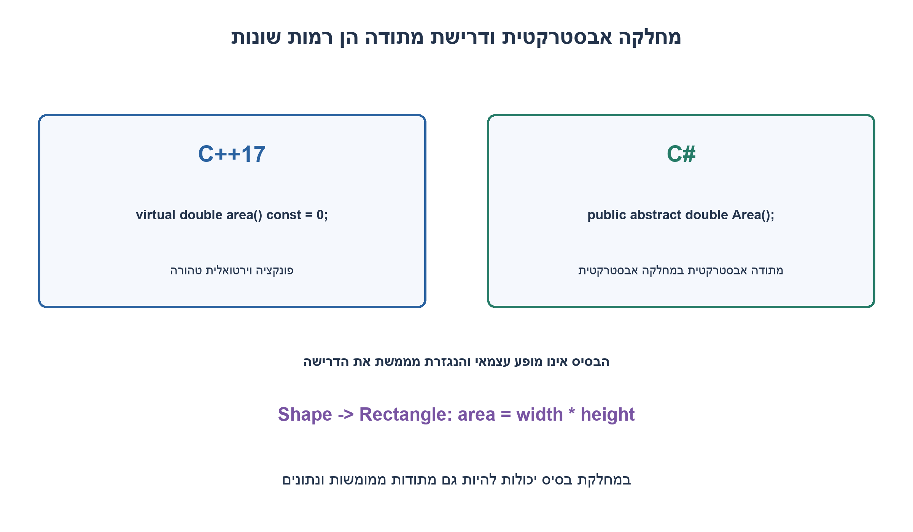
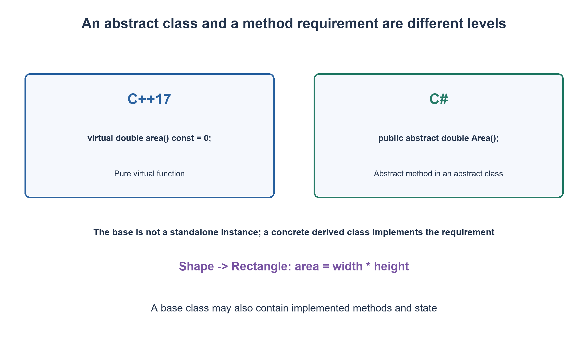

# PREP-243 — מחלקה אבסטרקטית לעומת מתודה וירטואלית טהורה

פתרון מוצע בסיוע AI; ביקורת מקצועית אנושית ממתינה.

[מקור פרטי](../sources/2026-11-01-batch20-20.png)

לכותבי C++ ו-C#: מהי מחלקה אבסטרקטית? מה ההבדל בינה לבין PURE VIRTUAL?


## עברית

מהי מחלקה אבסטרקטית, ומה הקשר בינה לבין pure virtual ב־C++? השוו גם ל־abstract ו־virtual ב־C#. הבדילו בין תכונה של מחלקה לתכונה של מתודה, הראו בסיס ומימוש קונקרטי, והסבירו אילו אובייקטים אפשר ליצור. אין להניח שכל מחלקה אבסטרקטית מכילה רק מתודות ללא מימוש.

1. ״אבסטרקטית״ מתאר האם אפשר ליצור מופע של המחלקה. pure virtual מתאר הצהרת פונקציה מסוימת ב־C++.
2. ב־C++ התחביר הוא virtual ... = 0; ירושה בלי מימוש הדרישות עדיין יכולה להשאיר מחלקה אבסטרקטית.
3. ב־C# מסמנים מחלקה ומתודה ב־abstract; מתודה virtual עם גוף היא מקרה אחר. מחלקת בסיס יכולה גם להחזיק נתונים ומתודות רגילות.

### לא משווים שתי ישויות מאותו סוג
מחלקה אבסטרקטית היא בסיס שאי אפשר ליצור ממנו אובייקט עצמאי. פונקציה pure virtual היא דרך ב־C++ להגדיר דרישה במסגרת המחלקה. המחלקה אבסטרקטית כאשר נשארת בה פונקציה וירטואלית שהמימוש הסופי שלה עדיין pure virtual; גם דרישה שעוברת בירושה נחשבת. לכן מחלקה נגזרת אינה נעשית קונקרטית רק משום שכתבו את שמה אחרי נקודתיים.

ב־C++17 נכתוב `virtual double area() const = 0;`. הסימון `=0` אינו החזרת אפס ואינו הצבת מצביע null. `Rectangle` שמספק `double area() const override` יכול להיות קונקרטי. התאמת const והחתימה חשובה; `override` גורם לקומפיילר לבדוק שבאמת הוחלפה המתודה המתאימה. למחלקת Shape עדיין יכולות להיות בנאי, שדות ומתודות ממומשות כגון label. מותר להחזיק מצביע או reference לבסיס אבסטרקטי ולהצביע באמצעותו על אובייקט קונקרטי.

פונקציה virtual רגילה יכולה לספק התנהגות בסיסית וגם לאפשר החלפה; עצם היותה virtual אינו הופך את המחלקה לאבסטרקטית. פונקציה pure virtual יכולה, במקרים המותרים, לקבל הגדרה מחוץ למחלקה; היא עדיין מחייבת את הכללים של מחלקה אבסטרקטית. לדסטרקטור pure virtual נדרשת הגדרה כשמשתמשים בו בהריסת נגזרת. בדוגמה המצורפת נבחר דסטרקטור וירטואלי רגיל כדי לשמור על הדוגמה פשוטה. אין לקרוא קריאה וירטואלית ל־pure virtual של הבסיס במהלך הבנייה או ההריסה ולצפות למימוש נגזרת.

### ב־C# משתמשים בתחביר של C#
`abstract class Shape { public abstract double Area(); }` אינה ניתנת ליצירת מופע. במחלקה קונקרטית נגזרת כותבים `public override double Area() => ...;`. מתודת abstract במחלקה אינה מכילה גוף ומחייבת מימוש לפני שהנגזרת תהיה קונקרטית. מתודת virtual רגילה כן מכילה מימוש שניתן להחליף. אין לכתוב C++ `=0` או מילות pure virtual כאילו הן תחביר C#. מחלקת C# יכולה להיות מוכרזת abstract גם בלי מתודות abstract. כללים של static abstract בממשקים הם נושא נפרד, ולא שינוי של דוגמה זו.

דוגמת Python הנוספת אינה הוכחה לתחביר C++ או C#: היא מדגימה את ההבחנה בין חוזה לא־שלם לבין מימוש קונקרטי. Shape ו־StillAbstract נכשלים ביצירת מופע; Rectangle עובד ויורש התנהגות רגילה. Ordinary שיורשת ABC אך אינה מגדירה מתודה אבסטרקטית יכולה להיווצר. אין כאן טענת ביצועים או יתרון של שפה אחת.

```cpp
// C++17 illustrative source; Python checks do not compile this listing.
struct Shape {
    virtual double area() const = 0;
    virtual ~Shape() = default;
    int sides() const { return 0; }
};
struct Rectangle : Shape {
    double width, height;
    Rectangle(double w, double h) : width(w), height(h) {}
    double area() const override { return width * height; }
};
```


```python
"""Python analogue of an abstract/concrete distinction, not a C++/C# runner."""
from abc import ABC, abstractmethod


class Shape(ABC):
    def label(self):
        return 'shape'

    @abstractmethod
    def area(self):
        raise NotImplementedError


class StillAbstract(Shape):
    pass


class Rectangle(Shape):
    def __init__(self, width, height):
        if width < 0 or height < 0:
            raise ValueError('Nonnegative dimensions required')
        self.width, self.height = width, height

    def area(self):
        return self.width * self.height


class Ordinary(ABC):
    """In Python, inheriting ABC alone does not make a class uninstantiable."""

    def area(self):
        return 0
```


[מחלקות אבסטרקטיות ב־C++](https://eel.is/c++draft/class.abstract)
[abstract ב־C#](https://learn.microsoft.com/en-us/dotnet/csharp/language-reference/keywords/abstract)
[virtual ב־C#](https://learn.microsoft.com/en-us/dotnet/csharp/language-reference/keywords/virtual)
[דוגמת ABC בשפת Python](https://docs.python.org/3.12/library/abc.html)



## English

What is an abstract class, and how does it relate to a C++ pure virtual function? Compare C# abstract and virtual. Distinguish a class property from a method property, show a base and a concrete implementation, and explain which objects can be instantiated. Do not assume abstract classes contain only unimplemented methods.

1. Abstract describes whether the class can be instantiated; pure virtual describes a particular C++ function declaration.
2. C++ uses virtual ... = 0; inheriting without implementing the requirements may leave a derived class abstract.
3. C# marks classes/methods abstract; a virtual method with a body is different. A base can also contain state and ordinary methods.

### These are not two things at the same level
An abstract class is a base from which no standalone object can be instantiated. A pure virtual function is a C++ way to declare a requirement within a class. A class is abstract while a virtual function's final overrider remains pure virtual, including inherited requirements. Merely naming a base after a colon does not make a derived class concrete.

In C++17 write `virtual double area() const = 0;`. The `=0` is neither returning zero nor assigning a null pointer. Rectangle providing `double area() const override` can be concrete. Matching const and the signature matters; override asks the compiler to check that the intended function is actually overridden. Shape may still have constructors, fields and implemented methods such as label. A pointer or reference to an abstract base may refer to a concrete derived object.

An ordinary virtual function can provide default behavior and allow overriding; virtual alone does not make a class abstract. A pure virtual function may have a separately defined body where permitted; that does not remove abstract-class rules. A pure virtual destructor needs a definition when used to destroy a derived object. The attached example instead uses an ordinary virtual destructor to stay simple. A virtual call to the base's pure virtual function during construction/destruction must not be treated as a call to a completed derived object.

### Use C# syntax for C#
`abstract class Shape { public abstract double Area(); }` cannot be instantiated. A concrete derived class writes `public override double Area() => ...;`. An abstract method in a class has no body and must be implemented before the derived class is concrete. An ordinary virtual method has a body that can be replaced. C++ `=0` and “pure virtual” are not C# declaration syntax. A C# class may be declared abstract even without abstract methods. Static abstract interface members are a separate topic, not a change to this example.

The additional Python example does not prove C++ or C# syntax; it illustrates incomplete contracts versus concrete implementations. Shape and StillAbstract reject instantiation; Rectangle works and inherits ordinary behavior. Ordinary inherits ABC but has no abstract method, so it can be instantiated. No performance or language-superiority claim follows.

```cpp
// C++17 illustrative source; Python checks do not compile this listing.
struct Shape {
    virtual double area() const = 0;
    virtual ~Shape() = default;
    int sides() const { return 0; }
};
struct Rectangle : Shape {
    double width, height;
    Rectangle(double w, double h) : width(w), height(h) {}
    double area() const override { return width * height; }
};
```


```python
"""Python analogue of an abstract/concrete distinction, not a C++/C# runner."""
from abc import ABC, abstractmethod


class Shape(ABC):
    def label(self):
        return 'shape'

    @abstractmethod
    def area(self):
        raise NotImplementedError


class StillAbstract(Shape):
    pass


class Rectangle(Shape):
    def __init__(self, width, height):
        if width < 0 or height < 0:
            raise ValueError('Nonnegative dimensions required')
        self.width, self.height = width, height

    def area(self):
        return self.width * self.height


class Ordinary(ABC):
    """In Python, inheriting ABC alone does not make a class uninstantiable."""

    def area(self):
        return 0
```


[C++ abstract classes](https://eel.is/c++draft/class.abstract)
[C# abstract](https://learn.microsoft.com/en-us/dotnet/csharp/language-reference/keywords/abstract)
[C# virtual](https://learn.microsoft.com/en-us/dotnet/csharp/language-reference/keywords/virtual)
[Python ABC analogue](https://docs.python.org/3.12/library/abc.html)



## Supporting material / חומר משלים

```json
{
  "assumptions": {
    "he": "השוואת C++17 ו־C# עם מתודות מופע; הדגמת Python 3.12 נפרדת ואינה קומפילציה של השפות האחרות.",
    "en": "C++17/C# instance-method comparison; the separate Python 3.12 analogue does not compile those other languages."
  },
  "optimality": {
    "he": "הסבר סמנטי, לא בעיית מינימום או benchmark. ההפשטה מתארת חוזה ומצב מחלקה, לא את מחיר השיגור במימוש מסוים.",
    "en": "Semantic explanation, not minimization or a benchmark. Abstraction describes a contract/class status, not an implementation-specific dispatch cost."
  },
  "verification": {
    "he": "תיעוד C++/C# נבדק; דוגמת ABC הורצה מול מחלקות שלא מממשות ומחלקה שמממשת area. קוד C++ לא קומפל ו־C# לא הורץ.",
    "en": "C++/C# documentation was reviewed; the ABC analogue executed missing-implementation and concrete-area cases. C++ was not compiled and C# was not run."
  },
  "edge_cases": {
    "he": "מחלקה נגזרת שנותרה אבסטרקטית; מתודה רגילה עם גוף; בסיס עם שדות; חתימת override שונה; C# abstract ללא מתודה אבסטרקטית.",
    "en": "A still-abstract derived class; a method with a body; base state; mismatched override signature; a C# abstract class with no abstract methods."
  },
  "common_mistakes": {
    "he": "להשוות מחלקה למתודה כאילו הן חלופות; לפרש =0 כהחזרת אפס; להניח שכל virtual הוא pure; להשתמש בתחביר C++ בתוך C#.",
    "en": "Treating class and method as alternatives; interpreting =0 as returning zero; assuming every virtual is pure; using C++ syntax in C#."
  },
  "interview_answer": {
    "he": "מחלקה אבסטרקטית אינה ניתנת למופע עצמאי; pure virtual היא דרישת מתודה ב־C++. נגזרת קונקרטית מממשת את הדרישות; ב־C# משתמשים ב־abstract וב־override.",
    "en": "An abstract class cannot be instantiated alone; pure virtual is a C++ method requirement. A concrete derived class implements the requirements; C# uses abstract and override."
  },
  "source_ambiguities": {
    "he": "המקור מערבב מונח של מחלקה ומונח של פונקציה. ההסבר שומר על שתי השפות אך אינו מציג pure virtual כמילת מפתח של C#.",
    "en": "The source compares a class-level term with a function-level term. Both languages are covered without presenting pure virtual as a C# keyword."
  },
  "solution_extensions": {
    "he": "האם מתודה pure virtual יכולה לקבל גוף? האם נגזרת ללא override ניתנת למופע? מדוע דסטרקטור וירטואלי רגיל נבחר בדוגמה?",
    "en": "Can a pure virtual function have a body? Can a derived class without the override be instantiated? Why does this example use an ordinary virtual destructor?"
  },
  "technical_references": {
    "he": [
      "[מחלקות אבסטרקטיות ב־C++](https://eel.is/c++draft/class.abstract)",
      "[abstract ב־C#](https://learn.microsoft.com/en-us/dotnet/csharp/language-reference/keywords/abstract)",
      "[virtual ב־C#](https://learn.microsoft.com/en-us/dotnet/csharp/language-reference/keywords/virtual)",
      "[דוגמת ABC בשפת Python](https://docs.python.org/3.12/library/abc.html)"
    ],
    "en": [
      "[C++ abstract classes](https://eel.is/c++draft/class.abstract)",
      "[C# abstract](https://learn.microsoft.com/en-us/dotnet/csharp/language-reference/keywords/abstract)",
      "[C# virtual](https://learn.microsoft.com/en-us/dotnet/csharp/language-reference/keywords/virtual)",
      "[Python ABC analogue](https://docs.python.org/3.12/library/abc.html)"
    ]
  }
}
```
