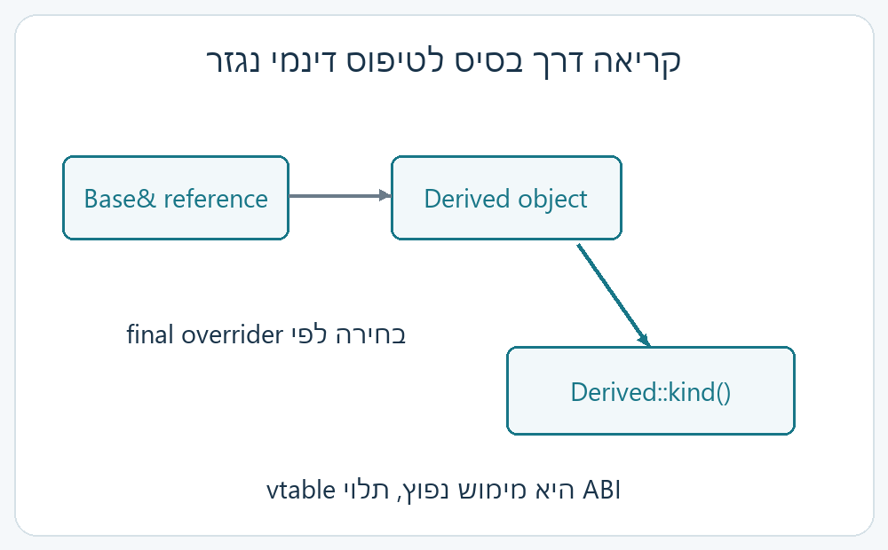
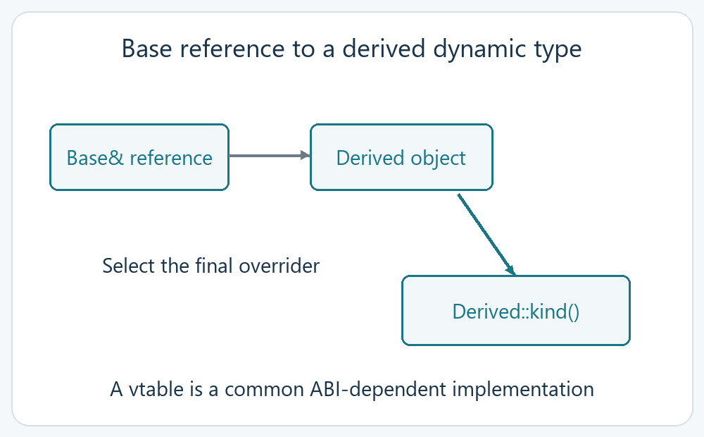

# PREP-243 · הרחבת קריאות וירטואליות

[C++ implementation](../solutions/prep_243_virtual_dispatch.cpp)

[Native verification](../checks/nov15-software-native-verification.json)

[מקורות פרטיים](../sources/2026-11-15-batch20-17.png)

## איך קריאה וירטואלית מגיעה למימוש הנכון?

הסבירו כיצד קריאה דרך מצביע או reference לבסיס ב־C++17 בוחרת override בהתאם לטיפוס הדינמי. הבחינו בין החוזה של השפה למנגנון טיפוסי של vtable. התייחסו גם לקריאה מפורשת עם שם הבסיס ולקריאות בזמן בנייה והריסה.

בקריאה וירטואלית רגילה דרך בסיס, המימוש שנבחר הוא ה־final overrider של הטיפוס הדינמי. בדוגמה Base& מצביע ל־Derived ולכן reference.kind() מחזירה derived. החתימה וה־const צריכים להתאים, ו־override מאפשר למהדר לבדוק זאת. vtable היא דרך מימוש נפוצה שבה האובייקט מכיל מצביע לטבלת פונקציות; התקן אינו מחייב טבלה, מבנה זיכרון מסוים או אפילו קריאה עקיפה בכל ביצוע. המהדר עשוי לבצע devirtualization כאשר הוא מוכיח את הטיפוס.

קריאה עם qualification מפורש, למשל reference.Base::kind(), בוחרת את מימוש הבסיס. בזמן בנאי או דסטרקטור dispatch מוגבל למחלקה שבנייתה או הריסתה מתבצעת, ואינו קופץ למימוש של חלק נגזר שטרם נבנה או כבר נהרס. קריאה וירטואלית ל־pure virtual בנסיבות האלה עלולה להיות לא מוגדרת, ולכן אין להשתמש בה כדי לבקש מימוש נגזר.

פונקציה virtual רגילה יכולה להיות בעלת גוף ברירת מחדל. =0 מגדירה pure virtual ומשפיעה על האפשרות ליצור מופע; היא אינה מתארת ערך מספרי שמוחזר. יש להגדיר דסטרקטור pure virtual כאשר הוא משמש בהריסת אובייקט. הפתרון הקיים מפרט גם את ההבדלים מול C#.

## How does virtual dispatch select the right implementation?

Explain how a C++17 call through a base pointer/reference selects an override using dynamic type. Distinguish the language contract from a typical vtable mechanism. Discuss explicitly qualified base calls and calls during construction/destruction.

An ordinary virtual call through a base selects the final overrider for the object's dynamic type. In the example Base& refers to Derived, so reference.kind() returns derived. Matching signature and const qualification matter; override asks the compiler to check them. A vtable is a common implementation using an object pointer to a table of function pointers. The standard requires neither that layout nor an indirect call on every execution. The compiler may devirtualize when it proves the dynamic type.

Explicit qualification, such as reference.Base::kind(), selects the base implementation. During construction or destruction, virtual dispatch is limited to the class whose constructor/destructor is executing. It does not call into an unconstructed or already destroyed derived portion. A virtual call to a pure virtual function in these circumstances can be undefined, so it cannot be used to request a derived implementation.

An ordinary virtual function can provide a default body. =0 declares a pure virtual function and affects whether an object can be instantiated; it does not specify a numeric return value. A pure virtual destructor needs a definition when used to destroy an object. The existing solution also explains C# distinctions.

