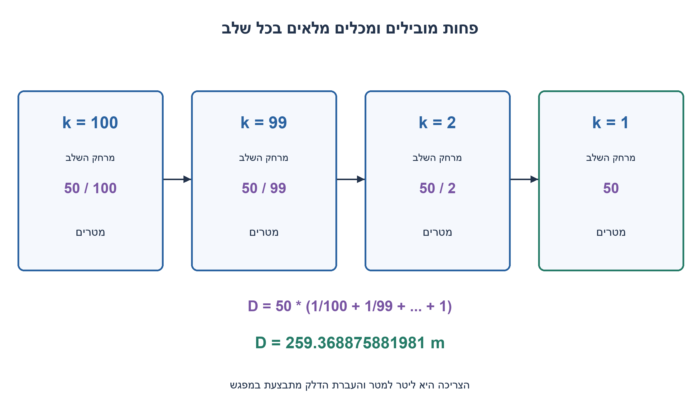
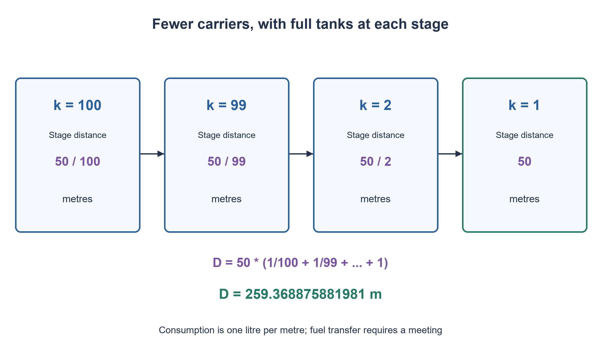

# PREP-244 — מאה אופנועים ודלק שמועבר ביניהם

פתרון מוצע בסיוע AI; ביקורת מקצועית אנושית ממתינה.

[מקור פרטי](../sources/2026-11-01-batch20-14.png)

יש 100 אופנועים, לכל אופנוע יש מיכל דלק של 50 ליטר. ניתן להעביר דלק בין האופנועים הנמצאים באותו מקום. נגיד שאופנוע עושה ליטר למטר. תאר את המרחק המקסימלי שניתן להגיע.


## עברית

יש 100 אופנועים בעלי מכלים בקיבולת 50 ליטר כל אחד. ניתן להעביר דלק בין אופנועים באותו מקום. כל אופנוע צורך ליטר אחד לכל מטר נסיעה. מהו המרחק המרבי שאופנוע אחד יכול להגיע אליו?

לצורך מודל מוגדר: כולם מתחילים באותה נקודה עם מכלים מלאים, נעים לאורך אותו מסלול, וניתן לעצור ולנטוש אופנועים. אין דלק חיצוני, מכלי נשיאה נוספים או מחסני דלק נפרדים. העברה ללא אובדן ונסיעה חלקית מותרות; אין דרישת חזרה לבסיס, אך מותר לבדוק גם תוכניות עם נסיעות חזרה. הוכיחו חסם וגם בנייה שמשיגה אותו. שימו לב שהצריכה היא ליטר למטר, לא ליטר לקילומטר.

1. אם k אופנועים נוסעים יחד למרחק d, הם צורכים יחד k·d ליטרים. כמה דלק צריך להיעלם כדי להשאיר k−1 מכלים מלאים?
2. בחרו d=50/k. אחרי הנסיעה, הדלק באופנוע שמוותרים עליו מספיק בדיוק למלא את החסר במכלים של הנותרים.
3. סכמו 50/100+50/99+...+50. לחסם עליון חשבו כמה אופנועים לפחות צריכים לחצות נקודה כדי לשאת את הדלק שייצרך בהמשך.

### משאירים פחות אופנועים, אבל ממלאים את הנותרים
בהתחלה יש 5,000 ליטר, אך אי אפשר לשים אותם במכל יחיד של 50 ליטר. גם האופנועים שמובילים דלק צורכים דלק. לכן חלוקת כל הדלק בצריכה של אופנוע אחד אינה פותרת את בעיית ההובלה.

כאשר k אופנועים מלאים נמצאים יחד, נסיעתם למרחק 50/k מטר צורכת בסך הכול 50 ליטר. בכל מכל נשארים 50−50/k ליטר. מעבירים את הדלק של אופנוע אחד ל־k−1 האחרים: לכל אחד חסרים 50/k ליטר, והחסר הכולל הוא `(k−1)·50/k=50−50/k`, בדיוק דלק התורם. התורם נעצר ריק, והנותרים מלאים. השלב תקף גם ל־k=2; בשלב האחרון k=1 נוסעים 50 מטר עד ריקון המכל.

לכן המרחק הוא

`D = 50·(1/100 + 1/99 + ... + 1) = 50·H₁₀₀ ≈ 259.368875881981 מטר`.

השלב הראשון הוא חצי מטר, השני 50/99 מטר, והאחרון 50 מטר. מותר להעביר דלק רק כשנמצאים יחד, והבנייה אכן שומרת את כל הפעילים יחד בכל העברה. לכל אורך הדרך אין חריגה מקיבולת מכל או יצירת דלק.

### מדוע גם תכנון אחר לא יעבור את החסם במודל הזה?
עוצרים את התוכנית כשאופנוע מגיע לראשונה לנקודת היעד. לכל נקודה x בין ההתחלה ליעד נגדיר F(x) להיות הדלק שחצה אותה נטו ימינה: הדלק שנצרך מימין לה ועוד הדלק שנותר שם בסיום. נגדיר P(x) כמספר החציות קדימה ו־T(x) כמספר החציות הכולל בשני הכיוונים. כל חציה קדימה נושאת לכל היותר 50 ליטר, וחציה אחורה יכולה רק להפחית את ההעברה נטו. לכן `F(x) ≤ 50·P(x) ≤ 50·T(x)`, ומכאן `T(x) ≥ ceil(F(x)/50)`.

כל חציה צורכת ליטר לכל מטר. לכן F יורדת בקצב של לפחות T ליטר למטר; דלק שנשאר חונה יוצר רק ירידות נוספות כשעוברים את נקודת החניה. באופן מקומי `−dF/dx ≥ T(x)`, עם אותן ירידות נקודתיות. כך נסיעות חזרה אינן עוקפות את החסם: גם אותן סופרים כצריכה.

לכן מרחק שניתן להרוויח מצריכת dF ליטרים אינו עולה על `dF/ceil(F/50)`. כמות הדלק ההתחלתית אינה עולה על 5,000, ולכן

`D ≤ ∫₀⁵⁰⁰⁰ dF/ceil(F/50) = Σ(k=1..100) 50/k`.

האינטגרל הוא פשוט סכום של מאה קטעים: בטווח שבו ההעברה נטו ימינה היא יותר מ־50(k−1) ועד 50k ליטר, דרושות לפחות k חציות. הבנייה משיגה שוויון בכל שלב, ולכן זו הוכחת מקסימום ולא רק אסטרטגיה טובה שנמצאה בניסוי. החסם כולל גם תוכניות עם נסיעות חזרה במודל המכלים; הוספת דרישת חזרה, שינוי קיבולות או דלק חיצוני דורשים ניתוח חדש.

במקרה כללי של n אופנועים, קיבולת C ליטר וצריכה r ליטר למטר, התוצאה היא `(C/r)·H_n`. יצירת התוכנית דורשת n שלבים ו־O(n) מקום לשמירת עקבה; חישוב הסכום בלבד מחזיק מספר קבוע של ערכים גדולים. גודל המונים והמכנים גדל בחשבון שברים, ולכן אין כאן טענת O(1) ביטים או מחיר קבוע לכל פעולה. הקוד משתמש בשברים מדויקים; הוא אינו סימולציה פיזית של מכל, מנוע או קצב העברה.

```python
"""Exact tank-only, one-way convoy construction; not a physical fuel simulation."""
from fractions import Fraction


def plan(count=100, capacity=50, litres_per_metre=1):
    if type(count) is not int or count < 0:
        raise ValueError('count must be a nonnegative integer')
    capacity, rate = Fraction(capacity), Fraction(litres_per_metre)
    if capacity <= 0 or rate <= 0:
        raise ValueError('Positive capacity and consumption required')
    position = Fraction(0)
    stages = []
    for active in range(count, 0, -1):
        distance = capacity / (active * rate)
        fuel_each = capacity - rate * distance
        position += distance
        stages.append({'active': active, 'distance': distance, 'position': position,
                       'fuel_before': active * capacity,
                       'fuel_after_driving': active * fuel_each,
                       'donor_fuel': fuel_each if active > 1 else Fraction(0),
                       'fuel_after_transfer': (active - 1) * capacity})
    return position, stages


def max_distance(count=100, capacity=50, litres_per_metre=1):
    """O(n) rational terms, O(1) auxiliary values excluding big-integer storage."""
    if type(count) is not int or count < 0:
        raise ValueError('count must be a nonnegative integer')
    capacity, rate = Fraction(capacity), Fraction(litres_per_metre)
    if capacity <= 0 or rate <= 0:
        raise ValueError('Positive capacity and consumption required')
    distance = Fraction(0)
    for active in range(1, count + 1):
        distance += capacity / (rate * active)
    return distance
```


הפתרון מבוסס על שימור דלק וחסם קיבולת שנגזרו כאן; אין טענה להוכחה באמצעות מדידה פיזית.



## English

There are 100 motorcycles, each with a 50-litre tank. Fuel can be transferred between motorcycles at the same location. Every motorcycle consumes one litre per metre travelled. What is the greatest distance one motorcycle can reach?

Use an explicit model: all start together with full tanks on the same route; motorcycles may stop and be abandoned. No outside fuel, extra carrying tanks or separate fuel depots are available. Transfers are lossless and fractional distances allowed; return trips are not required but may be considered. Prove an upper bound and a matching construction. Consumption is one litre per metre, not per kilometre.

1. If k motorcycles travel distance d together, they burn k·d litres. How much must be consumed before k−1 full tanks can hold everything left?
2. Choose d=50/k. The abandoned motorcycle then has exactly enough fuel to fill the deficits in all remaining tanks.
3. Sum 50/100+50/99+...+50. For an upper bound, count how many motorcycles must cross a position to carry the fuel consumed beyond it.

### Fewer motorcycles, with the remaining tanks refilled
Initially there are 5,000 litres, but they do not fit in one 50-litre tank. Fuel carriers also burn fuel, so dividing all fuel by one motorcycle's consumption ignores transportation.

When k full motorcycles are together, driving 50/k metres burns 50 litres in total. Each tank then contains 50−50/k litres. Transfer one motorcycle's fuel to the other k−1: each needs 50/k, so their total deficit `(k−1)·50/k=50−50/k` exactly equals the donor's fuel. Stop the empty donor; all remaining tanks are full. This works down to k=2; the final k=1 stage drives 50 metres on the last tank.

Thus

`D = 50·(1/100 + 1/99 + ... + 1) = 50·H₁₀₀ ≈ 259.368875881981 metres`.

The first stage is half a metre, the second 50/99 metres and the last 50 metres. Transfers occur only at meetings, because the construction keeps all active motorcycles together. No tank exceeds its capacity and no fuel is created.

### Why another plan cannot beat this bound in the stated model
Stop the plan when a motorcycle first reaches the target. At position x between the start and target, let F(x) be net fuel crossing rightward: fuel consumed to its right plus fuel left there at the end. Let P(x) count forward crossings and T(x) all crossings in both directions. Each forward crossing carries at most 50 litres, while backward-carried fuel only reduces net transfer. Hence `F(x) ≤ 50·P(x) ≤ 50·T(x)` and `T(x) ≥ ceil(F(x)/50)`.

Every crossing burns one litre per metre. Thus F decreases at a rate of at least T litres per metre; residual parked fuel adds downward jumps when its position is passed. Locally `−dF/dx ≥ T(x)`, with those additional jumps. Return trips therefore do not evade the bound: their consumption is counted too.

The distance gained by consuming dF litres is therefore at most `dF/ceil(F/50)`. At most 5,000 litres are initially available, giving

`D ≤ ∫₀⁵⁰⁰⁰ dF/ceil(F/50) = Σ(k=1..100) 50/k`.

The integral is just a sum of one hundred bands: net rightward transfer above 50(k−1) and at most 50k litres requires at least k crossings. The construction attains equality at each stage, proving the maximum rather than merely finding a good experimental strategy. The bound includes plans with return legs in the tank-only model. Adding a return requirement, different capacities or outside fuel requires fresh analysis.

For n motorcycles, capacity C litres and consumption r litres per metre, the result is `(C/r)·H_n`. Producing the plan takes n stages and O(n) stored trace entries; summing alone uses a fixed number of big values. Exact rational numerators/denominators grow, so this is not O(1) bits or constant-cost arithmetic. The code uses exact fractions, not a physical engine, tank or transfer-rate simulation.

```python
"""Exact tank-only, one-way convoy construction; not a physical fuel simulation."""
from fractions import Fraction


def plan(count=100, capacity=50, litres_per_metre=1):
    if type(count) is not int or count < 0:
        raise ValueError('count must be a nonnegative integer')
    capacity, rate = Fraction(capacity), Fraction(litres_per_metre)
    if capacity <= 0 or rate <= 0:
        raise ValueError('Positive capacity and consumption required')
    position = Fraction(0)
    stages = []
    for active in range(count, 0, -1):
        distance = capacity / (active * rate)
        fuel_each = capacity - rate * distance
        position += distance
        stages.append({'active': active, 'distance': distance, 'position': position,
                       'fuel_before': active * capacity,
                       'fuel_after_driving': active * fuel_each,
                       'donor_fuel': fuel_each if active > 1 else Fraction(0),
                       'fuel_after_transfer': (active - 1) * capacity})
    return position, stages


def max_distance(count=100, capacity=50, litres_per_metre=1):
    """O(n) rational terms, O(1) auxiliary values excluding big-integer storage."""
    if type(count) is not int or count < 0:
        raise ValueError('count must be a nonnegative integer')
    capacity, rate = Fraction(capacity), Fraction(litres_per_metre)
    if capacity <= 0 or rate <= 0:
        raise ValueError('Positive capacity and consumption required')
    distance = Fraction(0)
    for active in range(1, count + 1):
        distance += capacity / (rate * active)
    return distance
```


The solution derives a fuel-conservation/capacity bound here; no physical measurement is claimed as a proof.



## Supporting material / חומר משלים

```json
{
  "assumptions": {
    "he": "מאה מכלים מלאים, התחלה משותפת, מסלול משותף, צריכה של ליטר למטר, קיבולת קשיחה והעברה ללא אובדן רק במפגש; אין דרישת חזרה או מכל נוסף. החסם סופר גם נסיעות חזרה.",
    "en": "One hundred full tanks at a common start on a shared route; one litre/metre; hard capacity and lossless colocated transfers; no return requirement or extra tanks. The upper bound counts return legs too."
  },
  "optimality": {
    "he": "חסם חציית נקודה לפי קיבולת משיג בדיוק 50H100 מטר. בנייה עם מאה שלבי נטישה משיגה אותו. מחיר חישוב כללי הוא n פעולות שבר, לא טענת עלות ביטים קבועה.",
    "en": "The capacity cut bound is exactly 50H100 metres, attained by one hundred abandonment stages. General computation uses n rational updates, not constant bit complexity."
  },
  "verification": {
    "he": "נבדקו שימור דלק, קיבולת ושברים מדויקים בכל מאה השלבים. אורקל עצמאי של כל חלוקות שלבי הנטישה נבדק עד n=9; ההוכחה האנליטית נפרדת מהבדיקה הסופית.",
    "en": "Exact fuel conservation/capacity was checked for all hundred stages. An independent oracle enumerated abandonment-stage partitions through n=9; the analytical proof is separate from finite checking."
  },
  "edge_cases": {
    "he": "אופנוע אחד מגיע 50 מטר; אפס אופנועים מגיעים אפס; צריכה או קיבולת לא חיוביות אינן במודל. שינוי יחידות משנה את ערך המרחק ביחידות הנתונות.",
    "en": "One motorcycle reaches 50 metres; zero motorcycles reach zero; nonpositive capacity/consumption is outside the model. Unit changes change the numerical distance in those units."
  },
  "common_mistakes": {
    "he": "לומר 5,000 מטר בלי לספור מובילים; לחלק דלק שווה בשווה פעם אחת; להחליף ליטר למטר בליטר לקילומטר; להציג greedy ללא חסם עליון.",
    "en": "Claiming 5,000 metres without carrier cost; redistributing only once; changing litres/metre to litres/kilometre; giving greedy without an upper bound."
  },
  "interview_answer": {
    "he": "עם k מלאים נוסעים 50/k מטר, ממלאים k−1 מכלים מדלק האופנוע הנטוש, וחוזרים על כך. סכום השלבים הוא 50H100, וחסם קיבולת לחציית כל נקודה מוכיח אופטימליות במודל.",
    "en": "With k full tanks drive 50/k metres, refill k−1 from the abandoned donor and repeat. The sum is 50H100; the capacity cut bound proves optimality in this model."
  },
  "source_ambiguities": {
    "he": "המקור אינו אומר במפורש שכל המכלים מלאים או שכולם מתחילים יחד. תנאים אלו והיעדר דרישת חזרה נבחרו במפורש; אין לייחס למקור יחידות קילומטר.",
    "en": "The source does not explicitly state full tanks or a shared starting point. Those conditions and no return requirement are declared; kilometre units are not attributed to the source."
  },
  "solution_extensions": {
    "he": "כיצד משתנה המרחק לקיבולת C ולצריכה r? מה חסר בהוכחה אם מוסיפים מכלי נשיאה או דורשים מכולם לחזור?",
    "en": "How does the answer scale with capacity C and consumption r? What changes if extra carrying tanks or return of every motorcycle is required?"
  },
  "technical_references": {
    "he": [
      "הפתרון מבוסס על שימור דלק וחסם קיבולת שנגזרו כאן; אין טענה להוכחה באמצעות מדידה פיזית."
    ],
    "en": [
      "The solution derives a fuel-conservation/capacity bound here; no physical measurement is claimed as a proof."
    ]
  }
}
```
