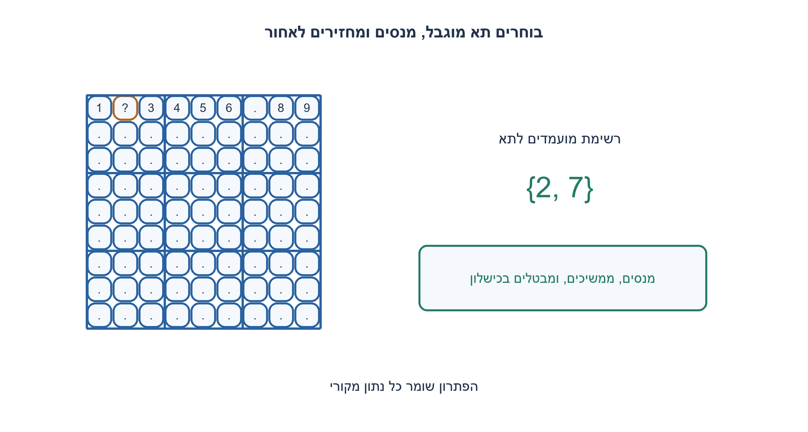
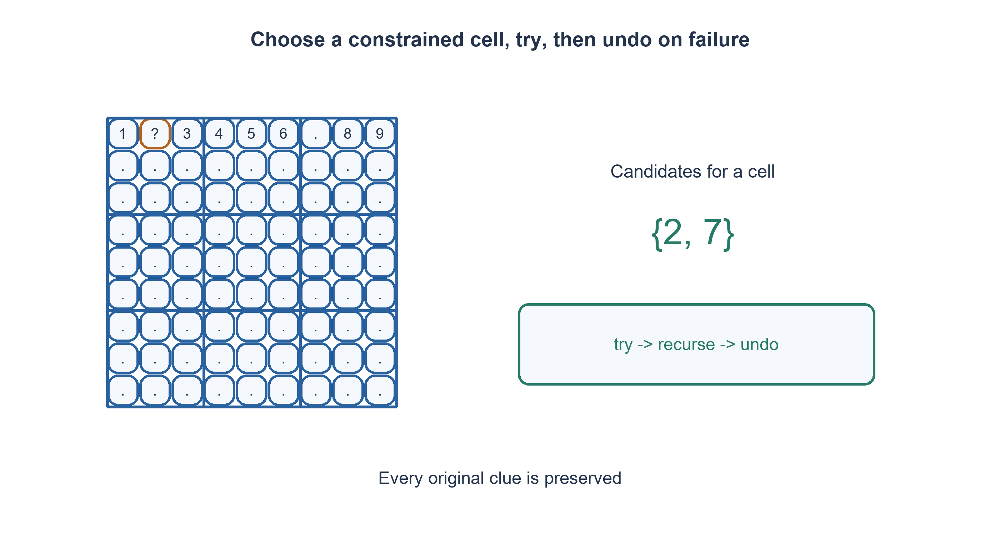

# PREP-245 — פתרון סודוקו: חיפוש עם חזרה לאחור ואימות הנתונים

פתרון מוצע בסיוע AI; ביקורת מקצועית אנושית ממתינה. הקושי אינו מכויל.

## עברית

כתבו פונקציה המקבלת לוח סודוקו ומחזירה לוח פתור אם קיים פתרון, או מציינת שאין פתרון.

 נבחר לוח 9×9 כרשימת תשע רשימות. כל תא הוא מספר שלם 0..9: אפס הוא תא ריק. בכל שורה, עמודה וריבוע 3×3 נדרשים המספרים 1..9 פעם אחת. נתוני המקור חייבים להישמר, וכל פתרון תקין מתקבל גם אם אינו יחיד. הפונקציה אינה משנה את לוח הקלט: היא מחזירה עותק פתור או None עבור נתונים עקביים שאינם ניתנים להשלמה. גודל שגוי, ערך שאינו שלם בטווח או כפילות בנתונים הקיימים גורמים ל־ ValueError. הסבירו איך מבדילים בין קלט פסול לכישלון חיפוש ומה מחזירים בכל מקרה.

1. איזו בדיקה מקומית פוסלת השמה בלי לחכות לסיום הלוח?
2. בחרו תא ריק, נסו רק ספרות שאינן קיימות בשורה, בעמודה ובריבוע שלו. מה חייבים להחזיר לאחור אם הענף נכשל?
3. נהלו מסכות לשורות, לעמודות ולריבועים. בחרו תא בעל מעט מועמדים, סמנו ספרה, חפשו רקורסיבית והסירו את הסימון בכישלון. אפס מועמדים סוגר את הענף.

### בונים פתרון בלי לנחש בלי בקרה
כל תא ריק הוא בחירה, אבל לא כל אחת מתשע הספרות עדיין מותרת בו. נבדוק תחילה את הנתונים הקיימים ונבנה שלוש קבוצות מסכות: בכל מסכה ביט דלוק פירושו שהספרה כבר נמצאת בשורה, בעמודה או בריבוע. מועמדי התא הם הספרות שאינן באיחוד של שלוש המסכות.

בכל קריאה בוחרים מבין התאים שעוד נותרו את בעל מספר המועמדים הקטן ביותר, שיטת MRV. אם אין מועמדים, שום פתרון אינו ממשיך את המצב הזה. אחרת בוחרים ספרה מותרת, מציבים אותה ומעדכנים את שלוש המסכות. אם הקריאה הבאה נכשלת, מאפסים את התא ומסירים את שלושת הסימונים לפני ניסיון הספרה הבאה. כשהרשימה הריקה מוצתה, הלוח מלא ומחזירים אותו. בחירת MRV מקצרת חיפוש במקרים רבים; היא אינה מבטיחה זמן פולינומי.

האינווריאנט: כל נתון מקורי נשאר במקומו, ההשמות החדשות אינן יוצרות כפילות, והמסכות מתארות בדיוק את התאים המאוישים. סימון ספרה חוקית משמר זאת, ופעולת undo משחזרת את המצב הקודם. לכל השלמה אפשרית יש בתא הנבחר ספרה מתוך קבוצת המועמדים, והלולאה מנסה כל אחת מהן; לכן אם כל הענפים נכשלו אין השלמה. עומק החיפוש קטן בכל צעד במספר התאים הריקים, ולכן האלגוריתם עוצר. לוח בעל כמה פתרונות אינו כישלון: די בפתרון התקין הראשון.

למשל, אם בשורה חסרות רק 2 ו־ 7, ובאותה עמודה כבר קיים 7, נשאר רק 2. בדיקת שורה לבדה לא מספיקה. דוגמה עקבית אך בלתי פתירה: בשמונת התאים הראשונים של שורה 0 כתובים 1..8, ובתא(1,8) כתוב 9; כל יתר התאים ריקים. אין כפילות בנתונים, אך לתא(0,8) לא נותרה ספרה.

אם E הוא מספר התאים הריקים, חסם גס לחיפוש הוא O(81·9^E) פעולות מסכה בבניית 9×9 זו: בכל צומת נסרקים לכל היותר 81 תאים. המסכות קבועות ברוחב 9; נדרש מקום ללוח המועתק ולתאים הריקים ולעומק הרקורסיה, O(81+E). עבור הגודל הקבוע אין טענה לאסימפטוטיקה משמעותית לפי אורך קלט משתנה, ובוודאי לא זמן חיפוש קטן לכל לוח. בהכללה לגודל אחר עלות פעולות המסכה ורוחביה משתנות.

הבדיקה העצמאית השתמשה באורקל שסורק שורות/עמודות/ריבועים, בלי מסכות או MRV. נבדקו 203 לוחות, כולל לוח ריק, לוח מלא ולוח עקבי בלתי פתיר, וחמישה קלטים פסולים. תוצאת כל הצלחה נבדקה סמנטית מול כל 27 הקבוצות והנתונים המקוריים; אין דרישה להתאים מילולית לפתרון יחיד.

```python
"""Find any 9x9 completion; duplicate givens are invalid, not unsatisfiable."""
FULL = (1 << 9) - 1


def solve_sudoku(board):
    if (not isinstance(board, list) or len(board) != 9
            or any(not isinstance(row, list) or len(row) != 9 for row in board)):
        raise ValueError('a 9x9 list of rows is required')
    if any(type(v) is not int or not 0 <= v <= 9 for row in board for v in row):
        raise ValueError('cells must be integers 0..9; zero means empty')
    work = [row[:] for row in board]
    rows, cols, boxes = [0] * 9, [0] * 9, [0] * 9
    empty = []
    for r in range(9):
        for c in range(9):
            value, b = work[r][c], (r // 3) * 3 + c // 3
            if not value:
                empty.append((r, c))
                continue
            bit = 1 << (value - 1)
            if (rows[r] | cols[c] | boxes[b]) & bit:
                raise ValueError('duplicate givens in a row, column or box')
            rows[r] |= bit
            cols[c] |= bit
            boxes[b] |= bit

    def visit(k):
        if k == len(empty):
            return True
        best, choices, size = k, 0, 10
        for i in range(k, len(empty)):
            r, c = empty[i]
            mask = FULL & ~(rows[r] | cols[c] | boxes[(r // 3) * 3 + c // 3])
            count = mask.bit_count()
            if count < size:
                best, choices, size = i, mask, count
            if size == 0:
                break
        if size == 0:
            return False
        empty[k], empty[best] = empty[best], empty[k]
        r, c = empty[k]
        b = (r // 3) * 3 + c // 3
        while choices:
            bit = choices & -choices
            choices ^= bit
            work[r][c] = bit.bit_length()
            rows[r] |= bit
            cols[c] |= bit
            boxes[b] |= bit
            if visit(k + 1):
                return True
            rows[r] ^= bit
            cols[c] ^= bit
            boxes[b] ^= bit
            work[r][c] = 0
        empty[k], empty[best] = empty[best], empty[k]
        return False

    return work if visit(0) else None
```




## English

Write a function that receives a Sudoku board and returns a completion if one exists, or indicates that none exists.

Choose a 9×9 list of nine lists, with integer cells0..9; zero means empty. Every row, column and 3×3 box must contain1..9 once. Preserve all original clues and accept any valid completion, including for nonunique puzzles. Do not mutate the input: return a completed copy, or None for locally consistent givens with no completion. Wrong shape, noninteger/out-of-range cells or duplicate givens raise ValueError. Explain invalid input versus unsuccessful search.

1. Which local test rejects a placement before completing the entire board?
2. Choose an empty cell and try only digits absent from its row, column and box. What must be undone after a failed branch?
3. Maintain row/column/box masks. Select a cell with few candidates, mark a digit, recurse and undo on failure. Zero candidates closes a branch.

### Search with constraints, then undo precisely
An empty cell is a choice, but not all nine digits remain available. First validate the givens and build masks for rows, columns and boxes; a set bit means that digit is already present. A cell's candidates are the digits absent from the union of its three masks.

At each call choose a remaining cell with the fewest candidates, the MRV heuristic. No candidates means this branch cannot succeed. Otherwise place an allowed digit, mark its three masks and recurse. On failure restore the cell to zero and remove all three marks before trying another digit. Reaching the end of the empty-cell list produces a completion. MRV often reduces search, but does not guarantee polynomial time.

Invariant: every original clue remains unchanged, new placements have no duplicates and masks exactly describe occupied cells. A legal placement preserves this; undo restores the previous state. Any possible completion uses one of the chosen cell's allowed digits, and every candidate is tried. Exhausting all branches therefore proves no completion exists. Each descent fills one additional cell, bounding recursion depth and ensuring termination. Multiple solutions are allowed: return the first valid one.

For example, if a row lacks2 and 7 but the column already contains7, only 2 remains. A row-only check is insufficient. A locally consistent but impossible board can place1..8 in the first eight cells of row 0 and 9 at(1,8), leaving all other cells empty. No givens conflict, yet(0,8) has no candidate.

For E empty cells a loose search bound for this9×9 implementation is O(81·9^E) mask operations: each node scans at most81 cells. Nine-bit masks have constant width. Storage includes the copied board, empty positions and recursion, O(81+E). A fixed-size puzzle does not provide a useful variable-input asymptotic guarantee, and search may be expensive. Generalizing board dimensions changes mask costs and widths.

The independent oracle scans rows/columns/boxes without masks or MRV. Verification covered203 boards, including empty/full and one consistent-but-unsatisfiable board, plus five invalid inputs. Every successful result was semantically checked against all 27 groups and the original givens rather than compared to one arbitrary completion.

```python
"""Find any 9x9 completion; duplicate givens are invalid, not unsatisfiable."""
FULL = (1 << 9) - 1


def solve_sudoku(board):
    if (not isinstance(board, list) or len(board) != 9
            or any(not isinstance(row, list) or len(row) != 9 for row in board)):
        raise ValueError('a 9x9 list of rows is required')
    if any(type(v) is not int or not 0 <= v <= 9 for row in board for v in row):
        raise ValueError('cells must be integers 0..9; zero means empty')
    work = [row[:] for row in board]
    rows, cols, boxes = [0] * 9, [0] * 9, [0] * 9
    empty = []
    for r in range(9):
        for c in range(9):
            value, b = work[r][c], (r // 3) * 3 + c // 3
            if not value:
                empty.append((r, c))
                continue
            bit = 1 << (value - 1)
            if (rows[r] | cols[c] | boxes[b]) & bit:
                raise ValueError('duplicate givens in a row, column or box')
            rows[r] |= bit
            cols[c] |= bit
            boxes[b] |= bit

    def visit(k):
        if k == len(empty):
            return True
        best, choices, size = k, 0, 10
        for i in range(k, len(empty)):
            r, c = empty[i]
            mask = FULL & ~(rows[r] | cols[c] | boxes[(r // 3) * 3 + c // 3])
            count = mask.bit_count()
            if count < size:
                best, choices, size = i, mask, count
            if size == 0:
                break
        if size == 0:
            return False
        empty[k], empty[best] = empty[best], empty[k]
        r, c = empty[k]
        b = (r // 3) * 3 + c // 3
        while choices:
            bit = choices & -choices
            choices ^= bit
            work[r][c] = bit.bit_length()
            rows[r] |= bit
            cols[c] |= bit
            boxes[b] |= bit
            if visit(k + 1):
                return True
            rows[r] ^= bit
            cols[c] ^= bit
            boxes[b] ^= bit
            work[r][c] = 0
        empty[k], empty[best] = empty[best], empty[k]
        return False

    return work if visit(0) else None
```




## חומר משלים / Supporting material

```json
{
  "assumptions": {
    "he": [
      "לוח 9×9, אפס לתא ריק וספרות 1..9; נשמר עותק של הקלט.",
      "מותר להחזיר כל פתרון; קלט פסול נבדל מלוח עקבי שאין לו השלמה."
    ],
    "en": [
      "9×9 board; zero is empty and 1..9 are digits; copy the input.",
      "Any valid completion is acceptable; invalid input differs from consistent but unsatisfiable input."
    ]
  },
  "optimality": {
    "he": "חסם חיפוש גס O(81·9^E), מקום O(81+E); MRV היא היוריסטיקה, לא הבטחת זמן פולינומי.",
    "en": "Loose O(81·9^E) search bound, O(81+E) storage; MRV is a heuristic, not a polynomial guarantee."
  },
  "verification": {
    "he": "203 לוחות נבדקו מול חיפוש עצמאי ואימות סמנטי, ועוד 5 קלטים פסולים. Python הורץ; אין מיצוי של כל לוחות הסודוקו.",
    "en": "203 boards checked against independent search and semantic validation, plus5 invalid inputs. Python executed; not exhaustive over all Sudoku puzzles."
  },
  "edge_cases": {
    "he": [
      "לוח ריק/מלא, פתרון לא יחיד, אפס מועמדים, כפילות בשורה/עמודה/ריבוע, קלט שלא השתנה."
    ],
    "en": [
      "Empty/full board, multiple completions, zero candidates, duplicate row/column/box clues, unchanged input."
    ]
  },
  "common_mistakes": {
    "he": [
      "לשכוח undo באחת המסכות.",
      "להחזיר כישלון אחרי הספרה הראשונה שנכשלה.",
      "לבדוק רק שורות או להשוות לפתרון צפוי יחיד.",
      "להציג MRV כהוכחה לזמן פולינומי."
    ],
    "en": [
      "Forgetting to undo a mask.",
      "Stopping after only the first failed digit.",
      "Checking only rows or requiring one exact completion.",
      "Treating MRV as a polynomial-time proof."
    ]
  },
  "interview_answer": {
    "he": "אאמת את הנתונים, אבחר תא מוגבל ואנסה כל מועמד חוקי עם חזרה לאחור מדויקת. הצלחה שומרת את כל הרמזים; כישלון אחרי מיצוי הענפים אומר שאין השלמה.",
    "en": "Validate clues, select a constrained cell and try every legal candidate with exact undo. Success preserves all givens; exhausting branches proves no completion."
  },
  "source_ambiguities": {
    "he": "המקור אינו מציין גודל או ייצוג. לוח 9×9, אפס, מדיניות שגיאות והעתקת קלט הם הבהרות העריכה; לא דרישות שיוחסו לצילום.",
    "en": "The source omits dimensions/representation.9×9, zero, error policy and input copying are explicit editorial choices."
  },
  "solution_extensions": {
    "he": [
      {
        "question": "איך בודקים אם הפתרון יחיד?",
        "answer_direction": "ממשיכים אחרי הפתרון הראשון, סופרים עד שני פתרונות ועוצרים בשני; יש לשמור undo גם במסלול הצלחה.",
        "principle": "מציאת עדות אחת והוכחת יחידות הן משימות שונות."
      }
    ],
    "en": [
      {
        "question": "How can uniqueness be checked?",
        "answer_direction": "Continue after the first completion, count up to two and stop at the second; retain undo on successful branches too.",
        "principle": "Finding a witness and proving uniqueness are different tasks."
      }
    ]
  }
}
```
