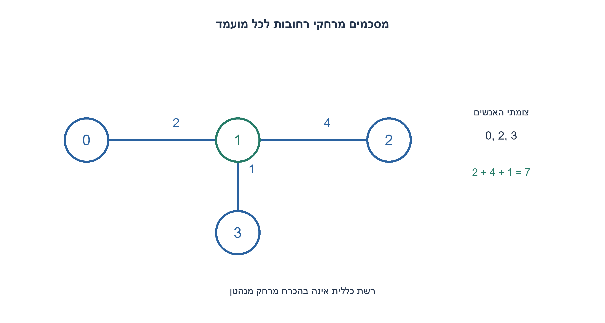
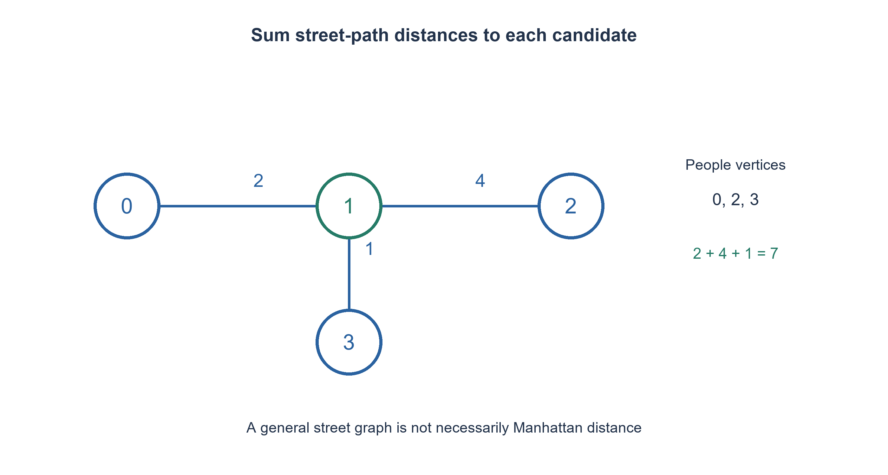

# PREP-246 — נקודת מפגש ברשת רחובות — מינימום סכום מרחקי הליכה

פתרון מוצע בסיוע AI; ביקורת מקצועית אנושית ממתינה. הקושי אינו מכויל.

## עברית

נתונה רשת רחובות ומיקומי אנשים עליה. מצאו נקודת מפגש שסכום מרחקי ההליכה הקצרים ביותר של כל האנשים אליה הוא מינימלי. מותר ללכת רק ברחובות.

 נבחר מודל מפורש: גרף סופי לא־מכוון, צמתים 0..V−1 וקשתות באורכים שלמים חיוביים. כל אדם נמצא בצומת; מקום בתוך רחוב מיוצג באמצעות פיצול הקשת והוספת צומת לפני הרצת האלגוריתם. מספר אנשים באותו צומת מותר. אפשר להיפגש גם בתוך רחוב. החזירו צומת מיטבי ואת סכום המרחקים, ובשוויון את הצומת בעל האינדקס הקטן. אם אין נקודה שאליה כולם יכולים להגיע, החזירו None.

 הציגו אלגוריתם נכון ונתחו זמן ומקום; אין הנחה שהרחובות הם רשת מלבנית. הסבירו גם את המקרה המיוחד של רשת מלבנית ללא מכשולים עם מרחק מנהטן.

1. האם מרחק בקו ישר או הפרש קואורדינטות באמת מתארים את הרחובות?
2. לכל אדם חשבו את המרחק הקצר ביותר לכל צומת, ואז סכמו לפי מועמד. איך מטפלים בקשת כנקודת מפגש אפשרית?
3. מכל קצה של קשת מתקבל ביטוי לינארי במיקום עליה. המרחק הוא המינימום בין שני הביטויים, ולכן סכום המרחקים קעור על הקשת ומקבל מינימום באחד מקצותיה.

### קודם בוחרים את מודל המרחק הנכון
לכל מקום מוצא נריץ Dijkstra על הגרף ונקבל את מרחקי ההליכה לכל צומת. נחזיק מערך סכומים ומערך המסמן אם כולם הגיעו לצומת. נסכום גם אנשים החולקים כתובת: כל אדם תורם למטרה. בסוף נבחר סכום מינימלי מבין הצמתים הנגישים לכולם, ונשבור שוויון באינדקס. אם הקבוצה ריקה, אין מפגש משותף אפשרי במודל הזה.

למה מותר לבדוק צמתים כאשר אפשר להיפגש באמצע רחוב? לקשת(u, v) באורך L, נסמן מיקום במרחק x מהקצה u. אחרי שפיצלנו קשתות בכל כתובות האנשים, אין אדם בפנים הקשת הנבחנת. כל מסלול אליה נכנס דרך u או v, לכן המרחק של אדם p הוא min(d(p, u)+x, d(p, v)+L−x). מינימום של שני ישרים הוא פונקציה קעורה של x. סכום פונקציות קעורות קעור, ולכל 0≤x≤L ערכו אינו קטן מהמינימום בין ערכי הקצוות: הוא מעל הקו המחבר ביניהם. לכן קיים קצה שאינו גרוע מנקודת הפנים. חוזרים על הטענה לכל קשת ומסיקים שקיים פתרון מיטבי בצומת. זו הוכחה נפרדת מבדיקת דוגמאות.

בדוגמת רחובות 0—2—1—4—2 וברחוב 1—1—3, כאשר האנשים בצמתים 0,2,3, סכום המרחקים בצומת 1 הוא 2+4+1=7. שמות הצמתים הם מזהים ולא קואורדינטות; חציון מספריהם אינו פותר את הבעיה.

עבור K אנשים, הקוד מריץ K פעמים Dijkstra עם ערימת מועמדים עצלה. בגרף עם E קשתות, הערימה יכולה להחזיק O(E+1) פריטים, ולכן חסם הזמן הוא O(K·(V+E)·log(V+E+1)) כולל מעבר על מערכי המרחקים. המקום הנוסף, כולל הגרף והערימה, הוא O(V+E). שומרים רק תוצאות של אדם אחד בכל פעם וסכומים, במקום מטריצת K×V. בניית הקוד אינה טוענת שזה הזמן המיטבי לכל סוג גרף. אם יש K גדול עם הרבה כתובות זהות, אפשר לצבור שכיחויות ולהריץ רק ממקורות שונים.

### ורק ברשת מנהטן ללא מכשולים
אם כל ההליכה היא ברשת מלבנית חופשית, מרחק הוא|x−xi|+|y−yi|. סכום המרחקים מתפרק לשתי בעיות חד־ממדיות בלתי תלויות, שכל אחת ממוזערת בחציון. זזים אל החציון כל עוד יש יותר אנשים בצד שאליו זזים מאשר בצד השני; אחרי שחוצים אותו היתרון מתהפך. אפשר לבחור חציון עליון בכל ציר; כשמספר האנשים זוגי גם כל הטווח שבין שני האמצעיים אופטימלי. הקוד ממיין בזמן O(KlogK) ושומר O(K) קואורדינטות. אלגוריתם בחירה יכול לשנות את מחיר מציאת החציון, אך אינו מתקן הנחת רחובות שגויה.

האורקל העצמאי השתמש ב־ Floyd–Warshall עבור 11,920 צירופי גרף ושני מקורות, ובדק 729 רשימות מיקומים ברשת. עוד 136,032 נקודות פנים מדוגמות לא שיפרו את המינימום בצמתים. הדגימות תומכות בקוד; הוכחת הקעירות היא שמכסה את כל נקודות הפנים.

```python
"""Exact vertex median in an undirected positive integer-length street graph."""
from heapq import heappop, heappush


def street_meeting_point(vertex_count, edges, people):
    if type(vertex_count) is not int or vertex_count <= 0:
        raise ValueError('positive vertex count required')
    graph = [[] for _ in range(vertex_count)]
    for u, v, length in edges:
        if (type(u) is not int or type(v) is not int
                or not 0 <= u < vertex_count or not 0 <= v < vertex_count
                or type(length) is not int or length <= 0):
            raise ValueError('valid endpoints and positive integer lengths required')
        graph[u].append((v, length))
        graph[v].append((u, length))
    if (not isinstance(people, list) or not people
            or any(type(p) is not int or not 0 <= p < vertex_count for p in people)):
        raise ValueError('at least one valid person vertex required')
    totals = [0] * vertex_count
    reachable = [True] * vertex_count
    for origin in people:
        distances = [None] * vertex_count
        distances[origin] = 0
        heap = [(0, origin)]
        while heap:
            distance, u = heappop(heap)
            if distances[u] != distance:
                continue
            for v, length in graph[u]:
                candidate = distance + length
                if distances[v] is None or candidate < distances[v]:
                    distances[v] = candidate
                    heappush(heap, (candidate, v))
        for v, distance in enumerate(distances):
            if distance is None:
                reachable[v] = False
            else:
                totals[v] += distance
    candidates = [v for v in range(vertex_count) if reachable[v]]
    if not candidates:
        return None
    best = min(candidates, key=lambda v: (totals[v], v))
    return best, totals[best]


def grid_meeting_point(points):
    """Separate specialization: unobstructed L1 grid, not an arbitrary graph."""
    if not points or any(len(p) != 2 or any(type(x) is not int for x in p) for p in points):
        raise ValueError('nonempty integer coordinate pairs required')
    xs, ys = sorted(p[0] for p in points), sorted(p[1] for p in points)
    x, y = xs[len(xs) // 2], ys[len(ys) // 2]
    return (x, y), sum(abs(a - x) + abs(b - y) for a, b in points)
```




## English

Given a street network and people living on it, find a meeting point minimizing the sum of their shortest walking distances. Walking is confined to streets.

Explicit model: a finite undirected graph with vertices0..V−1 and positive integer edge lengths. People lie at vertices; split an edge first to represent an interior address. Repeated person vertices are allowed. Meetings may also occur inside edges. Return an optimal vertex and total distance; tie-break by smallest vertex index. Return None if no meeting point is reachable by everyone.

Give a correct algorithm and analyze time/space. Do not assume a rectangular grid. Also explain the separate unobstructed Manhattan-grid specialization.

1. Do straight-line or coordinate differences actually describe these streets?
2. Compute shortest distances from each person to every vertex, then sum by candidate. How can meetings inside an edge be handled?
3. Distance via either endpoint is affine in edge position. The smaller of the two is concave, so the sum is concave along an edge and reaches a minimum at an endpoint.

### Choose the right distance model first
Run Dijkstra from each person's vertex to obtain walking distances to every candidate. Accumulate totals and whether each vertex is reachable by everyone. Count repeated addresses with multiplicity: every person contributes to the objective. Choose the minimum reachable total, then smallest index. An empty candidate set means no common reachable meeting point exists.

Why are vertices enough if meetings may occur inside a street? On edge(u, v) of lengthL let x be distance from u. After inserting every interior home as a vertex, no person lies strictly inside the edge considered. Every path enters through u or v, giving distance min(d(p, u)+x, d(p, v)+L−x). The minimum of two affine functions is concave in x. Summing preserves concavity, so every interior value is at least the smaller endpoint total: the curve lies above the line joining its endpoints. An endpoint is therefore no worse. Applying this to all edges proves that a vertex optimum exists, separately from sampled verification.

For edges0--1 of length 2,1--2 of length 4 and 1--3 of length 1, with people at 0,2,3, the total at vertex 1 is2+4+1=7. Vertex labels are identifiers, not coordinates; their numeric median does not solve this problem.

For K people the code runs Dijkstra K times with a lazy candidate heap. With E edges the heap may contain O(E+1) entries, giving O(K·(V+E)·log(V+E+1)) time including distance-array scans, and O(V+E) auxiliary storage including graph and heap. Retain one distance vector and accumulated totals rather than a K×V matrix. This is not asserted globally optimal for every graph class. Repeated addresses can be grouped by multiplicity to reduce the number of source runs.

### The separate unobstructed Manhattan-grid case
On a free rectangular street grid, distance is|x−xi|+|y−yi|. The total separates into independent one-dimensional objectives, each minimized by a median. Moving toward a median reduces distance to more people than it increases, until that balance reverses. An upper median in each coordinate works; for an even count, every point between the two middle coordinates is optimal on that axis. The supplied grid implementation sorts in O(KlogK) time and stores O(K) coordinates. Selection algorithms can change median-finding cost but cannot fix an incorrect street model.

An independent Floyd–Warshall oracle checked11,920 graph/two-origin cases;729 location lists checked the grid specialization. Another136,032 sampled edge-interior points never improved on the vertex optimum. These samples test implementation; concavity proves coverage of all interior points.

```python
"""Exact vertex median in an undirected positive integer-length street graph."""
from heapq import heappop, heappush


def street_meeting_point(vertex_count, edges, people):
    if type(vertex_count) is not int or vertex_count <= 0:
        raise ValueError('positive vertex count required')
    graph = [[] for _ in range(vertex_count)]
    for u, v, length in edges:
        if (type(u) is not int or type(v) is not int
                or not 0 <= u < vertex_count or not 0 <= v < vertex_count
                or type(length) is not int or length <= 0):
            raise ValueError('valid endpoints and positive integer lengths required')
        graph[u].append((v, length))
        graph[v].append((u, length))
    if (not isinstance(people, list) or not people
            or any(type(p) is not int or not 0 <= p < vertex_count for p in people)):
        raise ValueError('at least one valid person vertex required')
    totals = [0] * vertex_count
    reachable = [True] * vertex_count
    for origin in people:
        distances = [None] * vertex_count
        distances[origin] = 0
        heap = [(0, origin)]
        while heap:
            distance, u = heappop(heap)
            if distances[u] != distance:
                continue
            for v, length in graph[u]:
                candidate = distance + length
                if distances[v] is None or candidate < distances[v]:
                    distances[v] = candidate
                    heappush(heap, (candidate, v))
        for v, distance in enumerate(distances):
            if distance is None:
                reachable[v] = False
            else:
                totals[v] += distance
    candidates = [v for v in range(vertex_count) if reachable[v]]
    if not candidates:
        return None
    best = min(candidates, key=lambda v: (totals[v], v))
    return best, totals[best]


def grid_meeting_point(points):
    """Separate specialization: unobstructed L1 grid, not an arbitrary graph."""
    if not points or any(len(p) != 2 or any(type(x) is not int for x in p) for p in points):
        raise ValueError('nonempty integer coordinate pairs required')
    xs, ys = sorted(p[0] for p in points), sorted(p[1] for p in points)
    x, y = xs[len(xs) // 2], ys[len(ys) // 2]
    return (x, y), sum(abs(a - x) + abs(b - y) for a, b in points)
```




## חומר משלים / Supporting material

```json
{
  "assumptions": {
    "he": [
      "גרף לא־מכוון סופי עם אורכים חיוביים שלמים; כתובות בתוך קשת מפוצלות לצמתים.",
      "כל אדם נספר פעם אחת; נדרשת נגישות של כולם. חציון קואורדינטות שייך רק למקרה מנהטן החופשי."
    ],
    "en": [
      "Finite undirected graph with positive integer lengths; split edges at interior homes.",
      "Every person counts; require common reachability. Coordinate medians apply only to the free Manhattan-grid case."
    ]
  },
  "optimality": {
    "he": "גרף כללי: O(K(V+E) log(V+E+1)) זמן ו־ O(V+E) מקום בקוד. רשת מנהטן: O(KlogK) במימוש הממיין; אין טענת מיטביות כללית.",
    "en": "General graph code: O(K(V+E) log(V+E+1)) time and O(V+E) space. Sorting grid implementation: O(KlogK); no universal optimal-runtime claim."
  },
  "verification": {
    "he": "11,920 מקרי גרף,136,032 דגימות פנים ו־ 729 מקרי מנהטן מול אורקלים נפרדים;4 קלטים פסולים. Python הורץ.",
    "en": "11,920 graph cases,136,032 interior samples and 729 Manhattan cases against separate oracles;4 invalid inputs. Python executed."
  },
  "edge_cases": {
    "he": [
      "רכיבים מנותקים, אדם אחד, אנשים באותו מקום, שוויון, קשתות מקבילות, כתובת פנימית שנוספה כצומת."
    ],
    "en": [
      "Disconnected components, one person, shared addresses, ties, parallel edges, interior address inserted as a vertex."
    ]
  },
  "common_mistakes": {
    "he": [
      "להשתמש במרחק אווירי או בחציון מזהי צמתים.",
      "למזער את המרחק המרבי במקום את הסכום.",
      "לכלול צומת שאינו נגיש לכל האנשים.",
      "להכליל חציון מנהטן לרשת עם מכשולים."
    ],
    "en": [
      "Using Euclidean distance or median vertex IDs.",
      "Minimizing maximum distance instead of total.",
      "Accepting a vertex unreachable by someone.",
      "Applying Manhattan medians to obstructed networks."
    ]
  },
  "interview_answer": {
    "he": "אגדיר רשת משוקללת, אחשב מרחקים קצרים מכל מקור ואסכום בכל צומת. קיים מינימום בצומת כי הסכום קעור בתוך כל קשת; במנהטן חופשי ניתן להפריד לחציונים בצירים.",
    "en": "Model weighted streets, compute shortest distances from each source and sum at vertices. Concavity along every edge guarantees a vertex optimum; free Manhattan grids separate into coordinate medians."
  },
  "source_ambiguities": {
    "he": "המקור אינו מגדיר גאומטריה, כיווניות או משקלים. המודל הגרפי והסעיף המיוחד של מנהטן מוצגים בנפרד; אין הנחת רשת מלבנית נסתרת.",
    "en": "The source omits geometry, directionality and weights. The graph model and Manhattan specialization are separate; no hidden rectangular-grid assumption."
  },
  "solution_extensions": {
    "he": [
      {
        "question": "מה משתנה אם המטרה היא זמן ההגעה של האחרון?",
        "answer_direction": "ממזערים max של המרחקים, בעיית מרכז ולא חציון. בפרט נקודת פנים עשויה להיות טובה משני קצוות.",
        "principle": "שינוי פונקציית המטרה משנה גם את המועמדים וההוכחה."
      }
    ],
    "en": [
      {
        "question": "What if the objective is the last arrival time?",
        "answer_direction": "Minimize maximum distance: a center problem rather than a median. An interior point may then beat both endpoints.",
        "principle": "Changing the objective changes candidates and proof."
      }
    ]
  }
}
```
