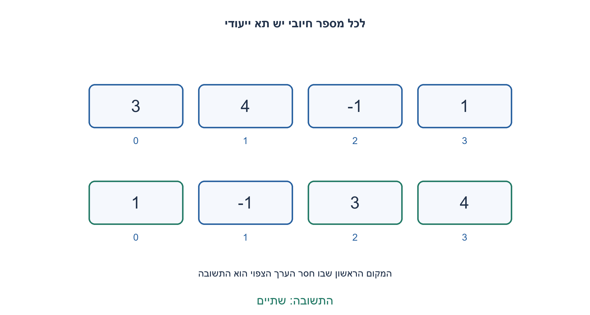
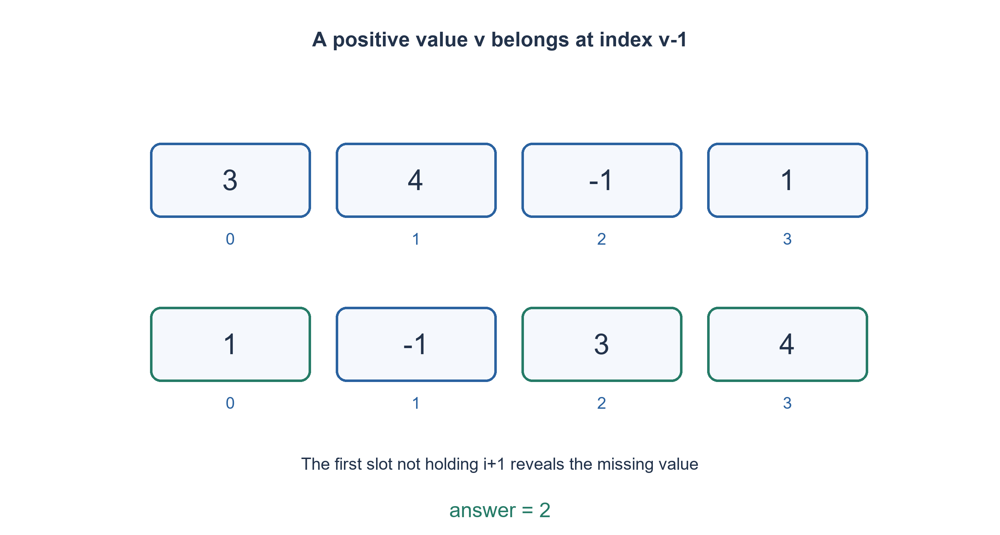

# PREP-247 — המספר החיובי הראשון שחסר — שימוש במערך עצמו כמפת מקום

פתרון מוצע בסיוע AI; ביקורת מקצועית אנושית ממתינה. הקושי אינו מכויל.

## עברית

נתון מערך לא ממוין של n מספרים שלמים, חיוביים ושליליים, עם אפסים וכפילויות. מצאו את המספר החיובי הקטן ביותר שאינו נמצא בו. לדוגמה, [1,2, −4, −1]מחזיר 3.

 מותר לשנות את סדר איברי המערך. נדרש O(n) זמן ו־ O(1) מילות עזר; אין מערך עזר, מיון או גיבוב במימוש. מערך ריק מחזיר 1. הקוד מקבל רשימת Python של מספרים שלמים בלבד, ומדגים מודל RAM של גישה לאינדקס והשוואה למילה; עבור שלמים ארוכים שרירותית גם עלות הקריאה וההשוואה תלויה בייצוג. הסבירו מדוע הלולאה הפנימית אינה יוצרת זמן ריבועי.

1. איזה חסם על התשובה מתקבל מכך שיש רק n תאים?
2. הערך v בטווח 1..n יכול להשתמש בתא v−1 בתור מקום ייעודי. איפה אפשר לשמור את המידע בלי מערך נוסף?
3. כל עוד הערך בתא בתחום וטרם נמצא במקומו, החליפו אותו עם התא value−1. אל תחליפו ערך עם עותק זהה. בסוף חפשו את התא הראשון שאינו מכיל index+1.

### המקום של המספר הוא גם הסימון שהוא קיים
התשובה תמיד בין 1 ל־ n+1. אם כל 1..n קיימים, התשובה n+1; אחרת לפחות אחד מהם חסר. לכן מספרים שליליים, אפס וערכים מעל n אינם צריכים תא ייעודי.

נעבור על האינדקסים. אם בתא i נמצא v בתחום 1..n, ובתא v−1 אין כבר v, נחליף ביניהם. ייתכן שהערך שהגיע עכשיו ל־ i גם צריך בית אחר, ולכן חוזרים על הבדיקה באותו תא. אם הערך מחוץ לטווח או שבביתו כבר יש עותק זהה, מתקדמים. אחרי כל ההחלפות, הערך החיובי v קיים אם ורק אם מקומו v−1 מכיל v. נחפש את המקום הראשון שאינו תקין; אינדקס i כזה מחזיר i+1. כשכל המקומות תקינים מחזירים n+1.

בדוגמה[3,4, −1,1]מציבים תחילה 3 במקום 2, אחר כך 4 במקום 3 ואת 1 במקום 0. מתקבל[1, −1,3,4], ולכן 2 חסר. זה אינו מיון מלא: הערכים שלא מעניינים אותנו יכולים להישאר בכל מקום. כפילויות כמו[1,1]דורשות עצירה כשהיעד כבר מחזיק 1; החלפת שני עותקים זהים לעולם לא מקדמת את האלגוריתם.

למה הזמן לינארי? כל החלפה מוצלחת מציבה לפחות ערך אחד בביתו הנכון. ערך שכבר נמצא בביתו לא יוצא משם: ניסיון להביא אליו אותו ערך נעצר בגלל בדיקת השוויון. לכן מספר התאים הנכונים עולה בכל החלפה, ויש לכל היותר n החלפות מוצלחות בכל הריצה, לא n בכל אינדקס. המעבר החיצוני והחיפוש הסופי לינאריים. לא נדרשים מבני עזר, אלא אינדקס יעד ומספר קבוע של משתנים. קריאת n ערכים היא הכרחית במקרה הגרוע במודל הכללי, ולכן סדר הזמן מתאים לחסם התחתון.

אין לגשת לתא value−1 לפני בדיקת 1≤value≤n. בקוד Python הסדר של and מבטיח זאת. חוזה הקלט נבדק לפני השינוי, כך שערך שאינו שלם אינו גורם למוטציה חלקית. הנתונים עצמם נשמרים כרב־קבוצה; רק הסדר משתנה. אם אסור לשנות את הקלט, יש לבחור פשרה אחרת, למשל קבוצה בגודל O(n), ואין לייחס לה מקום עזר קבוע.

בדיקה עצמאית מיצתה את כל הרשימות באורכים 0..7 מעל שישה ערכים, והשוותה לקבוצת ערכים נפרדת. בסך הכול 335,929 מקרים תקינים, כולל דוגמאות גדולות ושלמים רחבים, ועוד שלושה קלטים פסולים. נבדק גם שרב־קבוצת האיברים נשמרת. הקבוצה משמשת אורקל בלבד ואינה חלק מהפתרון.

```python
"""Mutate a list of integers in place; return its first absent positive integer."""


def first_missing_positive(values):
    if not isinstance(values, list) or any(type(v) is not int for v in values):
        raise ValueError('a mutable list of integers is required')
    n = len(values)
    for i in range(n):
        while 1 <= values[i] <= n and values[values[i] - 1] != values[i]:
            target = values[i] - 1
            values[i], values[target] = values[target], values[i]
    for i, value in enumerate(values):
        if value != i + 1:
            return i + 1
    return n + 1
```




## English

Given an unsorted array of n integers, allowing negatives, zeroes and duplicates, find the smallest absent positive integer. Example: [1,2, -4, -1]returns3.

Reordering the input is allowed. Require O(n) time and O(1) auxiliary words: no auxiliary array, sort or hash table in the implementation. Empty input returns1. The code takes a Python list of integers and illustrates a RAM model with word comparisons/indexing; arbitrary-size integer representation also affects reading/comparison costs. Explain why the inner loop does not make the algorithm quadratic.

1. What bound on the answer follows from having only n cells?
2. A value v in 1..n can use slot v-1 as its designated home. Where can the presence information live without another array?
3. While a value is in range and its home does not already contain it, swap it into slot value-1. Never swap duplicate equal values. Finally find the first slot not holding index+1.

### A value's home also records its presence
The answer lies in 1..n+1. If every value1..n occurs, return n+1; otherwise at least one is absent. Negatives, zero and values above n need no designated slot.

Scan indices. If slot i holds v in 1..n and slot v-1 does not already contain v, swap them. The replacement at i may need another home, so repeat at that same index. Out-of-range values or values whose home already has an equal copy stop the inner loop. Afterwards positive v is present exactly when slot v-1 contains v. Return i+1 at the first incorrect slot, or n+1 when all slots are correct.

For[3,4, -1,1], place3 in slot 2,4 in slot 3 and 1 in slot 0, producing[1, -1,3,4]. Thus2 is missing. This is not full sorting: irrelevant values need not be ordered. Duplicates such as[1,1]must stop when the destination already holds1; swapping equal copies makes no progress.

Why linear time? Every successful swap fills at least one correct home. A correctly homed value never leaves: another equal value is blocked by the equality check. The count of correct homes therefore increases at every swap, limiting successful swaps to n over the entire run, not n per index. Outer scanning and the final pass are linear. Storage consists of a destination index and a fixed number of variables, without an auxiliary structure. Worst-case reading of n values is necessary in the general model, matching the linear order.

Never access value-1 before checking1≤value≤n. Python's short-circuit and order enforces that. Input types are checked before mutation, preventing partial rearrangement on malformed input. The multiset is preserved; only ordering changes. Immutable input requires a different trade-off, such as an O(n) presence set, rather than pretending that allocation is constant space.

Independent verification exhausted lists of length 0..7 over six values against a separate set-membership oracle.335,929 valid cases include additional large/wide-integer examples, plus three invalid inputs. Multiset preservation was checked too. The set is an oracle, not part of the implementation.

```python
"""Mutate a list of integers in place; return its first absent positive integer."""


def first_missing_positive(values):
    if not isinstance(values, list) or any(type(v) is not int for v in values):
        raise ValueError('a mutable list of integers is required')
    n = len(values)
    for i in range(n):
        while 1 <= values[i] <= n and values[values[i] - 1] != values[i]:
            target = values[i] - 1
            values[i], values[target] = values[target], values[i]
    for i, value in enumerate(values):
        if value != i + 1:
            return i + 1
    return n + 1
```




## חומר משלים / Supporting material

```json
{
  "assumptions": {
    "he": [
      "רשימה ניתנת לשינוי עם שלמים, אפסים וכפילויות; סדרה אינו נשמר.",
      "עלות O(n) נמדדת במודל מילים; Python מאפשר שלמים רחבים שעלותם תלויה במספר הביטים."
    ],
    "en": [
      "Mutable integer list, including zero/duplicates; order is not preserved.",
      "O(n) measures word operations; Python permits wider integers with representation-dependent costs."
    ]
  },
  "optimality": {
    "he": "לכל היותר n החלפות מוצלחות, שני מעברים ו־ O(1) מילות עזר; O(n) במודל RAM.",
    "en": "At most n successful swaps, two scans and O(1) auxiliary words; O(n) in the RAM model."
  },
  "verification": {
    "he": "335,929 מקרים תקינים מול אורקל קבוצה ובדיקת רב־קבוצה, ועוד 3 פסולים. Python הורץ; אין מיצוי של כל השלמים.",
    "en": "335,929 valid cases against set/multiset oracles, plus3 invalid inputs. Python executed; not exhaustive over all integers."
  },
  "edge_cases": {
    "he": [
      "ריק, כל 1..n קיימים, רק שליליים, אפסים, עותקים שווים, ערך גדול מאוד, חסר 1."
    ],
    "en": [
      "Empty, all 1..n present, all negative, zeros, equal copies, very large values, missing1."
    ]
  },
  "common_mistakes": {
    "he": [
      "אינדוקס לפני בדיקת טווח.",
      "החלפת כפילויות ללא התקדמות.",
      "להחזיר 0 למרות שהשאלה מבקשת חיובי.",
      "לספור כל while בנפרד ולהסיק n²בלי לנתח החלפות."
    ],
    "en": [
      "Indexing before range validation.",
      "Swapping equal duplicates without progress.",
      "Returning zero despite a positive answer contract.",
      "Treating every while independently as n²without counting productive swaps."
    ]
  },
  "interview_answer": {
    "he": "התשובה עד n+1. אשתמש בתא v−1 כבית של v, אזיז אליו כל ערך רלוונטי פעם שמתקדמים, ואז אמצא את הבית הראשון שחסר בו הדייר. כל החלפה מתקנת בית חדש.",
    "en": "The answer is at most n+1. Use slot v-1 as v’s home, move relevant values there with productive swaps, then find the first vacant home. Every swap fixes a new home."
  },
  "source_ambiguities": {
    "he": "המקור אינו מגדיר אם מותר לשנות את המערך. המימוש בוחר מוטציה ומציג במפורש את הפשרה אם נדרשת שמירת הקלט.",
    "en": "The source does not specify mutation permission. This implementation chooses mutation and explicitly discusses immutable-input trade-offs."
  },
  "solution_extensions": {
    "he": [
      {
        "question": "מה אם צריך לשמר את סדר המערך המקורי?",
        "answer_direction": "קבוצת ערכים רלוונטיים מאפשרת זמן לינארי עם O(n) מקום; לחלופין העתקה לפני הסידור משלמת גם היא מקום.",
        "principle": "דרישת שמירת קלט משנה את חוזה הזיכרון."
      }
    ],
    "en": [
      {
        "question": "What if original array order must survive?",
        "answer_direction": "A set of relevant values gives linear time withO(n) space; copying before rearranging pays space too.",
        "principle": "Input preservation changes the storage contract."
      }
    ]
  }
}
```
