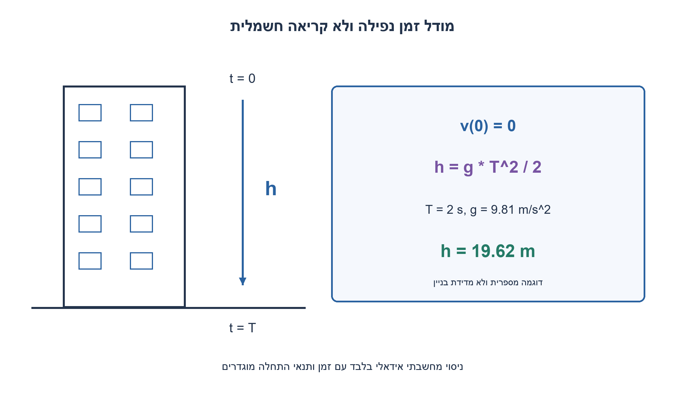
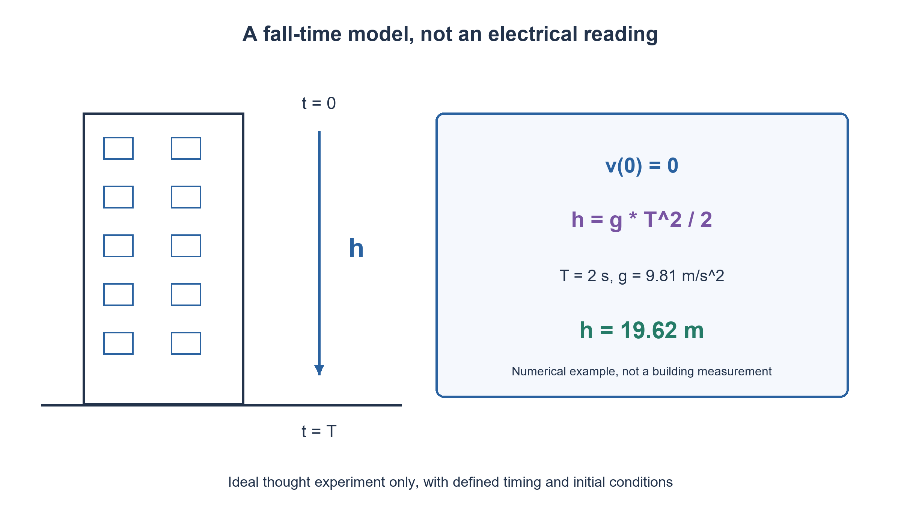

# PREP-248 — גובה בניין באמצעות וולטמטר וטיימר — ניסוי מחשבתי

פתרון מוצע בסיוע AI; ביקורת מקצועית אנושית ממתינה.

[מקור פרטי](../sources/2026-11-03-batch20-06.png)

ברשותך וולטמטר וטיימר. מצא דרך למדוד גובה בניין בן עשר קומות.

## עברית

ברשותכם וולטמטר וטיימר. הציעו דרך להסיק את גובהו של בניין בן עשר קומות, והסבירו מה נמדד ואילו הנחות נדרשות. אין נתון על גובה קומה או קשר בין מתח חשמלי לגובה. לצורך פתרון פיזיקלי אידאלי, מותר לנתח על הנייר זמן תנועה של הגוף מן הגג לגובה הקרקע. אין צורך לבצע ניסוי פיזי. הבחינו בין זמן התנועה עצמו לבין זמן שבו קול הפגיעה מגיע לצופה בגג; אל תחליפו את הוולטמטר בברומטר.

1. מה מד הזמן יכול למדוד גם אם המכשיר האחר אינו משמש למדידת מתח? חפשו קשר פיזיקלי בין זמן למרחק.
2. אם הגוף מתחיל ממנוחה ותאוצתו קבועה, המהירות גדלה בקו ישר. המרחק הוא השטח שמתחת לגרף המהירות.
3. במודל ללא גרר מתקבל h=gT²/2. ציינו איך מגדירים את רגעי ההתחלה והסיום ומה יקרה אם מודדים גם זמן התפשטות של קול.

### משתמשים בנתון שהטיימר באמת מספק
התובנה היא שאין חובה להשתמש בכלי לפי תפקידו החשמלי. הוולטמטר יכול להיות הגוף במודל תנועה מחשבתי, והטיימר מספק זמן. לעומת זאת, מדידת מתח מקרית בבניין אינה קובעת את גובהו: לא ניתן במקור קשר מכויל כזה. גם ״עשר קומות״ אינו מספיק למספר מטרים בלי גובה קומה.

נניח שהגוף מתחיל במנוחה בגובה הגג, כוח הכובד יוצר תאוצה קבועה g כלפי מטה, והגרר זניח. לאחר זמן T המהירות היא gT. גרף המהירות משולש, ולכן המרחק הוא השטח `h=(T·gT)/2=gT²/2`. עבור T=2 שניות ו־g=9.81 מטר לשנייה בריבוע מתקבלים 19.62 מטר. זו דוגמה מחושבת, לא טענה שזה גובהו של כל בניין בן עשר קומות. המדידה מתייחסת בין גובה ההתחלה לגובה הסיום; הפרש מגובה היד או מן הגג נכלל אם מבקשים גובה אדריכלי אחר.

### ההגדרה של הזמן משנה את התוצאה
T הוא משך התנועה עד הגעה לקרקע, עם שני אירועים מתוזמנים במודל. צופה בגג ששומע פגיעה מודד בדרך כלל `Tobs=T+h/c`, כאשר c מהירות הקול. הצבת Tobs בנוסחה הפשוטה מעריכה גובה גדול מדי. עם c ידוע, אפשר לפתור `Tobs=sqrt(2h/g)+h/c`, או להציב `h=gT²/2` ולפתור את המשוואה הריבועית עבור השורש החיובי של T. זוהי חלופה עם נתון נוסף, לא יכולת שהטיימר מספק בעצמו.

אם שגיאת הזמן חסומה ב־δT והמודל נשאר תקף, תחום הגובה המדויק הוא `g·max(0,T−δT)²/2` עד `g·(T+δT)²/2`. בקירוב לשגיאה קטנה, `δh/h≈2δT/T`, ועוד אי־הוודאות היחסית ב־g. גרר, מהירות התחלתית ותגובה אנושית לא נעלמים בגלל הנוסחה. איננו מורים לבצע שחרור מכשיר מגובה; הפתרון כאן הוא ניסוי מחשבתי ובדיקת מודל.

החישוב דורש מספר קבוע של פעולות ומקום קבוע במודל מספרים קבוע־רוחב. אין טענת דיוק מטרולוגי או דרך יחידה. רעיון חלופי שמשתמש באורך המכשיר כיחידת מידה דורש אורך ידוע וגישה למדידה; רעיון של מדידת תקופה כמטוטלת דורש גם חוט ומודל נוספים שלא נמסרו.

```python
"""Thought experiment only: no real device is released or building measured."""
import math


def height_from_fall_time(time, gravity=9.81):
    if not math.isfinite(time) or not math.isfinite(gravity) or time < 0 or gravity <= 0:
        raise ValueError('Finite time >= 0 and gravity > 0 required')
    return 0.5 * gravity * time * time


def height_interval(time, timing_error, gravity=9.81):
    if not math.isfinite(timing_error) or timing_error < 0:
        raise ValueError('Finite nonnegative timing error required')
    height_from_fall_time(time, gravity)
    return (height_from_fall_time(max(0, time - timing_error), gravity),
            height_from_fall_time(time + timing_error, gravity))
```


[מודל נפילה חופשית של NASA](https://www1.grc.nasa.gov/beginners-guide-to-aeronautics/free-falling-objects/)



## English

You have a voltmeter and a timer. Propose a way to infer the height of a ten-storey building, specifying the measured quantity and required assumptions. Neither a floor height nor a voltage-to-height relationship is given. For an idealized physics solution, you may analyze on paper the body's travel time from roof level to ground level. No physical experiment is required. Distinguish travel time from the time at which an impact sound reaches an observer on the roof; do not replace the voltmeter with a barometer.

1. What can the timer measure even if the other instrument is not used electrically? Seek a physical relation between time and distance.
2. With release from rest and constant acceleration, velocity grows linearly. Distance is the area under the velocity-time graph.
3. In a no-drag model h=gT²/2. Specify the start/end events and how measuring sound propagation as well would change the result.

### Use the quantity the timer actually provides
An instrument need not be used electrically in a thought experiment: the voltmeter can be the body in a motion model, and the timer supplies elapsed time. An arbitrary voltage measured in the building does not determine height; no calibrated voltage-height relation is given. Ten storeys also do not specify metres without floor heights.

Assume release from rest at roof level, constant downward acceleration g and negligible drag. At time T, velocity is gT. The velocity-time graph is triangular, so distance is its area: `h=(T·gT)/2=gT²/2`. For T=2 seconds and g=9.81 metres/second squared, the result is 19.62 metres. This is a numerical example, not the height of every ten-storey building. It measures separation of the start and end levels; hand or roof offsets matter if a different architectural height is requested.

### The definition of elapsed time changes the answer
T is travel time until ground arrival, with those two events timed in the model. A roof observer listening for impact instead measures approximately `Tobs=T+h/c`, where c is sound speed. Substituting Tobs into the simple formula overestimates height. With known c, solve `Tobs=sqrt(2h/g)+h/c`, or substitute `h=gT²/2` and solve the resulting quadratic for the positive T root. This alternative adds a physical parameter that the timer does not itself supply.

For timing error bounded by δT, the exact model interval is `g·max(0,T−δT)²/2` through `g·(T+δT)²/2`. For small error, `δh/h≈2δT/T`, plus relative uncertainty in g. Drag, initial velocity and human reaction do not disappear because a formula is available. This is a paper thought experiment and model check, not an instruction to release equipment from a building.

The computation uses a constant number of arithmetic operations and words in a fixed-width numeric model. It does not establish measurement accuracy or uniqueness. Using the instrument as a ruler requires a known length and physical access; a pendulum method needs a string and additional assumptions absent from the source.

```python
"""Thought experiment only: no real device is released or building measured."""
import math


def height_from_fall_time(time, gravity=9.81):
    if not math.isfinite(time) or not math.isfinite(gravity) or time < 0 or gravity <= 0:
        raise ValueError('Finite time >= 0 and gravity > 0 required')
    return 0.5 * gravity * time * time


def height_interval(time, timing_error, gravity=9.81):
    if not math.isfinite(timing_error) or timing_error < 0:
        raise ValueError('Finite nonnegative timing error required')
    height_from_fall_time(time, gravity)
    return (height_from_fall_time(max(0, time - timing_error), gravity),
            height_from_fall_time(time + timing_error, gravity))
```


[NASA free-fall model](https://www1.grc.nasa.gov/beginners-guide-to-aeronautics/free-falling-objects/)



## Supporting material / חומר משלים

```json
{
  "assumptions": {
    "he": "ניסוי מחשבתי בלבד: התחלה ממנוחה, תאוצה g קבועה, גרר זניח וזמן בין שחרור להגעה. עשר קומות אינן נותנות גובה מספרי.",
    "en": "Paper thought experiment: rest at release, constant g, negligible drag and release-to-arrival time. Ten storeys alone do not supply a numerical height."
  },
  "optimality": {
    "he": "מספר קבוע של פעולות לחישוב h; אין טענת אופטימום של מדידה, דיוק או מחיר ניסוי.",
    "en": "Constant arithmetic work to compute h; no optimal measurement accuracy or experiment-cost claim."
  },
  "verification": {
    "he": "1,204 מקרי זמן וכבידה הושוו לאינטגרציה נפרדת של המהירות; תחומי שגיאה ומקרי קלט פסול נבדקו. לא נמדד בניין.",
    "en": "1,204 time/gravity cases compared with independent velocity integration; error intervals and invalid inputs checked. No building was measured."
  },
  "edge_cases": {
    "he": "T=0; זמן או g פסולים; הגעה נראית לעומת קול; גרר ומהירות התחלתית; הפרש גובה שאינו בדיוק גובה הבניין.",
    "en": "T=0; invalid time/g; observed arrival versus sound; drag/initial velocity; level separation differing from architectural height."
  },
  "common_mistakes": {
    "he": "להחליף וולטמטר בברומטר; להניח גובה קומה; להציב זמן הכולל קול כאילו הוא זמן נפילה; לטעון לניסוי פיזי.",
    "en": "Replacing the voltmeter with a barometer; assuming floor height; treating sound-inclusive time as fall time; claiming a physical experiment."
  },
  "interview_answer": {
    "he": "במודל אידאלי הוולטמטר הוא גוף ולא חיישן גובה: זמן תנועה T ממנוחה נותן h=gT²/2, רק עם הנחות ותזמון נכונים.",
    "en": "In the ideal model the voltmeter is a body, not a height sensor: travel time T from rest gives h=gT²/2, with explicit assumptions and timing."
  },
  "source_ambiguities": {
    "he": "המקור אינו מגדיר שימוש לא־הרסני או תזמון פגיעה. נבחרה במפורש פרשנות תיאורטית; שימוש בכלים נוספים אינו מובן מאליו.",
    "en": "The source defines neither nondestructive use nor impact timing. A theoretical interpretation is declared; additional tools are not assumed."
  },
  "solution_extensions": {
    "he": "אם הצופה מודד קול, כתבו את המשוואה עם c והשוו לשגיאה שמתקבלת מהנוסחה הפשוטה.",
    "en": "If timing the impact sound, write the equation with c and compare against the simple formula error."
  },
  "technical_references": {
    "he": [
      "[מודל נפילה חופשית של NASA](https://www1.grc.nasa.gov/beginners-guide-to-aeronautics/free-falling-objects/)"
    ],
    "en": [
      "[NASA free-fall model](https://www1.grc.nasa.gov/beginners-guide-to-aeronautics/free-falling-objects/)"
    ]
  }
}
```
