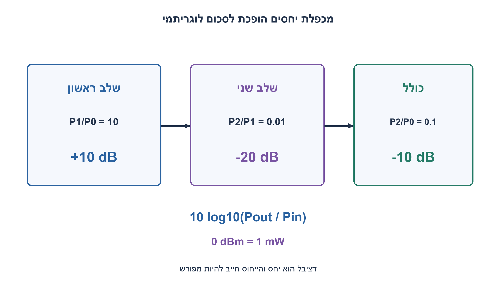
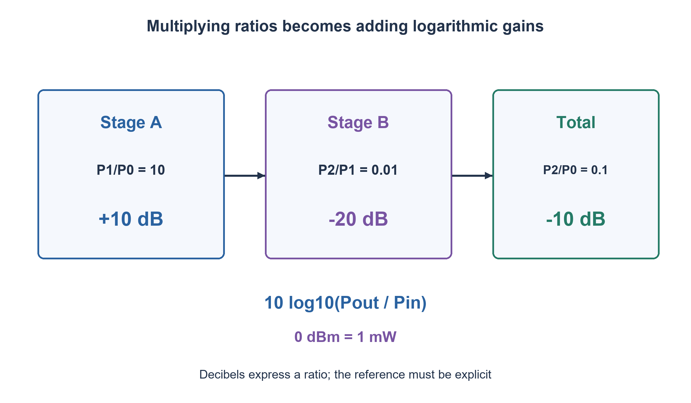

# PREP-249 — למה משתמשים בדציבלים? יחסים, הגבר וייחוס

פתרון מוצע בסיוע AI; ביקורת מקצועית אנושית ממתינה.

[מקור פרטי](../sources/2026-11-03-batch20-09.png)

מה הסיבה לשימוש ביחידות dB?

## עברית

הסבירו מדוע משתמשים ביחידות dB לתיאור הגבר והנחתה. הגדירו יחס הספק, הבדילו בינו לבין יחס משרעות והסבירו מתי משתמשים במקדם 10 ומתי ב־20. תנו דוגמה לשרשרת רכיבים, הבדילו בין dB ל־dBm וציינו מה צריך לדעת לפני שחיבור ערכי dB או שימוש ביחסי מתחים יהיה תקף.

1. לוגריתם הופך מכפלה לסכום. איך זה עוזר כשמכפילים הגברים של כמה רכיבים?
2. להספק הגדירו 10log10(Pout/Pin). למתח על התנגדויות שוות ההספק פרופורציוני לריבוע המתח.
3. הכפלת הספק נותנת בערך 3.01dB, הכפלת מתח בתנאים המתאימים כ־6.02dB. ב־dBm המכנה הוא 1mW, ולכן 0dBm אינו אפס הספק.

### מתחילים מיחס ולא מהספק מוחלט
עבור הספקים חיוביים נגדיר `GdB=10log10(Pout/Pin)`. יחס גדול מאחד נותן הגבר חיובי, יחס אחד נותן 0dB ויחס קטן מאחד נותן ערך שלילי. הסימון אינו משנה את הפיזיקה; הוא מאפשר להציג טווח יחסים גדול במספרים נוחים. פי עשרה בהספק הוא 10dB, פי מאה הוא 20dB ופי שניים כ־3.0103dB. אין משמעות ל־log של הספק שלילי; אפס הספק מתאים לגבול של מינוס אינסוף, לא ל־0dB.

### לשרשרת יש חשבון פשוט, בתנאי שהיחסים מתאימים
אם שלב ראשון נותן יחס הספק 10 ושלב שני יחס 0.01, היחס הכולל הוא 0.1. בלוגריתם: `10dB+(−20dB)=−10dB`. שני המכנים והמונה האמצעי מתבטלים כאשר מדובר באותם הספקים בממשקים. אין לחבר מספרי הגבר שנמדדו בתנאי עומס לא תואמים ולצפות לתוצאה מדויקת של השרשרת. חיבור הספקים של מקורות נפרדים נעשה תחילה ביחידות ליניאריות; 0dBm ועוד 0dBm אינם 0dBm של הספק כולל אלא כ־3.0103dBm עבור שני הספקים שווים שניתנים לחיבור.

### למה מופיע לפעמים 20?
על התנגדות R, למתח RMS מתקיים `P=Vrms²/R`. לכן עבור Rin=Rout מתקבל `10log10(Pout/Pin)=20log10(|Vout/Vin|)`. אם ההתנגדויות שונות, הביטוי להספק הוא `20log10(|Vout/Vin|)+10log10(Rin/Rout)`. אין להסיק הכפלת הספק מהכפלת מתח בלי לבדוק את העכבות והגדרת המשרעת. dB של יחס משרעת, כשהוגדר כך, אינו כולל את סימן או פאזה של המתח.

dB לבדו מתאר יחס. dBm מתאר רמת הספק ביחס ל־1mW: `LdBm=10log10(P/1mW)`. לכן 1mW הוא 0dBm ו־1W הוא 30dBm. הפרש שתי רמות dBm הוא יחס dB; הוספת הגבר dB לרמת כניסה dBm נותנת רמת יציאה dBm בתנאי שהגבר מתאים. גם dBV או dB SPL משתמשים בייחוסים אחרים ויש לפרט אותם. אין יחידת dB אחת שפירושה תמיד ״עוצמת קול מוחלטת״.

הדוגמאות הן חישוב יחסים, לא מדידת רעש, שמיעה או ביצועי מגבר. לכל המרה מספר קבוע של פעולות במודל נקודה צפה; בדיקת הדיוק כפופה לייצוג המספרי. עצם שימוש בלוגריתם אינו מוסיף מידע למדידה.

```python
"""Positive power ratios; voltage ratios use equal resistive impedances."""
import math


def power_db(output_power, input_power):
    if not all(math.isfinite(x) and x > 0 for x in (output_power, input_power)):
        raise ValueError('Finite positive powers required')
    return 10 * (math.log10(output_power) - math.log10(input_power))


def voltage_db_equal_impedance(output_rms, input_rms):
    if not all(math.isfinite(x) and x > 0 for x in (output_rms, input_rms)):
        raise ValueError('Finite positive RMS magnitudes required')
    return 20 * (math.log10(output_rms) - math.log10(input_rms))


def watts_to_dbm(watts):
    return power_db(watts, 0.001)
```


[NTIA — המרות דציבלים להספק ולמתח](https://its.ntia.gov/publications/download/tn_89-2.pdf)



## English

Explain why dB is useful for gain and attenuation. Define a power ratio, distinguish it from an amplitude ratio and explain factors 10 and 20. Give a cascaded-stage example, distinguish dB from dBm, and state what must be known before adding dB gains or using voltage ratios.

1. A logarithm turns multiplication into addition. How does that help with gains through several stages?
2. Use 10log10(Pout/Pin) for power. At equal resistances, power is proportional to squared voltage.
3. Doubling power is about 3.01 dB; doubling voltage under the right conditions is about 6.02 dB. dBm uses 1 mW as reference, so 0 dBm is not zero power.

### Begin with a ratio, not an absolute power
For positive powers define `GdB=10log10(Pout/Pin)`. Ratios above one give positive gain, one gives 0 dB, and ratios below one give negative gain. The notation does not change the physics; it compresses a broad range of ratios into manageable numbers. Ten times the power is 10 dB, one hundred times is 20 dB, and twice is about 3.0103 dB. A negative power is outside this definition; zero power approaches minus infinity, not 0 dB.

### Cascades become simple when their ratios match
If stageA has power ratio 10 and stageB ratio 0.01, the combined ratio is 0.1. Logarithmically, `10dB+(−20dB)=−10dB`. The intermediate power cancels only when the stages describe the actual connected interfaces. Gains measured under incompatible loading cannot automatically be added to predict that cascade. Separate source powers must first be added linearly:0dBm plus0dBm is not 0 dBm total; two equal additive powers produce about 3.0103 dBm.

### Why does20 sometimes replace10?
For resistance R and RMS voltage, `P=Vrms²/R`. If Rin=Rout, `10log10(Pout/Pin)=20log10(|Vout/Vin|)`. With unequal resistances the power expression becomes `20log10(|Vout/Vin|)+10log10(Rin/Rout)`. Do not infer doubled power from doubled voltage without checking impedances and amplitude definitions. An amplitude-ratio dB magnitude, when defined that way, does not encode voltage sign or phase.

dB alone expresses a ratio. dBm expresses power relative to 1 mW: `LdBm=10log10(P/1mW)`. Thus 1 mW is 0 dBm and 1 W is 30 dBm. Subtracting two dBm levels gives a dB ratio; adding a suitable dB gain to a dBm input level gives the dBm output level. Other reference units, such as dBV or dB SPL, require their own references. dB does not always mean an absolute sound level.

These are ratio calculations, not noise, hearing or amplifier measurements. Each conversion uses constant arithmetic work in a floating-point model, with numerical accuracy limited by representation. Taking a logarithm does not add information to a measurement.

```python
"""Positive power ratios; voltage ratios use equal resistive impedances."""
import math


def power_db(output_power, input_power):
    if not all(math.isfinite(x) and x > 0 for x in (output_power, input_power)):
        raise ValueError('Finite positive powers required')
    return 10 * (math.log10(output_power) - math.log10(input_power))


def voltage_db_equal_impedance(output_rms, input_rms):
    if not all(math.isfinite(x) and x > 0 for x in (output_rms, input_rms)):
        raise ValueError('Finite positive RMS magnitudes required')
    return 20 * (math.log10(output_rms) - math.log10(input_rms))


def watts_to_dbm(watts):
    return power_db(watts, 0.001)
```


[NTIA — power and voltage decibel conversions](https://its.ntia.gov/publications/download/tn_89-2.pdf)



## Supporting material / חומר משלים

```json
{
  "assumptions": {
    "he": "הספקים חיוביים; ליחס מתח המקביל ליחס הספק נדרשות עכבות מתאימות. הדוגמה משתמשת בהתנגדויות שוות ובמתחי RMS.",
    "en": "Positive powers; a voltage ratio representing power gain requires suitable impedances. The example uses equal resistances and RMS voltages."
  },
  "optimality": {
    "he": "סקאלה לוגריתמית מקצרת חישובי שרשרת ומציגה טווח גדול; זו אינה טענת אופטימום או מדידת חומרה.",
    "en": "A logarithmic scale simplifies cascades and large ranges; this is not an optimum or hardware measurement claim."
  },
  "verification": {
    "he": "900 זוגות הספק הושוו ללוגריתמים ב־Decimal עם 50 ספרות ולחישוב הספקים ממתחי RMS; נבדקו שני ערכי ייחוס dBm.",
    "en": "900 power pairs compared with 50-digit Decimal logarithms and independently computed RMS powers; two dBm references checked."
  },
  "edge_cases": {
    "he": "יחס1; הנחתה; הספק0 כגבול; ערכים שליליים פסולים; התנגדויות שונות; סכום הספקים לעומת מכפלת הגברים.",
    "en": "Ratio1; attenuation; zero as a limit; invalid negative power; unequal resistances; summing powers versus multiplying gains."
  },
  "common_mistakes": {
    "he": "להשתמש ב־20 לכל הספק; להציג0dBm כאפס; לחבר רמות מקור כאילו הן הגברים; להתעלם מפאזה או מעומס.",
    "en": "Using20 for power ratios; treating0dBm as zero; adding source levels as gains; ignoring phase or loading."
  },
  "interview_answer": {
    "he": "dB הוא לוגריתם של יחס:10log להספק ו־20log למשרעת בתנאים המתאימים. מכפלות הופכות לסכומים, וייחוס כמו1mW מגדיר dBm.",
    "en": "dB logarithmically expresses a ratio:10log for power,20log for amplitude under suitable conditions. Products become sums; a reference such as 1 mW defines dBm."
  },
  "source_ambiguities": {
    "he": "המקור אינו מציין תחום. הוסברו יחסי הספק ומתח חשמליים; אין להניח שכל dB הוא מדד שמיעה.",
    "en": "No application domain is specified. Electrical power/voltage ratios are explained; not every dB quantity is a hearing metric."
  },
  "solution_extensions": {
    "he": "שתי יציאות של1mW מתחברות כסכום הספקים: מה הרמה הכוללת? מה משתנה אם ידועים יחסי מתח אך העכבות שונות?",
    "en": "Two1mW outputs add as powers: what is the total level? What changes with voltage ratios across unequal impedances?"
  },
  "technical_references": {
    "he": [
      "[NTIA — המרות דציבלים להספק ולמתח](https://its.ntia.gov/publications/download/tn_89-2.pdf)"
    ],
    "en": [
      "[NTIA — power and voltage decibel conversions](https://its.ntia.gov/publications/download/tn_89-2.pdf)"
    ]
  }
}
```
