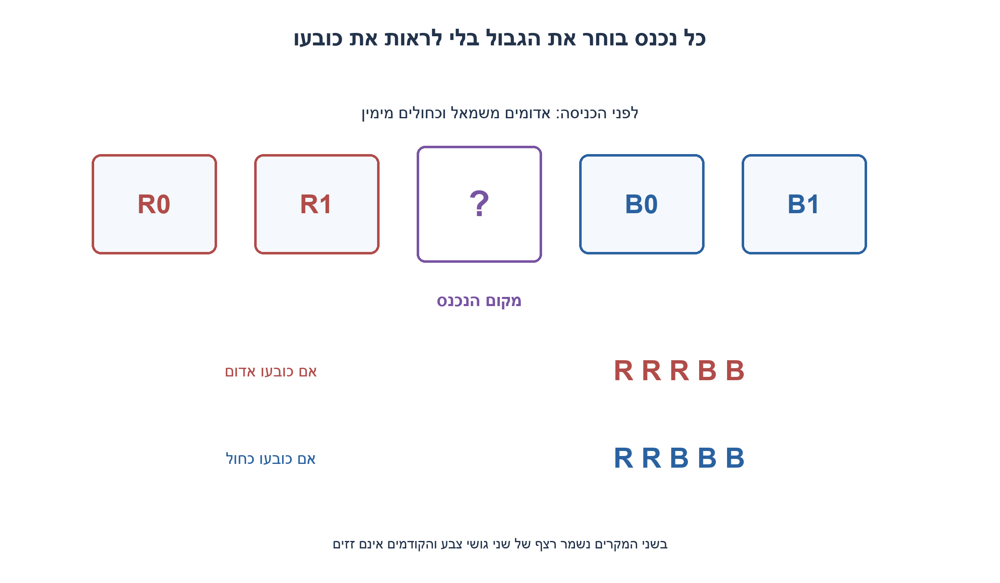
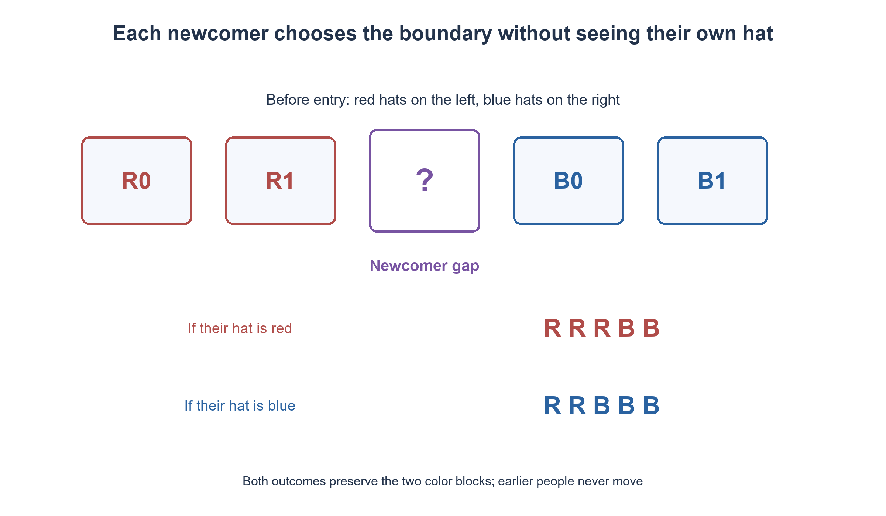

# PREP-250 — כובעים בחדר אטום — חלוקה מקוונת לשני צבעים

פתרון מוצע בסיוע AI; ביקורת מקצועית אנושית ממתינה.

[מקור פרטי](../sources/2026-11-03-batch20-11.png)

50 גמדים מחוץ לחדר, חצי חובשים כובע אדום וחצי כחול. עליהם להיכנס לחדר אטום ולהסתדר חצי כחול בצד אחד וחצי אדום בצד השני. הנכנס רואה את כל הגמדים שלפניו; מי שבחדר אינו יודע מי הבאים שייכנסו; כל גמד אינו יודע את צבעו; מי שנכנס מתמקם ואינו יכול לזוז לאחר מכן. ניתן לבנות אסטרטגיה משותפת מראש.

## עברית

חמישים גמדים,25 עם כובע אדום ו־25 עם כובע כחול, נכנסים אחד־אחד לחדר אטום. כל נכנס רואה את הכובעים של מי שכבר בפנים, אינו רואה את כובעו ואינו יודע מי ייכנס אחריו. עליו לבחור מיד מקום ואסור לו לזוז לאחר מכן. תכננו מראש אסטרטגיה שבסופה כל האדומים יהיו בצד אחד וכל הכחולים בצד השני.

הבהרה מרחבית שנוספה: מסדרים שורה עם שמאל וימין מוסכמים; לפני ההתמקמות אפשר לראות את כל הקודמים ולעמוד בכל רווח ביניהם או בקצוות, עם מספיק מקום. אין סימון של הצבע העצמי, תקשורת בזמן הכניסה או הזזה של מי שכבר התמקם. בדקו אם ידיעת25/25 בכלל נחוצה.

1. נסו לשמור תכונה אחרי כל כניסה, ולא להמתין לידיעת כל הכובעים. מה יהיה מבנה השורה התקינה?
2. אם כל האדומים שכבר נכנסו משמאל וכל הכחולים מימין, יש גבול ביניהם, גם כשאחד הגושים ריק.
3. בחרו תמיד בגבול: אחרי האדום האחרון ולפני הכחול הראשון. אם הנכנס אדום הוא מרחיב את הגוש השמאלי; אם כחול את הימני.

### הנכנס אינו צריך לדעת איזה משני הגושים הוא מרחיב
מסכימים מראש שאדומים יהיו משמאל וכחולים מימין. הנכנס מתבונן בשורה ובוחר ברווח שבין הגוש האדום לגוש הכחול. אם עדיין אין איש, הוא עומד במקום הראשון. אם יש רק אדומים, עומדים מימינם; אם רק כחולים, משמאלם. אלו אותם כללים עם גוש ריק, לא ניחוש של הצבע העצמי.

לדוגמה, השורה היא `R R B B`. הנכנס בוחר ברווח האמצעי. אם כובעו R התוצאה `R R R B B`; אם B התוצאה `R R B B B`. בשני המקרים נשארת שורה מחולקת. לכן החלטתו תלויה רק בכובעים שהוא רואה, ואינה צריכה מידע ממי שעוד לא נכנס.

### הוכחה באינדוקציה
בשורה הריקה התכונה ״כל אדום משמאל לכל כחול״ נכונה. נניח שהיא נכונה לפני הכניסה הבאה. כל אדם שכבר נמצא נשאר במקומו. הנכנס ממוקם אחרי כל אדום ולפני כל כחול. אם הוא אדום אין כחול משמאלו; אם הוא כחול אין אדום מימינו. היחסים בין הקודמים לא השתנו, ולכן התכונה נשמרת. אחרי50 כניסות היא בדיוק הדרישה. הטיעון תקף לכל מספר כניסות ולכל ספירה של שני הצבעים;25/25 אינו נחוץ.

האסטרטגיה אינה פרוטוקול אמירת צבעים או קידוד זוגיות של טור כובעים: כאן הבחירה היא מקום, ומותר לראות את הכובעים שכבר הונחו בשורה. אם נכנס יכול רק להיצמד לאחד משני קצוות, הגבול אינו תמיד נגיש ואין לטעון שהפתרון הזה עדיין עובד. אם החדר מאפשר רק עמדות צפופות ללא רווחים או שהנכנס אינו יכול לראות את שני הגושים, צריך חוזה מרחבי אחר. אלה הנחות מהותיות משום שהמקור אינו מפרט את הגאומטריה.

סריקת k כובעים קיימים מוצאת את הגבול ב־O(k) זמן ו־O(1) מקום נוסף מבחינת החלטת הנכנס. לכלn הכניסות זו O(n²) עבודת סריקה במימוש פשוט; אין טענת מינימום זמן ראייה או תנועה. מערך סימולציה מספק זהויות לצורך בדיקת אי־הזזת הקודמים; הוא אינו אמצעי תקשורת שהגמדים מקבלים. הבדיקה הממצה כוללת את שני צבעי הכובע האפשריים בכל החלטה.

```python
"""Boundary choice observes earlier hats, never the entrant's own color.

People already placed remain stationary. A newcomer may stand at any gap.
Order is left-to-right: red (0), then blue (1); no communication is required.
"""


def choose_gap(visible_colors):
    """Return the gap after the last visible red; empty line uses gap zero."""
    gap = 0
    for index, color in enumerate(visible_colors):
        if color not in (0, 1):
            raise ValueError('Binary colors required')
        if color == 0:
            gap = index + 1
    return gap


def simulate_arrival(colors):
    """Test coordinator knows hats; choose_gap receives only earlier hats."""
    placed = []
    for identity, own_color in enumerate(colors):
        if own_color not in (0, 1):
            raise ValueError('Binary colors required')
        gap = choose_gap([color for _, color in placed])
        placed.insert(gap, (identity, own_color))
    return placed
```


ההוכחה נגזרה כאן באמצעות אינווריאנט של שני גושי צבע; אינה נשענת על פתרון של שאלת כובעים אחרת.



## English

Fifty dwarfs,25 wearing red hats and25 blue, enter an opaque room one at a time. Each entrant sees earlier occupants' hats, cannot see their own, and does not know who will enter later. They must immediately choose a position and may not move afterward. Agree beforehand on a strategy leaving every red hat on one side and every blue hat on the other.

Added spatial clarification: form a line with agreed left/right directions; before taking a position, the entrant can see all earlier hats and stand at any gap or either end, with sufficient space. No own-color signal, live communication or displacement of earlier occupants is allowed. Is knowing25/25 necessary?

1. Preserve an invariant after every entry rather than waiting to know every hat. What does a valid partial line look like?
2. If existing reds are left of existing blues, their blocks have a boundary, even when one block is empty.
3. Always choose that boundary: after the last red and before the first blue. A red newcomer extends the left block; a blue newcomer extends the right block.

### A newcomer need not know which block they extend
Agree that reds belong on the left and blues on the right. Each entrant observes the current line and chooses the gap between the red block and blue block. If the room is empty, take the first position. With only reds, stand to their right; with only blues, stand to their left. These are the same boundary rule with an empty block, not guesses about one's own hat.

For example, the line is `R R B B`. The newcomer chooses the middle gap. If their hat is R, the result is `R R R B B`; if B, it is `R R B B B`. Either outcome remains partitioned. Thus the decision uses only visible hats, without knowing future entrants.

### Inductive correctness
In an empty line, “every red is left of every blue” holds. Assume it holds before the next entry. Earlier people stay stationary. The newcomer stands after every red and before every blue. If red, no blue is to their left; if blue, no red is to their right. Relations among earlier occupants are unchanged, so the invariant survives. After50 entries it is exactly the required final arrangement. The argument works for any number and any count of the two colors;25/25 is unnecessary.

This is not the spoken-parity protocol for a fixed hat queue: the action here is choosing a position, with visibility of already placed hats. If newcomers may only join one of the two ends, the boundary is not always accessible and this construction no longer suffices. Crowded fixed stations without gaps, or inability to see both blocks, likewise require a different spatial contract. Those are material assumptions because the source does not specify geometry.

Scanning k earlier hats finds the boundary in O(k) time and O(1) extra decision storage. A simple implementation scans O(n²) hats across n entries; no minimum visual or movement-time claim is made. The simulation stores identities to verify stationary prior order; it is not a communication device supplied to the dwarfs. Exhaustive checks include both possible own colors at every decision.

```python
"""Boundary choice observes earlier hats, never the entrant's own color.

People already placed remain stationary. A newcomer may stand at any gap.
Order is left-to-right: red (0), then blue (1); no communication is required.
"""


def choose_gap(visible_colors):
    """Return the gap after the last visible red; empty line uses gap zero."""
    gap = 0
    for index, color in enumerate(visible_colors):
        if color not in (0, 1):
            raise ValueError('Binary colors required')
        if color == 0:
            gap = index + 1
    return gap


def simulate_arrival(colors):
    """Test coordinator knows hats; choose_gap receives only earlier hats."""
    placed = []
    for identity, own_color in enumerate(colors):
        if own_color not in (0, 1):
            raise ValueError('Binary colors required')
        gap = choose_gap([color for _, color in placed])
        placed.insert(gap, (identity, own_color))
    return placed
```


The proof derives a two-block invariant here; it does not import a different hat-puzzle protocol.



## Supporting material / חומר משלים

```json
{
  "assumptions": {
    "he": "שני צבעים; כיוון שורה מוסכם; ראיית כל הקודמים; כניסה בכל רווח עם מקום פנוי. הקודמים נשארים במקומם.",
    "en": "Two colors; agreed line direction; visibility of all prior occupants; entry at any gap with space. Earlier people stay in place."
  },
  "optimality": {
    "he": "O(k) סריקה בכניסה ה־k ו־O(1) מקום להחלטה; O(n²) בכלל הכניסות במימוש פשוט. אין טענת מינימום פיזי.",
    "en": "O(k) scanning at entry k and O(1) decision storage; O(n²) across all entries in the simple implementation. No physical optimum claim."
  },
  "verification": {
    "he": "כל8,191 רצפי ההגעה באורכים0–12 נבדקו, שני צבעים אפשריים בכל בחירת רווח ואי־שינוי סדר הקודמים; נוספו200 סדרי25/25.",
    "en": "All 8,191 arrival strings of lengths 0–12 checked, both own colors at each gap and unchanged prior order; 200 source-sized 25/25 orders added."
  },
  "edge_cases": {
    "he": "שורה ריקה; רק צבע אחד; כניסה ראשונה ואחרונה; ספירות לא שוות; הגבלת מקום או ראייה שפוסלת את ההנחה.",
    "en": "Empty line; one color only; first/last entry; unequal counts; position or visibility restrictions invalidating the contract."
  },
  "common_mistakes": {
    "he": "להורות לאדם להצטרף לצבעו שאינו ידוע לו; לסמוך על סדר עתידי; להזיז קודמים; לבלבל חלוקה זו עם שאלת אמירת צבע.",
    "en": "Telling a person to join their unknown color; depending on future order; moving earlier occupants; confusing partition with spoken hat-color guessing."
  },
  "interview_answer": {
    "he": "אשמור גוש אדום ואחריו גוש כחול. כל נכנס עומד בגבול ביניהם; שני צבעי כובעו משמרים את החלוקה, ולכן אין צורך בידיעת הצבע העצמי.",
    "en": "Maintain a red block followed by a blue block. Every newcomer enters their boundary; either own color preserves the partition, so own-color knowledge is unnecessary."
  },
  "source_ambiguities": {
    "he": "המקור אינו מפרט אם אפשר להיכנס בין אנשים. הפתרון מצהיר על אפשרות זו ואינו טוען לפתרון תחת איסור כזה.",
    "en": "The source does not specify insertion between people. This construction explicitly permits it and makes no claim under a ban on insertion."
  },
  "solution_extensions": {
    "he": "אם מותר להיכנס רק בקצוות, הציגו מצב שבו הגבול פנימי והסבירו מדוע צריך אסטרטגיה או הנחות אחרות.",
    "en": "If entry is allowed only at the ends, exhibit an internal boundary and explain why a different strategy or assumptions are needed."
  },
  "technical_references": {
    "he": [
      "ההוכחה נגזרה כאן באמצעות אינווריאנט של שני גושי צבע; אינה נשענת על פתרון של שאלת כובעים אחרת."
    ],
    "en": [
      "The proof derives a two-block invariant here; it does not import a different hat-puzzle protocol."
    ]
  }
}
```
