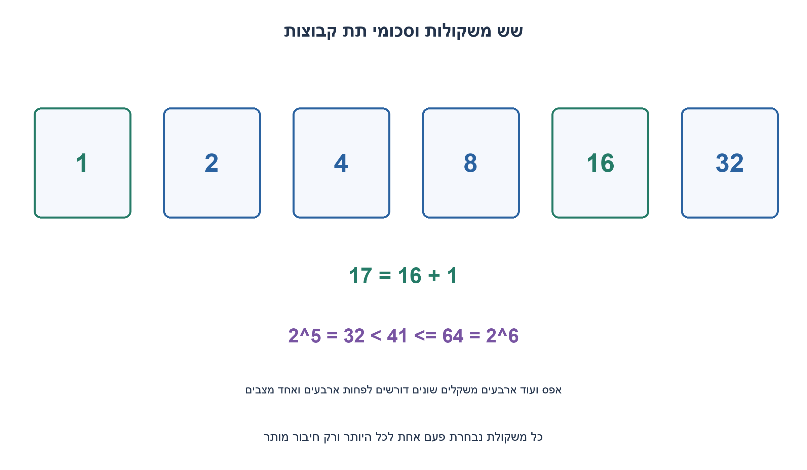
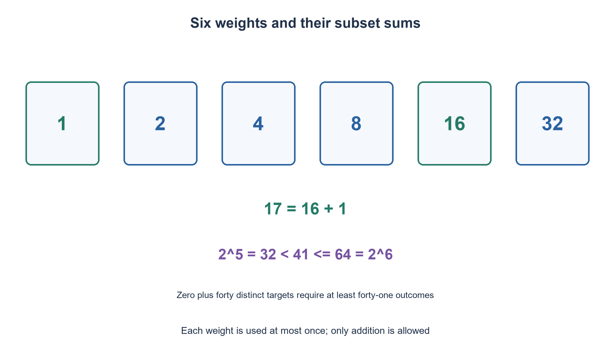

# PREP-251 — מספר משקולות מינימלי לכל משקל שלם מ־1 עד40

פתרון מוצע בסיוע AI; ביקורת מקצועית אנושית ממתינה.

[מקור פרטי](../sources/2026-11-03-batch20-18.png)

יש מד משקל שנותן כל משקל שתרצה. בחר מספר מינימלי של משקולות שיאפשרו להציג כל משקל שלם בין 1 ל-40 קילו על ידי הנחת המשקולות הנבחרות על המד. למשל 10,5,2 מייצגות יחד 17 קילו.

## עברית

בחרו מספר מינימלי של משקולות קבועות, כך שלכל מספר שלם מ־1 עד40 קילוגרם אפשר לבחור חלק מהן ולהניחן על מד המשקל לקבלת המספר המדויק. לכל משקולת עותק אחד, כל משקולת חיובית ובמשקל שלם, ובכל מדידה אפשר לבחור אם להשתמש בה או לא. מותר רק לחבר משקלים; אין כף נגדית, חיסור, פירוק משקולת או שימוש פעמיים באותו עותק. הציגו משקולות, דוגמה ל־17 והוכחת מינימליות.

1. לכל משקולת יש שתי אפשרויות: נבחרה או לא. כמה תתי־קבוצות קיימות עם k משקולות?
2. צריך לייצג גם את אפס בעזרת הקבוצה הריקה וגם40 מספרים חיוביים שונים. חמש משקולות יוצרות לכל היותר32 תתי־קבוצות.
3. שש משקולות בחזקות של2 נותנות64 תתי־קבוצות. הייצוג הבינארי מפרק כל מספר0–63 לסכום מתאים.

### בנייה: משתמשים בייצוג בינארי
בחרו משקולות `1,2,4,8,16,32` קילוגרם. לכל מספר שלם0–63 יש ייצוג בשש סיביות. סיבית1 אומרת לבחור את המשקולת המתאימה, וסיבית0 להשאירה בחוץ. לכן כל הדרישות1–40 מכוסות. למשל17=16+1, ו־40=32+8. אין חובה שסכום כל המשקולות יהיה40, והמקור אינו מגביל משקולת32 אף שחלק מהתוצאות האפשריות גדולות40.

הנכונות נובעת גם באינדוקציה: המשקולות עד2^(k−1) מייצגות0..2^k−1. הוספת2^k שומרת את הטווח הישן, ונותנת את הטווח הסמוך2^k..2^(k+1)−1. אין חור ביניהם. בשש משקולות הטווח0..63 כולל את כל היעדים.

### חסם תחתון: סופרים בחירות, לא רק את הסכום הכולל
עם k עותקים קבועים יש בדיוק2^k תתי־קבוצות. שתי תתי־קבוצות עלולות לתת אותו סכום, ולכן יש לכל היותר2^k תוצאות שונות. דרושים41 ערכים שונים: אפס של הקבוצה הריקה ועוד1..40. לכן `2^k≥41`, ומכאן `k≥ceil(log2(41))=6`. חמש משקולות אינן מספיקות, לא משנה אילו משקלים בוחרים. הבנייה משיגה6 ולכן היא מינימלית במודל החיבור בלבד.

משקולות `1,3,9,27` נותנות40 בסך הכול, אך רק16 תתי־קבוצות. הן אינן פותרות את המודל הזה: למשל2 אינו סכום שלהן. הן מתאימות לבעיה אחרת עם שתי כפות שבה כל משקולת יכולה להוסיף, להחסיר או לא להשתתף. אין להחליף בשקט את מד המשקל של המקור במאזני שתי כפות.

לא נדרש פתרון יחיד. גם קבוצה אחרת עם6 משקולות יכולה לכסות1..40; אין צורך לטעון שחזקות2 הן הבחירה המינימלית היחידה. עבור יעד כלליM≥1, חזקות2 עדM נותנות `floor(log2(M))+1=ceil(log2(M+1))` משקולות. בנייתן וייצוג יעד דורשים O(log M) פעולות ומקום לפלט. זו עלות אריתמטית; מספר הביטים של M אינו קבוע כאשר מכלילים לגדלים לא חסומים.

```python
"""One copy of each positive integral weight; only addition is permitted."""


def binary_weights(maximum):
    if type(maximum) is not int or maximum < 0:
        raise ValueError('Nonnegative integer maximum required')
    weights = []
    value = 1
    while value <= maximum:
        weights.append(value)
        value *= 2
    return weights


def select_weights(target, weights):
    if type(target) is not int or target < 0:
        raise ValueError('Nonnegative integer target required')
    chosen = []
    remaining = target
    for weight in reversed(weights):
        if weight <= remaining:
            chosen.append(weight)
            remaining -= weight
    if remaining:
        raise ValueError('Target not represented by these binary weights')
    return chosen
```


הבנייה והחסם נגזרו כאן מספירת תתי־קבוצות וייצוג בינארי; אין טענה לניסוי שקילה פיזי.



## English

Choose the fewest fixed weights so that every integer mass from 1 through 40 kilograms can be formed by placing a subset on a scale. Each positive integral weight has one available copy, used at most once per measurement. Only addition is allowed: no opposite pan, subtraction, splitting or reusing a copy. Give the weights, represent17 and prove minimality.

1. Each weight is either selected or not. How many subsets do k weights have?
2. The empty subset gives zero, and 40 different positive targets are also needed. Five weights yield at most32 subsets.
3. Six powers of2 yield64 subsets. Binary representation expresses every number0–63 as such a sum.

### Construction: use binary representation
Choose weights `1,2,4,8,16,32` kilograms. Every integer0–63 has a six-bit representation. A1 bit selects its weight; a0 bit leaves it out. Thus every target1–40 is covered. For example 17=16+1 and 40=32+8. The total of all weights need not equal40, and the source does not prohibit the32-kilogram weight or representations above40.

Correctness also follows inductively. Weights through 2^(k−1) represent0..2^k−1. Adding2^k keeps that old interval and adds the adjacent interval2^k..2^(k+1)−1, leaving no gap. Six weights cover0..63, including every required target.

### Lower bound: count choices, not merely total mass
With k fixed copies there are exactly 2^k subsets. Some may have equal sums, so there are at most 2^k different results. We need 41 distinct values: zero from the empty subset, plus 1..40. Therefore `2^k≥41`, giving `k≥ceil(log2(41))=6`. Five weights cannot suffice regardless of their values. The six-weight construction matches the bound and is minimal in the addition-only model.

Weights `1,3,9,27` total40 but offer only 16 subsets, so they do not solve this task:2, for example, cannot be formed. They belong to a different two-pan problem in which each weight can add, subtract or be unused. Do not silently replace the source's additive scale with a two-pan balance.

The optimal set need not be unique. Another six-weight set may also cover1..40; powers of2 are not claimed to be the sole optimum. For general M≥1, powers of2 through M give `floor(log2(M))+1=ceil(log2(M+1))` weights. Construction and target representation use O(log M) arithmetic operations and output storage. This is not a constant bit-cost claim for unbounded M.

```python
"""One copy of each positive integral weight; only addition is permitted."""


def binary_weights(maximum):
    if type(maximum) is not int or maximum < 0:
        raise ValueError('Nonnegative integer maximum required')
    weights = []
    value = 1
    while value <= maximum:
        weights.append(value)
        value *= 2
    return weights


def select_weights(target, weights):
    if type(target) is not int or target < 0:
        raise ValueError('Nonnegative integer target required')
    chosen = []
    remaining = target
    for weight in reversed(weights):
        if weight <= remaining:
            chosen.append(weight)
            remaining -= weight
    if remaining:
        raise ValueError('Target not represented by these binary weights')
    return chosen
```


The construction and lower bound derive from subset counting and binary representation; no physical weighing is claimed.



## Supporting material / חומר משלים

```json
{
  "assumptions": {
    "he": "עותק אחד מכל משקולת שלמה חיובית; משתמשים בתת־קבוצה ורק בחיבור. אין מאזני שתי כפות.",
    "en": "One copy of each positive integer weight; a subset is selected and only addition is permitted. There is no two-pan subtraction."
  },
  "optimality": {
    "he": "מינימום6 משקולות מוכח מחסם2^k≥41 ובנייה בחזקות2. ל־M כללי נדרשותceil(log2(M+1)) משקולות.",
    "en": "Six is minimal by2^k≥41 and a powers-of-two construction. General M requiresceil(log2(M+1)) weights."
  },
  "verification": {
    "he": "כל היעדים לכלM מ־0 עד255 נבדקו מול סכומי כל תתי־הקבוצות: 32,896 ייצוגים. החסם המתמטי נפרד מהבדיקה.",
    "en": "All targets for M=0..255 checked against enumerated subset sums: 32,896 representations. The mathematical bound is separate from finite checks."
  },
  "edge_cases": {
    "he": "יעדים1,17,32,40; יעד0; חזרה על משקולת אסורה; משקולות שאינן מייצגות יעד; קיום כמה קבוצות אופטימליות.",
    "en": "Targets1,17,32,40; zero; prohibited reuse; an unrepresentable target; multiple optimal weight sets."
  },
  "common_mistakes": {
    "he": "לבחור1,3,9,27 בלי היתר חיסור; לספור3^k במודל שתי אפשרויות; להוכיח רק שסכום המשקולות מספיק; לטעון ליחידות הפתרון.",
    "en": "Choosing1,3,9,27 without subtraction; counting3^k for two choices; using total mass alone as a coverage proof; claiming uniqueness."
  },
  "interview_answer": {
    "he": "יש41 תוצאות נחוצות כולל0, ו־k משקולות נותנות לכל היותר2^k תתי־קבוצות. לכן צריך6, והמשקולות1,2,4,8,16,32 משיגות זאת.",
    "en": "There are41 required values including0; k weights give at most 2^k subsets. Six are necessary, and1,2,4,8,16,32 suffice."
  },
  "source_ambiguities": {
    "he": "המקור מדגים10+5+2 על מד משקל. נוסח העריכה מבהיר חיבור בלבד; מודל מאזניים דו־כפי נשאר שאלת המשך נפרדת.",
    "en": "The source illustrates10+5+2 on a scale. The edited contract makes addition explicit; two-pan balancing is a separate follow-up."
  },
  "solution_extensions": {
    "he": "אם מותר להניח משקולות בשתי כפות, מה משתנה במספר המצבים ובבניית1,3,9,27? הסבירו את ההבדל במודל.",
    "en": "If weights may be put on either pan, how do outcome counts and1,3,9,27 change? Explain the different model."
  },
  "technical_references": {
    "he": [
      "הבנייה והחסם נגזרו כאן מספירת תתי־קבוצות וייצוג בינארי; אין טענה לניסוי שקילה פיזי."
    ],
    "en": [
      "The construction and lower bound derive from subset counting and binary representation; no physical weighing is claimed."
    ]
  }
}
```
