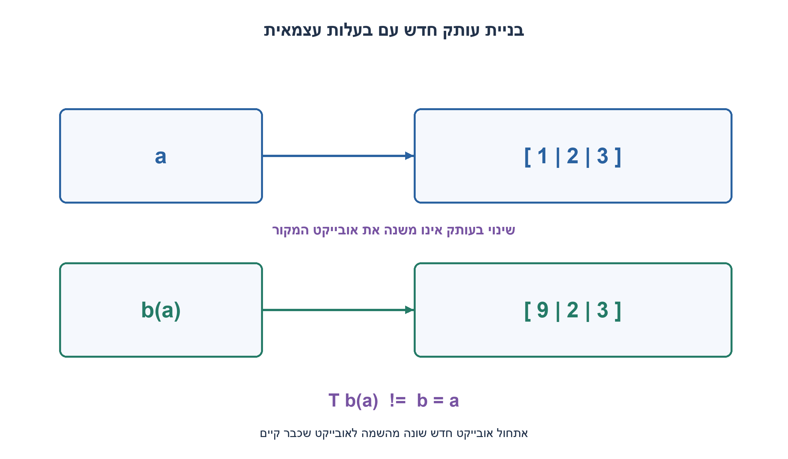
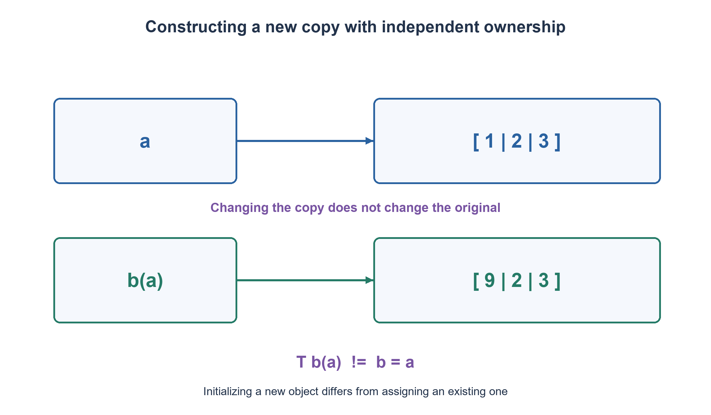

# PREP-252 — בנאי העתקה ב־C++ ובעלות על משאבים

פתרון מוצע בסיוע AI; ביקורת מקצועית אנושית ממתינה.

[מקור פרטי](../sources/2026-11-03-batch20-12.png)

מה זה Copy Constructor ולמה הוא חשוב?

## עברית

מהו Copy Constructor ב־C++ ומדוע הוא חשוב? השתמשו ב־C++17 והבדילו בין אתחול אובייקט חדש מעותק קיים לבין השמה לאובייקט שכבר קיים. הסבירו מה עושה העתקה אוטומטית לחברי מחלקה ולמצביע, מתי דרושה העתקה עצמאית של משאב ומתי נכון למנוע העתקה או להעדיף Rule of Zero. תנו דוגמה בטוחה, ציינו עלות ודונו בקשר לבנאי העברה ולהשמטת העתקות.

1. ב־T b(a) האובייקט b נוצר כעת. ב־b=a הוא כבר קיים. אלו אינן בהכרח אותה פעולה.
2. ברירת המחדל מעתיקה כל בסיס וחבר לפי טיפוסו. העתקת כתובת אינה יוצרת עותק של ההקצאה שאליה היא מצביעה.
3. הגדירו מה המשמעות של שני אובייקטים עצמאיים. std::vector יכול לנהל זאת עבורכם; בדוגמת בעלות ידנית צריך להתייחס גם להשמה, להריסה ולהעברה.

### בנאי העתקה מאתחל אובייקט חדש
הצורה הרגילה היא `T(const T& other)`. למשל `T b(a);` או `T b=a;` יכולים ליצור b חדש מתוך a קיים. לעומת זאת `b=a;` אחרי ששניהם קיימים היא השמת העתקה, דרך operator=. פרמטר מקור רגיל הוא const reference כדי לא לשנות את המקור וכדי לא לבקש עותק נוסף רק לשם העברת הפרמטר. התקן מכיר גם צורות נוספות; זו הצורה המקובלת לדוגמה זו.

בנאי העתקה אוטומטי מבצע העתקה לפי חברים ובסיסים. חבר int מועתק כערך, std::vector מעתיק את איבריו לפי החוזה שלו, ומצביע גולמי מועתק ככתובת. ״אוטומטי״ אינו שקול ל־memcpy ואינו יוצר באופן כללי הקצאה נפרדת עבור מצביע. אם שני אובייקטים חושבים שהם בעלי אותה הקצאה ומבצעים delete עליה, מתקבל ניהול משאבים שגוי. אם המצביע רק מושאל, שיתוף כתובת יכול דווקא להיות הכוונה; קודם מגדירים בעלות.

### עדיפות למבנה שמנהל את עצמו
Scores שבקוד מכילה std::vector<int>. אין צורך לכתוב בנאי העתקה, השמה או דסטרקטור: חברי המחלקה מספקים את התנהגות הערך. זהו Rule of Zero, לא איסור על כתיבת בנאי רגיל. שינוי איבר בעותק אינו משנה את איברי המקור. עבור משאב שלא ראוי להעתקה, כמו בעלות יחידה על התקן, אפשר למחוק פעולות העתקה ולהציע העברה או clone מפורש לפי החוזה.

הדוגמה OwnedInts מציגה העתקה מפורשת: תחילה מקצים n תאים חדשים, ואז מעתיקים ערכים. unique_ptr<int[]> מנהל את ההרס. לבנאי ההעברה נלקחת הבעלות והגודל במקור מתאפס; השמה מקבלת פרמטר לפי ערך ומחליפה ב־swap. אם יצירת עותק הפרמטר נכשלת בהקצאה, אובייקט היעד עדיין לא השתנה. גוף ההשמה עצמו אינו זורק; אין בכך הבטחה שיצירת פרמטר ההעתקה לעולם לא תזרוק. כך מטופלים גם השמה עצמית ושימוש מחדש באובייקט שהועבר ממנו.

### משמעות ועלות
להעתקת n מספרים למאגר נפרד יש O(n) זמן ו־O(n) אחסון נוסף עבור התוצאה במודל זה. העברת הבעלות בדוגמה היא O(1); אין להסיק מכך שכל move של כל טיפוס זול. כתיבת בנאי העתקה או דסטרקטור משפיעה על יצירת פעולות העברה אוטומטיות, ולכן בוחנים יחד את הפעולות המיוחדות ולא רק בנאי אחד.

אין לספור בנאים על סמך הנחה שכל החזרת ערך מעתיקה: ב־C++17 חלק מיצירת אובייקטים מערכים זמניים מתבצעת בלי קריאת בנאי העתקה, ו־NRVO הוא מקרה נפרד שעשוי להיות מותר. הבדיקה משתמשת במקור lvalue מפורש כדי לבחון העתקה אמיתית. המימוש וה־harness קומפלו בנפרד באמצעות GCC ב־C++17 עם אזהרות כשגיאות; כל 65 הגדלים 0–64 עברו ללא הודעות stderr. נבדקו אי־תלות של ערכים וכתובות, השמה עצמית, העברה, שימוש חוזר וחריגת גבול. לא הוזרקו כשלי הקצאה; בטיחות ההשמה נשענת על מבנה הקוד וכללי השפה.

```cpp
// C++17. A value type needing no custom special members (Rule of Zero).
#include <algorithm>
#include <cstddef>
#include <memory>
#include <stdexcept>
#include <utility>
#include <vector>

struct Scores {
    std::vector<int> values;
};

// Explicit ownership example: copies allocate independent element storage.
class OwnedInts {
    std::size_t size_ = 0;
    std::unique_ptr<int[]> values_;

public:
    explicit OwnedInts(std::size_t size = 0)
        : size_(size), values_(size ? new int[size]{} : nullptr) {}

    OwnedInts(const OwnedInts& other) : OwnedInts(other.size_) {
        for (std::size_t i = 0; i < size_; ++i) values_[i] = other.values_[i];
    }

    OwnedInts(OwnedInts&& other) noexcept
        : size_(std::exchange(other.size_, 0)), values_(std::move(other.values_)) {}

    // By-value assignment covers copy and move assignment; swap cannot throw.
    OwnedInts& operator=(OwnedInts other) noexcept {
        swap(other);
        return *this;
    }

    ~OwnedInts() = default;

    void swap(OwnedInts& other) noexcept {
        std::swap(size_, other.size_);
        values_.swap(other.values_);
    }

    std::size_t size() const noexcept { return size_; }
    int& at(std::size_t i) {
        if (i >= size_) throw std::out_of_range("OwnedInts");
        return values_[i];
    }
    const int& at(std::size_t i) const {
        if (i >= size_) throw std::out_of_range("OwnedInts");
        return values_[i];
    }
};
```


[טיוטת C++ — בנאי העתקה והעברה](https://eel.is/c++draft/class.copy.ctor)
[טיוטת C++ — השמת העתקה והעברה](https://eel.is/c++draft/class.copy.assign)
[C++ Core Guidelines — Rule of Zero ופעולות מיוחדות](https://isocpp.github.io/CppCoreGuidelines/CppCoreGuidelines#Rc-zero)



## English

What is a C++ Copy Constructor and why does it matter? Use C++17 and distinguish initializing a new object from assigning one that already exists. Explain memberwise copying, copying a pointer, independent resource copies, noncopyable ownership and the Rule of Zero. Give a safe example, state its cost, and discuss moves and copy elision.

1. In T b(a), b is being created. In b=a, b already exists. These need not invoke the same operation.
2. The default copies each base/member according to its type. Copying an address does not duplicate its allocation.
3. Define independent value semantics. std::vector can handle them for you; a manually managed owner must also address assignment, destruction and moves.

### A copy constructor initializes a new object
The usual form is `T(const T& other)`. For example, `T b(a);` or `T b=a;` may construct a new b from existing a. Once both exist, `b=a;` is copy assignment through operator=. A const reference avoids modifying the source or requiring another value copy merely to pass it. The standard permits additional forms; this is the conventional form used here.

An implicit copy constructor copies bases and members according to their types. An int copies its value, std::vector copies elements under its own contract, and a raw pointer copies its address. Memberwise copying is not generally memcpy and does not automatically duplicate a pointer's allocation. Two objects both believing they own and must delete that allocation violate ownership. A borrowed pointer may intentionally share its address; define ownership before choosing copy semantics.

### Prefer members that manage themselves
Scores in the code contains std::vector<int>. No custom copy constructor, assignment or destructor is needed: its members provide value semantics. This is the Rule of Zero, not a prohibition on ordinary constructors. Mutating the copy's element leaves the original unchanged. For a resource that should not be copied, such as exclusive device ownership, delete copy operations and offer moves or an explicit clone as appropriate.

OwnedInts demonstrates explicit deep copying: allocate n fresh elements, then copy values. unique_ptr<int[]> manages destruction. Its move constructor transfers ownership and resets the source size. By-value assignment swaps with the parameter. If allocating that parameter's copy fails, the target remains unchanged. The assignment body itself cannot throw; this does not promise that constructing a copy parameter never throws. Self-assignment and reuse of moved-from objects are covered.

### Meaning and cost
Copying n integers to independent storage takes O(n) time and O(n) result storage in this model. Moving ownership here is O(1); not every type has a cheap move. Declaring a copy constructor or destructor affects implicit move generation, so the special operations must be considered together.

Do not count constructors by assuming every return-by-value copies: C++17 permits or requires construction without invoking a copy constructor in specified temporary-object cases, while NRVO is a separate potentially permitted case. The harness uses an explicit lvalue source to exercise copying. The implementation and harness were separately compiled with GCC in C++17 mode, treating warnings as errors; all 65 sizes 0–64 passed with empty stderr. Tests cover independent values/addresses, self-assignment, moves, reuse and bounds. Allocation failures were not injected; assignment exception safety follows from the code structure and language rules.

```cpp
// C++17. A value type needing no custom special members (Rule of Zero).
#include <algorithm>
#include <cstddef>
#include <memory>
#include <stdexcept>
#include <utility>
#include <vector>

struct Scores {
    std::vector<int> values;
};

// Explicit ownership example: copies allocate independent element storage.
class OwnedInts {
    std::size_t size_ = 0;
    std::unique_ptr<int[]> values_;

public:
    explicit OwnedInts(std::size_t size = 0)
        : size_(size), values_(size ? new int[size]{} : nullptr) {}

    OwnedInts(const OwnedInts& other) : OwnedInts(other.size_) {
        for (std::size_t i = 0; i < size_; ++i) values_[i] = other.values_[i];
    }

    OwnedInts(OwnedInts&& other) noexcept
        : size_(std::exchange(other.size_, 0)), values_(std::move(other.values_)) {}

    // By-value assignment covers copy and move assignment; swap cannot throw.
    OwnedInts& operator=(OwnedInts other) noexcept {
        swap(other);
        return *this;
    }

    ~OwnedInts() = default;

    void swap(OwnedInts& other) noexcept {
        std::swap(size_, other.size_);
        values_.swap(other.values_);
    }

    std::size_t size() const noexcept { return size_; }
    int& at(std::size_t i) {
        if (i >= size_) throw std::out_of_range("OwnedInts");
        return values_[i];
    }
    const int& at(std::size_t i) const {
        if (i >= size_) throw std::out_of_range("OwnedInts");
        return values_[i];
    }
};
```


[C++ draft — copy/move constructors](https://eel.is/c++draft/class.copy.ctor)
[C++ draft — copy/move assignment](https://eel.is/c++draft/class.copy.assign)
[C++ Core Guidelines — Rule of Zero and special operations](https://isocpp.github.io/CppCoreGuidelines/CppCoreGuidelines#Rc-zero)



## Supporting material / חומר משלים

```json
{
  "assumptions": {
    "he": "C++17; סמנטיקת ערך למערך int; בעלות יחידה מאחורי הקלעים; אין ירושה או שימוש מקביל בדוגמה.",
    "en": "C++17; value semantics for an int array; internally unique ownership; no inheritance or concurrent access in the example."
  },
  "optimality": {
    "he": "העתקה עצמאית של n איברים O(n) זמן ו־O(n) זיכרון תוצאה; העברת הבעלות בדוגמה O(1). Rule of Zero עדיף כשחברים תקניים מתאימים.",
    "en": "Independent n-element copy:O(n) time and O(n) result storage; this ownership move is O(1). Prefer Rule of Zero when standard members meet the contract."
  },
  "verification": {
    "he": "כללי השפה נבדקו מול טיוטת התקן והנחיות C++. GCC ב־C++17 עם אזהרות כשגיאות קימפל והריץ בהצלחה harness של 65 גדלים; נבדקו כתובות וערכים עצמאיים, השמה עצמית, העברה וגבולות. לא הוזרקו כשלי הקצאה.",
    "en": "Rules reviewed against the C++ draft and Core Guidelines. GCC C++17 with warnings as errors compiled and passed a 65-size harness testing independent addresses/values, self-assignment, moves and bounds. Allocation failures were not injected."
  },
  "edge_cases": {
    "he": "אוסף ריק; מקור const; השמה עצמית; כשל הקצאה; טיפוס שאינו ניתן להעתקה; אובייקט לאחר move; השמטת העתקה.",
    "en": "Empty storage; const source; self-assignment; allocation failure; noncopyable type; moved-from reuse; copy elision."
  },
  "common_mistakes": {
    "he": "לבלבל בנאי עם השמה; להעתיק כתובת של משאב בעלות יחידה; להוסיף דסטרקטור בלי לבדוק פעולות מיוחדות; להציג כל return כעותק.",
    "en": "Confusing construction with assignment; copying an owning raw address; adding a destructor without checking special operations; treating every return as a copy."
  },
  "interview_answer": {
    "he": "בנאי העתקה בונה אובייקט חדש מאחר. העתקה לפי חברים מספיקה לחברי ערך, אך בעלות על משאב מחייבת חוזה נכון; אעדיף vector ו־Rule of Zero כשאפשר.",
    "en": "A copy constructor builds a new object from another. Memberwise copying fits value members, but resource ownership needs correct semantics; prefer vector and Rule of Zero when suitable."
  },
  "source_ambiguities": {
    "he": "המקור אינו מציין שפה או משאב. המונח פורש כ־C++17, והמשאב המפורש הוא דוגמת הוראה שנוספה.",
    "en": "The source names neither language version nor resource. It is interpreted as C++17, with an explicitly added ownership teaching example."
  },
  "solution_extensions": {
    "he": "כיצד הופכים את הטיפוס ללא־ניתן־להעתקה אך ניתן להעברה? מתי שיתוף בעלות ולא העתקה עמוקה הוא החוזה הנכון?",
    "en": "How would the type become move-only? When is shared ownership, rather than deep copying, the appropriate contract?"
  },
  "technical_references": {
    "he": [
      "[טיוטת C++ — בנאי העתקה והעברה](https://eel.is/c++draft/class.copy.ctor)",
      "[טיוטת C++ — השמת העתקה והעברה](https://eel.is/c++draft/class.copy.assign)",
      "[C++ Core Guidelines — Rule of Zero ופעולות מיוחדות](https://isocpp.github.io/CppCoreGuidelines/CppCoreGuidelines#Rc-zero)"
    ],
    "en": [
      "[C++ draft — copy/move constructors](https://eel.is/c++draft/class.copy.ctor)",
      "[C++ draft — copy/move assignment](https://eel.is/c++draft/class.copy.assign)",
      "[C++ Core Guidelines — Rule of Zero and special operations](https://isocpp.github.io/CppCoreGuidelines/CppCoreGuidelines#Rc-zero)"
    ]
  }
}
```
