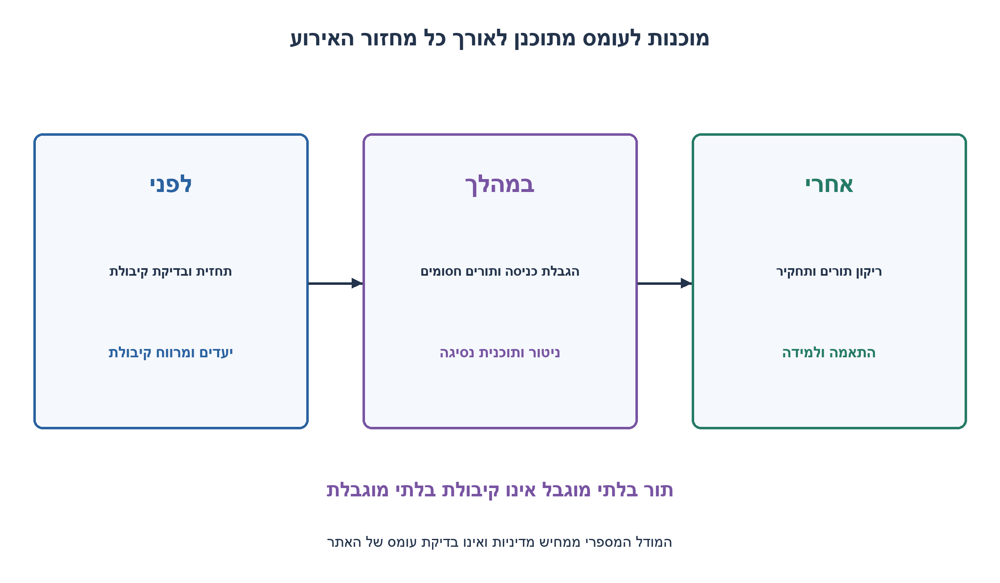
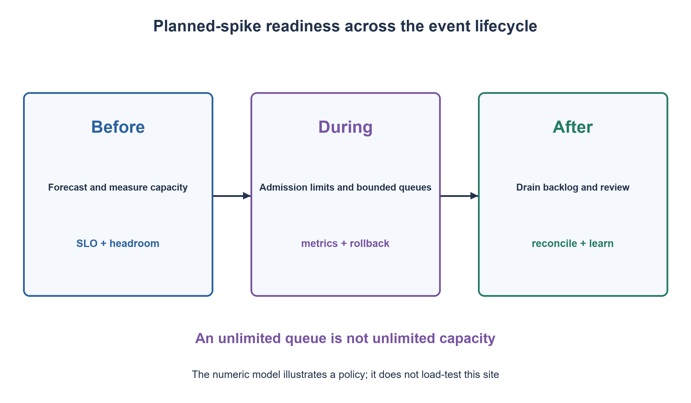

# PREP-253 — היערכות לאירוע עומס שיא מתוכנן

פתרון מוצע בסיוע AI; ביקורת מקצועית אנושית ממתינה.

[מקור פרטי](../sources/2026-11-03-batch20-19.png)

תאר תרחיש שבו אתר או שירות חווה עומס שיא Stress/Spike Load נקודתי, צפוי ומתוכנן: פרסום ציונים ארצי, תחילת שנה אקדמית או מכירה מיוחדת. בפרק זמן קצר מספר עצום של משתמשים מבצע פעולה דומה. אילו כלים ושיקולים ארכיטקטוניים נדרשים מצוות הפיתוח כדי שהאתר לא יקרוס ויטפל בעומס? פרט פעולות לפני האירוע, במהלכו ואחריו.

## עברית

אתר או שירות צפוי לקבל בתוך זמן קצר מספר גדול מאוד של משתמשים שמבצעים פעולה דומה, למשל פרסום ציונים או פתיחת מכירה. תארו תוכנית לפני האירוע, במהלכו ואחריו: מדידת ביקוש וקיבולת, ארכיטקטורה, בדיקות, ניטור ותפעול. הסבירו מה עושים כשהביקוש עולה על הקיבולת, כיצד מגינים על עקביות הנתונים ועל שירותי המשנה, ואילו פשרות משפיעות על חוויית המשתמש. אין מספר תעבורה, ספק ענן או יעד ביצועים נתון; כל מספר בדוגמה חייב להיות הנחה מוצהרת. אין צורך להפעיל עומס אמיתי על אתר כלשהו.

1. התחילו מהפעולה של המשתמש ומהו שירות תקין: זמן תגובה, שיעור שגיאות ונכונות נתונים. הוספת שרתים בלבד אינה מודדת צוואר בקבוק.
2. חשבו על קריאות לעומת כתיבות, cache ו־CDN, קיבולת DB, זמן התנעת שרתים ותלות חיצונית. תור אינסופי אינו קיבולת אינסופית.
3. הגדירו מראש הגבלת כניסה, תורים חסומים, timeout, retries מוגבלים עם jitter ופעולות אידמפוטנטיות; חברו לכך ניטור ותוכנית נסיגה מתורגלת.

### לפני האירוע: חוזה ובדיקת צווארי בקבוק
מגדירים תהליך משתמש קריטי ויעדים מדידים: זמני תגובה באחוזונים, שיעור הצלחה ונכונות של מידע או עסקה. מעריכים צורת עומס, משכו, תמהיל פעולות, מספר בקשות לפעולה, גודל payload והתנהגות retries. משתמשים במקביל אינם זהים לבקשות לשנייה. ממפים נתיב מלא: דפדפן, CDN, אימות, שרתי יישום, cache, מסד, תורים וספקים חיצוניים; לכל אחד קיבולת ומכסות משלו.

מודדים בסביבת בדיקה מבוקרת עומס רגיל, עלייה חדה, מצב מעבר לקיבולת, ריצה ממושכת והתאוששות אחרי ירידה. בודקים גם cache קר, נפילת מופע, שגיאת תלות ויצירת חיבורים. מחולל העומס צריך להפיק את הקצב שהוגדר בלי להסתיר האטה של המערכת. קובעים תנאי עצירה ונתוני בדיקה מתאימים. אין להסיק מקיבולת קריאות על קיבולת כתיבות, או מממוצע זמן תגובה על זנב ההתפלגות.

משתמשים ב־CDN או cache לנתונים שמתאימים לכך, עם מפתחות, זמני תוקף ומדיניות invalidation. מידע אישי לא הופך לציבורי בגלל cache. מעבירים עבודה לא־מיידית לתור חסום; מאנדקסים שאילתות, מצמצמים fan-out ושומרים על תקציב חיבורי DB כולל מכל המופעים. רכישה או שינוי מלאי צריכים עסקה או תנאי אטומי ואידמפוטנטיות; cache אינו מנגנון למניעת מכירה כפולה. מגדילים קיבולת מראש כשידוע האירוע, בודקים מכסות ומחממים רכיבים. autoscaling שמגיב אחרי דקות אינו מכסה בהכרח את השנייה הראשונה.

### במהלך האירוע: שירות יציב עם גבולות
מנטרים קצב בקשות שהגיעו, התקבלו והושלמו בנפרד, זמני זנב, שגיאות, CPU, זיכרון, חיבורים, נעילות וקצב גידול של תורים. כשביקוש גדול מהקצב הבטוח, בוחרים דחייה מוקדמת, המתנה מוגבלת או הורדת תכונות לפי עדיפות. תגובת429 או דף המתנה מוגדרים יכולים להיות טובים מאלפי בקשות שמחכות עד timeout. מסבירים למשתמש מה מצב בקשתו; אין להחזיר ״הצלחה״ אם פעולה אובדה.

לכל תלות יש תקציב זמן ומקביליות. retries מוגבלים עם backoff ו־jitter ואינם מתרבים בכל שכבה; משמרים מזהה פעולה למניעת כפילות. מנגנון circuit breaker עשוי להפחית לחץ על תלות חולה, אך דורש ספי פתיחה והתאוששות. מתרגלים on-call, ערוץ החלטות, בעל אחריות, התראות לפי פגיעה בשירות ופעולת rollback או כיבוי תכונה. הגדלת frontend אינה עוזרת אם היא רק מציפה מסד שכבר רווי.

### דוגמה מספרית מוצהרת ומגבלותיה
נניח ביקוש300 בקשות לשנייה, קיבולת נמדדת100 למופע ויעד שימוש75%. נדרשים4 מופעים עובדים: `ceil(300/(100·0.75))=4`. אם צריך לספוג אי־זמינות של מופע אחד, מקצים5 במודל הזה. זו הערכת תכנון מותנית בקיבולת שנמדדה, לא benchmark של האתר או הוכחת זמינות.

מודל הסלוטים המצורף מניח עלות אחידה, קיבולת שירות קבועה ותור מקסימליB. הוא מכניס לכל היותר שירות של סלוט אחד ועודB פריטים, מסיים עדC ומשאיר שארית חסומה. למשלC=3,B=2 והגעות `[2,8,0,0]` נותנות דחיית3 בזמן השיא ושארית2 שמתנקזת אחר כך. תור גדול יותר מפחית דחייה זמנית במחיר המתנה וזיכרון; הוא לא מגדיל throughput של צוואר הבקבוק. המודל נבדק מול אורקל חשבוני עצמאי ואינו מפיק p99 או קיבולת ייצור.

### אחרי האירוע
מוודאים שהבקשות שנותרו אכן הסתיימו, בודקים כפילויות, עקביות והתאמת עסקאות או תוצאות, ומשווים ביקוש וזמני תגובה לתחזית. מנתחים כשלים בלי לייחס הצלחה לעצם אי־קריסת השרת, מתעדים תיקונים ואחראים, ואז מצמצמים קיבולת בזהירות אחרי ריקון העבודה. אין ארכיטקטורה מיטבית אחת בלי יעדי שירות, עומס, עלות ומגבלות עקביות.

```python
"""Illustrative fixed-slot capacity model, not a load test of a real service.

Each slot may complete capacity requests. Admit at most capacity+queue_limit
requests including carried backlog. FIFO work left after service is bounded.
Uniform request costs, exact deterministic service, no retries or failures.
"""
from collections import deque
from fractions import Fraction


def required_instances(peak_per_second, measured_instance_capacity,
                       utilization=Fraction(3, 4), unavailable=1):
    if (type(peak_per_second) is not int or peak_per_second < 0 or
            type(measured_instance_capacity) is not int or measured_instance_capacity <= 0 or
            not 0 < utilization <= 1 or type(unavailable) is not int or unavailable < 0):
        raise ValueError('Invalid capacity inputs')
    utilization = Fraction(utilization)
    raw = Fraction(peak_per_second) / (measured_instance_capacity * utilization)
    working = (raw.numerator + raw.denominator - 1) // raw.denominator
    return working + unavailable


def simulate_slots(arrivals, capacity, queue_limit):
    if (type(capacity) is not int or capacity <= 0 or
            type(queue_limit) is not int or queue_limit < 0):
        raise ValueError('Positive slot capacity and nonnegative queue limit required')
    pending = deque()
    depth = 0
    trace = []
    for count in arrivals:
        if type(count) is not int or count < 0:
            raise ValueError('Nonnegative integer arrivals required')
        admitted = min(count, capacity + queue_limit - depth)
        rejected = count - admitted
        if admitted:
            pending.append(admitted)
        depth += admitted
        budget = capacity
        completed = 0
        while pending and budget:
            work = min(pending[0], budget)
            pending[0] -= work
            budget -= work
            depth -= work
            completed += work
            if pending[0] == 0:
                pending.popleft()
        trace.append(dict(arrived=count, admitted=admitted, rejected=rejected,
                          completed=completed, backlog=depth))
    return trace
```


[Google SRE — טיפול בעומס יתר](https://sre.google/sre-book/handling-overload/)
[Google SRE — רשימת בדיקות להשקה](https://sre.google/sre-book/launch-checklist/)
[Google Cloud — היערכות לאירוע קיבולת שיא](https://docs.cloud.google.com/support/docs/checklists/plan-peak-capacity-event)



## English

A website or service expects many users to perform a similar action in a short interval, such as grade publication or opening a sale. Plan work before, during and after the event: demand/capacity measurement, architecture, testing, monitoring and operations. Explain overload behavior, protection of data consistency and dependencies, and user-experience trade-offs. No traffic volume, cloud provider or performance target is supplied; label every numeric example as an assumption. No real website load test is required.

1. Start from the user operation and what acceptable service means:latency, errors and data correctness. More servers alone do not identify the bottleneck.
2. Distinguish reads/writes, caches/CDN, database limits, startup time and external dependencies. An unbounded queue is not unbounded capacity.
3. Predetermine admission limits, bounded queues, timeouts, limited jittered retries and idempotent operations; pair them with monitoring and a rehearsed rollback plan.

### Before: define the contract and measure bottlenecks
Identify the critical user operation and measurable goals:latency percentiles, success rate and data/transaction correctness. Forecast spike shape, duration, operation mix, requests per action, payload and retries. Concurrent users are not requests per second. Map the full path:browser, CDN, authentication, app servers, cache, database, queues and external providers, each with capacity and quotas.

In a controlled test environment, exercise ordinary traffic, a sudden rise, beyond-capacity demand, sustained load and recovery. Include cold caches, instance loss, dependency errors and connection startup. The generator should sustain the intended arrival pattern rather than hide server slowdown. Set stopping criteria and appropriate test data. Read capacity does not establish write capacity, and mean latency does not describe the tail.

Use CDN/cache for suitable data with explicit keys, expiry and invalidation. Personal data must not become public through caching. Queue non-immediate work with a bound; index queries, reduce fan-out and budget aggregate DB connections across all instances. Purchases/inventory changes require transactions or atomic conditions and idempotency; a cache does not prevent double-selling. Preprovision for a known event, check quotas and warm components. Scaling that starts after minutes may miss the first second.

### During: stable service with explicit limits
Monitor arrived, admitted and completed rates separately, tail latency, errors, CPU, memory, connections, locks and queue growth. If demand exceeds safe capacity, select early rejection, limited waiting or prioritized feature degradation. A defined429 response or waiting room can outperform thousands of requests timing out. Tell users their operation's state; do not report success for lost work.

Give each dependency time and concurrency budgets. Bound retries with backoff and jitter rather than multiplying them at every layer; retain operation identifiers to prevent duplicates. A circuit breaker may reduce pressure on a failing dependency but needs opening/recovery policies. Rehearse on-call roles, decision ownership, user-impact alerts and rollback/feature-disable actions. More frontend instances do not help if they only flood an already saturated database.

### An explicitly assumed numerical example
Assume 300 requests/second, measured 100 per instance and 75% target utilization. Four working instances are required:`ceil(300/(100·0.75))=4`. Reserving one unavailable instance gives five total in this model. This is conditional planning arithmetic, not a benchmark of this website or an availability proof.

The attached slot model assumes uniform costs, constant service capacity and queue bound B. It admits at most one slot of service plus B pending requests, completes up to C and leaves a bounded remainder. With C=3,B=2 and arrivals `[2,8,0,0]`, it rejects 3 at the spike and leaves backlog 2 that later drains. A larger queue trades temporary rejection for waiting and memory; it does not increase bottleneck throughput. Independent arithmetic oracles check this model; it provides neither production p99 nor actual capacity.

### After
Confirm pending requests actually finish; reconcile duplicates, data and transactions/results, and compare observed demand/latency with forecasts. Review failures without equating “did not crash” with success, record fixes/owners, then reduce provisioned capacity cautiously after work drains. No single architecture is optimal without service objectives, demand, cost and consistency constraints.

```python
"""Illustrative fixed-slot capacity model, not a load test of a real service.

Each slot may complete capacity requests. Admit at most capacity+queue_limit
requests including carried backlog. FIFO work left after service is bounded.
Uniform request costs, exact deterministic service, no retries or failures.
"""
from collections import deque
from fractions import Fraction


def required_instances(peak_per_second, measured_instance_capacity,
                       utilization=Fraction(3, 4), unavailable=1):
    if (type(peak_per_second) is not int or peak_per_second < 0 or
            type(measured_instance_capacity) is not int or measured_instance_capacity <= 0 or
            not 0 < utilization <= 1 or type(unavailable) is not int or unavailable < 0):
        raise ValueError('Invalid capacity inputs')
    utilization = Fraction(utilization)
    raw = Fraction(peak_per_second) / (measured_instance_capacity * utilization)
    working = (raw.numerator + raw.denominator - 1) // raw.denominator
    return working + unavailable


def simulate_slots(arrivals, capacity, queue_limit):
    if (type(capacity) is not int or capacity <= 0 or
            type(queue_limit) is not int or queue_limit < 0):
        raise ValueError('Positive slot capacity and nonnegative queue limit required')
    pending = deque()
    depth = 0
    trace = []
    for count in arrivals:
        if type(count) is not int or count < 0:
            raise ValueError('Nonnegative integer arrivals required')
        admitted = min(count, capacity + queue_limit - depth)
        rejected = count - admitted
        if admitted:
            pending.append(admitted)
        depth += admitted
        budget = capacity
        completed = 0
        while pending and budget:
            work = min(pending[0], budget)
            pending[0] -= work
            budget -= work
            depth -= work
            completed += work
            if pending[0] == 0:
                pending.popleft()
        trace.append(dict(arrived=count, admitted=admitted, rejected=rejected,
                          completed=completed, backlog=depth))
    return trace
```


[Google SRE — handling overload](https://sre.google/sre-book/handling-overload/)
[Google SRE — launch checklist](https://sre.google/sre-book/launch-checklist/)
[Google Cloud — peak-capacity event planning](https://docs.cloud.google.com/support/docs/checklists/plan-peak-capacity-event)



## Supporting material / חומר משלים

```json
{
  "assumptions": {
    "he": "שירות ואירוע היפותטיים; המספרים בדוגמה הנחות. מודל הבדיקה סלוטי, בקשות בעלות אחידה, שירות קבוע ובלי retries או כשלי תשתית.",
    "en": "Hypothetical service/event; numeric example is assumed. The tested slot model uses uniform requests, constant service and no retries/infrastructure failures."
  },
  "optimality": {
    "he": "אין פתרון מיטבי יחיד. תכנון קיבולת תלוי במדידה וביעדי שירות; מודל הסלוטים O(t) בזמן ו־O(B+1) גודל תור מרבי, בנוסף לפלט.",
    "en": "No unique optimum. Capacity planning depends on measurements/objectives; the slot model takes O(t) time and at most O(B+1) queued batches, plus output."
  },
  "verification": {
    "he": "25,920 עקבות תור הושוו לרקורסיה חשבונית ושימור עבודה;1,500 חישובי קיבולת נבדקו בחיפוש מינימום נפרד. לא הורץ עומס רשת או בדיקת ייצור.",
    "en": "25,920 queue traces compared with a recurrence/work conservation;1,500 capacity plans checked by independent minimum search. No network or production load test was run."
  },
  "edge_cases": {
    "he": "קפיצה לפני autoscale; cache קר; כתיבות כפולות; שירות משנה תקול; קריסת מופע; ירידת עומס עם backlog; בקשות יקרות מהרגיל.",
    "en": "Spike before autoscale; cold cache; duplicate writes; failing dependency; instance loss; demand drop with backlog; unusually expensive requests."
  },
  "common_mistakes": {
    "he": "להוסיף שרתים בלי למדוד DB; תורים אינסופיים; retries בלתי מוגבלים; cache למידע אישי בלי בידוד; ממוצע במקום p99; לדווח שהמודל הוא load test אמיתי.",
    "en": "Adding servers without measuring DB; unbounded queues/retries; unisolated private-data caching; means instead of p99; presenting the model as a real load test."
  },
  "interview_answer": {
    "he": "אגדיר יעדי שירות ואמדוד קיבולת לכל הנתיב; אכין scaling ו־cache מראש, גבולות כניסה ותורים, ניטור ונסיגה. אחרי האירוע אאמת סיום עבודה ועקביות ואשפר לפי הנתונים.",
    "en": "Define service objectives and measure end-to-end capacity; prepare scaling/cache, admission and queue limits, monitoring and rollback. Afterward verify completion/consistency and improve from evidence."
  },
  "source_ambiguities": {
    "he": "אין נתון על עומס, ספק, סוג נתונים או SLO. הוצגה מסגרת החלטות עם מספרים היפותטיים, ולא תוכנית פריסה ספציפית לאתר.",
    "en": "Traffic, provider, data and SLO are unspecified. This is a decision framework with hypothetical figures, not a deployment plan for this website."
  },
  "solution_extensions": {
    "he": "אם DB מאפשר רק200 כתיבות לשנייה וה־frontend גדל פי10, מה יקרה? תכננו backpressure או מסלול כתיבה שמכבד עקביות ומגבלת זמן.",
    "en": "If DB allows only 200 writes/second while frontend scales 10x, what happens? Design backpressure or a write path respecting consistency and deadline limits."
  },
  "technical_references": {
    "he": [
      "[Google SRE — טיפול בעומס יתר](https://sre.google/sre-book/handling-overload/)",
      "[Google SRE — רשימת בדיקות להשקה](https://sre.google/sre-book/launch-checklist/)",
      "[Google Cloud — היערכות לאירוע קיבולת שיא](https://docs.cloud.google.com/support/docs/checklists/plan-peak-capacity-event)"
    ],
    "en": [
      "[Google SRE — handling overload](https://sre.google/sre-book/handling-overload/)",
      "[Google SRE — launch checklist](https://sre.google/sre-book/launch-checklist/)",
      "[Google Cloud — peak-capacity event planning](https://docs.cloud.google.com/support/docs/checklists/plan-peak-capacity-event)"
    ]
  }
}
```
