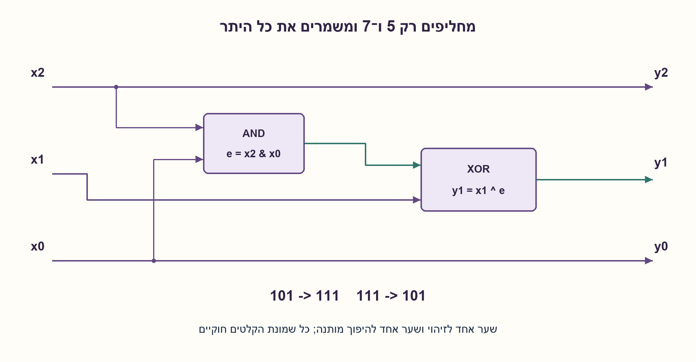
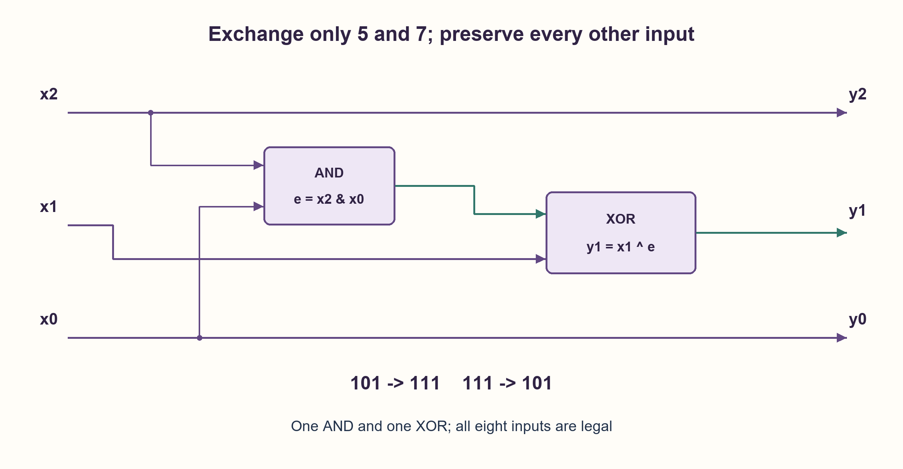

# PREP-254 — שלושה ביטים: החלפת 5 ו־7 ושמירת שאר הערכים

פתרון מוצע בסיוע AI; ביקורת מקצועית אנושית ממתינה. הקושי אינו מכויל.

[צילום מקור פרטי](../sources/2026-11-03-batch20-01.png)

ממש בחומרה מערכת שתקבל מספר בעל שלושה ביטים ותוציא את המספר שהתקבל, למעט 5 שיהפוך ל-7 ולהיפך.

חברות לפי הדיווח בצילום בלבד: Intel.

## עברית

בנו מעגל צירופי המקבל מספר לא מסומן x בן שלושה ביטים. עבור 5 החזירו 7, עבור 7 החזירו 5, ובכל ששת הקלטים האחרים החזירו את הקלט ללא שינוי. הציגו טבלת אמת, משוואות וחיבורי שערים.

הבהרות: x2 הוא MSB ו־x0 הוא LSB; מותר לקבל כל אחד משמונת הקלטים. אין שעון או זיכרון. לצורך ספירת הרכיבים נשתמש בשערי AND ו־XOR דו־כניסתיים ובחיווט חופשי. לא נדרשת הוכחת מינימום של שטח או השהיה.

1. כתבו את 5 ואת 7 בבינארי ומצאו איזו סיבית שונה ביניהם.
2. מה משותף לשתי הסיביות שאינן משתנות? כיצד תזהו בדיוק את שני הקלטים בלי לבדוק את הסיבית המשתנה?
3. הסיבית האמצעית מתהפכת רק כאשר שתי הסיביות החיצוניות הן 1. XOR מאפשר היפוך מותנה.

### להפוך רק במקום הנכון
`5=101` ו־`7=111`. רק x1 שונה. שתי הסיביות החיצוניות הן1 בשני המספרים, ואין קלט אחר בן שלושה ביטים שמקיים זאת. לכן אות האפשור הוא `e=x2 AND x0` והמעגל הוא:

```text
y2 = x2
y1 = x1 XOR e
y0 = x0
```

| x | y | הסבר |
|---|---|---|
|000|000|e=0|
|001|001|e=0|
|010|010|e=0|
|011|011|e=0|
|100|100|e=0|
|101|111|e=1|
|110|110|e=0|
|111|101|e=1|

אם e=0, XOR עם אפס מעביר את x1 ללא שינוי. אם e=1, XOR עם1 הופך אותה. שאר היציאות הן חוטים. זהו נימוק לכל שמונת הקלטים, לא רק בדיקה של5 ו־7. הפעלה פעמיים משחזרת את הקלט כי היפוך כפול מתבטל והסיביות המגדירות את e אינן משתנות.

### מחיר והבחנה מהחלפה על תחום מובטח
המימוש משתמש בשער AND אחד ובשער XOR אחד. מסלול הסיביות החיצוניות אל y1 כולל שני שערים, ומסלול x1 אל y1 כולל אחד. בלי ספריית תאים וזמני שערים אין כאן טענת תדר או מינימום שטח. `x XOR2` לבדו היה משנה גם 0↔2,1↔3,4↔6 ולכן אינו פותר את השאלה. PREP-119 מבטיחה קלט מאחד משני מספרים; כאן שמירת כל שאר הערכים היא דרישה מהותית נוספת.

### קוד SystemVerilog; תוצאות סימולציה בדוח נפרד

```systemverilog
`timescale 1ns/1ps
module prep254(input wire [2:0] x, output wire [2:0] y);
  assign y = {x[2], x[1] ^ (x[2] & x[0]), x[0]};
endmodule
```




### assumptions

```json
[
  "כל שמונת המספרים 0..7 חוקיים; המספר אינו מסומן.",
  "מודל צירופי אידאלי עם שערים דו־כניסתיים."
]
```

### optimality

שני שערים במימוש הנתון; לכל היותר שתי רמות שערים. אין טענת אופטימליות פיזית.

### verification

מודל Python נבדק מול טבלה עצמאית בכל שמונת הקלטים וגם בהפעלה כפולה: 16 בדיקות. קוד HDL וסימולציה מתועדים בנפרד.

ששת מימושי החומרה של האצווה קומפלו ב־Icarus Verilog עם ‎-g2012 -Wall והורצו ב־vvp בסביבה מבודדת ללא רשת:333,512 בדיקות עברו. נכללו גם נועלי ה־NAND של גלאי הפולס. נותרה אזהרה טכנית אחת על ירושת timescale של מודול הבדיקה tb, ללא כשל פונקציונלי. ראיה: checks/batch1103-native-verification.json. לא בוצעו סינתזה, STA או מדידה פיזית.

### edge_cases

```json
[
  "0,7 וששת הערכים שאינם מוחלפים.",
  "סדר ביטים וקלטים 101/111."
]
```

### common_mistakes

שימוש ב־XOR2 ללא אפשור; הנחה שהקלט תמיד5 או7; החלפת MSB במקום הסיבית האמצעית.

### interview_answer

5 ו־7 שונים רק בסיבית האמצעית, ושניהם מזוהים באמצעות AND של הסיביות החיצוניות. אני משתמש בתוצאה כדי לאפשר XOR של הסיבית האמצעית.

### source_ambiguities

המקור מגדיר במפורש לשמר את יתר הערכים; ספריית השערים לספירה היא בחירת עריכה.

### solution_extensions

```json
{
  "question": "כיצד מחליפים שני ערכים שרירותיים בני n ביטים ומשאירים את השאר?",
  "direction": "זהו אות התאמה לאחד משניהם ו־XOR עם המסכה a XOR b רק כאשר הוא פעיל.",
  "tests": "השוואה בין מיפוי על תחום מובטח לבין החלפה סלקטיבית."
}
```

## English

Build a combinational circuit with a three-bit unsigned input x. Return7 for5 and5 for7; preserve each of the other six input values. Give a truth table, equations and gate connections.

Clarifications: x2 is MSB and x0 is LSB; all eight inputs are legal. There is no clock or storage. For component counting use two-input AND/XOR gates and free wiring. A global minimum-area or minimum-delay proof is not requested.

1. Write5 and7 in binary and locate the differing bit.
2. What do the two unchanged bits have in common? Can they identify exactly the two affected inputs?
3. Toggle the middle bit only when both outer bits are1; XOR implements a conditional toggle.

### Toggle only in the selected pair
`5=101` and `7=111` differ only in x1. Both outer bits are1, a condition satisfied by exactly these two three-bit values. Form `e=x2 AND x0`:

```text
y2 = x2
y1 = x1 XOR e
y0 = x0
```

|x|y|Reason|
|---|---|---|
|000|000|e=0|
|001|001|e=0|
|010|010|e=0|
|011|011|e=0|
|100|100|e=0|
|101|111|e=1|
|110|110|e=0|
|111|101|e=1|

When e=0, XOR passes x1; when e=1 it complements x1. Other outputs are wires. This proves all eight cases rather than checking just5 and7. Applying the map twice restores the input: the enable bits are preserved and two toggles cancel.

### Cost and the promised-domain distinction
The construction uses one AND and one XOR. An outer-bit-to-y1 path has two gates; the x1 path has one. Without a cell library and delays this is not a frequency or minimum-area claim. Unconditional `x XOR2` also exchanges0/2,1/3 and4/6 and therefore fails. PREP-119 promises one of two input values; preserving every other value is an additional requirement here.

### SystemVerilog; simulation results are in a separate report

```systemverilog
`timescale 1ns/1ps
module prep254(input wire [2:0] x, output wire [2:0] y);
  assign y = {x[2], x[1] ^ (x[2] & x[0]), x[0]};
endmodule
```




### assumptions

```json
[
  "All values0..7 are legal unsigned inputs.",
  "Ideal combinational model with two-input gates."
]
```

### optimality

Two gates in this construction; at most two gate levels, without a physical optimality claim.

### verification

Python was compared with an independent eight-row table and the involution property:16 checks. HDL code and simulation evidence are recorded separately.

All six hardware implementations were compiled with Icarus Verilog -g2012 -Wall and run with vvp in an isolated network-denied environment:333,512 checks passed, including the pulse detector NAND latches. One technical warning remained about tb inheriting a timescale, without a functional failure. Evidence: checks/batch1103-native-verification.json. No synthesis, STA or physical measurement was performed.

### edge_cases

```json
[
  "0,7 and all six unaffected values.",
  "Bit order and the101/111 inputs."
]
```

### common_mistakes

Using unconditional XOR2; assuming the input is always5 or7; toggling MSB rather than the middle bit.

### interview_answer

5 and7 differ only in the middle bit. AND of the outer bits identifies exactly that pair and enables the middle-bit XOR.

### source_ambiguities

The source explicitly preserves other values; the counting gate library is an editorial choice.

### solution_extensions

```json
{
  "question": "How can two arbitrary n-bit values be exchanged while preserving all others?",
  "direction": "Detect membership in the selected pair, then conditionally XOR the mask a XOR b.",
  "tests": "Promised-domain maps versus selective replacement."
}
```
