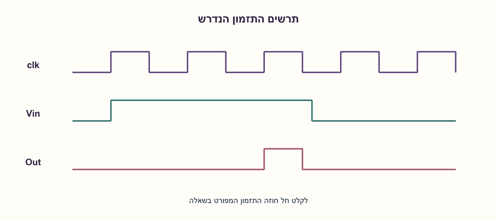
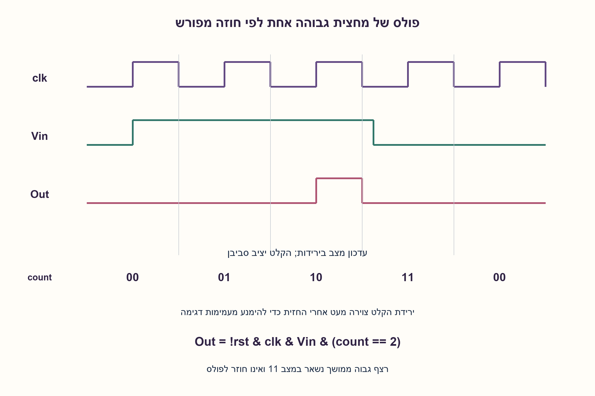
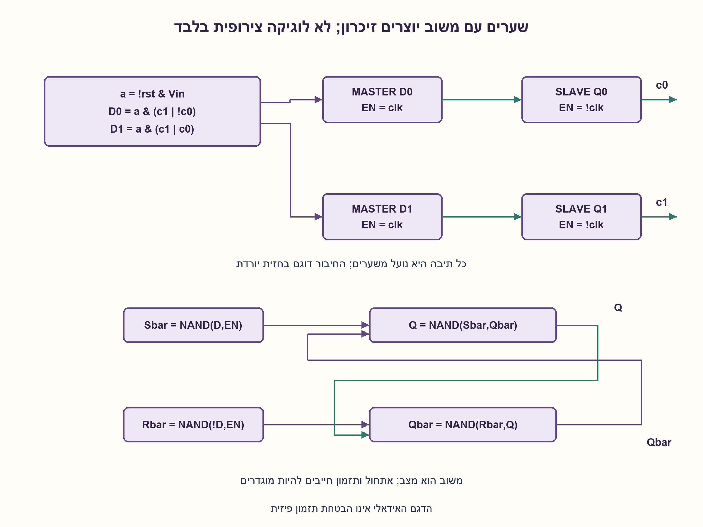
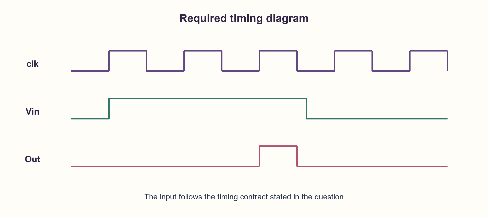
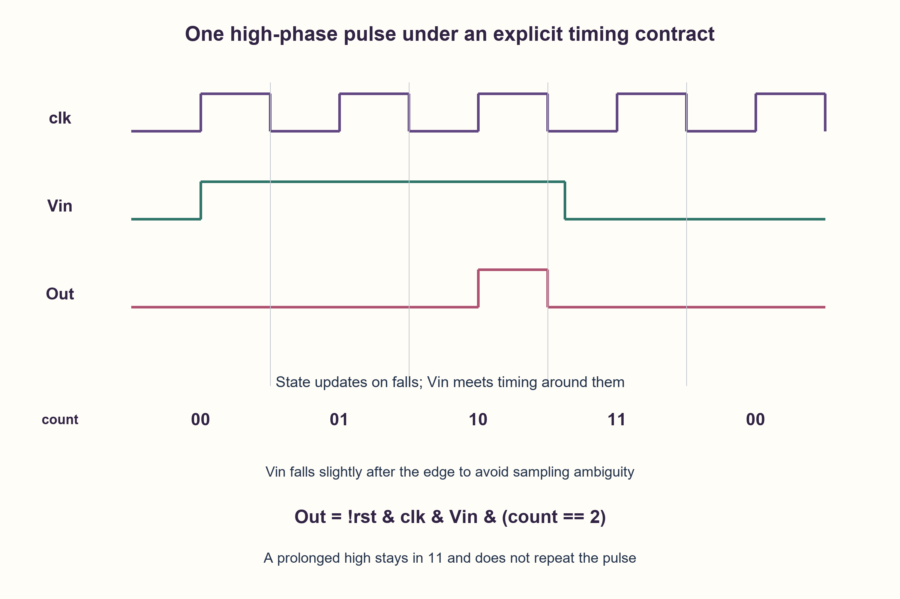
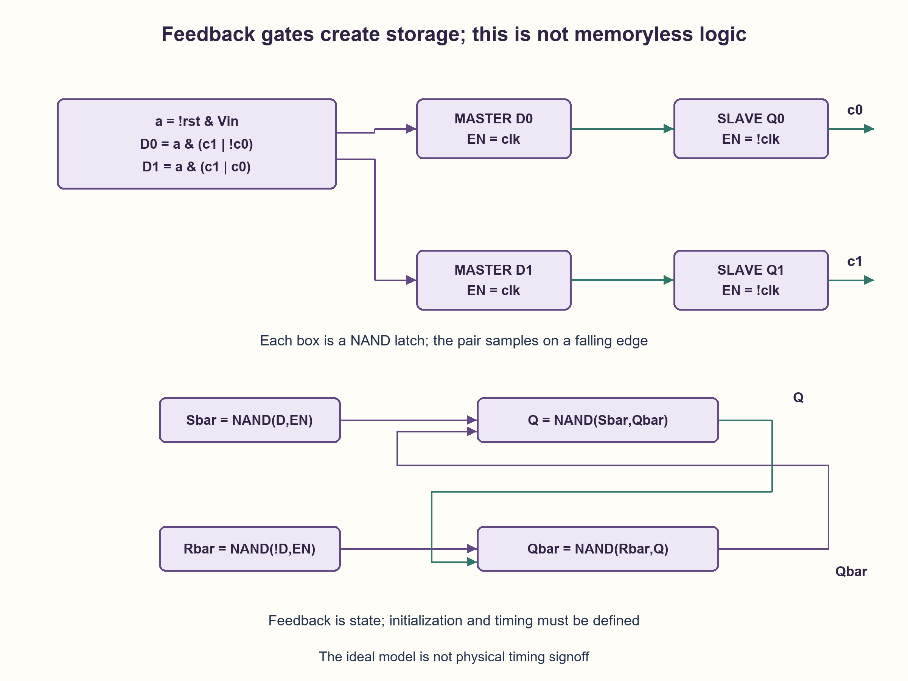

# PREP-255 — פולס במחצית הגבוהה השלישית של השעון לאחר Vin

פתרון מוצע בסיוע AI; ביקורת מקצועית אנושית ממתינה. הקושי אינו מכויל.

[צילום מקור פרטי](../sources/2026-11-03-batch20-13.png)

ממש על ידי שערים לוגיים רכיב שמקבל Vin ו-CLK ומוציא Vout לפי התרשים: Vin גבוה במשך שלושה מחזורי שעון, והפלט גבוה רק בחצי המחזור הגבוה השלישי. בתרשים עליית Vin חופפת לעליית CLK וירידתו חופפת לירידת CLK.

חברות לפי הדיווח בצילום בלבד: Freescale.

## עברית

תכננו רכיב לפי תרשים clk, Vin ו־Out: כאשר Vin עולה בתחילת המחצית הגבוהה הראשונה, Out נשאר0 בשתי המחציות הגבוהות הראשונות ומפיק1 במחצית הגבוהה השלישית. הכינו מימוש באמצעות שערים לוגיים.

הצילום מציג עקבה אחת, עם שינויי Vin בדיוק בחזיתות שעון, ואינו מגדיר איפוס, Vin ממושך או קלטים נוספים. לצורך מימוש חד־משמעי נבחר כאן חוזה משלים: Vin עומד ב־setup/hold סביב חזיתות יורדות; רכיבי המצב מתעדכנים בירידת clk. סופרים חזיתות יורדות רצופות שבהן Vin=1, ומפיקים Out=1 רק במחצית הגבוהה שלאחר שתיים מהן, כל עוד Vin עדיין1. Vin ממושך נותן פולס אחד בלבד; דגימת Vin=0 מכינה ניסיון חדש. האיפוס rst פעיל בגבוה ומוחזק לפחות דרך חזית יורדת; Out כבוי בעת איפוס. אין טענה שזהו החוזה היחיד האפשרי מהצילום.

״שערים בלבד״ מתיר כאן משוב לבניית נועלים ודלגלגים; אם הכוונה לשערים צירופיים ללא זיכרון, הסבירו מדוע המשימה אינה אפשרית.

1. יכולים להיות שני רגעים עם אותם clk ו־Vin אך עם Out שונה? איזה מידע על העבר צריך לשמור?
2. אפשר לעדכן את המצב כאשר clk יורד, כך שהוא יציב בזמן המחצית הגבוהה. כמה דגימות גבוהות כבר הושלמו?
3. השתמשו במונה רווי בן שני ביטים:0→1→2→3. הפיקו Out=clk AND Vin AND(count=2); מצב3 נשמר עד דגימת0.

### קודם מגדירים איזו היסטוריה התרשים דורש
אותם קלטים נוכחיים clk=1,Vin=1 קיימים גם במחצית הראשונה וגם בשלישית, אבל הפלט שונה. לכן אי אפשר לממש את ההבחנה רק באמצעות רשת שערים צירופית חסרת זיכרון. זיכרון שנבנה משערים עם משוב עדיין נחשב רכיב מצב.

נשתמש בשני ביטי מצב c1,c0. בחזית יורדת, אם rst=1 או Vin=0, המצב הבא0; אחרת המצב מתקדם עד3 ונשאר שם:

|מצב לפני|אחרי דגימת1|משמעות|
|---|---|---|
|00|01|הושלמה דגימה גבוהה ראשונה|
|01|10|הושלמה שנייה; אפשר פולס במחצית הבאה|
|10|11|הפולס הסתיים|
|11|11|Vin עוד גבוה; אין חזרה אוטומטית|

בכל זמן `Out = NOT rst AND clk AND Vin AND c1 AND NOT c0`. ל־a=NOT rst AND Vin, משוואות המצב הן `D0=a AND(c1 OR NOT c0)` ו־`D1=a AND(c1 OR c0)`. הן נגזרות מארבע שורות המצב ולא מזמן השהיה משוער של שער.

### התאמה לשלוש המחציות
מתחילים c=0. Vin עולה יחד עם תחילת המחצית הראשונה אך יציב סביב סופה: הפלט0; בירידה הראשונה c=1. במחצית השנייה הפלט0; בירידה השנייה c=2. במחצית השלישית הפלט1. בירידה השלישית clk מכבה אותו ומתקבל c=3, ולכן Vin ארוך אינו יוצר פולסים חוזרים. אם Vin יורד מוקדם בזמן המחצית השלישית, הוא מכבה את הפלט מוקדם. אם הוא נופל ונשאר נמוך דרך ירידת שעון, המצב מתאפס; נפילה קצרה שלא נדגמה אינה מבטיחה rearm.

התרשים הנקי מציג את ירידת Vin מעט אחרי הירידה השלישית. זה נותן אותו פולס נראה כמו המקור, בלי להעמיד פנים ששינוי בדיוק בחזית דגימה מקיים setup/hold. העלייה הראשונה היא בחזית עולה, בעוד הדגימה בחזית יורדת.

### כיצד בונים את הזיכרון משערים
נועל NAND מקבל `Sbar=NAND(D,EN)`, ‏`Rbar=NAND(NOT D,EN)`. שני NAND מצולבים מקיימים `Q=NAND(Sbar,Qbar)`, ‏`Qbar=NAND(Rbar,Q)`. נועל master שקוף ב־clk=1 ונועל slave שקוף ב־clk=0 יוצרים DFF בחזית יורדת. נדרשים שני זוגות כאלה לשני ביטי המצב, בתוספת לוגיקת המצב והפלט. סכמת הנועלים וקוד שערים מלא מצורפים. האיפוס במימוש הוא מסלול נתונים; מחזיקים אותו דרך מחזור דגימה ידוע כדי לאתחל גם את רשת המשוב.

האינווריאנט הוא c=min(3,r), כאשר r הוא מספר דגימות Vin=1 הרצופות האחרונות. כך c=2 בדיוק אחרי שתיים ולפני שלוש. ארבעת המצבים דרושים למימוש הרווי הזה, אך אין כאן הוכחת מינימום כוללת לכל חוזה אחר. ספירת רכיבי השערים תלויה בשיתוף היפוכים ובספרייה; סימולציה אידאלית אינה הוכחת היעדר גליצ׳ים או CDC בטוח בשבב.

### קוד SystemVerilog; תוצאות סימולציה בדוח נפרד

```systemverilog
`timescale 1ns/1ps
// Explicit edited contract: Vin meets setup/hold at each falling edge.
// After two qualifying falling edges, emit only the following high phase.
module prep255(input wire clk, rst, vin, output wire out,
               output reg [1:0] count);
  always @(negedge clk) begin
    if (rst || !vin) count <= 2'd0;
    else if (count != 2'd3) count <= count + 2'd1;
  end
  assign out = !rst && clk && vin && (count == 2'd2);
endmodule

// Storage can be built from basic NAND gates, rather than assumed free.
module prep255_nand_latch(input wire d, en, output wire q);
  wire nd, sn, rn, qb;
  not(nd, d);
  nand(sn, d, en);
  nand(rn, nd, en);
  nand(q, sn, qb);
  nand(qb, rn, q);
endmodule

// Master transparent high, slave transparent low: falling-edge DFF.
module prep255_falling_ff_gates(input wire d, clk, output wire q);
  wire qm, nclk;
  not(nclk, clk);
  prep255_nand_latch master(d, clk, qm);
  prep255_nand_latch slave(qm, nclk, q);
endmodule

module prep255_gates(input wire clk, rst, vin, output wire out,
                     output wire [1:0] count);
  wire active, n0, n1, eq2;
  assign active = !rst && vin;
  assign n0 = active && (count[1] || !count[0]);
  assign n1 = active && (count[1] || count[0]);
  prep255_falling_ff_gates bit0(n0, clk, count[0]);
  prep255_falling_ff_gates bit1(n1, clk, count[1]);
  assign eq2 = count[1] && !count[0];
  assign out = !rst && clk && vin && eq2;
endmodule
```








### assumptions

```json
[
  "Vin עומד בתזמון ביחס לחזית יורדת; המונה נדגם בירידה.",
  "האיפוס מוחזק דרך חזית יורדת; שערים עם משוב מותרים לבניית זיכרון.",
  "פולס יחיד לכל רצף גבוה שנדגם, ורווי במצב3."
]
```

### optimality

שני ביטי מצב, משוואות לוגיות ונועלי master/slave. אין טענת מינימום פיזי או תדר.

### verification

מודל Python עבר155,648 בדיקות לכל4096 רצפי Vin באורך12, כולל איפוס ומיסוך במחצית הנמוכה. קוד התנהגותי ושערי NAND מופרדים לצורך סימולציית HDL בדוח נפרד.

ששת מימושי החומרה של האצווה קומפלו ב־Icarus Verilog עם ‎-g2012 -Wall והורצו ב־vvp בסביבה מבודדת ללא רשת:333,512 בדיקות עברו. נכללו גם נועלי ה־NAND של גלאי הפולס. נותרה אזהרה טכנית אחת על ירושת timescale של מודול הבדיקה tb, ללא כשל פונקציונלי. ראיה: checks/batch1103-native-verification.json. לא בוצעו סינתזה, STA או מדידה פיזית.

### edge_cases

```json
[
  "Vin נמוך תמיד או גבוה זמן ממושך.",
  "דופק קצר שלא נלכד; ירידת Vin בזמן Out; איפוס באמצע רצף.",
  "שינוי Vin בדיוק בחזית דגימה אינו בתחום ההבטחה."
]
```

### common_mistakes

הסקת פונקציה צירופית מהתרשים; הנחה שפלט חייב להימשך מחזור מלא; טענה ששיהוי שערים לא מכויל סופר מחזורים; התעלמות מאתחול ומשוב.

### interview_answer

צריך לזכור כמה חזיתות יורדות רצופות ראו Vin=1. מצב2 מאפשר רק את המחצית הגבוהה הבאה; מצב3 חוסם חזרה עד דגימת0. את שני הדלגלגים ניתן לבנות מנועלי NAND.

### source_ambiguities

איפוס, דגימה בירידה, rearm ו־Vin ממושך הוגדרו כאן כי הצילום אינו מכריע. הזרמת Vin אסינכרוני מחייבת תכנון CDC נוסף.

### solution_extensions

```json
{
  "question": "מה משתנה אם מבקשים פולס מלא ומיושר לשעון בכל עליית Vin אסינכרונית?",
  "direction": "סנכרון/handshake, שמירת אירוע וחוזה latency חדשים; אין להבטיח קליטה של פולס צר ללא מנגנון מתאים.",
  "tests": "הבדל בין ציור גל, CDC והבטחת זיהוי."
}
```

## English

Design the clk/Vin/Out behavior shown in the clean waveform: if Vin rises at the beginning of the first high clock phase, Out stays0 in the first two high phases and pulses in the third. Use logic gates.

The source shows one trace, with Vin changing exactly at clock edges; it omits reset, prolonged Vin and other histories. For a definite implementation we add this contract: Vin meets setup/hold around falling edges; state updates on falling clk. Count consecutive falling edges sampling Vin=1 and emit only the high phase after two such edges, while Vin remains1. Sustained Vin produces one pulse; a sampled0 rearms it. Active-high rst is held through at least one falling edge, and suppresses Out while asserted. This is one explicit completion, not the uniquely implied source behavior.

Here “gates only” permits feedback to construct latches/flip-flops. If only acyclic combinational gates are allowed, explain why the task is impossible.

1. Can identical current clk/Vin values require different Out values? What history must be stored?
2. Update state on falling clk so it is stable throughout the high phase. How many high samples have completed?
3. Use a two-bit saturating count0→1→2→3. Emit clk AND Vin AND(count=2); state3 holds until a sampled0.

### Define the history before choosing gates
Current clk=1,Vin=1 occurs in both the first and third high phases, yet Out differs. An acyclic combinational network cannot distinguish these histories. Feedback-built storage is still state.

Use two state bits c1,c0. On falling clk, reset to0 for rst or Vin=0; otherwise increment up to3 and hold:

|Old state|After sampling1|Meaning|
|---|---|---|
|00|01|First qualifying sample completed|
|01|10|Second completed; enable the next high phase|
|10|11|Pulse completed|
|11|11|Vin remains high; do not repeat|

At all times `Out = NOT rst AND clk AND Vin AND c1 AND NOT c0`. With a=NOT rst AND Vin, next-state equations are `D0=a AND(c1 OR NOT c0)` and `D1=a AND(c1 OR c0)`. They follow from the transition table, not an assumed gate propagation delay.

### Matching the third high phase
Start at c=0. Vin rises with the first rising edge and is stable around the following falling edge: Out=0, then c=1 at that fall. The second high phase is0; its fall produces c=2. The third high phase is1. The third fall masks Out through clk and produces c=3. Prolonged Vin cannot repeat the pulse. Dropping Vin during the third high phase cuts it short. A low spanning a falling edge rearms the circuit; a brief unsampled low need not do so.

The clean waveform places Vin's fall slightly after the third falling edge. It yields the same visible Out as the source without pretending a data change exactly at a sampling edge meets setup/hold. The initial rise is at a rising edge, while sampling is on falling edges.

### Constructing storage from gates
A gated NAND latch forms `Sbar=NAND(D,EN)` and `Rbar=NAND(NOT D,EN)`, with cross-coupled `Q=NAND(Sbar,Qbar)` and `Qbar=NAND(Rbar,Q)`. A master transparent for clk=1 followed by a slave transparent for clk=0 forms a falling-edge DFF. Two master/slave pairs store the two state bits, with next-state and output logic. The diagram and full gate-level code are supplied. Reset is on the data path; hold it through a known sampling cycle to initialize the feedback network.

Invariant: c=min(3,r), where r is the run length of consecutively sampled high Vin values. Thus c=2 exactly after two and before three. Four states implement this chosen saturating contract; no global minimum is claimed across other completions. Gate cost depends on shared inversions and library. Ideal simulation does not prove physical glitch freedom or safe asynchronous clock-domain crossing.

### SystemVerilog; simulation results are in a separate report

```systemverilog
`timescale 1ns/1ps
// Explicit edited contract: Vin meets setup/hold at each falling edge.
// After two qualifying falling edges, emit only the following high phase.
module prep255(input wire clk, rst, vin, output wire out,
               output reg [1:0] count);
  always @(negedge clk) begin
    if (rst || !vin) count <= 2'd0;
    else if (count != 2'd3) count <= count + 2'd1;
  end
  assign out = !rst && clk && vin && (count == 2'd2);
endmodule

// Storage can be built from basic NAND gates, rather than assumed free.
module prep255_nand_latch(input wire d, en, output wire q);
  wire nd, sn, rn, qb;
  not(nd, d);
  nand(sn, d, en);
  nand(rn, nd, en);
  nand(q, sn, qb);
  nand(qb, rn, q);
endmodule

// Master transparent high, slave transparent low: falling-edge DFF.
module prep255_falling_ff_gates(input wire d, clk, output wire q);
  wire qm, nclk;
  not(nclk, clk);
  prep255_nand_latch master(d, clk, qm);
  prep255_nand_latch slave(qm, nclk, q);
endmodule

module prep255_gates(input wire clk, rst, vin, output wire out,
                     output wire [1:0] count);
  wire active, n0, n1, eq2;
  assign active = !rst && vin;
  assign n0 = active && (count[1] || !count[0]);
  assign n1 = active && (count[1] || count[0]);
  prep255_falling_ff_gates bit0(n0, clk, count[0]);
  prep255_falling_ff_gates bit1(n1, clk, count[1]);
  assign eq2 = count[1] && !count[0];
  assign out = !rst && clk && vin && eq2;
endmodule
```








### assumptions

```json
[
  "Vin meets timing at falling edges; state samples on falls.",
  "Reset spans a falling edge; gate feedback may construct storage.",
  "One pulse per sampled high run, saturating at3."
]
```

### optimality

Two state bits, Boolean equations and master/slave storage; no physical minimum or frequency claim.

### verification

Python passed155,648 checks over all4096 length12 Vin histories, including reset and low-phase masking. Behavioral and NAND-storage RTL are provided for separately recorded HDL simulation.

All six hardware implementations were compiled with Icarus Verilog -g2012 -Wall and run with vvp in an isolated network-denied environment:333,512 checks passed, including the pulse detector NAND latches. One technical warning remained about tb inheriting a timescale, without a functional failure. Evidence: checks/batch1103-native-verification.json. No synthesis, STA or physical measurement was performed.

### edge_cases

```json
[
  "Vin always low or prolonged high.",
  "An unsampled short low; Vin falling during Out; reset during a run.",
  "Vin changing exactly at a sampling edge is outside the timing promise."
]
```

### common_mistakes

Inferring a memoryless function; assuming a full-cycle output; counting cycles with uncalibrated gate delay; ignoring initialization and feedback.

### interview_answer

Remember how many consecutive falling edges sampled Vin=1. State2 enables the next high phase; state3 blocks repeats until a sampled0. Two flip-flops can be built from NAND latches.

### source_ambiguities

Reset, falling-edge sampling, rearming and prolonged Vin are editorial choices because the source is incomplete. Asynchronous Vin needs additional CDC design.

### solution_extensions

```json
{
  "question": "What changes if every asynchronous Vin rise requires a full synchronous pulse?",
  "direction": "Define synchronization/handshake, event retention and latency; a narrow pulse is not automatically captured.",
  "tests": "Distinguishing a waveform sketch, CDC and capture guarantees."
}
```
